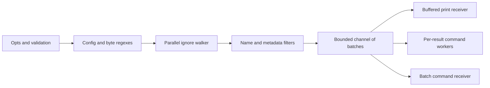

# Search pipeline and concurrency

`fd` is a single Rust binary. `main.rs` coordinates parsing and validation; `walk.rs` owns the running search. The `ignore` crate supplies parallel directory traversal, while fd owns matching, metadata filters, result transport, and result consumption. There is no application database: runtime state consists of configuration, filesystem entries, channels, buffers, and cancellation flags.

## Startup and ownership

`main` calls `run`, prints chained `anyhow` errors, and exits through `ExitCode`. `run` performs these steps in order:

1. Parse `cli::Opts`; when compiled with `completions`, handle completion generation before starting a search.
2. Apply `--base-directory`, resolve directory roots, and reject an empty valid-root set.
3. Reject path-like patterns when filename matching is selected; translate every `--and` expression and the positional pattern into regex text.
4. Build `Config`, including smart case, ignore policy, metadata constraints, styling, and an optional command set.
5. Check patterns that can only match hidden names on Unix, compile byte regexes, and call `walk::scan`.

`WorkerState` owns the regex vector and `Config`, plus shared atomic quit and interrupt flags. A command set is shared through `Arc`. The same configuration supplies both producer-side filters and consumer-side rendering or execution, avoiding a second interpretation of CLI flags after traversal begins.

The three consumers are alternatives selected by `Config.command` and its execution mode. See [matching and filters](../concepts/matching-and-filters.md) and [traversal policy](../concepts/traversal-and-ignore.md) for producer behavior.

## Entries and transport

The callback wraps normal walker entries in fd's `DirEntry`. A specific not-found error for a still-existing symlink is recovered as a broken-symlink entry. Other walker errors travel through the result channel. `DirEntry` lazily caches optional metadata and color style with `OnceCell`; filters can reuse metadata, and producers can compute styles before the print thread needs them. Broken-symlink entries use `symlink_metadata` and have no recorded traversal depth.

The channel capacity is twice the configured thread count. Each producer uses `BatchSender`, whose shared batch contains an optional vector behind a mutex. The first item sends a batch handle immediately; the receiver takes the vector once, and the producer starts a new vector when the prior one has been taken or reached its limit. This lets small results arrive promptly while amortizing transport overhead for bursts.

The normal producer batch limit is 256. With multiple per-result command workers it becomes one, distributing results across competing receivers. Channel capacity and batch limits apply backpressure when printing or child processes are slower than discovery; they do not imply that the entire search is collected before consumption.

## Receiver modes and result order

Printing uses one receiver with a locked, buffered stdout. It initially holds entries for up to 100 milliseconds by default, or `--max-buffer-time`. Finishing while still buffering sorts by path before printing. Crossing the deadline or accumulating more than 1,000 entries switches to streaming and flushes the held entries in arrival order. Streaming does not re-sort later results. Thus a quick search often looks sorted, but global output order is not a general contract.

Quiet mode returns success on the first matching entry without printing. The printing receiver also enforces the configured maximum result count. Command modes select different consumers; their execution and output synchronization are covered in [command execution](../workflows/command-execution.md). Path rendering and terminal behavior are covered in [output and paths](../concepts/output-and-paths.md).

## Failure and shutdown

When the print receiver terminates, it sets the quit flag. Producer callbacks check that flag and also stop when sending to a disconnected receiver fails. Scoped threads join the receiver after traversal, so borrowed search state remains valid for all workers.

Traversal errors are normally omitted from displayed output. `--show-errors` prints them; the print receiver does not convert each reported filesystem error into a failed search status. Startup validation and malformed configuration can fail before traversal. A failed output write other than `BrokenPipe` prints an error and returns failure; flush errors return failure too. A broken pipe is therefore not uniformly a success path.

The custom Ctrl-C handler is installed only for colored printing. The first interrupt sets quit and interrupt flags, and a second interrupt exits immediately. The scan returns `KilledBySigint` when the interrupt flag is set. On Unix, final exit restores and raises SIGINT when possible.

| Outcome | Exit value |
| --- | --- |
| Normal search, including no matches | 0 |
| Quiet search with a match | 0 |
| Quiet search without a match | 1 |
| General error or aggregated command failure | 1 |
| Interrupt fallback value | 130 |

`merge_exitcodes` collapses any nonzero command worker result into `GeneralError`; it does not preserve a child's exact exit status.

## Change boundaries and verification

For a new search option, connect `Opts` to `Config` before changing the relevant producer or consumer. Keep cheap name tests before metadata reads. Changes to delivery, cancellation, or ordering belong in `walk.rs`; changing template expansion belongs in `fmt`, and child-process behavior belongs in `exec`.

`walk.rs` unit tests exercise basename and full-path construction. Integration cases `test_quiet`, `test_max_results`, and `test_single_and_multithreaded_execution` cover observable modes. The test harness normalizes output, so ordinary expected-output assertions do not prove raw arrival order; see [development and testing](../workflows/development-and-testing.md).
