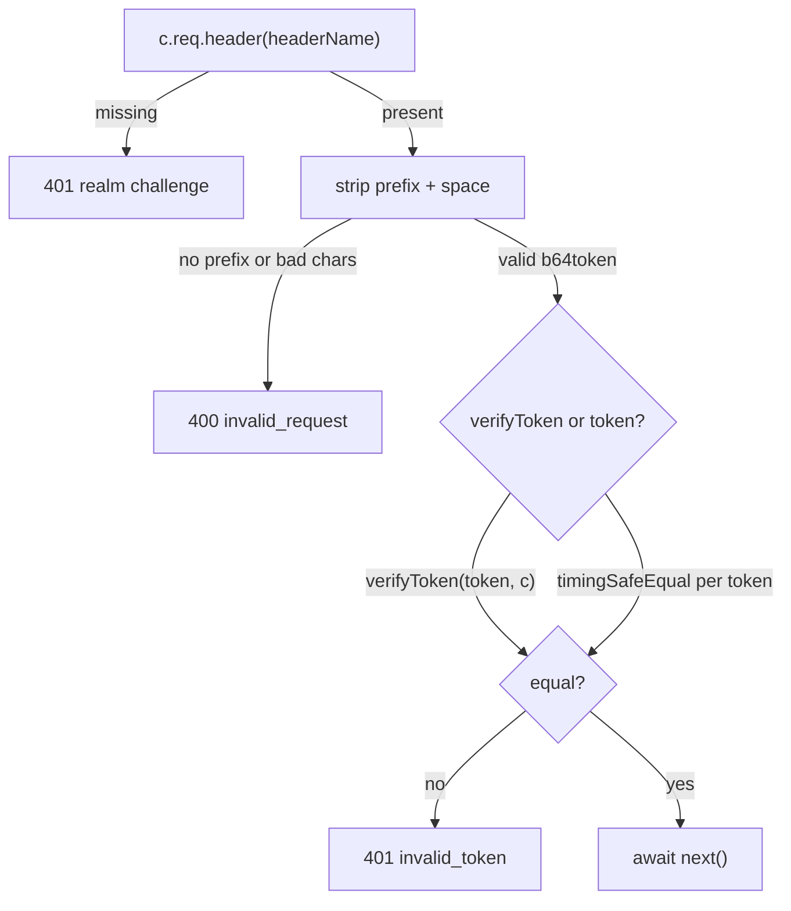
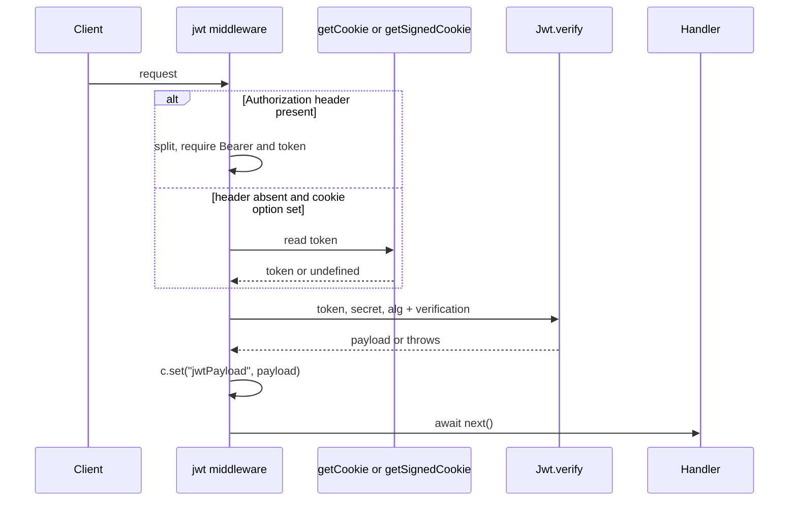

## Overview

Hono ships four authentication middleware that gate a route before its handler runs: `basicAuth` (HTTP Basic credentials), `bearerAuth` (opaque bearer tokens), `jwt` (a JSON Web Token checked against one secret or key) and `jwk` (a JWT checked against a set of public JSON Web Keys, optionally fetched from a `jwks_uri`). Each is a factory: it validates its options once when called and returns a `MiddlewareHandler` that runs per request. They are published as the `hono/basic-auth`, `hono/bearer-auth`, `hono/jwt` and `hono/jwk` entry points.

Sources: [package.json:74-83](repo://package.json#L74-L83), [package.json:209-218](repo://package.json#L209-L218), [jsr.json:43-44](repo://jsr.json#L43-L44)

All four reject a request by throwing an `HTTPException` that carries a fully built 401 or 400 `Response`, including a `WWW-Authenticate` challenge header. The default app error handler sees `getResponse` on the error and returns that response unchanged, so a client gets the challenge even without a custom `onError`. See [[Error Handling and HTTPException]] for how the exception travels and [[Middleware Composition]] for where these handlers sit in the chain.

Sources: [src/hono-base.ts:34-41](repo://src/hono-base.ts#L34-L41), [src/http-exception.ts:61-78](repo://src/http-exception.ts#L61-L78)

| Middleware | Credential source | Check | On success |
| --- | --- | --- | --- |
| `basicAuth` | `Authorization: Basic ...` | fixed user list or `verifyUser` | `onAuthSuccess`, then `next()` |
| `bearerAuth` | `Authorization` (or `headerName`) with `prefix` | `token` list or `verifyToken` | `next()` |
| `jwt` | header `Bearer <token>`, else a cookie | `Jwt.verify` with `secret` and `alg` | `c.set('jwtPayload', payload)` |
| `jwk` | header `Bearer <token>`, else a cookie | `Jwt.verifyWithJwks` with `keys` / `jwks_uri` | `c.set('jwtPayload', payload)` |

Sources: [src/middleware/basic-auth/index.ts:105-131](repo://src/middleware/basic-auth/index.ts#L105-L131), [src/middleware/bearer-auth/index.ts:156-220](repo://src/middleware/bearer-auth/index.ts#L156-L220), [src/middleware/jwt/jwt.ts:76-157](repo://src/middleware/jwt/jwt.ts#L76-L157), [src/middleware/jwk/jwk.ts:75-167](repo://src/middleware/jwk/jwk.ts#L75-L167)

## Constant-time comparison

`basicAuth` and `bearerAuth` never compare secrets with `===`. They call `timingSafeEqual` from `src/utils/buffer.ts`, which hashes both strings (with `sha256` unless a `hashFunction` option is given), then compares the two hashes and the two originals with `constantTimeEqualString`. That loop walks the longer length and ORs every character difference together, seeded with `aLen ^ bLen`, so the time spent does not reveal where the first mismatch is. If the hash function returns `null` or a non-string, the comparison fails.

Sources: [src/utils/buffer.ts:29-63](repo://src/utils/buffer.ts#L29-L63), [src/utils/buffer.ts:76-83](repo://src/utils/buffer.ts#L76-L83)

## basicAuth

### basicAuth options

`basicAuth(options, ...users)` takes either a fixed `username`/`password` pair or a `verifyUser` callback. Extra `{ username, password }` objects passed as rest arguments are additional accepted users; the pair from `options` is put first with `users.unshift`. The factory throws a plain `Error` at setup if neither shape is present.

Sources: [src/middleware/basic-auth/index.ts:14-29](repo://src/middleware/basic-auth/index.ts#L14-L29), [src/middleware/basic-auth/index.ts:80-103](repo://src/middleware/basic-auth/index.ts#L80-L103)

| Option | Type | Default | Description |
| --- | --- | --- | --- |
| `username` | `string` | none | Accepted username (with `password`). |
| `password` | `string` | none | Accepted password (with `username`). |
| `verifyUser` | `(username, password, c) => boolean \| Promise<boolean>` | none | Custom check; replaces the user list entirely. |
| `realm` | `string` | `'Secure Area'` | Realm sent in `WWW-Authenticate`; double quotes are escaped. |
| `hashFunction` | `Function` | `sha256` | Hash used by `timingSafeEqual`. |
| `invalidUserMessage` | `string \| object \| MessageFunction` | `'Unauthorized'` | Body of the 401; an object is sent as JSON. |
| `onAuthSuccess` | `(c, username) => void \| Promise<void>` | none | Runs after a successful check, before `next()`. |

Sources: [src/middleware/basic-auth/index.ts:31-79](repo://src/middleware/basic-auth/index.ts#L31-L79), [src/middleware/basic-auth/index.ts:93-99](repo://src/middleware/basic-auth/index.ts#L93-L99)

### Parsing the Authorization header

The per-request handler first calls `auth(ctx.req.raw)` from `src/utils/basic-auth.ts`. It matches the header against `CREDENTIALS_REGEXP`, which accepts the scheme `Basic` in any letter case surrounded by optional spaces, followed by a base64 token. The token is decoded with `decodeBase64` and a UTF-8 `TextDecoder`, then split at the first `:` by `USER_PASS_REGEXP`, so a password may itself contain colons. Invalid base64 makes `atob` throw a `DOMException`, which is swallowed: the function returns `undefined` and the request is treated as unauthenticated.

Sources: [src/utils/basic-auth.ts:1-26](repo://src/utils/basic-auth.ts#L1-L26)

```ts
const CREDENTIALS_REGEXP = /^ *(?:[Bb][Aa][Ss][Ii][Cc]) +([A-Za-z0-9._~+/-]+=*) *$/
const USER_PASS_REGEXP = /^([^:]*):(.*)$/
```

Sources: [src/utils/basic-auth.ts:3-4](repo://src/utils/basic-auth.ts#L3-L4)

### Verification and the 401 response

With `verifyUser`, the callback decides. Otherwise the handler loops over every configured user and compares username and password in parallel with `timingSafeEqual`; both must match. On success it awaits `onAuthSuccess` (if set) and then `next()`. Every other path, including a missing or malformed header, falls through to one 401: `WWW-Authenticate: Basic realm="<realm>"`, and a body from `invalidUserMessage` (a function is awaited with the context; a non-string result is JSON-encoded with `content-type: application/json`). The response is thrown inside an `HTTPException`.

Sources: [src/middleware/basic-auth/index.ts:105-153](repo://src/middleware/basic-auth/index.ts#L105-L153)

```ts
import { Hono } from 'hono'
import { basicAuth } from 'hono/basic-auth'

const app = new Hono()

app.use(
  '/auth/*',
  basicAuth({
    username: 'hono',
    password: 'ahotproject',
    onAuthSuccess: (c, username) => {
      c.set('user', { name: username, role: 'admin' })
    },
  })
)
```

Sources: [src/middleware/basic-auth/index.ts:47-78](repo://src/middleware/basic-auth/index.ts#L47-L78)

## bearerAuth

### bearerAuth options

`bearerAuth(options)` needs either `token` (one string or an array) or `verifyToken`; otherwise it throws at setup. Each of the three failure cases can override both the response body (`message`) and the `WWW-Authenticate` value (`wwwAuthenticateHeader`). The older flat `noAuthenticationHeaderMessage`, `invalidAuthenticationHeaderMessage` and `invalidTokenMessage` options still work but are deprecated, and the nested `message` takes precedence.

Sources: [src/middleware/bearer-auth/index.ts:16-66](repo://src/middleware/bearer-auth/index.ts#L16-L66), [src/middleware/bearer-auth/index.ts:104-115](repo://src/middleware/bearer-auth/index.ts#L104-L115)

| Option | Type | Default | Description |
| --- | --- | --- | --- |
| `token` | `string \| string[]` | none | Accepted token(s), compared with `timingSafeEqual`. |
| `verifyToken` | `(token, c) => boolean \| Promise<boolean>` | none | Custom check; takes precedence over `token`. |
| `realm` | `string` | `''` | Realm in the missing-header challenge; quotes escaped. |
| `prefix` | `string` | `'Bearer'` | Scheme before the token; `''` means the whole header is the token. |
| `headerName` | `string` | `'Authorization'` | Header to read. |
| `hashFunction` | `Function` | `sha256` | Hash used by `timingSafeEqual`. |
| `noAuthenticationHeader` | `{ message?, wwwAuthenticateHeader? }` | `'Unauthorized'`, `Bearer realm=""` | Response for a missing header (401). |
| `invalidAuthenticationHeader` | `{ message?, wwwAuthenticateHeader? }` | `'Bad Request'`, `Bearer error="invalid_request"` | Response for a malformed header (400). |
| `invalidToken` | `{ message?, wwwAuthenticateHeader? }` | `'Unauthorized'`, `Bearer error="invalid_token"` | Response for a token that fails the check (401). |

Sources: [src/middleware/bearer-auth/index.ts:68-90](repo://src/middleware/bearer-auth/index.ts#L68-L90), [src/middleware/bearer-auth/index.ts:156-217](repo://src/middleware/bearer-auth/index.ts#L156-L217)

### Request flow

The handler reads the configured header. A missing header is a 401. Otherwise, unless `prefix` is empty, it requires the header to start with the prefix (case-insensitive) followed by a space, and strips it with `trimStart`. The remaining value must match `^[A-Za-z0-9._~+/-]+=*$` (the RFC 6750 `b64token` shape); anything else is a 400 `invalid_request`. Only then is the token checked: `verifyToken` if present, a single `timingSafeEqual` for a string `token`, or a loop that stops at the first matching entry of an array. An empty array never matches.

Sources: [src/middleware/bearer-auth/index.ts:12-14](repo://src/middleware/bearer-auth/index.ts#L12-L14), [src/middleware/bearer-auth/index.ts:156-221](repo://src/middleware/bearer-auth/index.ts#L156-L221)



Sources: [src/middleware/bearer-auth/index.ts:156-221](repo://src/middleware/bearer-auth/index.ts#L156-L221)

### Error responses

`throwHTTPException` builds every failure. A `wwwAuthenticateHeader` given as a function is awaited with the context. A string value is used verbatim; an object is serialised as `key="value"` pairs joined by commas and prefixed with `prefix` plus a space (no prefix when `prefix` is empty). The body follows the same rule as `basicAuth`: strings are sent as text, other values as JSON.

Sources: [src/middleware/bearer-auth/index.ts:117-154](repo://src/middleware/bearer-auth/index.ts#L117-L154)

```ts
import { Hono } from 'hono'
import { bearerAuth } from 'hono/bearer-auth'

const app = new Hono()

app.use(
  '/api/*',
  bearerAuth({
    verifyToken: async (token, c) => token === c.env.API_TOKEN,
    invalidToken: {
      message: { error: 'invalid token' },
      wwwAuthenticateHeader: { error: 'invalid_token', error_description: 'expired' },
    },
  })
)
```

Sources: [src/middleware/bearer-auth/index.ts:17-20](repo://src/middleware/bearer-auth/index.ts#L17-L20), [src/middleware/bearer-auth/index.ts:45-66](repo://src/middleware/bearer-auth/index.ts#L45-L66), [src/middleware/bearer-auth/index.ts:128-140](repo://src/middleware/bearer-auth/index.ts#L128-L140)

## jwt

### jwt options

`jwt(options)` verifies a signed token with a single key. At setup it throws if `secret` or `alg` is missing, or if `crypto.subtle.importKey` is unavailable in the runtime. The signature and claim checks are delegated to `Jwt.verify`, described in [[JWT Utilities]].

Sources: [src/middleware/jwt/jwt.ts:53-74](repo://src/middleware/jwt/jwt.ts#L53-L74)

| Option | Type | Default | Description |
| --- | --- | --- | --- |
| `secret` | `string \| HonoJsonWebKey \| CryptoKey` | required | HMAC secret, PEM key, JWK or `CryptoKey`. |
| `alg` | `SignatureAlgorithm` | required | Expected algorithm; must equal the token header's `alg`. |
| `headerName` | `string` | `'Authorization'` | Header holding `Bearer <token>`. |
| `cookie` | `string \| { key, secret?, prefixOptions? }` | none | Cookie to read when the header is absent; `secret` reads a signed cookie. |
| `verification` | `VerifyOptions` | `{}` | Claim checks: `iss`, `aud`, and toggles for `exp`, `nbf`, `iat`. |

Sources: [src/middleware/jwt/jwt.ts:22-61](repo://src/middleware/jwt/jwt.ts#L22-L61), [src/utils/jwt/jwt.ts:78-89](repo://src/utils/jwt/jwt.ts#L78-L89)

### Token extraction and verification

The handler reads the header first. If it is present it is split on whitespace and must be exactly two parts with a first part of `bearer` in any case; otherwise the request fails at once with `invalid_request` / `invalid credentials structure`, and the cookie is not consulted. Only when the header is absent does `options.cookie` apply: a string is a cookie name read with `getCookie`, and an object with `secret` uses `getSignedCookie`, passing `prefixOptions` through when given (see [[Cookie Helper]]). No token at all gives `no authorization included in request`.

Sources: [src/middleware/jwt/jwt.ts:76-129](repo://src/middleware/jwt/jwt.ts#L76-L129)

The token is then passed to `Jwt.verify(token, options.secret, { alg: options.alg, ...verifyOpts })`. Any thrown error (bad signature, expired, wrong issuer, malformed token) is caught and stored as `cause`, and the middleware throws a 401 `HTTPException` with `invalid_token` / `token verification failure`, `statusText: 'Unauthorized'`, and the original error as `cause` so an `onError` handler can inspect it.

Sources: [src/middleware/jwt/jwt.ts:131-152](repo://src/middleware/jwt/jwt.ts#L131-L152)



Sources: [src/middleware/jwt/jwt.ts:76-157](repo://src/middleware/jwt/jwt.ts#L76-L157)

### WWW-Authenticate challenge

`jwt` and `jwk` share the same private `unauthorizedResponse` helper shape. Every failure is a 401 with body `Unauthorized` and a challenge whose realm is the request URL.

Sources: [src/middleware/jwt/jwt.ts:160-173](repo://src/middleware/jwt/jwt.ts#L160-L173), [src/middleware/jwk/jwk.ts:170-183](repo://src/middleware/jwk/jwk.ts#L170-L183)

```ts
'WWW-Authenticate': `Bearer realm="${opts.ctx.req.url}",error="${opts.error}",error_description="${opts.errDescription}"`,
```

Sources: [src/middleware/jwt/jwt.ts:170-170](repo://src/middleware/jwt/jwt.ts#L170-L170)

| Condition | `error` | `error_description` |
| --- | --- | --- |
| Header not `Bearer <token>` | `invalid_request` | `invalid credentials structure` |
| No header and no cookie token | `invalid_request` | `no authorization included in request` |
| Verification threw | `invalid_token` | `token verification failure` |

Sources: [src/middleware/jwt/jwt.ts:81-152](repo://src/middleware/jwt/jwt.ts#L81-L152)

## jwk

### jwk options

`jwk(options, init?)` is for tokens signed by an identity provider that publishes rotating public keys. It requires `keys`, `jwks_uri`, or both, and `alg` is an allow-list of asymmetric algorithms. Both `keys` and `jwks_uri` may be functions of the context, which lets the key set or URL depend on `c.env`. The optional second argument is the `RequestInit` used when fetching the JWKS.

Sources: [src/middleware/jwk/jwk.ts:17-73](repo://src/middleware/jwk/jwk.ts#L17-L73)

| Option | Type | Default | Description |
| --- | --- | --- | --- |
| `keys` | `HonoJsonWebKey[] \| (c) => HonoJsonWebKey[] \| Promise<...>` | none | Local public keys; each should carry a `kid`. |
| `jwks_uri` | `string \| (c) => string \| Promise<string>` | none | URL of a JWKS document; its `keys` are merged with `keys`. |
| `alg` | `AsymmetricAlgorithm[]` | required | Allowed `RS*`, `PS*`, `ES*` or `EdDSA` algorithms. |
| `allow_anon` | `boolean` | `false` | Let requests without any token through, unauthenticated. |
| `cookie` | `string \| { key, secret?, prefixOptions? }` | none | Cookie fallback, same as `jwt`. |
| `headerName` | `string` | `'Authorization'` | Header holding `Bearer <token>`. |
| `verification` | `VerifyOptions` | `{}` | Claim checks passed to `Jwt.verify`. |

Sources: [src/middleware/jwk/jwk.ts:48-64](repo://src/middleware/jwk/jwk.ts#L48-L64), [src/utils/jwt/jwa.ts:23-37](repo://src/utils/jwt/jwa.ts#L23-L37)

### Verification flow

Token extraction is identical to `jwt`. The difference starts when no token is found: with `allow_anon: true` the middleware returns `next()` without setting `jwtPayload`, so handlers must treat the payload as optional. Otherwise the 401 `no authorization included in request` is thrown. With a token, the handler resolves `keys` and `jwks_uri` (awaiting them when they are functions) and calls `Jwt.verifyWithJwks(token, { keys, jwks_uri, verification, allowedAlgorithms: options.alg }, init)`, which picks the key by the header's `kid`.

Sources: [src/middleware/jwk/jwk.ts:75-146](repo://src/middleware/jwk/jwk.ts#L75-L146)

Errors are split by type. A plain `Error` (its constructor is exactly `Error`, as thrown for a failed JWKS fetch or a JWKS response without a `keys` array) is rethrown as is, so it surfaces as a 500 through the error handler rather than being disguised as a bad token. Every `Jwt*` error subclass becomes the 401 `invalid_token` response with the error attached as `cause`.

Sources: [src/middleware/jwk/jwk.ts:148-162](repo://src/middleware/jwk/jwk.ts#L148-L162), [src/utils/jwt/jwt.ts:230-246](repo://src/utils/jwt/jwt.ts#L230-L246)

```ts
import { Hono } from 'hono'
import { jwk } from 'hono/jwk'

const app = new Hono()

app.use(
  '/auth/*',
  jwk({
    jwks_uri: (c) => `https://${c.env.authServer}/.well-known/jwks.json`,
    alg: ['RS256'],
    verification: { iss: 'https://auth.example.com', aud: 'my-api' },
  })
)
```

Sources: [src/middleware/jwk/jwk.ts:33-64](repo://src/middleware/jwk/jwk.ts#L33-L64)

## Reading the payload in handlers

After a successful check, both `jwt` and `jwk` call `ctx.set('jwtPayload', payload)`. `hono/jwt` augments `ContextVariableMap` with `JwtVariables<unknown>`, so `c.get('jwtPayload')` type-checks in any app that imports it; to get a precise type, declare `JwtVariables<MyPayload>` in the app's `Variables` (see [[Context]] and [[Type System]]). The `hono/jwt` entry also re-exports `sign`, `verify`, `decode`, `verifyWithJwks` and `AlgorithmTypes`, and `hono/jwk` re-exports only `jwk`.

Sources: [src/middleware/jwt/jwt.ts:17-20](repo://src/middleware/jwt/jwt.ts#L17-L20), [src/middleware/jwt/jwt.ts:154-154](repo://src/middleware/jwt/jwt.ts#L154-L154), [src/middleware/jwt/jwt.ts:175-178](repo://src/middleware/jwt/jwt.ts#L175-L178), [src/middleware/jwt/index.ts:1-9](repo://src/middleware/jwt/index.ts#L1-L9), [src/middleware/jwk/index.ts:1-1](repo://src/middleware/jwk/index.ts#L1-L1)

```ts
import { Hono } from 'hono'
import { jwt } from 'hono/jwt'
import type { JwtVariables } from 'hono/jwt'

type Payload = { sub: string; role: string }

const app = new Hono<{ Variables: JwtVariables<Payload> }>()

app.use('/auth/*', jwt({ secret: 'it-is-very-secret', alg: 'HS256' }))

app.get('/auth/me', (c) => {
  const payload = c.get('jwtPayload')
  return c.json({ sub: payload.sub })
})
```

Sources: [src/middleware/jwt/jwt.ts:17-20](repo://src/middleware/jwt/jwt.ts#L17-L20), [src/middleware/jwt/jwt.ts:53-61](repo://src/middleware/jwt/jwt.ts#L53-L61), [src/middleware/jwt/index.ts:1-3](repo://src/middleware/jwt/index.ts#L1-L3)

> [!WARNING]
> `basicAuth` and `bearerAuth` mutate the options object they receive (filling in `realm`, `invalidUserMessage` and `prefix` defaults). Do not share one options object between differently configured instances.

Sources: [src/middleware/basic-auth/index.ts:93-99](repo://src/middleware/basic-auth/index.ts#L93-L99), [src/middleware/bearer-auth/index.ts:110-115](repo://src/middleware/bearer-auth/index.ts#L110-L115)
