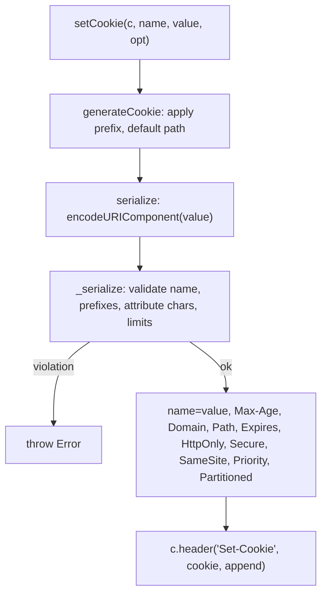

## Overview

The cookie helper (`hono/cookie`) reads cookies from the request's `Cookie` header and writes `Set-Cookie` headers on the response, with optional HMAC signing so the server can detect tampered values. It is a thin layer over `src/utils/cookie.ts`: the helper resolves name prefixes and talks to the `Context`, while `parse`, `parseSigned`, `serialize` and `serializeSigned` implement the RFC 6265 grammar and the rfc6265bis limits.

Sources: [src/helper/cookie/index.ts:1-8](repo://src/helper/cookie/index.ts#L1-L8), [package.json:104-108](repo://package.json#L104-L108)

Built-in middleware rely on it too: the language detector caches its result with `setCookie`, and the JWT middleware reads tokens from cookies (see [[Request Utility Middleware]] and [[Authentication Middleware]]).

Sources: [src/middleware/language/language.ts:5-8](repo://src/middleware/language/language.ts#L5-L8), [src/middleware/language/language.ts:212-224](repo://src/middleware/language/language.ts#L212-L224), [src/middleware/jwt/jwt.ts:96-110](repo://src/middleware/jwt/jwt.ts#L96-L110)

## Reading cookies

### getCookie

`getCookie` has two shapes. With a key it returns that cookie's value or `undefined`; without one it returns every valid cookie as a `Cookie` record (`Record<string, string>`), or `{}` when the request has no `Cookie` header. The optional third argument, `'secure'` or `'host'`, prepends `__Secure-` or `__Host-` to the key, so code can name the cookie as it was set.

Sources: [src/helper/cookie/index.ts:10-48](repo://src/helper/cookie/index.ts#L10-L48)

```ts
import { getCookie } from 'hono/cookie'

app.get('/cookie', (c) => {
  const all = getCookie(c)
  const yummy = getCookie(c, 'yummy_cookie')
  const secure = getCookie(c, 'yummy_cookie', 'secure') // reads __Secure-yummy_cookie
  return c.json({ all, yummy, secure })
})
```

Sources: [src/helper/cookie/index.ts:10-48](repo://src/helper/cookie/index.ts#L10-L48)

### getSignedCookie

`getSignedCookie(c, secret, key?, prefix?)` is the asynchronous counterpart. For each cookie it returns the original value when the signature verifies, `false` when the cookie looks signed but verification fails, and `undefined` when the cookie is absent. A cookie that does not have the signed shape is left out entirely, so an unsigned cookie with the same name also reads as `undefined`. The secret may be a string (UTF-8 encoded) or any `BufferSource`.

Sources: [src/helper/cookie/index.ts:16-25](repo://src/helper/cookie/index.ts#L16-L25), [src/helper/cookie/index.ts:50-76](repo://src/helper/cookie/index.ts#L50-L76), [src/utils/cookie.ts:140-165](repo://src/utils/cookie.ts#L140-L165)

```ts
import { getSignedCookie } from 'hono/cookie'

app.get('/me', async (c) => {
  const session = await getSignedCookie(c, c.env.COOKIE_SECRET, 'session')
  if (session === false) {
    return c.text('Tampered cookie', 400)
  }
  if (session === undefined) {
    return c.text('No session', 401)
  }
  return c.text(`Session ${session}`)
})
```

Sources: [src/helper/cookie/index.ts:16-25](repo://src/helper/cookie/index.ts#L16-L25), [src/utils/cookie.ts:160-161](repo://src/utils/cookie.ts#L160-L161)

## Writing cookies

### setCookie and generateCookie

`setCookie(c, name, value, options?)` appends one `Set-Cookie` header per call, so several cookies can be set on one response. It delegates to `generateCookie`, which is exported for code that needs the header string without a `Context`, for example to set a cookie on a `Response` built by hand.

Sources: [src/helper/cookie/index.ts:78-102](repo://src/helper/cookie/index.ts#L78-L102)

`generateCookie` defaults `path` to `/`. The `prefix` option rewrites the name and forces the attributes the browser requires for it, so a prefixed cookie cannot be produced in a form browsers would reject.

Sources: [src/helper/cookie/index.ts:78-97](repo://src/helper/cookie/index.ts#L78-L97)

| `prefix` | Name sent | Forced attributes |
| --- | --- | --- |
| none | `name` | `path: '/'` unless you pass `path` |
| `'secure'` | `__Secure-name` | `secure: true`; `path` defaults to `/` |
| `'host'` | `__Host-name` | `secure: true`, `path: '/'`, `domain` removed |

Sources: [src/helper/cookie/index.ts:83-95](repo://src/helper/cookie/index.ts#L83-L95)

```ts
import { setCookie, deleteCookie } from 'hono/cookie'

app.get('/login', (c) => {
  setCookie(c, 'session', 'abc123', {
    httpOnly: true,
    secure: true,
    sameSite: 'Lax',
    maxAge: 60 * 60 * 24,
  })
  setCookie(c, 'token', 'xyz', { prefix: 'host' }) // __Host-token=xyz; Path=/; Secure
  return c.text('ok')
})

app.get('/logout', (c) => {
  deleteCookie(c, 'session')
  deleteCookie(c, 'token', { prefix: 'host' })
  return c.text('bye')
})
```

Sources: [src/helper/cookie/index.ts:78-102](repo://src/helper/cookie/index.ts#L78-L102), [src/helper/cookie/index.ts:141-145](repo://src/helper/cookie/index.ts#L141-L145)

### setSignedCookie and generateSignedCookie

`setSignedCookie(c, name, value, secret, options?)` and `generateSignedCookie(name, value, secret, options?)` behave like their unsigned versions, with the same prefix handling, but return promises because signing uses Web Crypto.

Sources: [src/helper/cookie/index.ts:104-139](repo://src/helper/cookie/index.ts#L104-L139)

### deleteCookie

`deleteCookie(c, name, options?)` reads the current value (honouring `options.prefix`), then sets the cookie to an empty value with `maxAge: 0`, which tells the browser to drop it. It returns the value the request carried, or `undefined`. Browsers match deletions by name, `Path` and `Domain`, so pass the same `path` and `domain` used when the cookie was set.

Sources: [src/helper/cookie/index.ts:141-145](repo://src/helper/cookie/index.ts#L141-L145)

## Cookie options

`CookieOptions` maps directly onto `Set-Cookie` attributes. Lower-case spellings of `sameSite` and `priority` are accepted and capitalised on output.

Sources: [src/utils/cookie.ts:17-29](repo://src/utils/cookie.ts#L17-L29)

| Option | Type | Attribute written | Constraint |
| --- | --- | --- | --- |
| `domain` | `string` | `Domain=` | Omitted with `prefix: 'host'`; no `;`, CR or LF. |
| `path` | `string` | `Path=` | No `;`, CR or LF. |
| `maxAge` | `number` | `Max-Age=` (truncated to an integer) | Written only when `>= 0`; above 34560000 (400 days) throws. |
| `expires` | `Date` | `Expires=` (UTC string) | More than 400 days ahead throws. |
| `httpOnly` | `boolean` | `HttpOnly` | |
| `secure` | `boolean` | `Secure` | Required by `__Secure-`, `__Host-` and `partitioned`. |
| `sameSite` | `'Strict' \| 'Lax' \| 'None'` (any case) | `SameSite=` | No `;`, CR or LF. |
| `priority` | `'Low' \| 'Medium' \| 'High'` (any case) | `Priority=` | No `;`, CR or LF. |
| `partitioned` | `boolean` | `Partitioned` (CHIPS) | Throws without `secure`; the type also requires `secure: true`. |
| `prefix` | `'secure' \| 'host'` | name prefix | Helper only; see the prefix table. |

Sources: [src/utils/cookie.ts:194-253](repo://src/utils/cookie.ts#L194-L253), [src/utils/cookie.ts:11-15](repo://src/utils/cookie.ts#L11-L15)

At the type level, `serialize` uses `CookieConstraint<Name>`: a name literal starting with `__Secure-` requires `secure: true`, and one starting with `__Host-` additionally requires `path: '/'` and no `domain`, so many mistakes fail at compile time before the runtime checks below.

Sources: [src/utils/cookie.ts:31-35](repo://src/utils/cookie.ts#L31-L35), [src/utils/cookie.ts:255-262](repo://src/utils/cookie.ts#L255-L262)

## Serialization rules

`serialize(name, value, opt)` percent-encodes the value with `encodeURIComponent` and passes it to `_serialize`, which validates before writing anything and throws an `Error` on the first violation.

Sources: [src/utils/cookie.ts:255-262](repo://src/utils/cookie.ts#L255-L262)



Sources: [src/helper/cookie/index.ts:78-102](repo://src/helper/cookie/index.ts#L78-L102), [src/utils/cookie.ts:167-262](repo://src/utils/cookie.ts#L167-L262)

The checks run in this order, and the first violation throws:

Sources: [src/utils/cookie.ts:167-253](repo://src/utils/cookie.ts#L167-L253)

1. The name must consist of RFC 6265 token characters, letters, digits, `_` and `` !#$%&'*.^`|~+- ``, or `Invalid cookie name` is thrown.
2. A `__Secure-` name requires `secure`. A `__Host-` name requires `secure`, `path` exactly `/`, and no `domain`.
3. `domain`, `path`, `sameSite` and `priority` may not contain `;`, `\r` or `\n`, which blocks attribute and header injection.
4. `maxAge` above 34560000 seconds and `expires` more than 400 days ahead are refused, following the rfc6265bis cap browsers enforce.
5. `partitioned` without `secure` is refused.

Sources: [src/utils/cookie.ts:68-70](repo://src/utils/cookie.ts#L68-L70), [src/utils/cookie.ts:167-226](repo://src/utils/cookie.ts#L167-L226), [src/utils/cookie.ts:244-250](repo://src/utils/cookie.ts#L244-L250)

> [!WARNING]
> These checks throw from inside the handler. A `__Host-` cookie set with a custom `path` through the low-level `serialize`, or a `maxAge` of a year and a half, becomes a 500 response unless caught. The helper's `prefix` option avoids the prefix errors by forcing the required attributes.

Sources: [src/utils/cookie.ts:174-206](repo://src/utils/cookie.ts#L174-L206), [src/helper/cookie/index.ts:83-95](repo://src/helper/cookie/index.ts#L83-L95)

## Parsing rules

`parse(cookie, name?)` turns a `Cookie` header into a null-prototype object, so names like `__proto__` cannot pollute `Object.prototype`. When a name is requested and does not occur anywhere in the header string, it returns `{}` at once.

Sources: [src/utils/cookie.ts:102-108](repo://src/utils/cookie.ts#L102-L108)

The header is split on `;`. Pairs without `=` are skipped. Names and values are trimmed of spaces and tabs only. A pair is ignored when its name fails the token regex, when the name was already seen (the first occurrence wins, as the most specific cookie comes first), or when the value contains characters outside `validCookieValueRegEx`: printable ASCII except `"`, `;` and `\`. Space and comma are allowed in values for real-world compatibility even though RFC 6265 forbids them. One pair of surrounding double quotes is stripped, and values containing `%` are decoded with `decodeURIComponent`, keeping undecodable sequences as written. With a requested name, parsing stops at the first match.

Sources: [src/utils/cookie.ts:68-100](repo://src/utils/cookie.ts#L68-L100), [src/utils/cookie.ts:109-138](repo://src/utils/cookie.ts#L109-L138), [src/utils/url.ts:81-93](repo://src/utils/url.ts#L81-L93)

## Signed cookies

Signing uses HMAC with SHA-256 through `crypto.subtle`. `serializeSigned` computes the signature over the raw value, encodes it as standard base64 (always 44 characters ending in `=`), joins them as `value.signature`, and percent-encodes the whole string before the same `_serialize` validation runs.

Sources: [src/utils/cookie.ts:37-49](repo://src/utils/cookie.ts#L37-L49), [src/utils/cookie.ts:264-274](repo://src/utils/cookie.ts#L264-L274)

`parseSigned` imports the key once, parses the header with `parse`, then for each cookie splits at the last `.`. Cookies without a `.` after the first character, or whose signature part is not 44 characters ending in `=`, are skipped. The rest are verified with `crypto.subtle.verify`; a malformed base64 signature counts as a failed verification. The value is stored on success, `false` on failure.

Sources: [src/utils/cookie.ts:51-66](repo://src/utils/cookie.ts#L51-L66), [src/utils/cookie.ts:140-165](repo://src/utils/cookie.ts#L140-L165)

> [!NOTE]
> A signature proves the server issued the value, not that it is secret: the value is stored in clear text before the dot. Keep sensitive data server-side or encrypt it, and rotate the secret by reading with the old and new secret during a transition.

Sources: [src/utils/cookie.ts:264-274](repo://src/utils/cookie.ts#L264-L274)
