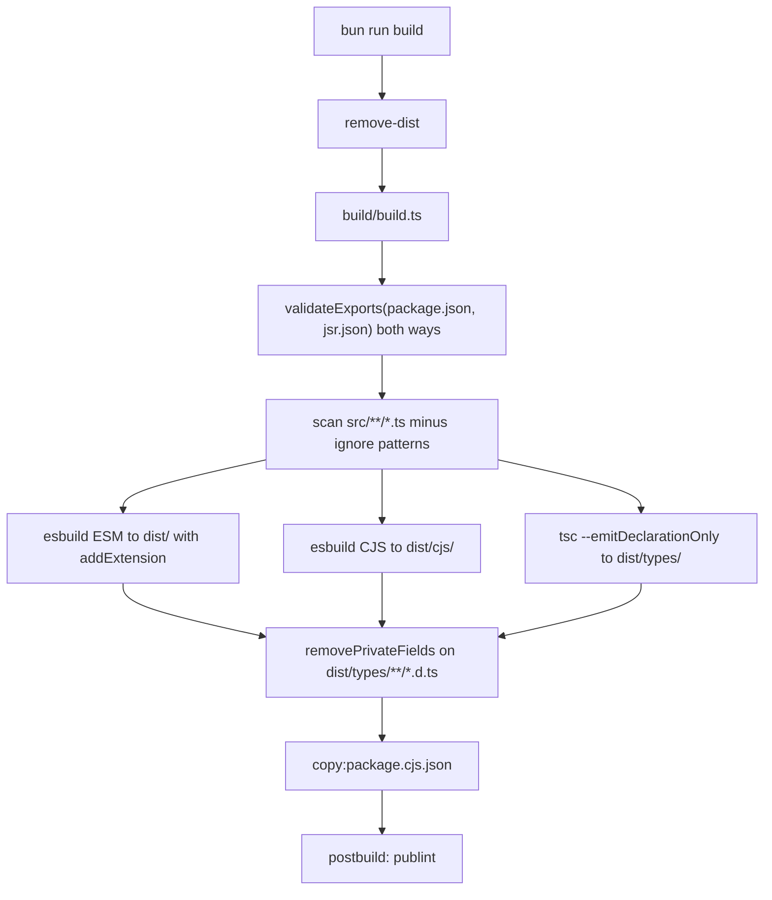

## Overview

This page is for working on Hono itself: setting up the repository, building the published `dist/` output, running the unit and runtime test suites, linting and formatting, measuring performance, and contributing. The repository uses Bun as package manager and script runner, esbuild and `tsc` for the build, Vitest for tests, and runs extra suites on Deno, Bun, Node.js, workerd, Fastly Compute and AWS Lambda so that the Web-standards promise in [[Overview]] is checked on every runtime.

Sources: [package.json:13-37](repo://package.json#L13-L37), [package.json:668-698](repo://package.json#L668-L698), [docs/CONTRIBUTING.md:27-35](repo://docs/CONTRIBUTING.md#L27-L35)

## Setup

### Toolchain versions

`package.json` pins the package manager as `bun@1.2.20`, and `.tool-versions` pins the versions CI installs for Node.js, Bun and Deno. CI jobs read this file through `node-version-file`, `bun-version-file` and `deno-version-file`.

Sources: [package.json:694-698](repo://package.json#L694-L698), [.github/workflows/ci.yml:37-47](repo://.github/workflows/ci.yml#L37-L47)

```text
nodejs 24.7.0
bun  1.2.19
deno 2.4.5
```

Sources: [.tool-versions:1-3](repo://.tool-versions#L1-L3)

### Clone and install

Install Bun, then clone and install with the frozen lockfile so dependency versions match CI.

Sources: [docs/CONTRIBUTING.md:27-35](repo://docs/CONTRIBUTING.md#L27-L35), [docs/CONTRIBUTING.md:56-60](repo://docs/CONTRIBUTING.md#L56-L60)

```bash
git clone git@github.com:honojs/hono.git && cd hono && bun install --frozen-lockfile
```

Sources: [docs/CONTRIBUTING.md:58-60](repo://docs/CONTRIBUTING.md#L58-L60)

## Scripts

| Script | Command | Purpose |
| --- | --- | --- |
| `test` | `tsc -p tsconfig.spec.json && vitest --run` | Type-check sources and tests, then run every Vitest project once |
| `test:watch` | `vitest --watch` | Rerun tests on change |
| `test:deno` | `deno test ... runtime-tests/deno` plus two `runtime-tests/deno-jsx` runs | Deno runtime tests, JSX in precompile and react-jsx modes |
| `test:bun` | `bun test --jsx-import-source ../../src/jsx runtime-tests/bun/*` | Bun runtime tests |
| `test:fastly`, `test:node`, `test:workerd`, `test:lambda`, `test:lambda-edge` | `vitest --run --project <name>` | One runtime project from the Vitest workspace |
| `test:all` | `bun run test && bun test:deno && bun test:bun` | Unit tests plus Deno and Bun |
| `lint`, `lint:fix` | `eslint src runtime-tests build perf-measures benchmarks` | ESLint, optionally fixing |
| `format`, `format:fix` | `prettier --check` / `--write` over the same folders | Prettier check or rewrite |
| `editorconfig-checker` | `editorconfig-checker` | Checks files against `.editorconfig` |
| `build` | `remove-dist`, `bun ./build/build.ts`, `copy:package.cjs.json` | Full build into `dist/` |
| `postbuild` | `publint` | Lints the built package layout |
| `watch` | Same as `build` with `--watch` | Incremental rebuilds |
| `coverage` | `vitest --run --coverage` | Coverage report |
| `prerelease`, `release` | `bun test:deno && bun run build`, then `np --no-publish` | Release preparation |

Sources: [package.json:13-37](repo://package.json#L13-L37)

## Build

### Build pipeline

`bun run build` deletes `dist/`, runs `build/build.ts`, then copies `package.cjs.json` (`{ "type": "commonjs" }`) into `dist/cjs/` and `dist/types/` so Node treats those folders as CommonJS despite the root `"type": "module"`. `publint` runs afterwards as `postbuild`.

Sources: [package.json:29-32](repo://package.json#L29-L32), [package.cjs.json:1-3](repo://package.cjs.json#L1-L3)



Sources: [package.json:29-32](repo://package.json#L29-L32), [build/build.ts:18-114](repo://build/build.ts#L18-L114)

### Steps in build/build.ts

1. Read the `exports` maps of `package.json` and `jsr.json` and call `validateExports` in both directions, so an entry added to one file but not the other fails the build with `Missing "<entry>" in '<file>'`.
2. Collect entry points: every `src/**/*.ts` except `src/**/*.test.ts`, `src/mod.ts`, `src/middleware.ts` and `src/deno/**/*.ts`. Each source file becomes its own output file; nothing is bundled into a single file.
3. Run three jobs in parallel: an ESM build into `dist/`, a CJS build into `dist/cjs/` (both with `outbase: './src'` and `platform: 'node'`), and `tsc --emitDeclarationOnly --declaration --project tsconfig.build.json` for `.d.ts` files. With `--watch`, esbuild uses `context().watch()` and `tsc` gets `-w`.
4. Strip `#private` fields from the generated declarations with `removePrivateFields`.

Sources: [build/build.ts:18-39](repo://build/build.ts#L18-L39), [build/build.ts:72-114](repo://build/build.ts#L72-L114), [build/validate-exports.ts:32-36](repo://build/validate-exports.ts#L32-L36)

The ESM config sets `bundle: true` but adds the `addExtension` plugin, which marks every import as external and rewrites it to a path with `.js`: `./foo` becomes `./foo.js` when `foo.ts` exists, or `./foo/index.js` when `foo/index.ts` exists. This gives Node-compatible ESM specifiers while each module stays a separate file, so a sub-path import such as `hono/cors` loads only what it needs.

Sources: [build/build.ts:41-92](repo://build/build.ts#L41-L92)

### Export validation

`validateExports(source, target, fileName)` throws for each `source` key that `target` does not cover. A key counts as covered when it is present verbatim; when it ends in `/*` and `target` has at least one key under that prefix (so `./utils/*` in `package.json` matches individual `./utils/...` entries in `jsr.json`); or when any parent of it is a `/*` pattern in `target`.

Sources: [build/validate-exports.ts:1-37](repo://build/validate-exports.ts#L1-L37)

### Removing private fields from declarations

`tsc` emits ECMAScript `#private` class fields into `.d.ts` files. `removePrivateFields` parses each declaration file with `oxc-parser`, collects every `PropertyDefinition` whose key is a `PrivateIdentifier` inside a class, and overwrites each one with spaces of the same length. Replacing with spaces instead of deleting keeps every other node's offsets valid while the removals are applied. Files with nothing to remove are not rewritten.

Sources: [build/remove-private-fields.ts:1-57](repo://build/remove-private-fields.ts#L1-L57)

### TypeScript configurations

| File | Used by | Settings |
| --- | --- | --- |
| `tsconfig.build.json` | `build/build.ts` | `rootDir: ./src/`, `outDir: ./dist/types/`, `noUnusedLocals`, `noUnusedParameters`, excludes test files |
| `tsconfig.spec.json` | `bun run test` | `noEmit`, `jsx: react-jsx` with `jsxImportSource: hono/jsx`, `vitest/globals` types, includes all of `src` |

Sources: [tsconfig.build.json:1-19](repo://tsconfig.build.json#L1-L19), [tsconfig.spec.json:1-11](repo://tsconfig.spec.json#L1-L11), [package.json:14-14](repo://package.json#L14-L14)

## Tests

### Vitest projects

`vitest.config.ts` enables globals and v8 coverage (JSON, text and HTML reporters into `coverage/raw/default`) and defines a workspace of projects. Coverage skips benchmarks, runtime tests, `build/build.ts`, `src/test-utils`, `perf-measures` and type-only files such as `src/**/types.ts`, `src/jsx/intrinsic-elements.ts` and `src/utils/http-status.ts`.

Sources: [vitest.config.ts:1-24](repo://vitest.config.ts#L1-L24)

| Project | Includes | JSX import source |
| --- | --- | --- |
| `main` | `src/**`, `scripts/**` and `build/**` files named `*.test.*` or `*.spec.*`; excludes `**/sandbox/**` and `**/*.case.test.*` | `./src/jsx` |
| `jsx-runtime-default` | `src/jsx/dom/**` tests and `src/jsx/hooks/dom.test.tsx` | `./src/jsx` |
| `jsx-runtime-dom` | The same DOM tests | `./src/jsx/dom` |
| Runtime projects | Every `runtime-tests/*/vitest.config.ts` | per project |

Sources: [vitest.config.ts:25-73](repo://vitest.config.ts#L25-L73)

The DOM tests run twice, once with each JSX import source, so client components behave the same whether compiled against `hono/jsx` or `hono/jsx/dom` (see [[Client Components and Hooks]]). Files named `*.case.test.*`, such as `src/router/common.case.test.ts`, hold shared cases that each router's own test imports, so they are excluded from direct runs.

Sources: [vitest.config.ts:36-70](repo://vitest.config.ts#L36-L70)

### Runtime tests

`runtime-tests/` holds one folder per runtime with a small app and tests that exercise runtime-specific behaviour: environment access through `env` and `getRuntimeKey`, streaming, static files, WebSockets, and auth middleware.

Sources: [runtime-tests/workerd/index.ts:1-30](repo://runtime-tests/workerd/index.ts#L1-L30), [runtime-tests/node/index.test.ts:1-30](repo://runtime-tests/node/index.test.ts#L1-L30)

| Folder | Runner | How the runtime is provided |
| --- | --- | --- |
| `runtime-tests/node` | Vitest project `node` | `@hono/node-server` (`serve`, `createAdaptorServer`) with `NAME=Node` |
| `runtime-tests/workerd` | Vitest project `workerd` | `unstable_dev` from `wrangler` starts `runtime-tests/workerd/index.ts` with `vars: { NAME: 'Hono' }` |
| `runtime-tests/fastly` | Vitest project `fastly` | `vite-plugin-fastly-js-compute` plugin, `fastly` global stubbed |
| `runtime-tests/lambda`, `runtime-tests/lambda-edge` | Vitest projects `lambda`, `lambda-edge` | Mock events passed to the adapters' `handle` |
| `runtime-tests/deno`, `runtime-tests/deno-jsx` | `deno test` | Deno itself, with `deno.json` mapping `@std/*` from JSR and `sloppy-imports` |
| `runtime-tests/bun` | `bun test` | Bun itself, JSX from `src/jsx` |

Sources: [runtime-tests/node/vitest.config.ts:1-11](repo://runtime-tests/node/vitest.config.ts#L1-L11), [runtime-tests/workerd/index.test.ts:1-20](repo://runtime-tests/workerd/index.test.ts#L1-L20), [runtime-tests/fastly/vitest.config.ts:1-10](repo://runtime-tests/fastly/vitest.config.ts#L1-L10), [runtime-tests/fastly/index.test.ts:1-12](repo://runtime-tests/fastly/index.test.ts#L1-L12), [runtime-tests/lambda/vitest.config.ts:1-11](repo://runtime-tests/lambda/vitest.config.ts#L1-L11), [runtime-tests/deno/deno.json:1-14](repo://runtime-tests/deno/deno.json#L1-L14), [package.json:16-22](repo://package.json#L16-L22)

> [!NOTE]
> `bun run test` runs the runtime Vitest projects too, because `vitest.config.ts` includes `./runtime-tests/*/vitest.config.ts`. Deno and Bun suites are not Vitest projects and need `bun test:deno` and `bun test:bun`.

Sources: [vitest.config.ts:25-26](repo://vitest.config.ts#L25-L26), [package.json:14-23](repo://package.json#L14-L23)

### Continuous integration

`.github/workflows/ci.yml` runs on pushes to `main` and `next` and on pull requests (ignoring changes only to `docs/`, `README.md` and similar). The `main` job runs `format`, `lint`, `editorconfig-checker`, `build` and `test` in that order. Separate jobs run the Deno, Bun (Linux and Windows), Fastly, Node.js (20.x, 22.x, 24.x), workerd, Lambda and Lambda@Edge suites, a `jsr publish --dry-run`, and a `coverage` job that uploads the merged coverage to Codecov.

Sources: [.github/workflows/ci.yml:1-58](repo://.github/workflows/ci.yml#L1-L58), [.github/workflows/ci.yml:59-125](repo://.github/workflows/ci.yml#L59-L125), [.github/workflows/ci.yml:126-183](repo://.github/workflows/ci.yml#L126-L183)

## Lint and format

ESLint uses `@hono/eslint-config` with every rule that needs type information switched off, plus a set of stylistic rules disabled. It ignores `.wrangler`, `coverage` and `dist`, and reports unused `eslint-disable` directives and inline configs as errors.

Sources: [eslint.config.mjs:1-80](repo://eslint.config.mjs#L1-L80)

Prettier formats `src`, `runtime-tests`, `build`, `perf-measures` and `benchmarks` with these settings:

Sources: [package.json:26-27](repo://package.json#L26-L27)

```json
{
  "printWidth": 100,
  "trailingComma": "es5",
  "tabWidth": 2,
  "semi": false,
  "singleQuote": true,
  "jsxSingleQuote": true,
  "endOfLine": "lf"
}
```

Sources: [.prettierrc:1-9](repo://.prettierrc#L1-L9)

## Benchmarks and performance measures

### Benchmarks

`benchmarks/` holds standalone projects, each with its own `package.json`, comparing Hono against other libraries: `routers` (Hono `RegExpRouter` and `TrieRouter` against find-my-way, express, koa-router, koa-tree-router, trek-router, `@medley/router` and others, using `mitata`), `routers-deno`, `jsx` (Hono JSX against React, Preact and nano), `query-param` (against `qs` and `fast-querystring`), `utils`, and `http-server`.

Sources: [benchmarks/routers/README.md:1-34](repo://benchmarks/routers/README.md#L1-L34), [benchmarks/routers/package.json:1-24](repo://benchmarks/routers/package.json#L1-L24), [benchmarks/jsx/package.json:1-28](repo://benchmarks/jsx/package.json#L1-L28), [benchmarks/query-param/package.json:1-15](repo://benchmarks/query-param/package.json#L1-L15)

```bash
cd benchmarks/routers
bun install --frozen-lockfile
bun run bench:node   # or: bun run bench:bun
```

Sources: [benchmarks/routers/README.md:16-32](repo://benchmarks/routers/README.md#L16-L32), [benchmarks/routers/package.json:2-7](repo://benchmarks/routers/package.json#L2-L7)

### HTTP server benchmark

`benchmarks/http-server/benchmark.ts` compares the HTTP throughput of two git refs. It builds a test app with `RegExpRouter` and three routes (`GET /`, `GET /id/:id` with a query and a header, `POST /json`), checks the endpoints unless `--skip-tests` is passed, then loads each with `bombardier --fasthttp` at 500 concurrent connections and writes a Markdown table of requests per second and percentage change. CI runs it on every pull request and posts the table as a PR comment.

Sources: [benchmarks/http-server/benchmark.ts:1-53](repo://benchmarks/http-server/benchmark.ts#L1-L53), [benchmarks/http-server/benchmark.ts:120-232](repo://benchmarks/http-server/benchmark.ts#L120-L232), [benchmarks/http-server/benchmark.ts:234-326](repo://benchmarks/http-server/benchmark.ts#L234-L326), [.github/workflows/ci.yml:194-258](repo://.github/workflows/ci.yml#L194-L258)

| Option | Default | Description |
| --- | --- | --- |
| `--baseline=<ref>` | `origin/main` | Git ref measured as the baseline |
| `--target=<ref>` | `current` | Git ref to compare, `current` means the working tree |
| `--runs=<n>` | `1` | Benchmark runs to average |
| `--duration=<s>` | `10` | Seconds per bombardier run |
| `--skip-tests` | off | Skip the endpoint checks |

Sources: [benchmarks/http-server/benchmark.ts:6-30](repo://benchmarks/http-server/benchmark.ts#L6-L30)

It needs Bun and bombardier installed locally, and runs from its own folder with `bun run benchmark.ts`.

Sources: [benchmarks/http-server/README.md:11-21](repo://benchmarks/http-server/README.md#L11-L21)

### Type-check and bundle-size measures

`perf-measures/` tracks two regressions that benchmarks miss. The composite action `.github/actions/perf-measures` runs on every pull request and on `main`:

Sources: [.github/actions/perf-measures/action.yml:1-19](repo://.github/actions/perf-measures/action.yml#L1-L19), [.github/workflows/ci.yml:184-192](repo://.github/workflows/ci.yml#L184-L192)

1. Type-check cost: `perf-measures/type-check/scripts/generate-app.ts` writes an app with 200 chained `.get('/routeN/:id', ...)` routes, then `tsc --diagnostics` and `tsgo --diagnostics` (typescript-go) compile it and `process-results.ts` turns the diagnostics into JSON metrics. This catches changes that make the [[Type System]] slower for large apps.
2. Bundle size: after `bun run build`, `check-bundle-size.ts` bundles and minifies `dist/index.js` with esbuild (ESM, `es2022`) and reports the size in bytes and kilobytes.
3. octocov compares the metrics with the target ref and reports the change.

Sources: [perf-measures/type-check/scripts/generate-app.ts:1-27](repo://perf-measures/type-check/scripts/generate-app.ts#L1-L27), [perf-measures/type-check/scripts/process-results.ts:1-30](repo://perf-measures/type-check/scripts/process-results.ts#L1-L30), [perf-measures/bundle-check/scripts/check-bundle-size.ts:1-52](repo://perf-measures/bundle-check/scripts/check-bundle-size.ts#L1-L52), [.github/actions/perf-measures/action.yml:21-64](repo://.github/actions/perf-measures/action.yml#L21-L64)

## Contributing

### Pull requests and policy

Contributions are issues, pull requests, third-party middleware, and sharing. A pull request must pass `bun run test`. The project states that the maintainer may decline ideas that do not fit, and that AI-assisted contributions are allowed but a maintainer may close a PR without notice and block the account if it wastes maintainers' time, whether or not AI was used.

Sources: [docs/CONTRIBUTING.md:1-39](repo://docs/CONTRIBUTING.md#L1-L39)

### Third-party middleware

Middleware that depends on other libraries or works only on one platform (GraphQL server, Firebase Auth, Sentry, for example) does not go into this repository. It lives in the `honojs/middleware` monorepo and is published under the `@hono` namespace; open an issue there to propose one.

Sources: [docs/CONTRIBUTING.md:41-54](repo://docs/CONTRIBUTING.md#L41-L54)

## Migration notes

`docs/MIGRATION.md` lists the breaking changes for each major upgrade. The main points:

Sources: [docs/MIGRATION.md:1-3](repo://docs/MIGRATION.md#L1-L3)

| Upgrade | Change |
| --- | --- |
| v4.3.11 to v4.4.0 | No longer published to `deno.land/x`; import `jsr:@hono/hono` |
| v3.12.x to v4.0.0 | Removed `c.jsonT()`, `c.stream()`, `c.streamText()`, `c.env()`, `app.showRoutes()`, `app.routerName`, `app.head()`, `app.handleEvent()`, `req.cookie()` and several `HonoRequest` passthroughs in favour of `c.json()`, `hono/streaming`, `hono/adapter`, `hono/dev`, `app.fetch()`, `hono/cookie` and `req.raw` |
| v3.12.x to v4.0.0 | Cloudflare Workers `serveStatic` requires `manifest`; JSX Renderer `docType` defaults to `true`; `FC` no longer passes `children` |
| v2.7.8 to v3.0.0 | `c.req` is a `HonoRequest` (use `c.req.raw` for the `Request`); `StaticRouter` removed; new validator API; `serveStatic` comes from adapters; Env generics must be declared with `type`, not `interface` |
| v2.0.9 to v2.1.0 | `c.req.parseBody()` parses only form data; Hono generics take `Bindings` and `Variables` |

Sources: [docs/MIGRATION.md:3-58](repo://docs/MIGRATION.md#L3-L58), [docs/MIGRATION.md:59-123](repo://docs/MIGRATION.md#L59-L123), [docs/MIGRATION.md:165-211](repo://docs/MIGRATION.md#L165-L211)
