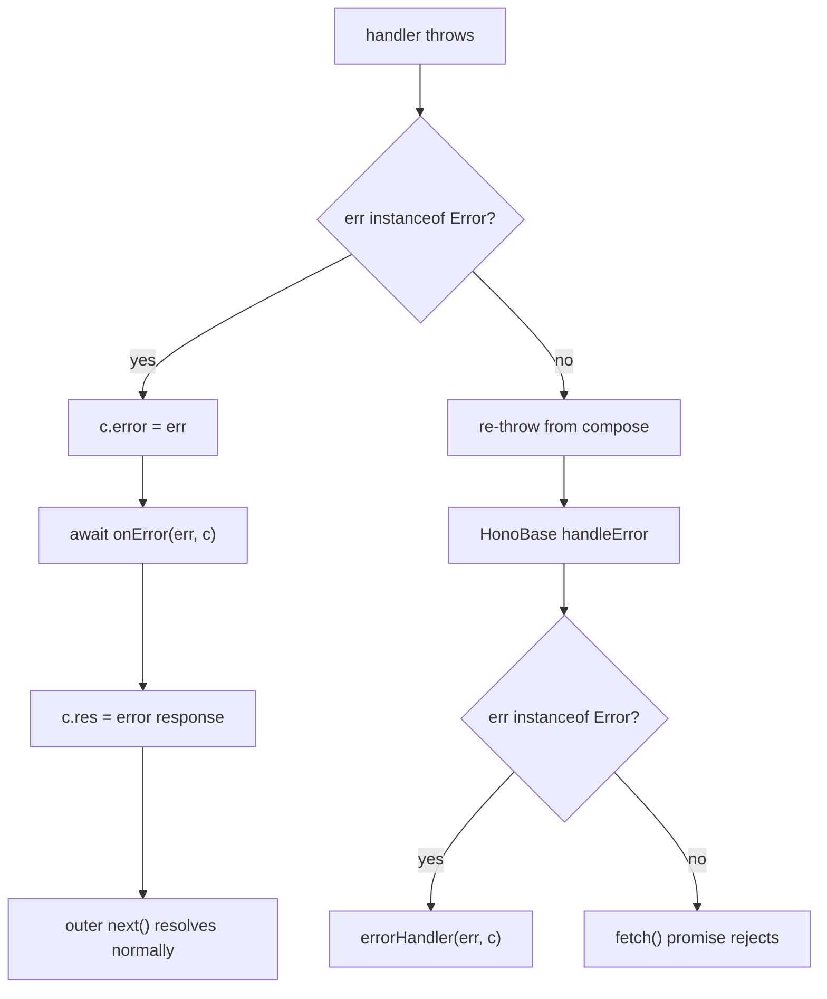

## Overview

Hono turns any `Error` thrown by a handler or middleware into a response through one error handler per app, set with `app.onError`. `HTTPException` is the error class for failures that already know their HTTP status, such as a failed authentication or a too-large body: throw it anywhere in the chain and the default error handler answers with its status and message, while any other error becomes a logged 500. Unmatched routes are a separate path handled by `app.notFound`, not by errors.

Sources: [src/http-exception.ts:20-46](repo://src/http-exception.ts#L20-L46), [src/hono-base.ts:31-42](repo://src/hono-base.ts#L31-L42)

Errors are caught by `compose` at the level where they are thrown and by the app's dispatch for anything that escapes. [[Middleware Composition]] describes the chain itself; this page follows an error through it.

Sources: [src/compose.ts:49-60](repo://src/compose.ts#L49-L60), [src/hono-base.ts:399-466](repo://src/hono-base.ts#L399-L466)

## HTTPException

### Constructor and options

`new HTTPException(status?, options?)` takes a status code, which defaults to `500`, and an options object. The status is typed as `ContentfulStatusCode`, so statuses that cannot carry a body (such as 204 or 304) are rejected at compile time. It is imported from `hono/http-exception`.

Sources: [src/http-exception.ts:46-59](repo://src/http-exception.ts#L46-L59), [src/utils/http-status.ts:71-72](repo://src/utils/http-status.ts#L71-L72), [package.json:69-73](repo://package.json#L69-L73)

| Option | Type | Default | Description |
| --- | --- | --- | --- |
| `message` | `string` | `''` (from `Error`) | The error message, and the response body when `res` is not given. |
| `res` | `Response` | none | A complete response to send, whose body and headers are used. |
| `cause` | `unknown` | none | Passed to `Error` as `cause`, for logging the underlying failure. |

Sources: [src/http-exception.ts:14-18](repo://src/http-exception.ts#L14-L18), [src/http-exception.ts:55-59](repo://src/http-exception.ts#L55-L59)

```ts
constructor(status: ContentfulStatusCode = 500, options?: HTTPExceptionOptions) {
  super(options?.message, { cause: options?.cause })
  this.res = options?.res
  this.status = status
}
```

Sources: [src/http-exception.ts:55-59](repo://src/http-exception.ts#L55-L59)

### getResponse()

`getResponse()` builds the response for the exception. With `res`, it creates a new `Response` from `res.body` and `res.headers` but with the exception's own `status`, so the status argument always wins over the status of `res`. Without `res`, the body is the message as plain text.

Sources: [src/http-exception.ts:61-77](repo://src/http-exception.ts#L61-L77)

```ts
getResponse(): Response {
  if (this.res) {
    const newResponse = new Response(this.res.body, {
      status: this.status,
      headers: this.res.headers,
    })
    return newResponse
  }
  return new Response(this.message, {
    status: this.status,
  })
}
```

Sources: [src/http-exception.ts:66-77](repo://src/http-exception.ts#L66-L77)

> [!WARNING]
> The `res` variant reuses the original body stream. Calling `getResponse()` a second time on the same exception produces a response whose body is already consumed.

Sources: [src/http-exception.ts:66-73](repo://src/http-exception.ts#L66-L73)

### Usage in built-in middleware

Built-in middleware use both forms. `basicAuth` builds a response with a `WWW-Authenticate` header and throws `new HTTPException(status, { res })`, `bodyLimit` throws a 413 with a prepared response, and `jwt` throws a 401 carrying both a `message` and a `res`. The validator throws a plain 400 with a message for malformed JSON or form bodies.

Sources: [src/middleware/basic-auth/index.ts:141-151](repo://src/middleware/basic-auth/index.ts#L141-L151), [src/middleware/body-limit/index.ts:50-58](repo://src/middleware/body-limit/index.ts#L50-L58), [src/middleware/jwt/jwt.ts:80-90](repo://src/middleware/jwt/jwt.ts#L80-L90), [src/validator/validator.ts:100-126](repo://src/validator/validator.ts#L100-L126)

```ts
import { HTTPException } from 'hono/http-exception'

app.post('/auth', async (c, next) => {
  if (!(await isAuthorized(c))) {
    throw new HTTPException(401, { message: 'Custom error message' })
  }
  await next()
})
```

Sources: [src/http-exception.ts:30-45](repo://src/http-exception.ts#L30-L45)

## onError

### The default error handler

When no `onError` is set, the app uses the module-level `errorHandler`. It checks with `'getResponse' in err` rather than `instanceof HTTPException`, so any error implementing the `HTTPResponseError` interface is turned into its own response. Everything else is logged with `console.error` and answered with `Internal Server Error` and status 500.

Sources: [src/hono-base.ts:35-42](repo://src/hono-base.ts#L35-L42), [src/types.ts:113-119](repo://src/types.ts#L113-L119)

```ts
const errorHandler: ErrorHandler = (err, c) => {
  if ('getResponse' in err) {
    const res = err.getResponse()
    return c.newResponse(res.body, res)
  }
  console.error(err)
  return c.text('Internal Server Error', 500)
}
```

Sources: [src/hono-base.ts:35-42](repo://src/hono-base.ts#L35-L42)

The exception's response is passed through `c.newResponse(res.body, res)` instead of being returned directly. That merges in headers set earlier with `c.header()`, for example by CORS or security-header middleware, so an error response still carries them.

Sources: [src/hono-base.ts:37-38](repo://src/hono-base.ts#L37-L38), [src/context.ts:604-639](repo://src/context.ts#L604-L639)

### A custom handler

`app.onError(handler)` replaces the default. The handler receives `(err, c)` and must return a `Response`. A custom handler replaces all default behaviour, including the `HTTPException` case, so check for it explicitly.

Sources: [src/hono-base.ts:271-274](repo://src/hono-base.ts#L271-L274), [src/types.ts:116-119](repo://src/types.ts#L116-L119)

```ts
import { HTTPException } from 'hono/http-exception'

app.onError((err, c) => {
  if (err instanceof HTTPException) {
    return err.getResponse()
  }
  console.error(err)
  return c.json({ error: 'Internal Server Error' }, 500)
})
```

Sources: [src/hono-base.ts:271-274](repo://src/hono-base.ts#L271-L274), [src/http-exception.ts:66-77](repo://src/http-exception.ts#L66-L77)

## How an error travels

### Inside compose

When a handler at index `i` throws, the `catch` in that `dispatch(i)` checks `err instanceof Error`. If it is, compose sets `c.error = err`, awaits the error handler and stores the result in `c.res`, even if the context was already finalized. The middleware that called `next()` sees a normal return and can read `c.error`.

Sources: [src/compose.ts:49-69](repo://src/compose.ts#L49-L69), [src/context.ts:318-333](repo://src/context.ts#L318-L333)



Sources: [src/compose.ts:49-69](repo://src/compose.ts#L49-L69), [src/hono-base.ts:399-404](repo://src/hono-base.ts#L399-L404), [src/hono-base.ts:450-465](repo://src/hono-base.ts#L450-L465)

### In the app's dispatch

`#dispatch` wraps both execution paths. The single-handler fast path catches synchronous throws with `try` and rejected promises with `.catch`; the composed path awaits `compose` inside `try`. Both call `#handleError`, which runs `errorHandler` for `Error` instances and re-throws anything else.

Sources: [src/hono-base.ts:399-404](repo://src/hono-base.ts#L399-L404), [src/hono-base.ts:429-465](repo://src/hono-base.ts#L429-L465)

Dispatch also raises one error itself: when the composed chain ends without a response, it throws `Context is not finalized`, which reaches the error handler like any other `Error`.

Sources: [src/hono-base.ts:454-459](repo://src/hono-base.ts#L454-L459)

> [!CAUTION]
> Throwing a value that is not an `Error` (a string, a plain object, or a `Response`) skips every error handler, and the promise returned by `app.fetch` rejects. Wrap such values in `HTTPException` or an `Error`.

Sources: [src/compose.ts:53-59](repo://src/compose.ts#L53-L59), [src/hono-base.ts:399-404](repo://src/hono-base.ts#L399-L404)

If the error handler itself throws inside compose, that new error propagates out of the current `dispatch(i)` to the middleware above it, whose own `dispatch` level then catches it and calls the error handler again.

Sources: [src/compose.ts:49-60](repo://src/compose.ts#L49-L60)

## Sub-applications

### Error handlers across app.route()

`app.route(path, subApp)` keeps each sub-app's error handling. When the sub-app still has the default `errorHandler`, its routes are copied as-is and errors go to the parent's handler. When the sub-app called `onError`, each of its handlers is wrapped in `compose([], subApp.errorHandler)`, so an error thrown by that handler is turned into a response by the sub-app's handler before the parent's chain sees it.

Sources: [src/hono-base.ts:208-232](repo://src/hono-base.ts#L208-L232)

```ts
const api = new Hono()
api.onError((err, c) => c.json({ error: err.message }, 500))
api.get('/boom', () => {
  throw new Error('boom')
})

const app = new Hono()
app.onError((err, c) => c.text('parent', 500))
app.route('/api', api) // GET /api/boom answers JSON from api.onError
```

Sources: [src/hono-base.ts:219-229](repo://src/hono-base.ts#L219-L229)

The wrapping is per handler, so errors raised in the parent's own middleware, even on `/api` paths, still go to the parent's handler. Applications attached with `app.mount()` are plain functions: anything they throw reaches the Hono error handler of the app that mounted them.

Sources: [src/hono-base.ts:219-229](repo://src/hono-base.ts#L219-L229), [src/hono-base.ts:372-381](repo://src/hono-base.ts#L372-L381)

## notFound

### Not-found responses

A request that matches no handler, or whose last middleware calls `next()` with nothing after it, gets the not-found handler's response. The default answers `404 Not Found` as text; `app.notFound(handler)` replaces it, and `c.notFound()` calls the same handler from inside a route.

Sources: [src/hono-base.ts:31-33](repo://src/hono-base.ts#L31-L33), [src/hono-base.ts:291-294](repo://src/hono-base.ts#L291-L294), [src/compose.ts:61-65](repo://src/compose.ts#L61-L65), [src/context.ts:776-779](repo://src/context.ts#L776-L779)

```ts
app.notFound((c) => c.json({ message: 'Not Found', path: c.req.path }, 404))
```

Sources: [src/hono-base.ts:291-294](repo://src/hono-base.ts#L291-L294)

Only the top-level app's not-found handler is used. `app.route()` copies routes into a clone of the parent, which carries the parent's handler, so a `notFound` set on a sub-app has no effect once it is mounted with `route()`.

Sources: [src/hono-base.ts:175-184](repo://src/hono-base.ts#L175-L184), [src/hono-base.ts:218-231](repo://src/hono-base.ts#L218-L231)
