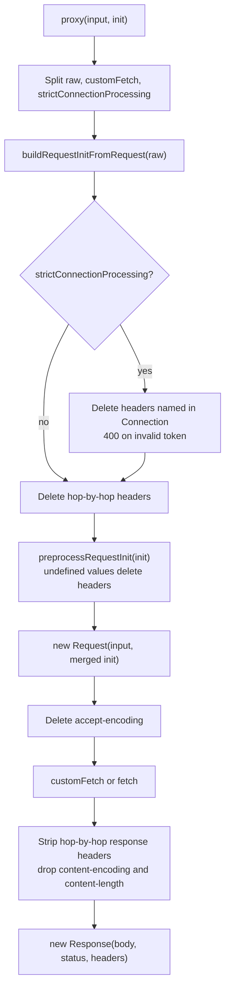

## Overview

Hono ships a set of small helpers under separate subpath exports (`hono/factory`, `hono/testing`, `hono/accepts`, `hono/proxy`, `hono/route`, `hono/dev`, `hono/adapter`, `hono/conninfo`). None of them change how requests are routed; each solves one recurring problem around an app: typing middleware and handlers defined outside a route call, testing an app without a network, content negotiation, forwarding a request to another server, introspecting the matched route, listing routes, reading environment variables portably, and describing the client's connection.

Sources: [package.json:99-113](repo://package.json#L99-L113), [package.json:329-413](repo://package.json#L329-L413)

The factory and testing helpers lean on the type system: `createHandlers` and `createMiddleware` keep the `Env` and `Input` generics that are otherwise lost when a handler is not written inline (see [[Type System]]), and `testClient` reuses the [[RPC Client (hc)]] against `app.request`. The others are plain runtime utilities.

Sources: [src/helper/factory/index.ts:332-375](repo://src/helper/factory/index.ts#L332-L375), [src/helper/testing/index.ts:16-27](repo://src/helper/testing/index.ts#L16-L27)

## Factory helper

### createFactory and Factory

`createFactory<E, P>(init?)` returns a `Factory` bound to one `Env` type, so every app, middleware and handler made from it shares the same `Bindings` and `Variables` typing without repeating the generic.

Sources: [src/helper/factory/index.ts:332-366](repo://src/helper/factory/index.ts#L332-L366)

| Option | Type | Description |
| --- | --- | --- |
| `initApp` | `(app: Hono<E>) => void` | Called on every app built by `createApp`, e.g. to register shared middleware or set variables. |
| `defaultAppOptions` | `HonoOptions<E>` | Default options for `new Hono()`. When `createApp(options)` also passes options, they are shallow-merged with the call's options winning. |

Sources: [src/helper/factory/index.ts:18-18](repo://src/helper/factory/index.ts#L18-L18), [src/helper/factory/index.ts:336-351](repo://src/helper/factory/index.ts#L336-L351)

```ts
createApp = (options?: HonoOptions<E>): Hono<E> => {
  const app = new Hono<E>(
    options && this.#defaultAppOptions
      ? { ...this.#defaultAppOptions, ...options }
      : (options ?? this.#defaultAppOptions)
  )
  if (this.initApp) {
    this.initApp(app)
  }
  return app
}
```

Sources: [src/helper/factory/index.ts:341-351](repo://src/helper/factory/index.ts#L341-L351)

### createMiddleware

`createMiddleware` is an identity function: it returns the middleware it receives. Its value is entirely in the type signature, which gives the callback a typed `c` and `next` and keeps the `Input` and response type `R` (defaulting to `Response` when the middleware returns nothing). The standalone export defaults `E` to `any`; the factory method uses the factory's `E`.

Sources: [src/helper/factory/index.ts:353-355](repo://src/helper/factory/index.ts#L353-L355), [src/helper/factory/index.ts:368-375](repo://src/helper/factory/index.ts#L368-L375)

```ts
import { createMiddleware } from 'hono/factory'

const auth = createMiddleware<{ Variables: { user: string } }>(async (c, next) => {
  c.set('user', 'alice')
  await next()
})

app.get('/me', auth, (c) => c.text(c.var.user))
```

Sources: [src/helper/factory/index.ts:368-375](repo://src/helper/factory/index.ts#L368-L375)

### createHandlers

`factory.createHandlers(...handlers)` exists so that a handler chain defined in a separate place (a controller file, say) gets the same inference as an inline `app.get(path, mw, handler)`. `CreateHandlersInterface` has overloads for one to ten handlers; each successive handler's `Input` defaults to the intersection of the previous ones and its `Env` to `IntersectNonAnyTypes` of the earlier envs, so a validator's output is visible to the final handler. At runtime it only filters out `undefined` entries and returns the array, which you spread into a route.

Sources: [src/helper/factory/index.ts:20-53](repo://src/helper/factory/index.ts#L20-L53), [src/helper/factory/index.ts:357-360](repo://src/helper/factory/index.ts#L357-L360)

```ts
import { createFactory } from 'hono/factory'
import { validator } from 'hono/validator'

const factory = createFactory<{ Bindings: { DB: D1Database } }>()

const handlers = factory.createHandlers(
  validator('query', (v) => ({ q: String(v.q ?? '') })),
  (c) => c.json({ q: c.req.valid('query').q })
)

app.get('/search', ...handlers)
```

Sources: [src/helper/factory/index.ts:357-366](repo://src/helper/factory/index.ts#L357-L366)

## Testing helper

`testClient(app, Env?, executionCtx?, options?)` returns an `hc` client typed from the app and wired to `app.request` instead of the network. The custom fetch forwards the bindings and execution context, so handlers that read `c.env` or call `c.executionCtx.waitUntil` work in tests. The base URL is fixed to `http://localhost`, and `options` accepts every `ClientRequestOptions` field except `fetch` (headers, `init`, `buildSearchParams`, `webSocket`).

Sources: [src/helper/testing/index.ts:13-27](repo://src/helper/testing/index.ts#L13-L27)

```ts
export const testClient = <T extends Hono<any, Schema, string>>(
  app: T,
  Env?: ExtractEnv<T>['Bindings'] | {},
  executionCtx?: ExecutionContext,
  options?: Omit<ClientRequestOptions, 'fetch'>
): UnionToIntersection<Client<T, 'http://localhost'>> => {
  const customFetch = (input: RequestInfo | URL, init?: RequestInit) => {
    return app.request(input, init, Env, executionCtx)
  }

  return hc<typeof app, 'http://localhost'>('http://localhost', { ...options, fetch: customFetch })
}
```

Sources: [src/helper/testing/index.ts:16-27](repo://src/helper/testing/index.ts#L16-L27)

```ts
import { testClient } from 'hono/testing'

const res = await testClient(app).search.$get({ query: { q: 'hono' } })
expect(await res.json()).toEqual({ q: 'hono' })
```

Sources: [src/helper/testing/index.ts:16-27](repo://src/helper/testing/index.ts#L16-L27)

> [!NOTE]
> As with `hc`, the inference only works when the app's routes were chained so the schema type was kept. A route registered with a separate `app.get(...)` statement is not part of `typeof app`.

Sources: [src/helper/testing/index.ts:13-21](repo://src/helper/testing/index.ts#L13-L21)

## Accepts helper

`accepts(c, options)` performs content negotiation on any `Accept*` header. It reads `options.header`; if the header is missing it returns `options.default` immediately. Otherwise `parseAccept` splits the header into `{ type, params, q }` entries (sorting by quality only when the header is not already in descending order), and the matcher picks the result.

Sources: [src/helper/accepts/accepts.ts:40-49](repo://src/helper/accepts/accepts.ts#L40-L49), [src/utils/accept.ts:211-237](repo://src/utils/accept.ts#L211-L237)

| Option | Type | Description |
| --- | --- | --- |
| `header` | `AcceptHeader` | Header to read, e.g. `Accept`, `Accept-Language`, `Accept-Encoding`. |
| `supports` | `string[]` | Values the server can produce. |
| `default` | `string` | Returned when the header is absent or nothing matches. |
| `match` | `(accepts: Accept[], config) => string` | Optional custom matcher; defaults to `defaultMatch`. |

Sources: [src/helper/accepts/accepts.ts:5-19](repo://src/helper/accepts/accepts.ts#L5-L19)

`defaultMatch` sorts by `q` descending and returns the first entry whose `type` is exactly in `supports`. Wildcards such as `*/*` or `en-*` are not expanded, so a header of only `*/*` yields the default; pass a custom `match` when you need wildcard or prefix matching.

Sources: [src/helper/accepts/accepts.ts:21-25](repo://src/helper/accepts/accepts.ts#L21-L25)

```ts
import { accepts } from 'hono/accepts'

app.get('/users', (c) => {
  const lang = accepts(c, {
    header: 'Accept-Language',
    supports: ['en', 'zh'],
    default: 'en',
  })
  return c.text(lang === 'zh' ? '你好' : 'Hello')
})
```

Sources: [src/helper/accepts/accepts.ts:27-49](repo://src/helper/accepts/accepts.ts#L27-L49)

## Proxy helper

### How proxy builds the upstream request

`proxy(input, init?)` is a `fetch` wrapper for reverse proxying whose result can be returned straight from a handler. The second argument may be a `Request`, or a `RequestInit` extended with `raw`, `customFetch` and `strictConnectionProcessing`. Because `HonoRequest` exposes the original request as `raw`, spreading `...c.req` into the init forwards the method, body, headers and abort signal.

Sources: [src/helper/proxy/index.ts:24-48](repo://src/helper/proxy/index.ts#L24-L48), [src/helper/proxy/index.ts:160-171](repo://src/helper/proxy/index.ts#L160-L171)



Sources: [src/helper/proxy/index.ts:50-113](repo://src/helper/proxy/index.ts#L50-L113), [src/helper/proxy/index.ts:160-190](repo://src/helper/proxy/index.ts#L160-L190)

The steps, in order:

Sources: [src/helper/proxy/index.ts:160-190](repo://src/helper/proxy/index.ts#L160-L190)

1. `buildRequestInitFromRequest` copies the raw request's headers and removes the RFC 2616 hop-by-hop headers (`connection`, `keep-alive`, `proxy-authenticate`, `proxy-authorization`, `te`, `trailer`, `transfer-encoding`, `upgrade`). It sets `duplex: 'half'` when there is a streaming body.
2. With `strictConnectionProcessing: true`, it also deletes every header named in the `Connection` header, after checking each name against the RFC 9110 token pattern and throwing `HTTPException(400)` on an invalid name.
3. `preprocessRequestInit` converts a plain-object `headers` into `Headers`, treating `null` or `undefined` values as "do not send". Those headers override the ones copied from `raw`.
4. `accept-encoding` is removed from the outgoing request so the upstream answers with an encoding the current runtime can decode.
5. On the response, hop-by-hop headers are removed; if `content-encoding` is present it and `content-length` are deleted, since the body has already been decoded and the length no longer matches.

Sources: [src/helper/proxy/index.ts:9-22](repo://src/helper/proxy/index.ts#L9-L22), [src/helper/proxy/index.ts:50-113](repo://src/helper/proxy/index.ts#L50-L113), [src/helper/proxy/index.ts:172-190](repo://src/helper/proxy/index.ts#L172-L190)

> [!WARNING]
> `strictConnectionProcessing` defaults to `false` on purpose: honouring an untrusted client's `Connection` header would let it strip arbitrary headers (for example ones your proxy adds) from the upstream request. Enable it only for trusted internal traffic.

Sources: [src/helper/proxy/index.ts:32-43](repo://src/helper/proxy/index.ts#L32-L43)

### Proxy example

```ts
import { proxy } from 'hono/proxy'

app.all('/proxy/:path', (c) => {
  return proxy(`http://${originServer}/${c.req.param('path')}`, {
    ...c.req,
    headers: {
      ...c.req.header(),
      'X-Forwarded-For': '127.0.0.1',
      'X-Forwarded-Host': c.req.header('host'),
      Authorization: undefined,
    },
  })
})
```

Sources: [src/helper/proxy/index.ts:139-149](repo://src/helper/proxy/index.ts#L139-L149)

## Route helper

The route helpers read the router's match result stored on the request, so middleware can learn which routes matched and which one is running. `c.req.routeIndex` is the index of the handler currently executing within that list.

Sources: [src/helper/route/index.ts:32-34](repo://src/helper/route/index.ts#L32-L34), [src/request.ts:55-55](repo://src/request.ts#L55-L55)

| Function | Returns |
| --- | --- |
| `matchedRoutes(c)` | Every `RouterRoute` (`basePath`, `path`, `method`, `handler`) that matched the request, middleware included, in execution order. |
| `routePath(c, index?)` | The registered path of the route at `index` (default: the current one), e.g. `'/posts/:id'`. Negative indexes count from the end, like `Array.prototype.at`. |
| `baseRoutePath(c, index?)` | The registered base path of that route, e.g. `'/:sub'` for an app mounted with `app.route('/:sub', subApp)`. |
| `basePath(c, index?)` | The base path with parameters filled from the actual request path, e.g. `'/requested-sub-app-path'`. |

Sources: [src/helper/route/index.ts:32-107](repo://src/helper/route/index.ts#L32-L107)

`basePath` returns the registered base path unchanged when it has no `:` or `*`. Otherwise it walks the segments from `splitRoutingPath`, measures how many characters of `c.req.path` each segment consumes (a literal segment by its own length, a parameter by matching its pattern or `[^/]+`), and slices that prefix from the request path. Results are cached per `Context` and index in a `WeakMap`, so repeated calls in one request are cheap.

Sources: [src/helper/route/index.ts:106-141](repo://src/helper/route/index.ts#L106-L141)

```ts
import { routePath } from 'hono/route'

app.use('*', (c, next) => {
  console.log(routePath(c)) // '*'
  console.log(routePath(c, -1)) // '/posts/:id'
  return next()
})
```

Sources: [src/helper/route/index.ts:43-59](repo://src/helper/route/index.ts#L43-L59)

## Dev helper

`inspectRoutes(app)` maps `app.routes` to `{ path, method, name, isMiddleware }`. It unwraps composed sub-app handlers with `findTargetHandler`, treats a function with more than one declared parameter (`(c, next)`) as middleware, and names anonymous functions `[middleware]` or `[handler]`.

Sources: [src/helper/dev/index.ts:16-37](repo://src/helper/dev/index.ts#L16-L37), [src/utils/handler.ts:8-15](repo://src/utils/handler.ts#L8-L15)

`showRoutes(app, opts?)` prints those routes to the console, one line per unique method and path with aligned columns. Middleware is hidden unless `verbose` is set, in which case each handler name is listed under its route. Colour defaults to `getColorEnabled()`, which honours `NO_COLOR` and Deno's `noColor`.

Sources: [src/helper/dev/index.ts:11-14](repo://src/helper/dev/index.ts#L11-L14), [src/helper/dev/index.ts:39-74](repo://src/helper/dev/index.ts#L39-L74), [src/utils/color.ts:14-27](repo://src/utils/color.ts#L14-L27)

| Option | Type | Default | Description |
| --- | --- | --- | --- |
| `verbose` | `boolean` | `false` | Include middleware and list handler names under each route. |
| `colorize` | `boolean` | `getColorEnabled()` | Print the method in green ANSI colour. |

Sources: [src/helper/dev/index.ts:11-14](repo://src/helper/dev/index.ts#L11-L14), [src/helper/dev/index.ts:39-40](repo://src/helper/dev/index.ts#L39-L40)

`getRouterName(app)` triggers one `match('GET', '/')` so a lazy router such as `SmartRouter` settles on its implementation, then returns `app.router.name` (see [[Router Interface and Selection]]).

Sources: [src/helper/dev/index.ts:76-79](repo://src/helper/dev/index.ts#L76-L79)

## Adapter helper

### getRuntimeKey

`getRuntimeKey()` detects the current runtime and returns one of `'node' | 'deno' | 'bun' | 'workerd' | 'fastly' | 'edge-light' | 'other'`. It first checks whether `navigator.userAgent` starts with `Deno`, `Bun`, `Cloudflare-Workers` or `Node.js`, then falls back to the `EdgeRuntime` global (Vercel Edge), the `fastly` global, and `process.release.name === 'node'` for Node versions before 21.1 that lack `navigator.userAgent`.

Sources: [src/helper/adapter/index.ts:8-8](repo://src/helper/adapter/index.ts#L8-L8), [src/helper/adapter/index.ts:43-90](repo://src/helper/adapter/index.ts#L43-L90)

### env

`env(c, runtime?)` returns environment variables in a runtime-neutral way, so the same code reads secrets on Node and on Workers. The source depends on the runtime:

Sources: [src/helper/adapter/index.ts:10-41](repo://src/helper/adapter/index.ts#L10-L41)

| Runtime | Source |
| --- | --- |
| `node`, `bun`, `edge-light` | `globalThis.process.env` |
| `deno` | `Deno.env.toObject()` |
| `workerd` | `c.env` (the Worker bindings) |
| `fastly`, `other` | `{}` (Fastly uses its ConfigStore instead) |

Sources: [src/helper/adapter/index.ts:20-40](repo://src/helper/adapter/index.ts#L20-L40)

```ts
import { env, getRuntimeKey } from 'hono/adapter'

app.get('/env', (c) => {
  const { NAME } = env<{ NAME: string }>(c)
  return c.text(`${NAME} on ${getRuntimeKey()}`)
})
```

Sources: [src/helper/adapter/index.ts:10-50](repo://src/helper/adapter/index.ts#L10-L50)

## ConnInfo types

`hono/conninfo` exports only types; each runtime adapter provides its own `getConnInfo(c)` that satisfies `GetConnInfo` (see [[Runtime Adapters]]). `ConnInfo.remote` is a `NetAddrInfo` with optional `transport` (`'tcp' | 'udp'`), `port`, `address` and `addressType` (`'IPv4' | 'IPv6' | undefined`). The union type means that when an adapter knows the address it also states its type.

Sources: [src/helper/conninfo/types.ts:1-45](repo://src/helper/conninfo/types.ts#L1-L45), [src/helper/conninfo/index.ts:1-6](repo://src/helper/conninfo/index.ts#L1-L6)
