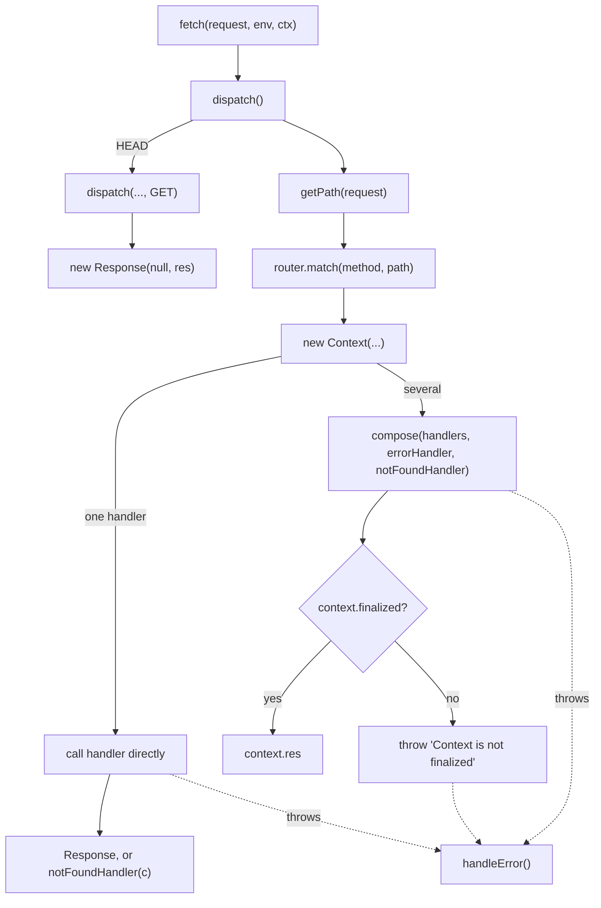

## Overview

Every Hono application is an instance of the `Hono` class. It holds a router, a list of registered routes, an error handler and a not-found handler, and exposes one entry point, `fetch`, that takes a Web-standard `Request` and returns a `Response`. Because `fetch` has the same shape as a Service Worker or Cloudflare Workers handler, the same app object runs on every runtime covered in [[Runtime Adapters]].

Sources: [src/hono-base.ts:98-124](repo://src/hono-base.ts#L98-L124), [src/hono-base.ts:479-485](repo://src/hono-base.ts#L479-L485)

The implementation is split in two. `HonoBase` in `src/hono-base.ts` contains all routing, dispatch and error logic but no router: its comment describes it as "like an abstract class". The exported `Hono` in `src/hono.ts` only extends it and picks a router. The presets `hono/quick` and `hono/tiny` are the same subclass with a different router, which is how Hono ships several bundle-size and speed trade-offs from one code base (see [[Router Interface and Selection]]).

Sources: [src/hono-base.ts:114-118](repo://src/hono-base.ts#L114-L118), [src/hono.ts:16-34](repo://src/hono.ts#L16-L34), [src/preset/quick.ts:13-24](repo://src/preset/quick.ts#L13-L24), [src/preset/tiny.ts:11-20](repo://src/preset/tiny.ts#L11-L20)

## Constructor and options

### HonoOptions

`new Hono(options)` accepts a `HonoOptions` object. All three fields are optional.

Sources: [src/hono-base.ts:44-87](repo://src/hono-base.ts#L44-L87)

| Option | Type | Default | Description |
| --- | --- | --- | --- |
| `router` | `Router<[H, RouterRoute]>` | `SmartRouter` over `RegExpRouter` and `TrieRouter` | The router that stores routes and matches requests. Ignored by the `hono/quick` and `hono/tiny` presets, which always set their own. |
| `strict` | `boolean` | `true` | When `true`, `/hello` and `/hello/` are different paths. When `false`, a trailing slash is removed before matching. |
| `getPath` | `(request, options?: { env }) => string` | `getPath` from `src/utils/url.ts` | Computes the routing path from the request, for example to route on the `Host` header. |

Sources: [src/hono-base.ts:46-87](repo://src/hono-base.ts#L46-L87), [src/hono.ts:26-33](repo://src/hono.ts#L26-L33), [src/preset/quick.ts:18-23](repo://src/preset/quick.ts#L18-L23)

### How the options are applied

The base constructor removes `strict` from the options and copies everything else onto the instance with `Object.assign`, so `router` and `getPath` become instance fields. It then resolves `getPath` from `strict`: with `strict` unset or `true` it uses the supplied `getPath` or the default one; with `strict: false` it always uses `getPathNoStrict`.

Sources: [src/hono-base.ts:170-172](repo://src/hono-base.ts#L170-L172)

```ts
const { strict, ...optionsWithoutStrict } = options
Object.assign(this, optionsWithoutStrict)
this.getPath = (strict ?? true) ? (options.getPath ?? getPath) : getPathNoStrict
```

Sources: [src/hono-base.ts:170-172](repo://src/hono-base.ts#L170-L172)

> [!WARNING]
> `strict: false` takes precedence over a custom `getPath`: the custom function is silently replaced by `getPathNoStrict`. To combine host-based routing with trailing-slash tolerance, strip the slash inside your own `getPath`.

Sources: [src/hono-base.ts:172](repo://src/hono-base.ts#L172)

The default `getPath` scans the URL once, starting after the `scheme://host` part, and stops at the first `?` or `#`. Only when it meets a `%` does it fall back to slicing and running `tryDecodeURI` on the path, protecting a literal `%25` from being decoded twice. `getPathNoStrict` calls it and drops one trailing `/` when the path is longer than one character.

Sources: [src/utils/url.ts:106-146](repo://src/utils/url.ts#L106-L146)

### The Hono subclass

`Hono` calls `super(options)` and then sets `this.router` to `options.router` or a new `SmartRouter` that tries `RegExpRouter` first and falls back to `TrieRouter`. `RegExpRouter` is described in [[RegExpRouter]], the others in [[TrieRouter, LinearRouter and PatternRouter]].

Sources: [src/hono.ts:26-33](repo://src/hono.ts#L26-L33)

```ts
constructor(options: HonoOptions<E> = {}) {
  super(options)
  this.router =
    options.router ??
    new SmartRouter({
      routers: [new RegExpRouter(), new TrieRouter()],
    })
}
```

Sources: [src/hono.ts:26-33](repo://src/hono.ts#L26-L33)

The router only has to implement `add(method, path, handler)` and `match(method, path)`. `match` returns a `Result`: a list of `[handler, params]` pairs, either with parameter values inline or with parameter indexes plus a shared stash array.

Sources: [src/router.ts:29-52](repo://src/router.ts#L29-L52), [src/router.ts:98](repo://src/router.ts#L98)

## Registering routes

### Method handlers

The constructor creates `get`, `post`, `put`, `delete`, `options`, `patch` and `all` at runtime by looping over `METHODS` plus `METHOD_NAME_ALL_LOWERCASE`. Each one accepts either a path followed by handlers, or handlers alone. Every handler becomes its own route entry, so `app.get('/a', mw, handler)` registers two routes on the same path.

Sources: [src/router.ts:9-17](repo://src/router.ts#L9-L17), [src/hono-base.ts:127-141](repo://src/hono-base.ts#L127-L141)

```ts
allMethods.forEach((method) => {
  this[method] = (args1: string | H, ...args: H[]) => {
    if (typeof args1 === 'string') {
      this.#path = args1
    } else {
      this.#addRoute(method, this.#path, args1)
    }
    args.forEach((handler) => {
      this.#addRoute(method, this.#path, handler)
    })
    return this as any
  }
})
```

Sources: [src/hono-base.ts:128-141](repo://src/hono-base.ts#L128-L141)

When the first argument is a function, the route uses the private `#path` field, which remembers the last path set by any registration call (initially `/`). This is what makes chained registration work: `app.get('/posts', list).post(create)` registers `POST /posts`.

Sources: [src/hono-base.ts:122](repo://src/hono-base.ts#L122), [src/hono-base.ts:130-135](repo://src/hono-base.ts#L130-L135)

### on() and use()

`app.on(method, path, ...handlers)` accepts a single method or path, or arrays of either, and registers every handler for every method and path combination, uppercasing the method. It is how you register a method outside `METHODS`, such as `PURGE`.

Sources: [src/hono-base.ts:143-154](repo://src/hono-base.ts#L143-L154)

`app.use(...)` registers middleware under the method `ALL`. Without a path it uses `*` and sets `#path` to `*`, so a later path-less `app.get(handler)` also lands on `*`. Middleware and handlers live in the same router; the difference is only in how they call `next`, described in [[Middleware Composition]].

Sources: [src/hono-base.ts:156-168](repo://src/hono-base.ts#L156-L168)

```ts
app.use(logger())
app.on(['GET', 'POST'], ['/a', '/b'], (c) => c.text('a or b'))
app.get('/posts', (c) => c.text('list')).post((c) => c.text('created', 201))
```

Sources: [src/hono-base.ts:143-168](repo://src/hono-base.ts#L143-L168)

### addRoute

All registration paths end in the private `#addRoute`. It uppercases the method, prefixes the path with the app's `_basePath` through `mergePath`, builds a `RouterRoute` record, passes `[handler, route]` to `router.add`, and appends the record to `app.routes`. Because the router receives the route record alongside the handler, the request later knows which route each handler came from (`c.req.routePath`, see [[HonoRequest]]).

Sources: [src/hono-base.ts:385-397](repo://src/hono-base.ts#L385-L397), [src/types.ts:57-62](repo://src/types.ts#L57-L62)

`mergePath` joins segments with exactly one slash and drops a trailing `/` sub-path, so `mergePath('/api', '/')` is `/api` but `mergePath('/api/', '/')` keeps `/api/`.

Sources: [src/utils/url.ts:148-169](repo://src/utils/url.ts#L148-L169)

## Grouping applications

### basePath()

`basePath(path)` returns a clone whose `_basePath` is the merged path. `#clone` passes the same `router` and `getPath` to a new instance and shares the `routes` array, the error handler and the not-found handler. Routes registered on the clone are therefore added to the original app's router, just with the prefix.

Sources: [src/hono-base.ts:175-184](repo://src/hono-base.ts#L175-L184), [src/hono-base.ts:247-253](repo://src/hono-base.ts#L247-L253)

```ts
const app = new Hono()
const api = app.basePath('/api')
api.get('/users', (c) => c.json([])) // GET /api/users, served by app.fetch
```

Sources: [src/hono-base.ts:247-253](repo://src/hono-base.ts#L247-L253)

### route()

`route(path, subApp)` copies a sub-application's routes into this app under `path`. It makes a `basePath(path)` clone of the parent and re-adds each of the sub-app's `routes`, passing the route's own `basePath` so the combined base path is kept. It returns the parent, with the sub-app's schema merged into the type for [[RPC Client (hc)]].

Sources: [src/hono-base.ts:208-232](repo://src/hono-base.ts#L208-L232)

If the sub-app has its own `onError` handler, each copied handler is wrapped so errors thrown inside it reach the sub-app's handler rather than the parent's. The wrapper stores the original under the `COMPOSED_HANDLER` key so tools can find the real handler through `findTargetHandler`.

Sources: [src/hono-base.ts:219-229](repo://src/hono-base.ts#L219-L229), [src/utils/constants.ts:1-4](repo://src/utils/constants.ts#L1-L4), [src/utils/handler.ts:8-15](repo://src/utils/handler.ts#L8-L15)

```ts
if (app.errorHandler === errorHandler) {
  handler = r.handler
} else {
  handler = async (c: Context, next: Next) =>
    (await compose([], app.errorHandler)(c, () => r.handler(c, next))).res
  ;(handler as any)[COMPOSED_HANDLER] = r.handler
}
```

Sources: [src/hono-base.ts:221-227](repo://src/hono-base.ts#L221-L227)

> [!NOTE]
> `route()` copies routes at call time. Routes added to the sub-app after `app.route(...)` are not seen by the parent, and the sub-app's `notFound` handler is never used: the clone carries the parent's not-found handler.

Sources: [src/hono-base.ts:175-184](repo://src/hono-base.ts#L175-L184), [src/hono-base.ts:218-231](repo://src/hono-base.ts#L218-L231)

### mount()

`mount(path, applicationHandler, options?)` plugs in any `(request, ...args) => Response` function, such as another framework's handler. It registers one `ALL` route on `path/*`. The route calls the foreign handler with a rewritten request and extra arguments; if the handler returns a response it is used, otherwise the middleware calls `next()`.

Sources: [src/hono-base.ts:328-383](repo://src/hono-base.ts#L328-L383)

| Option | Type | Default | Description |
| --- | --- | --- | --- |
| `optionHandler` | `(c: Context) => unknown` | returns `[c.env, c.executionCtx]` | Builds the extra arguments. An array is spread; a single value becomes one argument. Passing a function as `options` sets this field. |
| `replaceRequest` | `(req: Request) => Request` or `false` | strips the mount prefix from the pathname | Rewrites the request. `false` passes the request unchanged. |

Sources: [src/hono-base.ts:89-96](repo://src/hono-base.ts#L89-L96), [src/hono-base.ts:334-370](repo://src/hono-base.ts#L334-L370)

The default arguments read `c.executionCtx` inside a `try` block, because the getter throws when no execution context exists (for example on Node.js). The default request rewrite computes `getPath(request)`, removes the merged prefix length and falls back to `/`.

Sources: [src/hono-base.ts:355-370](repo://src/hono-base.ts#L355-L370)

## Entry points

### fetch()

`fetch(request, env?, executionCtx?)` is the runtime entry point. It forwards to `#dispatch` with the request method. It is an arrow-function property, so `export default app` or `serve({ fetch: app.fetch })` works without binding.

Sources: [src/hono-base.ts:468-485](repo://src/hono-base.ts#L468-L485)

### request()

`request(input, requestInit?, env?, executionCtx?)` is a testing helper. A `Request` input is passed through, re-created with `requestInit` when one is given. A string or `URL` is used as-is when it starts with `http://` or `https://`; otherwise it is treated as a path and prefixed with `http://localhost`.

Sources: [src/hono-base.ts:499-517](repo://src/hono-base.ts#L499-L517)

```ts
const res = await app.request('/posts', { method: 'POST', body: 'x' }, { DB: fakeDb })
expect(res.status).toBe(201)
```

Sources: [src/hono-base.ts:499-517](repo://src/hono-base.ts#L499-L517)

### fire()

`fire()` registers a global `fetch` event listener that calls `event.respondWith` with the dispatch result, passing the event itself as the execution context. It is deprecated in favour of `fire` from `hono/service-worker`.

Sources: [src/hono-base.ts:519-542](repo://src/hono-base.ts#L519-L542)

## Dispatch flow

### From request to response

`#dispatch` turns one request into a response in these steps.

Sources: [src/hono-base.ts:406-466](repo://src/hono-base.ts#L406-L466)

1. A `HEAD` request is dispatched again as `GET`, and the result is copied into a new `Response` with a `null` body, keeping status and headers.
2. `getPath(request, { env })` computes the path and `router.match(method, path)` returns all matching handlers in order: middleware and handlers for this method plus `ALL` routes.
3. A `Context` is created with the path, the match result, `env`, the execution context and the app's not-found handler (see [[Context]]).
4. With exactly one match, the handler is called directly, without `compose`.
5. Otherwise `compose(matchResult[0], errorHandler, notFoundHandler)` runs the chain and the final `context.res` is returned.

Sources: [src/hono-base.ts:412-450](repo://src/hono-base.ts#L412-L450)



Sources: [src/hono-base.ts:406-466](repo://src/hono-base.ts#L406-L466)

### The single-handler fast path

Most requests in a small app match one handler, so dispatch skips `compose` and its promise chain. The handler gets a `next` that sets `c.res` to the not-found response. A synchronous throw is caught by `try`, a rejected promise by `.catch`; both go to `#handleError`. If a handler resolves with nothing, the result is `c.res` when the context was finalized (for example by calling `next()`), otherwise the not-found response.

Sources: [src/hono-base.ts:429-448](repo://src/hono-base.ts#L429-L448)

```ts
return res instanceof Promise
  ? res
      .then(
        (resolved: Response | undefined) =>
          resolved || (c.finalized ? c.res : this.#notFoundHandler(c))
      )
      .catch((err: Error) => this.#handleError(err, c))
  : (res ?? this.#notFoundHandler(c))
```

Sources: [src/hono-base.ts:440-447](repo://src/hono-base.ts#L440-L447)

### The composed path

With several matches, dispatch awaits the composed chain. If no handler ever produced a response, `context.finalized` is still `false` and dispatch throws an `Error` whose message starts with `Context is not finalized` and asks whether a `Response` was returned or `await next()` called, which the surrounding `catch` hands to the error handler, so the client sees a 500 from the default handler.

Sources: [src/hono-base.ts:450-465](repo://src/hono-base.ts#L450-L465)

When no route matches at all, `matchResult[0]` is empty and the composed path runs: `compose` finds no handler at index 0 and calls the not-found handler. How the chain itself works is covered in [[Middleware Composition]].

Sources: [src/hono-base.ts:450](repo://src/hono-base.ts#L450), [src/compose.ts:61-65](repo://src/compose.ts#L61-L65)

## onError and notFound

### Default handlers

`app.notFound(handler)` and `app.onError(handler)` replace the two module-level defaults and return the app for chaining. The default not-found handler answers `404 Not Found` as text. The default error handler returns `err.getResponse()` for any error that has that method (such as `HTTPException`), and otherwise logs the error and answers `Internal Server Error` with status 500.

Sources: [src/hono-base.ts:31-42](repo://src/hono-base.ts#L31-L42), [src/hono-base.ts:271-294](repo://src/hono-base.ts#L271-L294)

```ts
app.notFound((c) => c.json({ message: 'Not Found' }, 404))
app.onError((err, c) => {
  console.error(err)
  return c.text('Custom Error Message', 500)
})
```

Sources: [src/hono-base.ts:271-294](repo://src/hono-base.ts#L271-L294)

### Non-Error values

`#handleError` only calls the error handler for `Error` instances. Anything else thrown (a string, a plain object, a `Response`) is re-thrown, so the promise from `fetch` rejects and the runtime decides what to send. [[Error Handling and HTTPException]] covers the full error path.

Sources: [src/hono-base.ts:399-404](repo://src/hono-base.ts#L399-L404)
