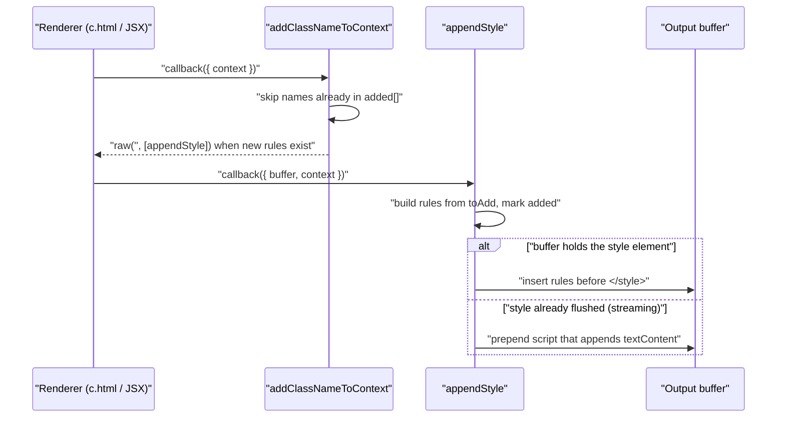

## Overview

Hono ships two small helpers for producing markup without a JSX build step. `hono/html` exports the `html` tagged template, which escapes interpolated values and can carry asynchronous content, and `raw`, which marks a string as already safe. `hono/css` exports `css`, `cx`, `keyframes`, `viewTransition` and the `Style` component, which generate hashed class names and inject the matching CSS rules into a `<style>` element while the page renders.

Sources: [src/helper/html/index.ts:1-57](repo://src/helper/html/index.ts#L1-L57), [src/helper/css/index.ts:225-262](repo://src/helper/css/index.ts#L225-L262)

Both helpers are built on the escaped-string model in `src/utils/html.ts`: a value is a `String` object flagged with `isEscaped: true` and an optional list of `callbacks` that run when the final document is assembled. That same model is used by [[JSX Server Rendering]], so `html` output, JSX elements and CSS class names can be mixed freely, and `c.html()` resolves the callbacks before it builds the response (see [[Context]]).

Sources: [src/utils/html.ts:6-46](repo://src/utils/html.ts#L6-L46), [src/context.ts:723-733](repo://src/context.ts#L723-L733)

## Escaped strings and callbacks

### The HtmlEscapedString model

`raw(value, callbacks?)` wraps any value in `new String(value)` and sets `isEscaped = true` and `callbacks` on it. Code that sees `isEscaped` copies the string verbatim instead of escaping it, which is why `raw` must only receive trusted markup.

Sources: [src/utils/html.ts:40-46](repo://src/utils/html.ts#L40-L46)

```ts
export const raw = (value: unknown, callbacks?: HtmlEscapedCallback[]): HtmlEscapedString => {
  const escapedString = new String(value) as HtmlEscapedString
  escapedString.isEscaped = true
  escapedString.callbacks = callbacks

  return escapedString
}
```

Sources: [src/utils/html.ts:40-46](repo://src/utils/html.ts#L40-L46)

A callback receives `{ phase, buffer, context }`. `phase` is one of `HtmlEscapedCallbackPhase.Stringify` (1), `BeforeStream` (2) or `Stream` (3); `buffer` is a one-element array holding the output so far, which a callback may rewrite in place; `context` is an object unique to one render, used as a `WeakMap` key. A callback may return a `Promise<string>` whose content is appended and whose own callbacks are resolved recursively.

Sources: [src/utils/html.ts:6-21](repo://src/utils/html.ts#L6-L21)

### Escaping

`escapeToBuffer` finds the first character matching `/[&<>'"]/`. If there is none it appends the string unchanged; otherwise it walks the rest of the string and replaces `"` with `&quot;`, `'` with `&#39;`, `&` with `&amp;`, `<` with `&lt;` and `>` with `&gt;`, appending to `buffer[0]`.

Sources: [src/utils/html.ts:51-127](repo://src/utils/html.ts#L51-L127)

### String buffers

When some parts are asynchronous, the output is kept as a `StringBuffer`: an odd-length array that alternates strings and promises and is read from the tail. `stringBufferToString` awaits every entry, walks the array backwards, collects each part's `callbacks`, and escapes any resolved part that is not flagged `isEscaped`. It returns `raw(str, callbacks)` so the callbacks survive to the final resolution step.

Sources: [src/utils/html.ts:23-38](repo://src/utils/html.ts#L23-L38), [src/utils/html.ts:53-88](repo://src/utils/html.ts#L53-L88)

`resolveCallback(str, phase, preserveCallbacks, context, buffer?)` is the step that runs the callbacks: it first turns an escaped-string object or promise into its string, appends it to the buffer, calls every callback with the same `phase`, `buffer` and `context`, and recursively resolves any strings they return. With `preserveCallbacks` it returns `raw(result, callbacks)`; otherwise the plain string. `resolveCallbackSync` is the synchronous variant, always using phase `Stringify` and a fresh `context`.

Sources: [src/utils/html.ts:129-182](repo://src/utils/html.ts#L129-L182)

## The html tagged template

### How values are interpolated

`html` starts with a buffer `['']` and, for each literal chunk, appends the chunk and then processes the following value. Arrays are flattened with `flat(Infinity)` so lists of fragments render in order. Each child is handled by type.

Sources: [src/helper/html/index.ts:17-23](repo://src/helper/html/index.ts#L17-L23)

| Child | Treatment |
| --- | --- |
| `string` | escaped with `escapeToBuffer` |
| `number` | appended as is |
| `boolean`, `null`, `undefined` | skipped, so `${cond && html'...'}` works |
| escaped object with `callbacks` | inserted as a new buffer slot, keeping its callbacks |
| escaped object without callbacks | `toString()` appended, or a new slot if it returns a `Promise` |
| `Promise` | inserted as a new buffer slot |
| anything else | `toString()` then escaped |

Sources: [src/helper/html/index.ts:11-49](repo://src/helper/html/index.ts#L11-L49)

New slots are added with `buffer.unshift('', child)`, which is why the buffer is read from the tail. After the last literal, `html` returns synchronously when the buffer has a single string: `raw(buffer[0])`, or the callback-resolved string if callbacks were attached. Otherwise it returns `stringBufferToString(buffer, buffer.callbacks)`, a `Promise<HtmlEscapedString>`.

Sources: [src/helper/html/index.ts:50-56](repo://src/helper/html/index.ts#L50-L56)

### Rendering with c.html

```ts
import { Hono } from 'hono'
import { html, raw } from 'hono/html'

const app = new Hono()

app.get('/:name', (c) => {
  const { name } = c.req.param()
  return c.html(
    html`<!doctype html>
      <h1>Hello! ${name}!</h1>
      ${raw('<p>trusted markup</p>')}`
  )
})
```

Sources: [src/helper/html/index.ts:9-57](repo://src/helper/html/index.ts#L9-L57), [src/context.ts:723-733](repo://src/context.ts#L723-L733)

`c.html()` accepts the string or the promise: when it receives an object it calls `resolveCallback(html, HtmlEscapedCallbackPhase.Stringify, false, {})` before creating a `text/html; charset=UTF-8` response, so async parts and CSS callbacks are resolved first.

Sources: [src/context.ts:723-733](repo://src/context.ts#L723-L733)

> [!WARNING]
> `raw()` disables escaping entirely. Pass it only markup you produced yourself, never request data.

Sources: [src/utils/html.ts:40-46](repo://src/utils/html.ts#L40-L46)

## CSS helper API

### Exports

The module-level exports all come from one default context created with `createCssContext({ id: DEFAULT_STYLE_ID })`, where `DEFAULT_STYLE_ID` is `'hono-css'`. Every export is marked experimental.

Sources: [src/helper/css/index.ts:217-262](repo://src/helper/css/index.ts#L217-L262), [src/helper/css/common.ts:2-4](repo://src/helper/css/common.ts#L2-L4)

| Export | Signature | Returns |
| --- | --- | --- |
| `css` | tagged template with `CssVariableType` values | `Promise<string>` class name |
| `cx` | class names, `css` results, strings or falsy values as arguments | `Promise<string>` combined class name |
| `keyframes` | tagged template | `CssClassName` whose name is `@keyframes <name>` |
| `viewTransition` | tagged template, an existing class, or no argument | `Promise<string>` class name |
| `Style` | `({ children?, nonce? })` | `<style id="...">` element |
| `rawCssString` | `(value: string)` | value inserted into CSS without escaping |
| `createCssContext` | `({ id, classNameSlug?, onInvalidSlug? })` | a new set of `css`, `cx`, `keyframes`, `viewTransition`, `Style` |

Sources: [src/helper/css/index.ts:29-61](repo://src/helper/css/index.ts#L29-L61), [src/helper/css/common.ts:27-36](repo://src/helper/css/common.ts#L27-L36)

### Styling a page

```tsx
import { css, cx, keyframes, Style } from 'hono/css'

const spin = keyframes`
  from { transform: rotate(0deg); }
  to { transform: rotate(360deg); }
`

const base = css`
  /* button */
  padding: 0.5rem;
  &:hover { color: red; }
`

const spinning = css`
  ${base}
  animation: ${spin} 1s linear infinite;
`

app.get('/', (c) =>
  c.html(
    <html>
      <head>
        <Style />
      </head>
      <body>
        <button class={cx(spinning, 'external-class')}>Go</button>
      </body>
    </html>
  )
)
```

Sources: [src/helper/css/index.ts:169-215](repo://src/helper/css/index.ts#L169-L215), [src/helper/css/common.ts:139-199](repo://src/helper/css/common.ts#L139-L199)

`Style` must be rendered somewhere in the document, normally in `<head>`, because the rules are injected into the element with the context's `id`. Passing `children` (a `css` result) writes that style string directly as global CSS, and `nonce` is added to the `<style>` tag and to any fallback `<script>` described below.

Sources: [src/helper/css/index.ts:192-206](repo://src/helper/css/index.ts#L192-L206)

## Class name generation

### Building the style string

`buildStyleString(strings, values)` concatenates the template. A leading comment such as `/* button */` becomes the label. Each interpolated value is processed by kind.

Sources: [src/helper/css/common.ts:139-148](repo://src/helper/css/common.ts#L139-L148)

| Value | Result |
| --- | --- |
| `boolean`, `null`, `undefined` | skipped |
| `string` | inserted, with `\`, `"`, `'` and a `/` after `<` backslash-escaped |
| `number` | inserted as is |
| `rawCssString(...)` | inserted verbatim |
| `keyframes` result | its name is inserted and the keyframes rule is recorded as a dependency selector |
| class followed by `{` | inserted as `.className` selector, recorded as a dependency |
| other class | its style string is inlined (with a `;` added if missing), its selectors and external class names carried over |

Sources: [src/helper/css/common.ts:139-199](repo://src/helper/css/common.ts#L139-L199)

The concatenated string is passed through `minify`, a single regular expression that keeps quoted strings and removes leading and trailing whitespace, comments, trailing semicolons before `}`, whitespace around `{ } ; : ,`, and runs of spaces.

Sources: [src/helper/css/common.ts:79-106](repo://src/helper/css/common.ts#L79-L106)

### Hashing and slugs

`cssCommon` hashes `label + styleString` with a goober-derived function that yields `css-<number>`, so identical styles always share one class name. If the minified string is wrapped as `:-hono-global{...}` it is treated as global CSS: the selector is prefixed with `PSEUDO_GLOBAL_SELECTOR` and the class name is built from the dependency selectors instead.

Sources: [src/helper/css/common.ts:38-50](repo://src/helper/css/common.ts#L38-L50), [src/helper/css/common.ts:201-238](repo://src/helper/css/common.ts#L201-L238)

```ts
const toHash = (str: string): string => {
  let i = 0,
    out = 11
  while (i < str.length) {
    out = (101 * out + str.charCodeAt(i++)) >>> 0
  }
  return 'css-' + out
}
```

Sources: [src/helper/css/common.ts:43-50](repo://src/helper/css/common.ts#L43-L50)

A context created with `classNameSlug` can replace the hash. The function receives `(hash, label, styleString)`, where `label` is trimmed and has inner whitespace replaced by `-`. A returned slug must match `/^-?[_a-zA-Z][_a-zA-Z0-9-]*$/`; for `keyframes` it also must not be a CSS-wide keyword (`default`, `inherit`, `initial`, `none`, `revert`, `revert-layer`, `unset`). An invalid slug falls back to the hash and is reported to `onInvalidSlug`, which defaults to `console.warn('Invalid slug: ...')`.

Sources: [src/helper/css/common.ts:52-77](repo://src/helper/css/common.ts#L52-L77), [src/helper/css/common.ts:120-137](repo://src/helper/css/common.ts#L120-L137), [src/helper/css/common.ts:260-288](repo://src/helper/css/common.ts#L260-L288)

| Option | Type | Default | Description |
| --- | --- | --- | --- |
| `id` | `string` | required | `id` of the `<style>` element the context writes to |
| `classNameSlug` | `(hash, label, styleString) => string` | none | custom class name; falsy return keeps the hash |
| `onInvalidSlug` | `(slug) => void` | `console.warn` | called when the slug is not a safe identifier |

Sources: [src/helper/css/index.ts:63-80](repo://src/helper/css/index.ts#L63-L80)

### cx, keyframes and viewTransition

`cx` turns every plain string argument into an empty class object whose only content is the string as an external class name, then calls `css` with an all-empty template, so the result is a new class that composes the given classes and appends the external names. Strings containing `<`, `{` or `}` are dropped because they could break out of the style element when used as a selector.

Sources: [src/helper/css/index.ts:173-178](repo://src/helper/css/index.ts#L173-L178), [src/helper/css/common.ts:58-60](repo://src/helper/css/common.ts#L58-L60), [src/helper/css/common.ts:240-258](repo://src/helper/css/common.ts#L240-L258)

`keyframes` returns a plain object (not a promise) whose class name is `@keyframes <hash or slug>`; when interpolated in a `css` template the name is inserted and the rule is emitted alongside the class. `viewTransition` builds a class whose style is `view-transition-name:<name>`; with no argument it creates a unique name from a counter comment `/* h-v-t N */`. Any `::view-transition-*()` pseudo-element with empty parentheses in the content gets the transition name filled in.

Sources: [src/helper/css/common.ts:260-333](repo://src/helper/css/common.ts#L260-L333), [src/helper/css/index.ts:180-190](repo://src/helper/css/index.ts#L180-L190)

## Style injection

### Server rendering flow

`newCssClassNameObject` wraps a computed class into a `String` flagged `isEscaped`, HTML-escaping the class name first if an external name contains `&<>'"`. It attaches one callback, `addClassNameToContext`, and returns a resolved promise carrying the same symbol properties. Its `toString` is replaced with the client-side implementation so the same object also works under `hono/jsx/dom`.

Sources: [src/helper/css/index.ts:88-167](repo://src/helper/css/index.ts#L88-L167)



Sources: [src/helper/css/index.ts:88-147](repo://src/helper/css/index.ts#L88-L147), [src/utils/html.ts:142-182](repo://src/utils/html.ts#L142-L182)

Per render `context`, a `WeakMap` stores two records: rules still to add and rules already added. `addClassNameToContext` registers the class's own selector and every dependency selector that is not yet added; if everything is already present it returns nothing, so each rule is emitted once per document.

Sources: [src/helper/css/index.ts:83-86](repo://src/helper/css/index.ts#L83-L86), [src/helper/css/index.ts:124-147](repo://src/helper/css/index.ts#L124-L147)

`appendStyle` turns the pending entries into rule text: global entries are written verbatim, `@keyframes` entries as `@keyframes name{...}`, and classes as `.name{...}`. If the buffer still contains `<style id="<id>">...</style>`, the rules are spliced in before `</style>`. When the style element has already been sent, as happens with streamed rendering, it emits a `<script>` that runs `document.querySelector('#<id>').textContent+=...`, using the nonce that `Style` recorded for that context.

Sources: [src/helper/css/index.ts:89-122](repo://src/helper/css/index.ts#L89-L122), [src/helper/css/index.ts:192-203](repo://src/helper/css/index.ts#L192-L203)

### Client rendering

In the browser the class object's `toString` comes from `createCssJsxDomObjects`. Converting it to a string calls `insertRule` for the selector and every dependency, which finds the style sheet for the context's `id` and calls `sheet.insertRule` once per class name. If the sheet is not in the DOM yet it retries on the next microtask and throws `style sheet not found` if it is still missing. See [[Client Components and Hooks]] for the DOM renderer.

Sources: [src/jsx/dom/css.ts:92-125](repo://src/jsx/dom/css.ts#L92-L125), [src/helper/css/index.ts:165-166](repo://src/helper/css/index.ts#L165-L166)

> [!NOTE]
> Use a separate `createCssContext` with a different `id` when two independent style sheets must coexist on one page, or when you need custom class names through `classNameSlug`.

Sources: [src/helper/css/index.ts:72-86](repo://src/helper/css/index.ts#L72-L86)
