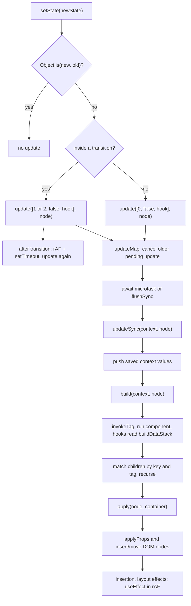

## Overview

`hono/jsx/dom` is a small client-side renderer that runs the same JSX components as [[JSX Server Rendering]] in the browser, with a React-compatible hook API. It keeps a tree of plain node objects, re-runs a component when its state changes, diffs the new children against the old ones, and patches the real DOM. Because it shares `hono/jsx`'s hooks and component contracts, a component that uses `useState` renders its initial state on the server and becomes interactive once the client bundle mounts it.

Sources: [src/jsx/dom/index.ts:1-58](repo://src/jsx/dom/index.ts#L1-L58), [src/jsx/dom/render.ts:41-104](repo://src/jsx/dom/render.ts#L41-L104), [src/jsx/hooks/index.ts:182-191](repo://src/jsx/hooks/index.ts#L182-L191)

The hooks live in `src/jsx/hooks/index.ts` and are re-exported by both `hono/jsx` and `hono/jsx/dom`. Each hook reads the component being built from `buildDataStack`; when that stack is empty, as during server rendering, the hook returns a static value instead of storing state.

Sources: [src/jsx/index.ts:11-33](repo://src/jsx/index.ts#L11-L33), [src/jsx/dom/index.ts:11-35](repo://src/jsx/dom/index.ts#L11-L35), [src/jsx/dom/render.ts:106-106](repo://src/jsx/dom/render.ts#L106-L106)

## Setup and Entry Points

Point the JSX compiler at the DOM runtime for client code. Its `jsxDEV` returns a plain `{ tag, type, props, key, ref }` object (no string rendering) and swaps the special intrinsic tags (`title`, `meta`, `link`, `script`, `style`, `form`, `input`, `button`) for their DOM components.

Sources: [src/jsx/dom/jsx-dev-runtime.ts:1-23](repo://src/jsx/dom/jsx-dev-runtime.ts#L1-L23), [src/jsx/dom/jsx-runtime.ts:1-8](repo://src/jsx/dom/jsx-runtime.ts#L1-L8)

```json
{
  "compilerOptions": {
    "jsx": "react-jsx",
    "jsxImportSource": "hono/jsx/dom"
  }
}
```

Sources: [package.json:179-193](repo://package.json#L179-L193)

| Import path | Provides |
| --- | --- |
| `hono/jsx/dom` | `render`, hooks, `createContext`, `useContext`, `memo`, `ErrorBoundary`, `Suspense`, `createPortal`, `flushSync`, `createElement`, `cloneElement`, `Children`, `Fragment`, `useFormStatus`, `useActionState`, `useOptimistic` |
| `hono/jsx/dom/client` | `createRoot`, `hydrateRoot` (shaped like `react-dom/client`) |
| `hono/jsx/dom/css` | `css`, `cx`, `keyframes`, `viewTransition`, `Style`, `createCssContext` for the browser |
| `hono/jsx/dom/server` | `renderToString`, `renderToReadableStream` (server side) |

Sources: [src/jsx/dom/index.ts:85-125](repo://src/jsx/dom/index.ts#L85-L125), [package.json:179-208](repo://package.json#L179-L208)

## Mounting

### render

`render(jsxNode, container)` wraps the element in a fragment node and calls `renderNode`. `renderNode` builds the whole tree with a fresh render context (top-level flag set, empty error-handler stack), applies it into a detached `DocumentFragment`, re-points every node's container from the fragment to the real container, and finally calls `container.replaceChildren(fragment)`.

Sources: [src/jsx/dom/render.ts:783-799](repo://src/jsx/dom/render.ts#L783-L799), [src/jsx/dom/render.ts:706-711](repo://src/jsx/dom/render.ts#L706-L711)

```tsx
import { render, useState } from 'hono/jsx/dom'

const Counter = () => {
  const [count, setCount] = useState(0)
  return <button onClick={() => setCount(count + 1)}>{count}</button>
}

render(<Counter />, document.getElementById('root')!)
```

Sources: [src/jsx/dom/render.ts:796-799](repo://src/jsx/dom/render.ts#L796-L799), [src/jsx/hooks/index.ts:182-243](repo://src/jsx/hooks/index.ts#L182-L243)

### createRoot and hydrateRoot

`createRoot(element)` returns a `Root` with `render` and `unmount`. The first `render` mounts an internal component that keeps the element in `useState`; later `render` calls just set that state, so updates go through the normal diff. `unmount()` sets the state to `null` and marks the root so a later `render` throws `Cannot update an unmounted root`. Options are not supported and only log a warning.

Sources: [src/jsx/dom/client.ts:11-66](repo://src/jsx/dom/client.ts#L11-L66)

`hydrateRoot(element, node)` is `createRoot` followed by `render`. There is no hydration of existing markup: the server-rendered children of `element` are replaced by freshly created DOM nodes.

Sources: [src/jsx/dom/client.ts:68-84](repo://src/jsx/dom/client.ts#L68-L84), [src/jsx/dom/render.ts:790-793](repo://src/jsx/dom/render.ts#L790-L793)

## Render Pipeline

### Node Objects

The renderer stores state on the JSX objects themselves, using short field names to keep the bundle small. Text children become `NodeString` objects (`t` text, `d` dirty); everything else is a `NodeObject`.

Sources: [src/jsx/dom/render.ts:41-80](repo://src/jsx/dom/render.ts#L41-L80)

| Field | Meaning |
| --- | --- |
| `vC` | Current virtual children |
| `pC` | Previous children kept while an error fallback is shown |
| `vR` | Children to remove at the next apply |
| `pP` | Previous props, used to diff attributes |
| `nN` | Next sibling node, used to find the DOM insertion point |
| `e` | The rendered DOM element or text node |
| `c` | The container element |
| `n` | XML namespace (SVG or MathML) |
| `f` / `s` | Force a rebuild / skip build and apply for this node |
| `a` | Set when the node is unmounted, so a pending update is dropped |
| `DOM_STASH` | `[hookIndex, hookStorage, contexts, closestErrorHandler]` for function components |

Sources: [src/jsx/dom/render.ts:41-65](repo://src/jsx/dom/render.ts#L41-L65)

The render `Context` is a tuple: pending type (`0` none, `1` low-priority transition, `2` `useTransition`), an error flag, an optional update hook (used by view transitions and `useDeferredValue`), a view-transition flag, a top-level-render flag, and the stack of active error handlers.

Sources: [src/jsx/dom/render.ts:82-104](repo://src/jsx/dom/render.ts#L82-L104)

### From setState to the DOM



Sources: [src/jsx/hooks/index.ts:197-243](repo://src/jsx/hooks/index.ts#L197-L243), [src/jsx/dom/render.ts:713-781](repo://src/jsx/dom/render.ts#L713-L781), [src/jsx/dom/render.ts:274-291](repo://src/jsx/dom/render.ts#L274-L291), [src/jsx/dom/render.ts:387-481](repo://src/jsx/dom/render.ts#L387-L481)

### update and updateSync

`update(context, node)` batches re-renders per component. It stores a runner for `node` in `updateMap`, resolving any earlier pending promise for the same node with `undefined` so only the last call renders. Outside `flushSync` it awaits one microtask and then runs the latest runner; inside `flushSync` the node is added to the current set and rendered when the callback returns. When the context carries an update hook, the runner hands `updateSync` to that hook instead of calling it directly.

Sources: [src/jsx/dom/render.ts:734-781](repo://src/jsx/dom/render.ts#L734-L781), [src/jsx/dom/render.ts:801-813](repo://src/jsx/dom/render.ts#L801-L813)

`updateSync` re-establishes the context values captured when the node was first built (pushing them onto each context's value stack), calls `build`, and returns early if the build threw or the node was unmounted meanwhile (`a`). It then pops the values and calls `apply`, except during a low-priority render that hit an error, so a transition never replaces the visible UI with a fallback.

Sources: [src/jsx/dom/render.ts:713-732](repo://src/jsx/dom/render.ts#L713-L732)

### build

`build(context, node, children?)` produces the new child list. For a function node, `invokeTag` resets the hook index, pushes `[context, node]` onto `buildDataStack`, merges `defaultProps`, and calls the component (or its `DOM_RENDERER` replacement); for an element, the children come from `props.children`. Nested arrays are flattened and each child is turned into a node by `buildNode`.

Sources: [src/jsx/dom/render.ts:274-291](repo://src/jsx/dom/render.ts#L274-L291), [src/jsx/dom/render.ts:497-526](repo://src/jsx/dom/render.ts#L497-L526), [src/jsx/dom/render.ts:667-704](repo://src/jsx/dom/render.ts#L667-L704)

Each new child is matched to an old child: a text node to the first old text node, a keyed node to the old node with the same `key` and `tag`, otherwise to the first old node with the same `tag`. A matched node keeps its DOM element and hook state and receives the new props, with the old ones kept in `pP`. A function component is marked to skip (`s`) when it is not forced and either its `memo` comparator says the props are equal or the JSX object is identical to the one it was created from (the pattern the React compiler emits), and its captured context values are unchanged. Unmatched old children go to `vR` for removal, and `nN` links are updated so `apply` knows where to insert.

Sources: [src/jsx/dom/render.ts:527-609](repo://src/jsx/dom/render.ts#L527-L609), [src/jsx/dom/render.ts:483-491](repo://src/jsx/dom/render.ts#L483-L491)

### apply

`applyNodeObject` flattens function and fragment children into a list of real DOM-producing nodes (`getNextChildren`), collects effect data on the way, and removes nodes in `vR` (running effect cleanups and ref cleanups). It then walks the list: dirty text nodes get new `textContent`, new elements are created (with `createElementNS` inside SVG or MathML), props are applied, children are applied recursively, and each element is appended, inserted before its successor or swapped into place. Nodes marked to skip reuse their element untouched.

Sources: [src/jsx/dom/render.ts:293-362](repo://src/jsx/dom/render.ts#L293-L362), [src/jsx/dom/render.ts:387-461](repo://src/jsx/dom/render.ts#L387-L461)

After the DOM is updated, collected effects run in React's order: `useInsertionEffect` callbacks immediately, then all `useLayoutEffect` callbacks, then `useEffect` callbacks in a `requestAnimationFrame`.

Sources: [src/jsx/dom/render.ts:462-480](repo://src/jsx/dom/render.ts#L462-L480)

### Props, Events and Refs

`applyProps` diffs new props against `pP`. Keys go through the same name normalization as the server (`className` to `class`, `htmlFor` to `for`).

Sources: [src/jsx/dom/render.ts:164-272](repo://src/jsx/dom/render.ts#L164-L272)

| Prop | DOM behavior |
| --- | --- |
| `onClick`, `onInput`, ... | `addEventListener` with the lowercased name; a `Capture` suffix listens in the capture phase; `onChange` maps to `input` and `onDoubleClick` to `dblclick`; a non-function value throws |
| `ref` | A function ref is called with the element and may return a cleanup (otherwise it is called with `null` on removal); an object ref gets `current` set and cleared |
| `style` | A string sets `cssText`; an object resets `cssText` and calls `setProperty` per entry |
| `dangerouslySetInnerHTML` | Sets `innerHTML` from `__html` |
| `value` | Set as a property on `input` and `textarea` (also `textContent` for `textarea`); on `select` it is applied after the options are rendered |
| `checked`, `selected` | Set as properties on `input` and `option` |
| other | `null`, `undefined` and `false` remove the attribute, `true` sets it to empty, anything else is stringified; invalid attribute names are ignored |

Sources: [src/jsx/dom/render.ts:115-162](repo://src/jsx/dom/render.ts#L115-L162), [src/jsx/dom/render.ts:170-249](repo://src/jsx/dom/render.ts#L170-L249)

### Error Boundaries, Suspense and Portals

On the client, `ErrorBoundary` and `Suspense` return a fragment tagged with a `DOM_ERROR_HANDLER`. When `build` sees such a fragment it pushes the handler onto the context's error stack, and every function component built below it records the closest handler. When a component throws, `build` calls that handler with the error and a `retry` function; a returned fallback is built into the boundary node and applied immediately. `ErrorBoundary` rethrows promises and returns `fallbackRender(error)` or `fallback`; `Suspense` rethrows real errors, returns `fallback` for a thrown promise and calls `retry` when the promise settles.

Sources: [src/jsx/dom/components.ts:7-38](repo://src/jsx/dom/components.ts#L7-L38), [src/jsx/dom/render.ts:503-512](repo://src/jsx/dom/render.ts#L503-L512), [src/jsx/dom/render.ts:610-664](repo://src/jsx/dom/render.ts#L610-L664)

`createPortal(children, container, key?)` returns a node with the internal tag `_hp` whose element is `container`; its children are rendered into that container while staying in the component tree for state and context. The node is preserved on unmount so the container itself is never removed.

Sources: [src/jsx/dom/render.ts:815-825](repo://src/jsx/dom/render.ts#L815-L825), [src/jsx/dom/render.ts:334-339](repo://src/jsx/dom/render.ts#L334-L339)

## Hooks

### Hooks Outside the Client Renderer

Every hook checks `buildDataStack.at(-1)` first. On the server the stack is empty (except inside `Suspense`, which pushes a stub node so `use()` can work), so the hooks fall back to values that let the same component render once to HTML.

Sources: [src/jsx/hooks/index.ts:182-191](repo://src/jsx/hooks/index.ts#L182-L191), [src/jsx/streaming.ts:54-65](repo://src/jsx/streaming.ts#L54-L65)

| Hook | Without a client render |
| --- | --- |
| `useState` | Returns the initial state and a no-op setter |
| `useEffect`, `useLayoutEffect`, `useInsertionEffect` | Do nothing |
| `useCallback` | Returns the callback |
| `useMemo` | Calls the factory |
| `useRef` | Returns a new `{ current }` object |
| `useTransition`, `useViewTransition` | Return `[false, () => {}]` |
| `useSyncExternalStore` | Returns `getServerSnapshot()`; throws `getServerSnapshot is required for server side rendering` without it |

Sources: [src/jsx/hooks/index.ts:89-99](repo://src/jsx/hooks/index.ts#L89-L99), [src/jsx/hooks/index.ts:126-131](repo://src/jsx/hooks/index.ts#L126-L131), [src/jsx/hooks/index.ts:260-330](repo://src/jsx/hooks/index.ts#L260-L330), [src/jsx/hooks/index.ts:348-352](repo://src/jsx/hooks/index.ts#L348-L352), [src/jsx/hooks/index.ts:397-409](repo://src/jsx/hooks/index.ts#L397-L409)

### useState and useReducer

Hook state is stored on the node in `DOM_STASH[1]`, one array per hook kind (state, effect, callback, memo, ref) indexed by the call order, which is why hooks must be called in the same order on every render. `useState(initial)` accepts a value or a lazy initializer. Its setter accepts a value or an updater function, ignores values that are `Object.is`-equal to the current one, writes the new value immediately, and schedules `update` for the node. `useReducer(reducer, initialArg, init?)` is built on `useState` with a memoized dispatcher.

Sources: [src/jsx/hooks/index.ts:8-12](repo://src/jsx/hooks/index.ts#L8-L12), [src/jsx/hooks/index.ts:178-258](repo://src/jsx/hooks/index.ts#L178-L258)

### Effects

`useEffect`, `useLayoutEffect` and `useInsertionEffect` share `useEffectCommon`. When the dependencies changed (or none were given), it runs the previous cleanup and stores a runner in the slot of the effect kind; `apply` later invokes the runner, which records the returned cleanup. Removing the node calls the cleanup. `useImperativeHandle(ref, createHandle, deps)` is a `useEffect` that assigns `ref.current` and clears it on cleanup.

Sources: [src/jsx/hooks/index.ts:14-34](repo://src/jsx/hooks/index.ts#L14-L34), [src/jsx/hooks/index.ts:260-297](repo://src/jsx/hooks/index.ts#L260-L297), [src/jsx/hooks/index.ts:384-395](repo://src/jsx/hooks/index.ts#L384-L395), [src/jsx/dom/render.ts:341-344](repo://src/jsx/dom/render.ts#L341-L344)

### Memoization and Refs

`useMemo(factory, deps)` and `useCallback(callback, deps)` keep the previous value until a dependency changes by identity. `useRef(initial)` returns the same object for the life of the component. `useId()` returns a stable `:r<n>:` id (base-32 counter) via `useMemo`. `createRef()` returns `{ current: null }`, `forwardRef` passes the `ref` prop as a second argument, and `useDebugValue` is a no-op. `memo(component, propsAreEqual?)` from `hono/jsx/dom` attaches the comparator that `build` uses to skip a re-render.

Sources: [src/jsx/hooks/index.ts:299-382](repo://src/jsx/hooks/index.ts#L299-L382), [src/jsx/dom/index.ts:76-83](repo://src/jsx/dom/index.ts#L76-L83)

### Transitions and Deferred Values

`startTransition(callback)` and the function returned by `useTransition()` run the callback with a pending entry on `pendingStack`. A `setState` inside it calls `update` with pending type `1` (or `2` for `useTransition`), and once the callback's promise settles a follow-up update is queued with `requestAnimationFrame` and `setTimeout`, skipped if the node re-rendered in between. `useTransition` returns `isPending` as `true` while the render runs with pending type `2`; an error from an async transition callback is rethrown on the next render so an `ErrorBoundary` can catch it.

Sources: [src/jsx/hooks/index.ts:101-155](repo://src/jsx/hooks/index.ts#L101-L155), [src/jsx/hooks/index.ts:206-239](repo://src/jsx/hooks/index.ts#L206-L239)

`useDeferredValue(value, initialValue?)` returns the previous value while it schedules a state change with pending type `3`; the re-render that shows the new value is queued after a frame at low priority. `startViewTransition(callback)` makes state updates inside the callback render inside `document.startViewTransition` (or directly when the browser lacks it), and `useViewTransition()` returns `[isUpdating, startViewTransition]`, rendering a second time after the transition finishes when it was read.

Sources: [src/jsx/hooks/index.ts:157-176](repo://src/jsx/hooks/index.ts#L157-L176), [src/jsx/hooks/index.ts:36-99](repo://src/jsx/hooks/index.ts#L36-L99)

### useSyncExternalStore and use

`useSyncExternalStore(subscribe, getSnapshot, getServerSnapshot?)` stores the snapshot in state and subscribes in a `useEffect`, setting state from `getSnapshot()` on each notification. During the first top-level render it starts from `getServerSnapshot()` when given, so the first client render matches the server HTML, and switches to `getSnapshot()` in the effect.

Sources: [src/jsx/hooks/index.ts:397-425](repo://src/jsx/hooks/index.ts#L397-L425)

`use(promise)` throws the promise until it settles, caching the result per promise in a `WeakMap`; a rejected promise is rethrown as its error. The nearest `Suspense` shows its fallback meanwhile.

Sources: [src/jsx/hooks/index.ts:332-346](repo://src/jsx/hooks/index.ts#L332-L346)

## Context on the Client

The DOM `createContext(defaultValue)` returns a provider function that renders a fragment of three parts: an internal tag that pushes `value` onto `context.values`, the children, and an internal tag that pops it. The fragment also carries an error handler that pops the value when a child throws. `useContext` reads the top of `values`. Because a re-render can start in the middle of the tree, `build` snapshots every context's current value onto each function component (`DOM_STASH[2]`), and `updateSync` pushes those values back before rebuilding the component.

Sources: [src/jsx/dom/context.ts:7-52](repo://src/jsx/dom/context.ts#L7-L52), [src/jsx/dom/render.ts:528-539](repo://src/jsx/dom/render.ts#L528-L539), [src/jsx/dom/render.ts:713-728](repo://src/jsx/dom/render.ts#L713-L728)

## Form Actions

### form, button and input

Passing a function as a `<form action>` makes the DOM `form` component listen for `submit`, call `preventDefault()`, build a `FormData` from the form and call the action with it. While an async action runs, the form is wrapped in a `FormContext` provider whose value reports the pending submission. A `button` or `input` with a function `formAction` dispatches a synthetic `submit` event carrying its own action, which the form runs instead of its `action`.

Sources: [src/jsx/dom/intrinsic-element/components.ts:318-427](repo://src/jsx/dom/intrinsic-element/components.ts#L318-L427)

### useFormStatus, useActionState and useOptimistic

| Hook | Signature | Behavior |
| --- | --- | --- |
| `useFormStatus` | `() => FormStatus` | Inside a form: `pending`, `data` (the `FormData`), `method` (`'post'`) and `action` while a submission is in flight; `pending: false` and `null` fields otherwise |
| `useActionState` | `(fn, initialState, permalink?) => [state, action]` | `action(formData)` sets state to `await fn(state, formData)`; `permalink` becomes the server-rendered `action` URL |
| `useOptimistic` | `(state, updateState) => [optimisticState, addOptimistic]` | `addOptimistic(x)` applies `updateState(current, x)` at once; the value returns to `state` when every registered action promise has settled |

Sources: [src/jsx/dom/hooks/index.ts:11-91](repo://src/jsx/dom/hooks/index.ts#L11-L91), [src/jsx/intrinsic-element/components.ts:182-192](repo://src/jsx/intrinsic-element/components.ts#L182-L192)

```tsx
import { useActionState, useFormStatus } from 'hono/jsx/dom'

const SubmitButton = () => {
  const { pending } = useFormStatus()
  return <button disabled={pending}>Save</button>
}

const NameForm = () => {
  const [message, action] = useActionState(async (_prev: string, data: FormData) => {
    await fetch('/api/name', { method: 'POST', body: data })
    return `Saved ${data.get('name')}`
  }, '')
  return (
    <form action={action}>
      <input name='name' />
      <SubmitButton />
      <p>{message}</p>
    </form>
  )
}
```

Sources: [src/jsx/dom/hooks/index.ts:37-91](repo://src/jsx/dom/hooks/index.ts#L37-L91), [src/jsx/dom/intrinsic-element/components.ts:319-386](repo://src/jsx/dom/intrinsic-element/components.ts#L319-L386)

## Document Metadata in the Browser

`title`, `meta`, hoistable `link`, `script` (with `src` and `async`) and `style` (with `href` and `precedence`) render through a portal into `document.head`. Before creating an element, `documentMetadataTag` looks for one already in `head` with the same de-dupe key (`src`, `href`, `data-href`, `name`, ...), so tags emitted by the server are reused instead of duplicated, and caches created elements per key. Elements with a `precedence` are inserted after the last element of the same precedence. With `blocking="render"`, the component calls `use()` on the element's load promise so rendering suspends until the stylesheet or script has loaded, and `onLoad`/`onError` are attached to the same promise.

Sources: [src/jsx/dom/intrinsic-element/components.ts:56-160](repo://src/jsx/dom/intrinsic-element/components.ts#L56-L160), [src/jsx/dom/intrinsic-element/components.ts:161-256](repo://src/jsx/dom/intrinsic-element/components.ts#L161-L256), [src/jsx/dom/intrinsic-element/components.ts:257-316](repo://src/jsx/dom/intrinsic-element/components.ts#L257-L316)

## Client CSS

`hono/jsx/dom/css` exposes the same `css`, `cx`, `keyframes`, `viewTransition` and `Style` API as the server-side CSS helper described in [[HTML and CSS Helpers]], but class names insert their rules into a live stylesheet. Render `<Style />` once to create `<style id="hono-css">`; when a class name produced by `css` is converted to a string (for example in a `class` prop), its rule and nested selectors are added with `insertRule`, once per class. If the stylesheet is not in the document yet, insertion is retried after a microtask and then throws `style sheet not found`.

Sources: [src/jsx/dom/css.ts:77-143](repo://src/jsx/dom/css.ts#L77-L143), [src/helper/css/common.ts:4-4](repo://src/helper/css/common.ts#L4-L4)

`createCssContext({ id, classNameSlug?, onInvalidSlug? })` creates an independent set of these functions bound to another style element id, with an optional function to customize generated class names.

Sources: [src/jsx/dom/css.ts:171-226](repo://src/jsx/dom/css.ts#L171-L226)

```tsx
import { css, Style } from 'hono/jsx/dom/css'

const App = () => (
  <>
    <Style />
    <h1 class={css`color: red; font-size: 2rem;`}>Hello</h1>
  </>
)
```

Sources: [src/jsx/dom/css.ts:228-263](repo://src/jsx/dom/css.ts#L228-L263)
