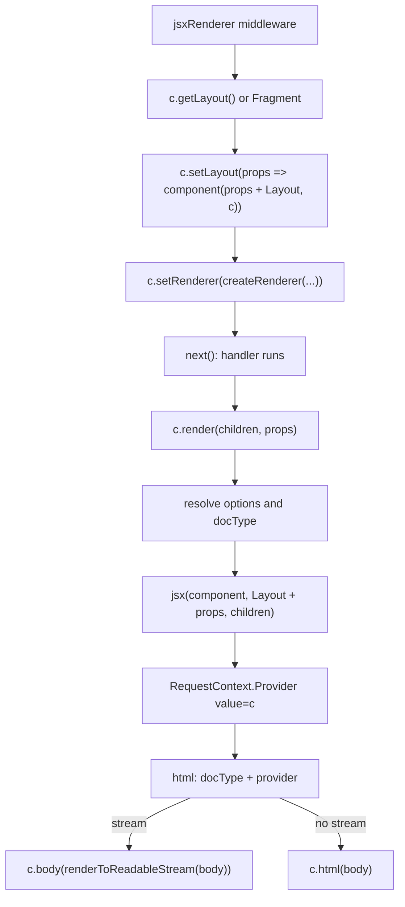

## Overview

The `jsxRenderer` middleware (imported from `hono/jsx-renderer`) lets an app declare its HTML layout once and have every handler render only the page content with `c.render(content, props)`. It plugs into two hooks that every `Context` has: `c.setRenderer`, which replaces the function behind `c.render`, and `c.setLayout`/`c.getLayout`, which let several `jsxRenderer` instances on nested routes wrap each other. It also provides the current `Context` to components through `useRequestContext`, so deep components can read the request without prop drilling.

Sources: [src/middleware/jsx-renderer/index.ts:1-31](repo://src/middleware/jsx-renderer/index.ts#L1-L31), [src/middleware/jsx-renderer/index.ts:116-129](repo://src/middleware/jsx-renderer/index.ts#L116-L129), [package.json:174-178](repo://package.json#L174-L178)

The rendering itself is done by `hono/jsx`; see [[JSX Server Rendering]] for how components become HTML and how `Suspense` streams. The `Context` methods used here are described in [[Context]].

Sources: [src/middleware/jsx-renderer/index.ts:7-13](repo://src/middleware/jsx-renderer/index.ts#L7-L13)

## Rendering Hooks on Context

### c.render and c.setRenderer

`c.render(...args)` calls the renderer stored in the private `#renderer` field. If no middleware has set one, it falls back to `(content) => this.html(content)`, so `c.render` works even without `jsxRenderer`. `c.setRenderer(renderer)` replaces that field for the rest of the request; any middleware can use it to wrap content in its own markup.

Sources: [src/context.ts:436-497](repo://src/context.ts#L436-L497)

```tsx
app.use('*', async (c, next) => {
  c.setRenderer((content) => {
    return c.html(
      <html>
        <body>
          <p>{content}</p>
        </body>
      </html>
    )
  })
  await next()
})
```

Sources: [src/context.ts:474-497](repo://src/context.ts#L474-L497)

### c.setLayout and c.getLayout

`c.setLayout(layout)` stores a layout function in `#layout` and returns it; `c.getLayout()` reads it back. `jsxRenderer` is the only built-in user of these: each instance reads the layout left by the outer instance and stores its own.

Sources: [src/context.ts:338-339](repo://src/context.ts#L338-L339), [src/context.ts:453-472](repo://src/context.ts#L453-L472)

### Typing the Props of c.render

The type of `c.render` comes from the `ContextRenderer` interface, which is empty by default; `Renderer` then resolves to `(content: string | Promise<string>) => Response | Promise<Response>`. Augment `ContextRenderer` to give `c.render` a second argument. `PropsForRenderer` extracts that second parameter's type, and `jsxRenderer` passes it to your layout component.

Sources: [src/context.ts:59-88](repo://src/context.ts#L59-L88)

```ts
declare module 'hono' {
  interface ContextRenderer {
    (content: string | Promise<string>, props: { title: string }): Response | Promise<Response>
  }
}
```

Sources: [src/context.ts:59-86](repo://src/context.ts#L59-L86), [src/index.ts:40-40](repo://src/index.ts#L40-L40)

## Using jsxRenderer

### Basic Layout

`jsxRenderer(component?, options?)` returns a middleware. The component receives `children` (what the handler passed to `c.render`), every prop from the second argument of `c.render`, a `Layout` component, and the `Context` as a second argument.

Sources: [src/middleware/jsx-renderer/index.ts:23-31](repo://src/middleware/jsx-renderer/index.ts#L23-L31), [src/middleware/jsx-renderer/index.ts:116-129](repo://src/middleware/jsx-renderer/index.ts#L116-L129)

```tsx
import { Hono } from 'hono'
import { jsxRenderer } from 'hono/jsx-renderer'

const app = new Hono()

app.use(
  '*',
  jsxRenderer(({ children, title }) => (
    <html>
      <head>
        <title>{title}</title>
      </head>
      <body>{children}</body>
    </html>
  ))
)

app.get('/about', (c) => c.render(<h1>About me!</h1>, { title: 'About' }))
```

Sources: [src/middleware/jsx-renderer/index.ts:82-129](repo://src/middleware/jsx-renderer/index.ts#L82-L129)

The response is `<!DOCTYPE html>` followed by the rendered layout, sent with `c.html()` as `text/html; charset=UTF-8`. Without a component, `c.render(content)` still adds the doctype and the request context provider, and renders `content` as is.

Sources: [src/middleware/jsx-renderer/index.ts:40-80](repo://src/middleware/jsx-renderer/index.ts#L40-L80), [src/context.ts:723-733](repo://src/context.ts#L723-L733)

### Options

`options` is either an object or a function `(c) => RendererOptions` evaluated when `c.render` is called, so it can depend on bindings or the request.

Sources: [src/middleware/jsx-renderer/index.ts:18-21](repo://src/middleware/jsx-renderer/index.ts#L18-L21), [src/middleware/jsx-renderer/index.ts:116-119](repo://src/middleware/jsx-renderer/index.ts#L116-L119)

| Option | Type | Default | Description |
| --- | --- | --- | --- |
| `docType` | `boolean \| string` | `true` | `true` or unset writes `<!DOCTYPE html>`; `false` writes nothing; a string is written verbatim, for example an XHTML doctype |
| `stream` | `boolean \| Record<string, string>` | `false` | `true` streams the response with default headers; an object streams it and sets exactly those headers instead |

Sources: [src/middleware/jsx-renderer/index.ts:41-48](repo://src/middleware/jsx-renderer/index.ts#L41-L48), [src/middleware/jsx-renderer/index.ts:66-79](repo://src/middleware/jsx-renderer/index.ts#L66-L79), [src/middleware/jsx-renderer/index.ts:87-91](repo://src/middleware/jsx-renderer/index.ts#L87-L91)

```tsx
app.use(
  '*',
  jsxRenderer<Env>(
    ({ children }) => (
      <html>
        <body>{children}</body>
      </html>
    ),
    (c) => ({ docType: true, stream: c.env?.HONO_STREAMING ?? true })
  )
)
```

Sources: [src/middleware/jsx-renderer/index.ts:116-120](repo://src/middleware/jsx-renderer/index.ts#L116-L120), [src/middleware/jsx-renderer/index.test.tsx:410-432](repo://src/middleware/jsx-renderer/index.test.tsx#L410-L432)

### Streaming

With `stream: true` the renderer sets `Transfer-Encoding: chunked`, `Content-Type: text/html; charset=UTF-8` and `Content-Encoding: Identity`, then returns `c.body(renderToReadableStream(body))`. Setting `Content-Encoding` makes the compress middleware leave the stream alone, since it skips responses that already have that header. Because the response is built with `c.body`, a status set earlier with `c.status(201)` is kept. Pair it with `Suspense` so slow parts of the page arrive after the shell.

Sources: [src/middleware/jsx-renderer/index.ts:66-76](repo://src/middleware/jsx-renderer/index.ts#L66-L76), [src/middleware/compress/index.ts:90-96](repo://src/middleware/compress/index.ts#L90-L96), [src/middleware/jsx-renderer/index.test.tsx:489-511](repo://src/middleware/jsx-renderer/index.test.tsx#L489-L511)

```tsx
import { Suspense } from 'hono/jsx/streaming'

app.get('/', (c) =>
  c.render(
    <Suspense fallback={<p>loading...</p>}>
      <SlowComponent />
    </Suspense>,
    { title: 'Streaming' }
  )
)
```

Sources: [src/jsx/streaming.ts:42-45](repo://src/jsx/streaming.ts#L42-L45), [src/middleware/jsx-renderer/index.ts:66-76](repo://src/middleware/jsx-renderer/index.ts#L66-L76)

## Render Flow

When a request passes through `jsxRenderer`, the middleware does three things before calling `next()`: it takes the outer layout from `c.getLayout()` (or `Fragment` when there is none), stores a new layout that calls this component with that outer `Layout`, and installs a renderer built by `createRenderer`.

Sources: [src/middleware/jsx-renderer/index.ts:120-129](repo://src/middleware/jsx-renderer/index.ts#L120-L129)



Sources: [src/middleware/jsx-renderer/index.ts:33-80](repo://src/middleware/jsx-renderer/index.ts#L33-L80), [src/middleware/jsx-renderer/index.ts:120-129](repo://src/middleware/jsx-renderer/index.ts#L120-L129)

Inside the renderer, `options` is resolved first (calling it with `c` when it is a function) and the doctype string is picked. The component is wrapped in a JSX element whose props are `Layout` plus the `c.render` props, with the handler's content as children. That element is placed inside `RequestContext.Provider` with `value: c`, and the doctype is prepended with `raw` inside the `html` template so it is not escaped.

Sources: [src/middleware/jsx-renderer/index.ts:40-64](repo://src/middleware/jsx-renderer/index.ts#L40-L64)

## Nested Layouts

Because each `jsxRenderer` reads the previous layout before writing its own, a sub-app mounted with `app.route()` can add its own frame inside the parent's. The inner component receives the outer layout as `Layout` and decides where to render it; any props it gives `Layout` become the outer component's props. The last `jsxRenderer` to run owns the renderer, so its `docType` and `stream` options apply.

Sources: [src/middleware/jsx-renderer/index.ts:120-128](repo://src/middleware/jsx-renderer/index.ts#L120-L128), [src/middleware/jsx-renderer/index.ts:49-58](repo://src/middleware/jsx-renderer/index.ts#L49-L58)

```tsx
const app = new Hono()
app.use(
  '*',
  jsxRenderer(({ children, title, Layout }) => (
    <Layout>
      <html>
        <head>{title}</head>
        <body>{children}</body>
      </html>
    </Layout>
  ))
)

const blog = new Hono()
blog.use(
  '*',
  jsxRenderer(({ children, Layout, title }) => (
    <Layout title={title}>
      <div class='nested'>{children}</div>
    </Layout>
  ))
)
blog.get('/', (c) => c.render(<h1>Post</h1>, { title: 'Nested' }))

app.route('/nested', blog)
```

Sources: [src/middleware/jsx-renderer/index.test.tsx:81-104](repo://src/middleware/jsx-renderer/index.test.tsx#L81-L104)

A request to `/nested` produces `<!DOCTYPE html><html><head>Nested</head><body><div class="nested"><h1>Post</h1></div></body></html>`. The outermost component also receives a `Layout`, which is `Fragment` there, so rendering `<Layout>` at the top level is harmless.

Sources: [src/middleware/jsx-renderer/index.test.tsx:120-125](repo://src/middleware/jsx-renderer/index.test.tsx#L120-L125), [src/middleware/jsx-renderer/index.ts:121-121](repo://src/middleware/jsx-renderer/index.ts#L121-L121)

> [!NOTE]
> An inner layout that never renders `<Layout>` replaces the outer frame entirely instead of nesting inside it.

Sources: [src/middleware/jsx-renderer/index.ts:122-126](repo://src/middleware/jsx-renderer/index.ts#L122-L126)

## useRequestContext

`RequestContext` is a JSX context created with `createContext(null)`. `useRequestContext()` reads it inside any component rendered through `c.render` and returns the `Context`, typed with the optional `E`, `P` and `I` generics. Called outside such a render it throws `RequestContext is not provided.`

Sources: [src/middleware/jsx-renderer/index.ts:15-16](repo://src/middleware/jsx-renderer/index.ts#L15-L16), [src/middleware/jsx-renderer/index.ts:131-165](repo://src/middleware/jsx-renderer/index.ts#L131-L165)

```tsx
import type { FC } from 'hono/jsx'
import { useRequestContext } from 'hono/jsx-renderer'

const RequestUrlBadge: FC = () => {
  const c = useRequestContext()
  return <b>{c.req.url}</b>
}

app.get('/page/info', (c) =>
  c.render(
    <div>
      You are accessing: <RequestUrlBadge />
    </div>
  )
)
```

Sources: [src/middleware/jsx-renderer/index.ts:139-165](repo://src/middleware/jsx-renderer/index.ts#L139-L165)

The value travels through the per-render context store of `hono/jsx`, so concurrent requests each see their own `Context`. On runtimes without `AsyncLocalStorage`, calling `useRequestContext()` after an `await` in an async component finds no provider and throws; call it before the first `await`.

Sources: [src/jsx/context.ts:149-189](repo://src/jsx/context.ts#L149-L189), [src/jsx/context.ts:100-108](repo://src/jsx/context.ts#L100-L108)
