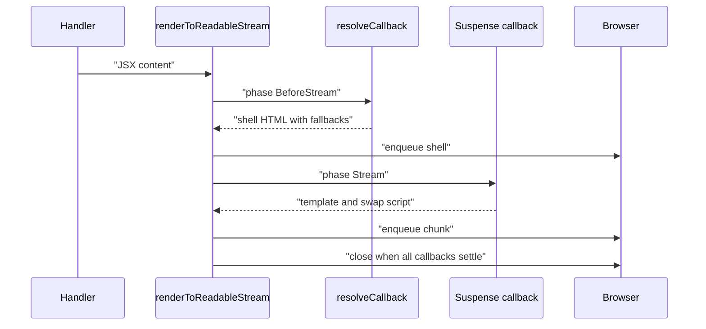

## Overview

`hono/jsx` is Hono's own JSX implementation for producing HTML on the server. It does not build a virtual DOM: every JSX expression becomes a `JSXNode` whose `toString()` writes escaped HTML straight into a string buffer, and the result is an `HtmlEscapedString` that `c.html()` can send without escaping it again. Async components, `Suspense`, `ErrorBoundary` and document metadata hoisting are layered on the same string pipeline through callbacks attached to the escaped string.

Sources: [src/jsx/base.ts:140-177](repo://src/jsx/base.ts#L140-L177), [src/utils/html.ts:6-46](repo://src/utils/html.ts#L6-L46)

The same components can also run in the browser through `hono/jsx/dom` ([[Client Components and Hooks]]): `createContext`, `ErrorBoundary`, `Suspense`, `memo` and the hoisted intrinsic elements each carry a `DOM_RENDERER` symbol pointing at their client implementation. For page layouts per request, see [[JSX Renderer Middleware]]; for the `html` tagged template and `css` helper built on the same escaped-string type, see [[HTML and CSS Helpers]].

Sources: [src/jsx/base.ts:318-327](repo://src/jsx/base.ts#L318-L327), [src/jsx/context.ts:243-250](repo://src/jsx/context.ts#L243-L250), [src/jsx/components.ts:262-262](repo://src/jsx/components.ts#L262-L262), [src/jsx/streaming.ts:138-138](repo://src/jsx/streaming.ts#L138-L138)

## Entry Points

| Import path | Source | What it provides |
| --- | --- | --- |
| `hono/jsx` | `src/jsx/index.ts` | `jsx`/`createElement`, `Fragment`, `memo`, `ErrorBoundary`, `createContext`, `useContext`, the hooks, `Suspense`, `Children`, `cloneElement`, `isValidElement`, `version` |
| `hono/jsx/jsx-runtime` | `src/jsx/jsx-runtime.ts` | `jsx`, `jsxs`, `Fragment` for the automatic runtime, plus `jsxTemplate`, `jsxAttr`, `jsxEscape` for Deno's precompile transform |
| `hono/jsx/jsx-dev-runtime` | `src/jsx/jsx-dev-runtime.ts` | `jsxDEV` and `Fragment` |
| `hono/jsx/streaming` | `src/jsx/streaming.ts` | `Suspense`, `renderToReadableStream`, `StreamingContext` |
| `hono/jsx/dom/server` | `src/jsx/dom/server.ts` | `renderToString` and `renderToReadableStream` shaped like `react-dom/server` |

Sources: [package.json:154-173](repo://package.json#L154-L173), [package.json:204-208](repo://package.json#L204-L208), [src/jsx/index.ts:36-74](repo://src/jsx/index.ts#L36-L74)

The default export of `hono/jsx` mirrors the named exports so libraries written against `React.createElement` or `React.useState` work with an `import React from 'hono/jsx'` alias. `StrictMode` is just `Fragment`, and `version` reports `19.0.0-hono-jsx`.

Sources: [src/jsx/index.ts:75-110](repo://src/jsx/index.ts#L75-L110), [src/jsx/base.ts:444-444](repo://src/jsx/base.ts#L444-L444)

## JSX Runtime

### Classic and Automatic Runtimes

Both compiler modes end in `jsxFn(tag, props, children)`. The classic `jsx(tag, props, ...children)` (also exported as `createElement`) folds the rest arguments into `props.children` (a single child stays unwrapped), pulls `key` out of `props`, and then calls `jsxFn`. The automatic runtime exports `jsxDEV` as both `jsx` and `jsxs`; it receives `children` already inside `props` and passes them on as an array, and the compiler supplies `key` as the third argument.

Sources: [src/jsx/base.ts:304-316](repo://src/jsx/base.ts#L304-L316), [src/jsx/jsx-dev-runtime.ts:11-25](repo://src/jsx/jsx-dev-runtime.ts#L11-L25), [src/jsx/jsx-runtime.ts:6-8](repo://src/jsx/jsx-runtime.ts#L6-L8)

```json
{
  "compilerOptions": {
    "jsx": "react-jsx",
    "jsxImportSource": "hono/jsx"
  }
}
```

Sources: [package.json:159-168](repo://package.json#L159-L168)

### Tag Classification

`jsxFn` decides which node class renders a tag, checking the tag in this order.

Sources: [src/jsx/base.ts:319-331](repo://src/jsx/base.ts#L319-L331)

1. A function tag (a component) becomes a `JSXFunctionNode`.
2. A string tag that names one of the special intrinsic components (`title`, `script`, `style`, `link`, `meta`, `form`, `input`, `button`) is swapped for that component and also becomes a `JSXFunctionNode`.
3. `svg` and `head` become a plain `JSXNode` whose only child is a provider of an internal namespace context, so descendants know they are inside SVG (camelCase attributes become kebab-case) or inside `head` (metadata is not hoisted again).
4. Any other string becomes a plain `JSXNode`.

Sources: [src/jsx/base.ts:319-351](repo://src/jsx/base.ts#L319-L351), [src/jsx/intrinsic-element/components.ts:121-210](repo://src/jsx/intrinsic-element/components.ts#L121-L210)

On its first call `jsxFn` also copies every entry of `domRenderers` onto the matching intrinsic component as its `DOM_RENDERER`, which is how a server-defined `<form>` knows its client counterpart. The `JSXNode` constructor rejects tag names that could break out of the markup: `isValidTagName` refuses names starting with `!` or `?` and names holding whitespace, quotes, `<`, `>`, `/`, `=`, a backtick, a backslash or control characters, and throws `Invalid JSX tag name`.

Sources: [src/jsx/base.ts:147-154](repo://src/jsx/base.ts#L147-L154), [src/jsx/utils.ts:18-47](repo://src/jsx/utils.ts#L18-L47)

### Precompile Support

Deno's `"jsx": "precompile"` mode turns static markup into template strings at compile time and only calls the runtime for the dynamic parts. `hono/jsx/jsx-runtime` exports the three hooks it needs: `jsxTemplate` is the `html` tagged template from the HTML helper, `jsxAttr(key, value)` serializes a single attribute (dropping invalid names and `null`/`undefined`, turning a style object into a CSS string, escaping strings, and deferring a `Promise` value), and `jsxEscape` is the identity function because `jsxTemplate` already escapes interpolated values.

Sources: [src/jsx/jsx-runtime.ts:9-51](repo://src/jsx/jsx-runtime.ts#L9-L51), [src/helper/html/index.ts:11-57](repo://src/helper/html/index.ts#L11-L57)

```json
{
  "compilerOptions": {
    "jsx": "precompile",
    "jsxImportSource": "hono/jsx",
    "lib": ["deno.ns", "dom", "dom.iterable"]
  }
}
```

Sources: [runtime-tests/deno-jsx/deno.precompile.json:1-6](repo://runtime-tests/deno-jsx/deno.precompile.json#L1-L6)

## Rendering to a String

### JSXNode and toString

`JSXNode.toString()` creates a buffer `['']`, calls `toStringToBuffer(buffer)`, and returns one of three things: the plain string when nothing was asynchronous, the string after running its synchronous callbacks through `resolveCallbackSync` when callbacks were collected, or a `Promise` from `stringBufferToString` when any child left a promise in the buffer. The whole render runs inside `runWithRenderContext` (or inside a `suspendedContext` captured earlier) so context values are scoped to this render.

Sources: [src/jsx/base.ts:166-177](repo://src/jsx/base.ts#L166-L177)

Because the node carries `isEscaped: true`, a `JSXNode` can be placed in an `html` template or returned from a handler and is never escaped twice. `c.html()` accepts the resulting string or promise; when it is an object it runs `resolveCallback` with the `Stringify` phase before building the response.

Sources: [src/jsx/base.ts:140-146](repo://src/jsx/base.ts#L140-L146), [src/context.ts:723-733](repo://src/context.ts#L723-L733)

```tsx
import { Hono } from 'hono'
import type { FC } from 'hono/jsx'

const Item: FC<{ name: string }> = ({ name }) => <li>{name}</li>

const app = new Hono()
app.get('/', (c) =>
  c.html(
    <ul>
      <Item name='<script>' />
    </ul>
  )
)
```

Sources: [src/jsx/base.ts:28-32](repo://src/jsx/base.ts#L28-L32), [src/context.ts:723-733](repo://src/context.ts#L723-L733)

### Element and Attribute Serialization

`toStringToBuffer` writes `<tag`, then each prop after normalizing its name (`className` to `class`, `htmlFor` to `for`, `httpEquiv` to `http-equiv` and others; inside SVG, presentation attributes such as `strokeWidth` become `stroke-width`). Names that fail `isValidAttributeName` are skipped silently. Void elements (`br`, `img`, `input`, `meta`, `link`, ...) with no children close with `/>`.

Sources: [src/jsx/base.ts:179-251](repo://src/jsx/base.ts#L179-L251), [src/jsx/utils.ts:1-12](repo://src/jsx/utils.ts#L1-L12), [src/jsx/base.ts:52-78](repo://src/jsx/base.ts#L52-L78)

| Prop value | Output |
| --- | --- |
| `children` | Skipped; rendered as content |
| `style` object | Serialized as `property:value` pairs joined by `;`, `null` entries dropped, then escaped |
| string | `key="..."` with `&`, `<`, `>`, `'`, `"` escaped |
| `null` or `undefined` | Attribute omitted |
| number or `HtmlEscapedString` | Written as is |
| boolean on a known boolean attribute (`checked`, `disabled`, `hidden`, ...) | `key=""` when `true`, omitted when `false` |
| `dangerouslySetInnerHTML` | `__html` becomes the raw content; throws if the element also has children |
| `Promise` | The attribute value is filled in when the promise resolves |
| function | Ignored when the key starts with `on` or is `ref` (client-only handlers); otherwise throws `Invalid prop` |
| anything else | `toString()` then escaped |

Sources: [src/jsx/base.ts:195-239](repo://src/jsx/base.ts#L195-L239), [src/jsx/base.ts:79-106](repo://src/jsx/base.ts#L79-L106)

Children go through `childrenToStringToBuffer`: strings are escaped, booleans, `null` and `undefined` are skipped, nested nodes recurse, numbers and escaped strings are appended verbatim, promises are pushed onto the buffer, and arrays are flattened recursively.

Sources: [src/jsx/base.ts:108-129](repo://src/jsx/base.ts#L108-L129)

### Function and Async Components

`JSXFunctionNode` calls the component with its props (children folded into `props.children`) and inspects the return value. `null`, `undefined` and booleans render nothing; a `JSXNode` is rendered in place; a number or escaped string is appended and its `callbacks` are merged into the buffer; any other value is escaped as text.

Sources: [src/jsx/base.ts:254-296](repo://src/jsx/base.ts#L254-L296)

An async component returns a `Promise`, which is pushed onto the buffer with `buffer.unshift('', res)` so the surrounding markup keeps rendering. When any context exists, the node first calls `captureRenderContext()` and attaches the resumer to the resolved child as `suspendedContext`, so the child sees the same provided values when it renders later.

Sources: [src/jsx/base.ts:268-283](repo://src/jsx/base.ts#L268-L283)

### The String Buffer

A `StringBuffer` alternates strings and promises, and new content is always appended to `buffer[0]`; each time a promise is met, `unshift('', promise)` moves the text so far to the right and starts a new head. `stringBufferToString` therefore awaits the whole buffer and concatenates it from the tail, escaping any resolved value that is not already marked `isEscaped` and gathering `callbacks` from every escaped piece.

Sources: [src/utils/html.ts:23-38](repo://src/utils/html.ts#L23-L38), [src/utils/html.ts:53-88](repo://src/utils/html.ts#L53-L88)

`raw(value, callbacks)` wraps a value in a `String` object flagged `isEscaped`, and `escapeToBuffer` is the escaping routine (adapted from `react-dom`) that only scans past the first character needing escaping.

Sources: [src/utils/html.ts:40-46](repo://src/utils/html.ts#L40-L46), [src/utils/html.ts:90-127](repo://src/utils/html.ts#L90-L127)

### Callbacks and Phases

Features that need to change the output after the main markup is known attach an `HtmlEscapedCallback` to the escaped string. Each callback receives the phase, the shared `buffer` (when the whole document is in memory) and a `context` object unique to the render that callbacks use as a `WeakMap` key.

Sources: [src/utils/html.ts:6-21](repo://src/utils/html.ts#L6-L21)

| Phase | Value | Run by | Meaning |
| --- | --- | --- | --- |
| `Stringify` | 1 | `resolveCallbackSync`, `c.html()` | The full document is in `buffer`; callbacks may rewrite it in place |
| `BeforeStream` | 2 | `renderToReadableStream` before the first chunk | Synchronous rewrites only; `Suspense` and `ErrorBoundary` return nothing here |
| `Stream` | 3 | `renderToReadableStream` per chunk | Callbacks return a promise of extra HTML to append to the stream |

Sources: [src/utils/html.ts:129-182](repo://src/utils/html.ts#L129-L182), [src/jsx/streaming.ts:92-95](repo://src/jsx/streaming.ts#L92-L95)

## Components

### Fragment, memo and React Helpers

`Fragment` returns a `JSXFragmentNode` that renders only its children. `memo(component, propsAreEqual = shallowEqual)` caches the last result on the server and recomputes it only when `propsAreEqual` reports a change; it also stores the comparator under `DOM_MEMO` and the raw component under `DOM_RENDERER` so the client renderer can skip unchanged subtrees. `shallowEqual` compares sorted keys and treats two empty `children` as equal.

Sources: [src/jsx/base.ts:298-302](repo://src/jsx/base.ts#L298-L302), [src/jsx/base.ts:353-419](repo://src/jsx/base.ts#L353-L419)

`isValidElement` checks for an object with `tag` and `props`; `cloneElement` re-runs `jsx` with merged props and either the new children or the original ones. `Children` provides `map`, `forEach`, `count`, `only` (throws unless there is exactly one child) and `toArray`.

Sources: [src/jsx/base.ts:421-442](repo://src/jsx/base.ts#L421-L442), [src/jsx/children.ts:1-20](repo://src/jsx/children.ts#L1-L20)

### ErrorBoundary

`ErrorBoundary` (marked experimental) catches errors thrown while its children render, synchronously or from async components, and renders `fallback` or `fallbackRender(error)` instead, calling `onError(error)` first.

Sources: [src/jsx/components.ts:50-61](repo://src/jsx/components.ts#L50-L61)

| Prop | Type | Description |
| --- | --- | --- |
| `fallback` | `Child` | Markup rendered when a child throws; may itself be a promise |
| `fallbackRender` | `(error: Error) => Child` | Used when `fallback` is not given |
| `onError` | `(error: Error) => void` | Called with the error before the fallback renders |

Sources: [src/jsx/components.ts:47-61](repo://src/jsx/components.ts#L47-L61), [src/jsx/components.ts:94-111](repo://src/jsx/components.ts#L94-L111)

When every child resolves synchronously, the result is a plain `Fragment` and a synchronous throw is replaced by the rendered fallback. When any child is still pending, the boundary emits an empty `<template id="E:n">` followed by an `E:n` comment marker, with a callback. In the `Stringify` phase the callback writes the content (or the fallback) between the markers in `buffer`; in the `Stream` phase it sends a `<template data-hono-target="E:n">` with the content plus an inline script that moves it into place, or, on error, a script that removes everything up to the `E:n` comment and inserts the fallback. Nested callbacks (for example a `Suspense` inside the boundary) are wrapped so their failures also reach `catchCallback`, and a final script removes the markers once all of them finish.

Sources: [src/jsx/components.ts:112-200](repo://src/jsx/components.ts#L112-L200), [src/jsx/components.ts:201-261](repo://src/jsx/components.ts#L201-L261)

```tsx
import { ErrorBoundary } from 'hono/jsx'

const Profile = async () => {
  const user = await fetchUser()
  return <p>{user.name}</p>
}

app.get('/', (c) =>
  c.html(
    <ErrorBoundary fallback={<p>Could not load the profile</p>} onError={console.error}>
      <Profile />
    </ErrorBoundary>
  )
)
```

Sources: [src/jsx/components.ts:55-126](repo://src/jsx/components.ts#L55-L126)

## Context

### createContext and useContext

`createContext(defaultValue)` returns a component that is also its own `Provider`. Rendering the provider pushes `props.value` onto the value stack for the current render, renders its children to a string, and pops the value when the string (or its promise) settles. `useContext(context)` reads the top of that stack, or the default when no provider is active.

Sources: [src/jsx/context.ts:202-261](repo://src/jsx/context.ts#L202-L261)

```tsx
import { createContext, useContext } from 'hono/jsx'

const ThemeContext = createContext('light')

const Button = () => {
  const theme = useContext(ThemeContext)
  return <button class={theme}>OK</button>
}

const Page = () => (
  <ThemeContext.Provider value='dark'>
    <Button />
  </ThemeContext.Provider>
)
```

Sources: [src/jsx/context.ts:213-261](repo://src/jsx/context.ts#L213-L261)

### Per-Request Isolation

Context values live in a per-render `WeakMap` store, not on the context object, so two concurrent requests never see each other's providers. `runWithRenderContext` creates that store. On the first use, `loadAsyncLocalStorage` probes `process.getBuiltinModule('node:async_hooks')` and then `process.mainModule.require`, so Node.js 20.16+, Deno, Bun and Cloudflare Workers with `nodejs_compat` keep the store across `await`.

Sources: [src/jsx/context.ts:15-70](repo://src/jsx/context.ts#L15-L70), [src/jsx/context.ts:149-189](repo://src/jsx/context.ts#L149-L189)

Without `AsyncLocalStorage`, the store is only set during synchronous work (`fallbackStore`). A `useContext` call after an `await` inside an async component then returns the context default value, never another request's, and the first such read logs a one-time `console.warn`. Suspension points (`JSXFunctionNode`, `childrenToString`, `Suspense`, `ErrorBoundary`) call `captureRenderContext()` before deferring work, and the returned resumer pushes the captured values back while the deferred subtree renders.

Sources: [src/jsx/context.ts:73-80](repo://src/jsx/context.ts#L73-L80), [src/jsx/context.ts:111-147](repo://src/jsx/context.ts#L111-L147), [src/jsx/context.ts:191-200](repo://src/jsx/context.ts#L191-L200), [src/jsx/components.ts:14-30](repo://src/jsx/components.ts#L14-L30)

## Document Metadata Hoisting

### Hoisted Tags

`title`, `meta`, `link`, `script` and `style` written anywhere in a component tree are moved into the document's `<head>` when the full document is rendered, following React 19's rules. Each is a function component that either renders normally (`returnWithoutSpecialBehavior`) or goes through `documentMetadataTag`, which renders the tag and attaches an `insertIntoHead` callback.

Sources: [src/jsx/intrinsic-element/components.ts:93-119](repo://src/jsx/intrinsic-element/components.ts#L93-L119)

| Tag | Rendered in place when | De-duplicated by | Sorted by `precedence` |
| --- | --- | --- | --- |
| `title` | Inside `svg` or `head` | Not de-duplicated | No |
| `meta` | Inside `head`, or has `itemProp` | `name`, `httpEquiv`, `charset`, `itemProp` | No |
| `link` | Has `onLoad`/`onError`, or is a stylesheet without `precedence` or with `disabled` | `href`, only for stylesheets with `precedence` | Yes, for stylesheets with `precedence` |
| `script` | Lacks `src` or `async`, or is inside `head` | `src` | No |
| `style` | Lacks `href` or `precedence` | `data-href` (the `href` prop is renamed) | Yes |

Sources: [src/jsx/intrinsic-element/components.ts:121-177](repo://src/jsx/intrinsic-element/components.ts#L121-L177), [src/jsx/intrinsic-element/common.ts:3-23](repo://src/jsx/intrinsic-element/common.ts#L3-L23)

### How insertIntoHead Works

`insertIntoHead` runs only when a `buffer` is present, that is in the `Stringify` phase or before streaming. It keeps a per-render list of tags in a `WeakMap` keyed by the callback `context`. A tag whose de-dupe key matches an earlier tag is removed from the buffer. Once the buffer contains `</head>`, every collected tag is removed from its original position and the list is inserted just before `</head>`. For sortable tags, groups are ordered by first appearance of each `precedence` value and tags without precedence go last; the `precedence` prop is written out as `data-precedence`.

Sources: [src/jsx/intrinsic-element/components.ts:17-91](repo://src/jsx/intrinsic-element/components.ts#L17-L91), [src/jsx/intrinsic-element/components.ts:96-105](repo://src/jsx/intrinsic-element/components.ts#L96-L105)

> [!NOTE]
> Hoisting needs the document's own `<head>` in the same render. A fragment rendered without a `head` element keeps the tags where they were written.

Sources: [src/jsx/intrinsic-element/components.ts:64-90](repo://src/jsx/intrinsic-element/components.ts#L64-L90)

### Form Actions on the Server

`form`, `input` and `button` are also special components. On the server a function passed as `action` (or `formAction`) is replaced by its `PERMALINK` string when it has one (the third argument of `useActionState`), and dropped otherwise, so the server-rendered form still has a usable URL.

Sources: [src/jsx/intrinsic-element/components.ts:179-210](repo://src/jsx/intrinsic-element/components.ts#L179-L210)

## Suspense and Streaming

### Suspense

`Suspense` (experimental, from `hono/jsx/streaming`) renders its children's `toString()` results. If none is a promise, it returns the joined HTML. Otherwise it awaits `fallback.toString()` and returns an empty `<template id="H:n">`, the fallback and a closing `/$` comment marker, with a callback: when the document is stringified in one piece it replaces that span with the resolved content in `buffer`; while streaming it emits `<template data-hono-target="H:n">` with the content and a script that removes the fallback up to the `/$` comment and swaps in the template content.

Sources: [src/jsx/streaming.ts:36-137](repo://src/jsx/streaming.ts#L36-L137)

Children that call `use(promise)` throw the promise. `Suspense` pushes a stub node onto `buildDataStack` so hooks have somewhere to store state, catches the thrown promise, and retries with `childrenToString` once it settles, inside the captured render context.

Sources: [src/jsx/streaming.ts:54-85](repo://src/jsx/streaming.ts#L54-L85), [src/jsx/components.ts:14-30](repo://src/jsx/components.ts#L14-L30)

### renderToReadableStream

`renderToReadableStream(content, onError = console.trace)` converts a `JSXNode` to its string or promise and returns a `ReadableStream` of UTF-8 bytes.

Sources: [src/jsx/streaming.ts:140-149](repo://src/jsx/streaming.ts#L140-L149)



Sources: [src/jsx/streaming.ts:146-220](repo://src/jsx/streaming.ts#L146-L220)

The stream first resolves the content with the `BeforeStream` phase and enqueues the shell. It then calls every callback of the result with the `Stream` phase, and each returned promise is resolved the same way when it settles: its own callbacks are invoked with `Stream` (so nested Suspense boundaries chain), and its HTML is enqueued. A rejected chunk is logged, passed to `onError` and replaced by an empty string. The loop waits until the number of resolved chunks equals the number of callbacks, then closes the stream; `cancel()` stops further enqueues.

Sources: [src/jsx/streaming.ts:152-218](repo://src/jsx/streaming.ts#L152-L218)

```tsx
import { Suspense, renderToReadableStream } from 'hono/jsx/streaming'

const Comments = async () => {
  const comments = await loadComments()
  return <ul>{comments.map((t) => <li>{t}</li>)}</ul>
}

app.get('/', (c) => {
  const stream = renderToReadableStream(
    <html>
      <body>
        <Suspense fallback={<p>Loading...</p>}>
          <Comments />
        </Suspense>
      </body>
    </html>
  )
  return c.body(stream, {
    headers: {
      'Content-Type': 'text/html; charset=UTF-8',
      'Transfer-Encoding': 'chunked',
    },
  })
})
```

Sources: [src/jsx/streaming.ts:42-50](repo://src/jsx/streaming.ts#L42-L50), [src/jsx/streaming.ts:146-149](repo://src/jsx/streaming.ts#L146-L149)

The [[JSX Renderer Middleware]] sets these headers for you with its `stream` option. For non-JSX streams, see [[Streaming and Server-Sent Events]].

Sources: [src/middleware/jsx-renderer/index.ts:66-76](repo://src/middleware/jsx-renderer/index.ts#L66-L76)

### Script Nonce

The inline scripts that `Suspense` and `ErrorBoundary` emit read a nonce from `StreamingContext`. Wrap the tree in `<StreamingContext.Provider value={{ scriptNonce }}>` to satisfy a Content Security Policy that requires nonces.

Sources: [src/jsx/streaming.ts:18-32](repo://src/jsx/streaming.ts#L18-L32), [src/jsx/streaming.ts:105-117](repo://src/jsx/streaming.ts#L105-L117), [src/jsx/components.ts:70-70](repo://src/jsx/components.ts#L70-L70)

## react-dom/server Compatibility

`hono/jsx/dom/server` exposes `renderToString(element)` and `renderToReadableStream(element, options)` with React's signatures. `renderToString` calls `toString()` and throws `Async component is not supported in renderToString` if the result is a promise. `renderToReadableStream` wraps the Hono function and returns a `Promise` of the stream; only `onError` is honored and other options log a warning.

Sources: [src/jsx/dom/server.ts:11-70](repo://src/jsx/dom/server.ts#L11-L70)
