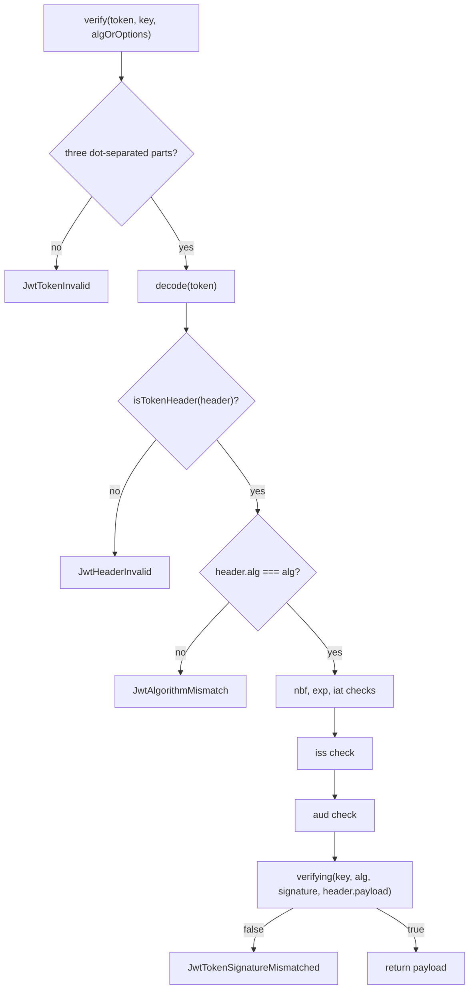

## Overview

`src/utils/jwt` is Hono's dependency-free implementation of JSON Web Tokens (RFC 7519) signed as JSON Web Signatures (RFC 7515) with the algorithms of RFC 7518. It exists so that the `jwt` and `jwk` middleware, and application code that mints tokens, run on every runtime Hono targets using only the Web Crypto API (`crypto.subtle`). The module is split by RFC: `jwt.ts` handles encoding, claims and key-set lookup, `jws.ts` turns keys into `CryptoKey` objects and signs or verifies bytes, `jwa.ts` lists the algorithm names, and `types.ts` holds the error classes and the payload type.

Sources: [src/utils/jwt/jwt.ts:1-29](repo://src/utils/jwt/jwt.ts#L1-L29), [src/utils/jwt/jws.ts:1-11](repo://src/utils/jwt/jws.ts#L1-L11), [src/utils/jwt/jwa.ts:1-5](repo://src/utils/jwt/jwa.ts#L1-L5)

The functions are reachable in three ways. `hono/utils/jwt` exports a `Jwt` object grouping `sign`, `verify`, `decode` and `verifyWithJwks`. `hono/jwt` re-exports the same four functions as named exports next to the `jwt` middleware and the `AlgorithmTypes` enum. On JSR each file is also its own entry (`./utils/jwt/jwa`, `./utils/jwt/jws`, `./utils/jwt/jwt`, `./utils/jwt/types`). How the middleware use these functions is covered in [[Authentication Middleware]].

Sources: [src/utils/jwt/index.ts:1-7](repo://src/utils/jwt/index.ts#L1-L7), [src/middleware/jwt/jwt.ts:175-178](repo://src/middleware/jwt/jwt.ts#L175-L178), [src/middleware/jwt/index.ts:1-4](repo://src/middleware/jwt/index.ts#L1-L4), [package.json:314-318](repo://package.json#L314-L318), [jsr.json:95-100](repo://jsr.json#L95-L100)

```ts
import { sign, verify, decode } from 'hono/jwt'

const payload = {
  sub: 'user123',
  role: 'admin',
  exp: Math.floor(Date.now() / 1000) + 60 * 5,
}
const secret = 'mySecretKey'

const token = await sign(payload, secret) // HS256 by default
const verified = await verify(token, secret, 'HS256')
const { header, payload: claims } = decode(token)
```

Sources: [src/utils/jwt/jwt.ts:56-60](repo://src/utils/jwt/jwt.ts#L56-L60), [src/utils/jwt/jwt.ts:96-100](repo://src/utils/jwt/jwt.ts#L96-L100), [src/utils/jwt/jwt.ts:264-279](repo://src/utils/jwt/jwt.ts#L264-L279)

## Algorithms

`AlgorithmTypes` enumerates the thirteen supported `alg` values. `SignatureAlgorithm` is the union of its keys, `SymmetricAlgorithm` is the three HMAC variants, and `AsymmetricAlgorithm` is the remaining ten. The asymmetric type is what `jwk` and `verifyWithJwks` accept as an allow-list.

Sources: [src/utils/jwt/jwa.ts:7-37](repo://src/utils/jwt/jwa.ts#L7-L37)

`getKeyAlgorithm` in `jws.ts` maps each name to Web Crypto parameters. An unknown name throws `JwtAlgorithmNotImplemented`. RSA-PSS uses a salt length equal to the hash size in bytes, and `ES512` uses the P-521 curve.

Sources: [src/utils/jwt/jws.ts:122-224](repo://src/utils/jwt/jws.ts#L122-L224)

| `alg` | Web Crypto `name` | Hash | Extra parameters |
| --- | --- | --- | --- |
| `HS256` / `HS384` / `HS512` | `HMAC` | SHA-256 / 384 / 512 | none |
| `RS256` / `RS384` / `RS512` | `RSASSA-PKCS1-v1_5` | SHA-256 / 384 / 512 | none |
| `PS256` / `PS384` / `PS512` | `RSA-PSS` | SHA-256 / 384 / 512 | `saltLength` 32 / 48 / 64 |
| `ES256` / `ES384` / `ES512` | `ECDSA` | SHA-256 / 384 / 512 | `namedCurve` P-256 / P-384 / P-521 |
| `EdDSA` | `Ed25519` | none | `namedCurve` Ed25519 |

Sources: [src/utils/jwt/jws.ts:122-220](repo://src/utils/jwt/jws.ts#L122-L220)

> [!NOTE]
> `EdDSA` relies on the runtime's Ed25519 support in `crypto.subtle`; the source notes it was only available in Safari, Deno and Node.js when written.

Sources: [src/utils/jwt/jws.ts:214-220](repo://src/utils/jwt/jws.ts#L214-L220)

## Keys

### Accepted key forms

Every signing and verifying function takes a `SignatureKey`: a string, a `HonoJsonWebKey` (the DOM `JsonWebKey` plus an optional `kid`), or a `CryptoKey`. Strings are interpreted by content: a PEM containing `PRIVATE` is imported as PKCS#8, a PEM containing `PUBLIC` as SPKI, and anything else as raw bytes of its UTF-8 encoding, which is the HMAC secret case. `pemToBinary` strips the `-----BEGIN ...-----` and `-----END ...-----` lines and whitespace before base64-decoding.

Sources: [src/utils/jwt/jws.ts:21-27](repo://src/utils/jwt/jws.ts#L21-L27), [src/utils/jwt/jws.ts:50-52](repo://src/utils/jwt/jws.ts#L50-L52)

### Signing keys

`importPrivateKey` returns a `CryptoKey` as is when its `type` is `private` or `secret` and throws for a public key. A JWK object is imported with format `jwk`, a private PEM with `pkcs8`, and other strings with `raw`; all with usage `sign` and `extractable: false`. Every call imports the key again, so passing a pre-imported `CryptoKey` avoids repeated work on hot paths.

Sources: [src/utils/jwt/jws.ts:54-76](repo://src/utils/jwt/jws.ts#L54-L76)

### Verification keys

`importPublicKey` lets a token be verified with the same material that signed it. A `CryptoKey` of type `public` or `secret` is used directly; a private `CryptoKey` is converted with `exportPublicJwkFrom`, which requires it to be extractable and copies only the public fields (`kty`, `alg`, `e`, `n`, `crv`, `x`, `y`). A private PEM string is imported as an extractable PKCS#8 key and converted the same way. The result is then imported as `jwk`, `spki` or `raw` with usage `verify`.

Sources: [src/utils/jwt/jws.ts:78-120](repo://src/utils/jwt/jws.ts#L78-L120)

`isCryptoKey` checks `instanceof crypto.webcrypto.CryptoKey` on Node.js, where `CryptoKey` is not a global in Node 18, and the global `CryptoKey` elsewhere. Both import functions throw if `crypto.subtle.importKey` is missing.

Sources: [src/utils/jwt/jws.ts:226-234](repo://src/utils/jwt/jws.ts#L226-L234), [src/utils/jwt/jws.ts:54-57](repo://src/utils/jwt/jws.ts#L54-L57)

### Signing and verifying bytes

`signing` and `verifying` are thin wrappers: resolve the algorithm parameters, import the key, and call `crypto.subtle.sign` or `crypto.subtle.verify`.

Sources: [src/utils/jwt/jws.ts:29-48](repo://src/utils/jwt/jws.ts#L29-L48)

```ts
export async function signing(
  privateKey: SignatureKey,
  alg: SignatureAlgorithm,
  data: BufferSource
): Promise<ArrayBuffer> {
  const algorithm = getKeyAlgorithm(alg)
  const cryptoKey = await importPrivateKey(privateKey, algorithm)
  return await crypto.subtle.sign(algorithm, cryptoKey, data)
}
```

Sources: [src/utils/jwt/jws.ts:29-37](repo://src/utils/jwt/jws.ts#L29-L37)

## sign

`sign(payload, privateKey, alg = 'HS256')` builds the compact serialization. Header and payload are JSON-stringified, UTF-8 encoded, base64url-encoded with `encodeBase64Url`, and stripped of `=` padding by `encodeJwtPart`. The header is `{ alg, typ: 'JWT' }`. When the key is an object with an `alg` field (a JWK), that `alg` overrides the argument and the key's `kid` is copied into the header, so tokens signed with a JWK can be matched by `verifyWithJwks` later. The signature over `header.payload` is base64url-encoded without padding and appended.

Sources: [src/utils/jwt/jwt.ts:31-36](repo://src/utils/jwt/jwt.ts#L31-L36), [src/utils/jwt/jwt.ts:56-76](repo://src/utils/jwt/jwt.ts#L56-L76), [src/utils/encode.ts:6-11](repo://src/utils/encode.ts#L6-L11)

```ts
const partialToken = `${encodedHeader}.${encodedPayload}`

const signaturePart = await signing(privateKey, alg, utf8Encoder.encode(partialToken))
const signature = encodeSignaturePart(signaturePart)

return `${partialToken}.${signature}`
```

Sources: [src/utils/jwt/jwt.ts:70-75](repo://src/utils/jwt/jwt.ts#L70-L75)

`sign` does not add any claim: set `exp`, `nbf` or `iat` yourself, as seconds since the epoch, in the payload. `JWTPayload` allows arbitrary keys and types the registered ones.

Sources: [src/utils/jwt/types.ts:128-154](repo://src/utils/jwt/types.ts#L128-L154)

## verify

### Arguments and options

`verify(token, publicKey, algOrOptions)` requires the algorithm: passing nothing throws `JwtAlgorithmRequired`. The third argument is either an algorithm name or a `VerifyOptionsWithAlg` object.

Sources: [src/utils/jwt/jwt.ts:78-116](repo://src/utils/jwt/jwt.ts#L78-L116)

| Option | Type | Default | Description |
| --- | --- | --- | --- |
| `alg` | `SignatureAlgorithm` | required | Must equal the token header's `alg`. |
| `iss` | `string \| RegExp` | none | Required issuer; string is compared exactly, `RegExp` is tested. |
| `aud` | `string \| string[] \| RegExp` | none | Accepted audience(s); any one match passes. |
| `exp` | `boolean` | `true` | Check the `exp` claim when present. |
| `nbf` | `boolean` | `true` | Check the `nbf` claim when present. |
| `iat` | `boolean` | `true` | Check the `iat` claim when present. |

Sources: [src/utils/jwt/jwt.ts:78-94](repo://src/utils/jwt/jwt.ts#L78-L94), [src/utils/jwt/jwt.ts:105-112](repo://src/utils/jwt/jwt.ts#L105-L112)

### Verification order

The checks run in a fixed order, cheapest first, and the signature is verified last. All claim checks therefore run on an unauthenticated payload, but nothing is returned until the signature matches.

Sources: [src/utils/jwt/jwt.ts:96-188](repo://src/utils/jwt/jwt.ts#L96-L188)



Sources: [src/utils/jwt/jwt.ts:118-188](repo://src/utils/jwt/jwt.ts#L118-L188)

`isTokenHeader` accepts a header object whose `alg` is one of `AlgorithmTypes` and whose `typ`, if present, is exactly `JWT`. Requiring `header.alg` to equal the caller's `alg` blocks algorithm confusion: a token cannot choose `none` or switch an RSA public key into an HMAC secret.

Sources: [src/utils/jwt/jwt.ts:44-54](repo://src/utils/jwt/jwt.ts#L44-L54), [src/utils/jwt/jwt.ts:123-129](repo://src/utils/jwt/jwt.ts#L123-L129)

### Claim checks

Time claims are compared against `now = Math.floor(Date.now() / 1000)` and are only checked when present in the payload; a claim that is present but not a finite number always fails. There is no clock-skew leeway option.

Sources: [src/utils/jwt/jwt.ts:130-145](repo://src/utils/jwt/jwt.ts#L130-L145)

| Claim | Fails when | Error |
| --- | --- | --- |
| `nbf` | `payload.nbf > now` | `JwtTokenNotBefore` |
| `exp` | `payload.exp <= now` | `JwtTokenExpired` |
| `iat` | `now < payload.iat` (issued in the future) | `JwtTokenIssuedAt` |
| `iss` | option set and claim missing, unequal, or not matching the `RegExp` | `JwtTokenIssuer` |
| `aud` | option set and claim missing | `JwtPayloadRequiresAud` |
| `aud` | no payload audience matches the option | `JwtTokenAudience` |

Sources: [src/utils/jwt/jwt.ts:130-174](repo://src/utils/jwt/jwt.ts#L130-L174)

For `aud`, a string payload audience is wrapped in an array, and the check passes if `some` entry matches: tested by a `RegExp` option, equal to a string option, or included in an array option.

Sources: [src/utils/jwt/jwt.ts:158-174](repo://src/utils/jwt/jwt.ts#L158-L174)

### Signature check

The signed input is everything before the last `.`, re-encoded to UTF-8, and the third segment is base64url-decoded with `decodeBase64Url` before being passed to `verifying`.

Sources: [src/utils/jwt/jwt.ts:176-187](repo://src/utils/jwt/jwt.ts#L176-L187), [src/utils/encode.ts:6-8](repo://src/utils/encode.ts#L6-L8)

## verifyWithJwks

`verifyWithJwks(token, { keys, jwks_uri, verification, allowedAlgorithms }, init?)` verifies a token against a JSON Web Key Set, the shape identity providers publish at `/.well-known/jwks.json`. It reads only the header first with `decodeHeader`, then runs the steps below.

Sources: [src/utils/jwt/jwt.ts:197-216](repo://src/utils/jwt/jwt.ts#L197-L216), [src/utils/jwt/jwt.ts:281-291](repo://src/utils/jwt/jwt.ts#L281-L291)

1. Rejects an invalid header (`JwtHeaderInvalid`) and a header without `kid` (`JwtHeaderRequiresKid`).
2. Rejects `HS256`, `HS384` and `HS512` outright with `JwtSymmetricAlgorithmNotAllowed`, because a public key set must never be usable as an HMAC secret.
3. Rejects any `alg` not in `allowedAlgorithms` with `JwtAlgorithmNotAllowed`.
4. Copies `keys`, then, if `jwks_uri` is set, fetches it with `init` and appends the response's `keys`. A non-OK response, a missing `keys` field, or a non-array `keys` throws a plain `Error`; so does having neither source.
5. Finds the key whose `kid` equals the header's; none found throws `JwtTokenInvalid`.
6. If that key declares an `alg`, it must equal the header's (`JwtAlgorithmMismatch`).
7. Calls `verify(token, matchingKey, { alg: header.alg, ...verification })`.

Sources: [src/utils/jwt/jwt.ts:190-262](repo://src/utils/jwt/jwt.ts#L190-L262)

> [!NOTE]
> The JWKS is fetched on every call; nothing is cached. Pass `keys` directly, or cache the fetch through `init` or a runtime cache, when request volume matters.

Sources: [src/utils/jwt/jwt.ts:228-246](repo://src/utils/jwt/jwt.ts#L228-L246)

## decode

`decode(token)` splits the token, base64url-decodes and JSON-parses the header and payload, and returns `{ header, payload }` without checking the signature or any claim. Any wrong part count or parse failure becomes `JwtTokenInvalid`. `decodeHeader` does the same for the header only. Use `decode` to inspect a token (for example to read `kid` or `iss` before choosing a key), never to trust it.

Sources: [src/utils/jwt/jwt.ts:35-36](repo://src/utils/jwt/jwt.ts#L35-L36), [src/utils/jwt/jwt.ts:264-291](repo://src/utils/jwt/jwt.ts#L264-L291)

## Base64url encoding

`src/utils/encode.ts` provides the codecs. `encodeBase64` builds a binary string byte by byte for `btoa`, because `btoa` only accepts Latin-1; `decodeBase64` reverses it with `atob`, filling the byte array from both ends at once. The URL-safe variants swap `+`/`/` with `-`/`_`. JWT code removes `=` padding when encoding; `atob` accepts unpadded input when decoding.

Sources: [src/utils/encode.ts:1-34](repo://src/utils/encode.ts#L1-L34)

## Error types

### Error classes

Every failure is a subclass of `Error` with a matching `name`, so callers can branch on `instanceof` or on `err.name`. The `jwt` and `jwk` middleware wrap them in a 401 and keep the original as `cause`.

Sources: [src/utils/jwt/types.ts:6-115](repo://src/utils/jwt/types.ts#L6-L115)

| Class | Thrown by | Meaning |
| --- | --- | --- |
| `JwtAlgorithmNotImplemented` | `getKeyAlgorithm` | `alg` not in the switch. |
| `JwtAlgorithmRequired` | `verify` | No algorithm given. |
| `JwtAlgorithmMismatch` | `verify`, `verifyWithJwks` | Header `alg` differs from the expected or key's `alg`. |
| `JwtTokenInvalid` | `decode`, `decodeHeader`, `verify`, `verifyWithJwks` | Not three parts, unparsable, or no key with the `kid`. |
| `JwtHeaderInvalid` | `verify`, `verifyWithJwks` | Header fails `isTokenHeader`. |
| `JwtHeaderRequiresKid` | `verifyWithJwks` | Header has no `kid`. |
| `JwtSymmetricAlgorithmNotAllowed` | `verifyWithJwks` | Header uses an `HS*` algorithm. |
| `JwtAlgorithmNotAllowed` | `verifyWithJwks` | Header `alg` not in `allowedAlgorithms`. |
| `JwtTokenNotBefore` | `verify` | `nbf` in the future or invalid. |
| `JwtTokenExpired` | `verify` | `exp` reached or invalid. |
| `JwtTokenIssuedAt` | `verify` | `iat` in the future or invalid. |
| `JwtTokenIssuer` | `verify` | Issuer missing or not matching. |
| `JwtPayloadRequiresAud` | `verify` | `aud` option set but no claim. |
| `JwtTokenAudience` | `verify` | No audience matches. |
| `JwtTokenSignatureMismatched` | `verify` | Signature check returned false. |

Sources: [src/utils/jwt/types.ts:6-115](repo://src/utils/jwt/types.ts#L6-L115), [src/utils/jwt/jwt.ts:96-188](repo://src/utils/jwt/jwt.ts#L96-L188), [src/utils/jwt/jwt.ts:190-291](repo://src/utils/jwt/jwt.ts#L190-L291)

### Handling errors

The classes are not re-exported from `hono/jwt`; import them from `hono/utils/jwt/types`.

Sources: [src/middleware/jwt/index.ts:1-4](repo://src/middleware/jwt/index.ts#L1-L4), [jsr.json:99-99](repo://jsr.json#L99-L99), [package.json:319-323](repo://package.json#L319-L323)

```ts
import { verify } from 'hono/jwt'
import { JwtTokenExpired } from 'hono/utils/jwt/types'

try {
  const payload = await verify(token, secret, { alg: 'HS256', iss: 'my-app' })
} catch (e) {
  if (e instanceof JwtTokenExpired) {
    // ask the client to refresh
  }
}
```

Sources: [src/utils/jwt/types.ts:41-46](repo://src/utils/jwt/types.ts#L41-L46), [src/utils/jwt/jwt.ts:91-100](repo://src/utils/jwt/jwt.ts#L91-L100)
