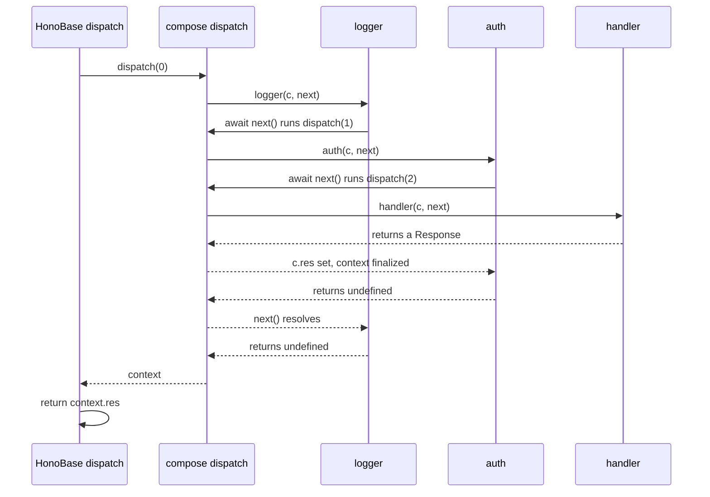

## Overview

In Hono, middleware and route handlers are the same kind of thing: functions registered on the router that receive `(c, next)`. For each request the router returns every matching function in registration order, and `compose` in `src/compose.ts` runs them as an "onion": each function can do work, call `await next()` to run the rest of the chain, and then do more work on the way back out. The implementation is based on the `koa-compose` package, with Hono-specific handling of errors, the not-found case and the response stored on the context.

Sources: [src/compose.ts:1-15](repo://src/compose.ts#L1-L15), [src/hono-base.ts:418-450](repo://src/hono-base.ts#L418-L450)

The difference between a middleware and a handler is only behavioural. A handler returns a `Response`. A middleware calls `next()` and returns nothing, or returns a response to stop the chain early. Both are stored in the router through `app.use`, `app.get` and the other registration methods described in [[Hono App and Request Lifecycle]].

Sources: [src/types.ts:70-95](repo://src/types.ts#L70-L95), [src/hono-base.ts:156-168](repo://src/hono-base.ts#L156-L168)

## Handler types

### Handler, MiddlewareHandler and Next

| Type | Signature | Notes |
| --- | --- | --- |
| `Next` | `() => Promise<void>` | Runs the remaining chain. Always awaited. |
| `Handler` | `(c: Context<E, P, I>, next: Next) => R` | `R` is a `Response`, a `TypedResponse` or a promise of either. |
| `MiddlewareHandler` | `(c: Context<E, P, I>, next: Next) => Promise<R or void>` | Must be async; may resolve with nothing. |
| `H` | `Handler` or `MiddlewareHandler` | What the router stores. |

Sources: [src/types.ts:35](repo://src/types.ts#L35), [src/types.ts:70-95](repo://src/types.ts#L70-L95)

Some helpers need to tell the two apart at runtime. `isMiddleware` treats a function that declares more than one parameter as middleware, and `findTargetHandler` follows the `COMPOSED_HANDLER` property that `app.route()` sets on wrapped handlers back to the original function.

Sources: [src/utils/handler.ts:8-15](repo://src/utils/handler.ts#L8-L15), [src/hono-base.ts:224-226](repo://src/hono-base.ts#L224-L226)

## compose()

### Signature

`compose(middleware, onError?, onNotFound?)` returns a function `(context, next?) => Promise<Context>`. `middleware` is the router's match list, `[[handler, route], params][]`, and only the handler (`middleware[i][0][0]`) is used. The optional `next` is called after the last middleware; the app's dispatch never passes it, but `app.route()` does when it wraps a sub-app handler.

Sources: [src/compose.ts:15-20](repo://src/compose.ts#L15-L20), [src/compose.ts:42-47](repo://src/compose.ts#L42-L47), [src/hono-base.ts:224-225](repo://src/hono-base.ts#L224-L225)

### The dispatch loop

Each call to `next()` is `dispatch(i + 1)`. The steps for one index are as follows.

Sources: [src/compose.ts:32-71](repo://src/compose.ts#L32-L71)

1. If `i` is not greater than the last index run, throw `next() called multiple times`. This catches a middleware that calls `next()` twice.
2. Pick the handler at `i` and set `context.req.routeIndex = i`, so `c.req.param()` and `routePath` refer to that handler's route. Past the end of the list, use the outer `next` if one was given.
3. Call `handler(context, () => dispatch(i + 1))` and await the result.
4. If it throws an `Error` and `onError` exists, store the error in `context.error`, call `onError(err, context)` and remember that this was an error response. Any other thrown value, or any error without `onError`, is re-thrown.
5. If there was no handler at all and the context is not finalized, call `onNotFound(context)`.
6. If a result exists and the context is not finalized (or the result is an error response), assign it to `context.res`.

Sources: [src/compose.ts:32-71](repo://src/compose.ts#L32-L71)

```ts
if (handler) {
  try {
    res = await handler(context, () => dispatch(i + 1))
  } catch (err) {
    if (err instanceof Error && onError) {
      context.error = err
      res = await onError(err, context)
      isError = true
    } else {
      throw err
    }
  }
} else {
  if (context.finalized === false && onNotFound) {
    res = await onNotFound(context)
  }
}

if (res && (context.finalized === false || isError)) {
  context.res = res
}
return context
```

Sources: [src/compose.ts:49-70](repo://src/compose.ts#L49-L70)

### Request walk-through

For `app.use(logger)`, `app.use('/api/*', auth)` and `app.get('/api/me', handler)`, a request to `/api/me` matches all three. The diagram shows the order of execution.

Sources: [src/compose.ts:32-71](repo://src/compose.ts#L32-L71), [src/hono-base.ts:450-461](repo://src/hono-base.ts#L450-L461)



Sources: [src/compose.ts:32-71](repo://src/compose.ts#L32-L71), [src/hono-base.ts:450-461](repo://src/hono-base.ts#L450-L461)

## The finalized flag

### When a response is taken

`context.finalized` turns `true` the first time `c.res` is assigned. Compose writes a handler's return value into `c.res` only while the context is not finalized. Once the innermost handler has answered, a middleware that returns a different `Response` after `await next()` is ignored.

Sources: [src/context.ts:414-434](repo://src/context.ts#L414-L434), [src/compose.ts:67-69](repo://src/compose.ts#L67-L69)

To replace or modify the response on the way out, assign it explicitly. The `c.res` setter carries over headers already set on the old response.

Sources: [src/context.ts:414-434](repo://src/context.ts#L414-L434)

```ts
app.use(async (c, next) => {
  await next()
  if (c.res.status === 404) {
    c.res = c.json({ error: 'not found' }, 404)
  }
})
```

Sources: [src/context.ts:414-434](repo://src/context.ts#L414-L434), [src/context.ts:708-721](repo://src/context.ts#L708-L721)

### Short-circuiting

A middleware that returns a response without calling `next()` ends the chain: later handlers never run, and the returned response becomes `c.res`. This is how authentication middleware rejects a request (see [[Authentication Middleware]]).

Sources: [src/compose.ts:49-69](repo://src/compose.ts#L49-L69)

### No response at all

If the chain finishes without any handler answering, for example a middleware that neither returns a response nor calls `next()`, the context stays unfinalized. The app's dispatch then throws `Context is not finalized`, which reaches the error handler and becomes a 500 by default.

Sources: [src/hono-base.ts:452-465](repo://src/hono-base.ts#L452-L465)

When the last middleware calls `next()` and there is nothing after it, compose calls the not-found handler, so `app.use('*', mw)` with no matching route answers 404 rather than failing.

Sources: [src/compose.ts:61-65](repo://src/compose.ts#L61-L65)

### The single-handler shortcut

When the router returns exactly one handler, the app does not call `compose`. It calls the handler with a `next` that sets `c.res` to the not-found response, and applies the same rules for missing responses and errors. Behaviour is the same; only the extra promise work is skipped.

Sources: [src/hono-base.ts:429-448](repo://src/hono-base.ts#L429-L448)

## Errors inside the chain

### Where errors are caught

Every `dispatch(i)` has its own `try` block, so a thrown error is caught at the level of the function that threw it, not at the outermost level. The error handler's response is stored on `c.res`, and the `await next()` in the middleware above resolves normally. With the app's error handler always passed in, an outer middleware never sees the exception from `next()`; it should check `c.error` instead.

Sources: [src/compose.ts:49-60](repo://src/compose.ts#L49-L60), [src/hono-base.ts:450](repo://src/hono-base.ts#L450)

```ts
app.use(async (c, next) => {
  await next()
  if (c.error) {
    console.error('request failed', c.error.message)
  }
})
```

Sources: [src/context.ts:318-333](repo://src/context.ts#L318-L333)

> [!NOTE]
> The error response always replaces `c.res`, even if the context was already finalized, because the `isError` flag bypasses the `finalized` check. A middleware that throws after `await next()` therefore turns a successful response into the error response.

Sources: [src/compose.ts:67-69](repo://src/compose.ts#L67-L69)

Values that are not `Error` instances are re-thrown by compose and by the app's `#handleError`, so they escape `fetch`. The full error path, including `HTTPException`, is in [[Error Handling and HTTPException]].

Sources: [src/compose.ts:53-59](repo://src/compose.ts#L53-L59), [src/hono-base.ts:399-404](repo://src/hono-base.ts#L399-L404)

## Typing middleware with createMiddleware

### createMiddleware()

`createMiddleware` from `hono/factory` returns its argument unchanged. It exists only for types: it lets you declare the `Env`, path and input of a middleware written outside an app, so `c.set`, `c.var` and `c.env` are typed inside it and the variables flow into routes that use it.

Sources: [src/helper/factory/index.ts:368-375](repo://src/helper/factory/index.ts#L368-L375)

```ts
export const createMiddleware = <
  E extends Env = any,
  P extends string = string,
  I extends Input = {},
  R extends HandlerResponse<any> | void = void,
>(
  middleware: MiddlewareHandler<E, P, I, R extends void ? Response : R>
): MiddlewareHandler<E, P, I, R extends void ? Response : R> => middleware
```

Sources: [src/helper/factory/index.ts:368-375](repo://src/helper/factory/index.ts#L368-L375)

```ts
import { createMiddleware } from 'hono/factory'

const withUser = createMiddleware<{ Variables: { user: string } }>(async (c, next) => {
  c.set('user', 'hono')
  await next()
})

app.get('/me', withUser, (c) => c.text(c.var.user))
```

Sources: [src/helper/factory/index.ts:368-375](repo://src/helper/factory/index.ts#L368-L375), [src/context.ts:546-602](repo://src/context.ts#L546-L602)

The `R` parameter declares a response type a middleware may return early, which keeps that response in the route's inferred output for [[RPC Client (hc)]]. With `R` left as `void`, the middleware is typed as returning `Response`.

Sources: [src/helper/factory/index.ts:368-375](repo://src/helper/factory/index.ts#L368-L375), [src/types.ts:83-88](repo://src/types.ts#L83-L88)

### Factory methods

`createFactory<E>()` returns a `Factory` whose `createMiddleware` is the same identity function with `E` fixed, so every middleware made from it shares one environment type. `createHandlers(...)` types a list of handlers defined apart from `app.get` and drops `undefined` entries. `createApp(options?)` builds a `Hono` app, merging `defaultAppOptions` with the given options and calling `initApp(app)` if set. Other factory helpers are covered in [[Factory, Testing and Other Helpers]].

Sources: [src/helper/factory/index.ts:332-366](repo://src/helper/factory/index.ts#L332-L366)
