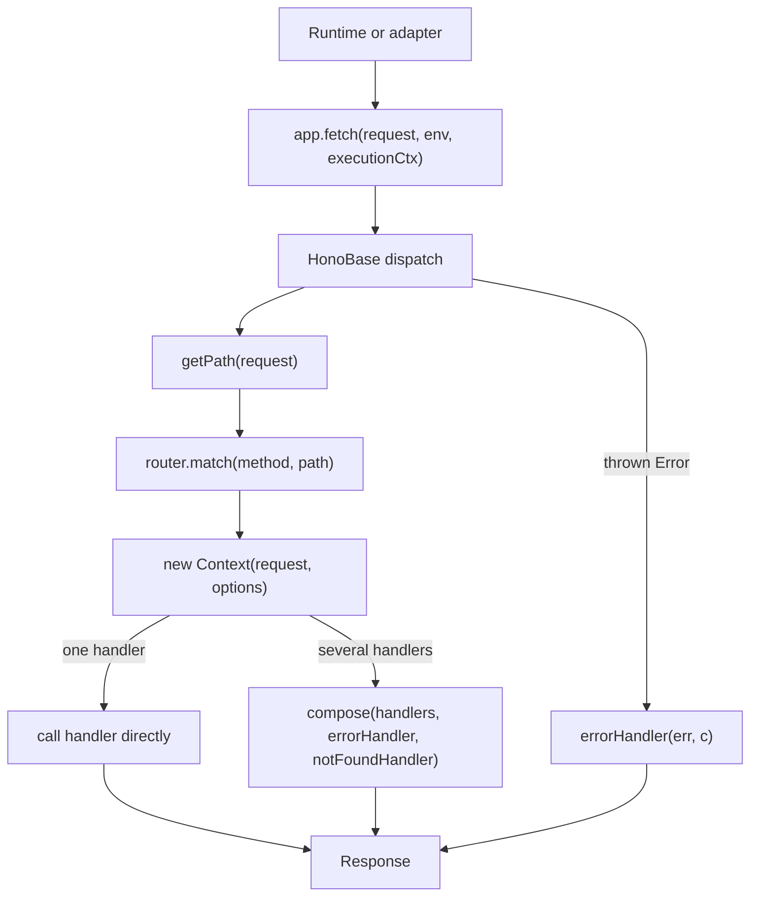

## Overview

Hono is a small web framework built only on Web Standards: an application receives a standard `Request` and returns a standard `Response`. Because it depends on nothing beyond the Fetch API, the same application code runs on Cloudflare Workers, Fastly Compute, Deno, Bun, Vercel, AWS Lambda, Lambda@Edge and Node.js. The package has zero runtime dependencies and ships many optional modules (middleware, helpers, JSX, adapters, a typed client) as separate sub-path exports, so an app only bundles what it imports.

Sources: [README.md:22-47](repo://README.md#L22-L47), [package.json:1-12](repo://package.json#L1-L12)

The smallest app creates a `Hono` instance, registers a route and exports the instance. Runtimes that speak the module-worker convention (Cloudflare Workers, Bun, Deno via `deno serve`) call the exported object's `fetch` method for every request.

Sources: [src/index.ts:1-15](repo://src/index.ts#L1-L15), [src/hono-base.ts:479-485](repo://src/hono-base.ts#L479-L485)

```ts
import { Hono } from 'hono'
const app = new Hono()

app.get('/', (c) => c.text('Hono!'))

export default app
```

Sources: [README.md:26-33](repo://README.md#L26-L33)

## Architecture

### Request path through the core

A request enters through `app.fetch`, which hands it to the private `#dispatch` method of `HonoBase`. `#dispatch` computes the path with `getPath`, asks the router for the handlers that match the method and path, builds a `Context` around the request, and then either calls the single matched handler directly or runs all of them through `compose`, the onion-style middleware runner. Errors go to the app's error handler, unmatched requests to the not-found handler. [[Hono App and Request Lifecycle]] traces this in detail.

Sources: [src/hono-base.ts:406-466](repo://src/hono-base.ts#L406-L466), [src/compose.ts:15-73](repo://src/compose.ts#L15-L73)



Sources: [src/hono-base.ts:406-485](repo://src/hono-base.ts#L406-L485)

### HonoBase and the Hono presets

`HonoBase` (in `src/hono-base.ts`) holds everything except the router: route registration (`get`, `post`, `put`, `delete`, `options`, `patch`, `all`, `on`, `use`), grouping (`route`, `basePath`, `mount`), handlers for errors and 404 (`onError`, `notFound`) and the entry points (`fetch`, `request`, `fire`). It leaves `router` unset; a subclass assigns one in its constructor. This split lets Hono offer presets that differ only in their router.

Sources: [src/hono-base.ts:98-173](repo://src/hono-base.ts#L98-L173)

| Import | Class | Router | Trade-off |
| --- | --- | --- | --- |
| `hono` | `Hono` from `src/hono.ts` | `SmartRouter` over `RegExpRouter` and `TrieRouter`, unless `options.router` is given | Default; `RegExpRouter` is the fast path, `TrieRouter` the fallback for routes it cannot compile |
| `hono/quick` | `Hono` from `src/preset/quick.ts` | `SmartRouter` over `LinearRouter` and `TrieRouter` | `LinearRouter` replaces `RegExpRouter` as the first candidate |
| `hono/tiny` | `Hono` from `src/preset/tiny.ts` | `PatternRouter` | Smallest preset (under 12kB per the README) |
| `hono/hono-base` | `HonoBase` | none, you assign `router` | Full control |

Sources: [src/hono.ts:16-34](repo://src/hono.ts#L16-L34), [src/preset/quick.ts:1-24](repo://src/preset/quick.ts#L1-L24), [src/preset/tiny.ts:1-20](repo://src/preset/tiny.ts#L1-L20), [README.md:43-44](repo://README.md#L43-L44), [package.json:54-68](repo://package.json#L54-L68)

The default `Hono` constructor only sets the router: `options.router ?? new SmartRouter({ routers: [new RegExpRouter(), new TrieRouter()] })`. `SmartRouter` tries each candidate on the first match and keeps the first one that accepts all registered routes. See [[Router Interface and Selection]], [[RegExpRouter]] and [[TrieRouter, LinearRouter and PatternRouter]].

Sources: [src/hono.ts:26-33](repo://src/hono.ts#L26-L33), [src/router/smart-router/router.ts:21-60](repo://src/router/smart-router/router.ts#L21-L60)

### The main entry point

The root module `hono` exports the `Hono` class, the `Context` class, and the core types an application or middleware author needs: `Env`, `Handler`, `MiddlewareHandler`, `Next`, `ErrorHandler`, `NotFoundHandler`, `ValidationTargets`, `Input`, `Schema`, `ToSchema`, `TypedResponse`, `ContextVariableMap`, `ContextRenderer`, `ExecutionContext`, `HonoRequest`, and the client inference types `InferRequestType`, `InferResponseType` and `ClientRequestOptions`.

Sources: [src/index.ts:17-53](repo://src/index.ts#L17-L53)

## Package layout

Each folder under `src/` is a layer with one job. The core files sit at the top of `src/`; everything else is opt-in.

Sources: [src/hono-base.ts:1-29](repo://src/hono-base.ts#L1-L29), [build/build.ts:28-39](repo://build/build.ts#L28-L39)

| Path | Role | Pages |
| --- | --- | --- |
| `src/hono-base.ts`, `src/hono.ts`, `src/preset/` | App class, route registration, dispatch | [[Hono App and Request Lifecycle]] |
| `src/context.ts` | Per-request `Context`: response builders, headers, variables, renderer | [[Context]] |
| `src/request.ts` | `HonoRequest` wrapper: params, query, headers, body parsing, validated data | [[HonoRequest]] |
| `src/compose.ts` | Middleware runner | [[Middleware Composition]] |
| `src/http-exception.ts` | `HTTPException` and default error handling | [[Error Handling and HTTPException]] |
| `src/types.ts` | Generic types for env, handlers, schemas and path params | [[Type System]] |
| `src/router.ts`, `src/router/` | Router interface and five implementations | [[Router Interface and Selection]], [[RegExpRouter]], [[TrieRouter, LinearRouter and PatternRouter]] |
| `src/validator/` | `validator()` middleware | [[Validator]] |
| `src/client/` | `hc` typed RPC client | [[RPC Client (hc)]] |
| `src/middleware/` | Built-in middleware (auth, CORS, cache, compress, logger, etc.) | [[Authentication Middleware]], [[Security Middleware]], [[Caching, Compression and Limits]], [[Request Utility Middleware]], [[Serving Static Files]], [[JSX Renderer Middleware]] |
| `src/helper/` | Helpers (cookie, html, css, streaming, ssg, websocket, factory, testing, dev, conninfo, proxy, accepts, route, adapter) | [[Cookie Helper]], [[HTML and CSS Helpers]], [[Streaming and Server-Sent Events]], [[Static Site Generation]], [[WebSocket Helper]], [[Factory, Testing and Other Helpers]] |
| `src/jsx/` | Server-side JSX runtime and `hono/jsx/dom` client runtime with hooks | [[JSX Server Rendering]], [[Client Components and Hooks]] |
| `src/adapter/` | Runtime glue: aws-lambda, bun, cloudflare-pages, cloudflare-workers, deno, lambda-edge, netlify, service-worker, vercel | [[Runtime Adapters]] |
| `src/utils/` | Shared utilities (URL, body, cookie, crypto, JWT, mime, etc.) | [[JWT Utilities]] |

Sources: [src/index.ts:17-53](repo://src/index.ts#L17-L53), [package.json:69-143](repo://package.json#L69-L143), [package.json:144-263](repo://package.json#L144-L263), [package.json:264-343](repo://package.json#L264-L343), [package.json:344-413](repo://package.json#L344-L413)

Each adapter folder exports only what that runtime needs. For example the AWS Lambda adapter exports `handle`, `streamHandle` and `getConnInfo`; the Bun adapter exports `serveStatic`, `toSSG`, `createBunWebSocket`, `upgradeWebSocket`, `websocket`, `getConnInfo` and `getBunServer`; the Cloudflare Workers adapter exports `serveStatic`, `upgradeWebSocket` and `getConnInfo`.

Sources: [src/adapter/aws-lambda/index.ts:6-14](repo://src/adapter/aws-lambda/index.ts#L6-L14), [src/adapter/bun/index.ts:6-11](repo://src/adapter/bun/index.ts#L6-L11), [src/adapter/cloudflare-workers/index.ts:6-8](repo://src/adapter/cloudflare-workers/index.ts#L6-L8)

## Export map

### How a sub-path resolves

`package.json` declares `"type": "module"` and an `exports` map in which every entry has three conditions: `types` points into `dist/types/`, `import` into `dist/` (ESM) and `require` into `dist/cjs/` (CommonJS). A matching `typesVersions` block maps the same sub-paths for older TypeScript module resolution that ignores `exports`.

Sources: [package.json:1-12](repo://package.json#L1-L12), [package.json:38-48](repo://package.json#L38-L48), [package.json:415-440](repo://package.json#L415-L440)

```json
"./jsx": {
  "types": "./dist/types/jsx/index.d.ts",
  "import": "./dist/jsx/index.js",
  "require": "./dist/cjs/jsx/index.js"
},
```

Sources: [package.json:154-158](repo://package.json#L154-L158)

The same sub-paths are published to JSR as `@hono/hono`, where `jsr.json` maps them straight to TypeScript sources. The build refuses to run when the two maps disagree (see [[Development, Build and Tests]]).

Sources: [jsr.json:1-20](repo://jsr.json#L1-L20), [build/build.ts:20-26](repo://build/build.ts#L20-L26)

### Sub-paths by group

| Group | Sub-paths |
| --- | --- |
| Core | `.`, `./request`, `./types`, `./hono-base`, `./tiny`, `./quick`, `./http-exception` |
| Auth and security middleware | `./basic-auth`, `./bearer-auth`, `./jwt`, `./jwk`, `./ip-restriction`, `./cors`, `./csrf`, `./secure-headers` |
| Other middleware | `./body-limit`, `./cache`, `./compress`, `./context-storage`, `./etag`, `./trailing-slash`, `./timeout`, `./timing`, `./logger`, `./method-override`, `./powered-by`, `./pretty-json`, `./request-id`, `./language`, `./combine`, `./jsx-renderer`, `./serve-static` |
| Helpers | `./route`, `./cookie`, `./accepts`, `./html`, `./css`, `./ssg`, `./streaming`, `./factory`, `./adapter`, `./testing`, `./dev`, `./ws`, `./conninfo`, `./proxy` |
| JSX | `./jsx`, `./jsx/jsx-runtime`, `./jsx/jsx-dev-runtime`, `./jsx/streaming`, `./jsx/dom`, `./jsx/dom/jsx-runtime`, `./jsx/dom/jsx-dev-runtime`, `./jsx/dom/client`, `./jsx/dom/css`, `./jsx/dom/server` |
| Validation and client | `./validator`, `./client` |
| Routers | `./router`, `./router/reg-exp-router`, `./router/smart-router`, `./router/trie-router`, `./router/pattern-router`, `./router/linear-router` |
| Utilities | `./utils/jwt`, `./utils/*` (any file under `src/utils/`) |
| Runtime adapters | `./cloudflare-workers`, `./cloudflare-pages`, `./deno`, `./bun`, `./aws-lambda`, `./vercel`, `./netlify`, `./lambda-edge`, `./service-worker` |

Sources: [package.json:38-143](repo://package.json#L38-L143), [package.json:144-263](repo://package.json#L144-L263), [package.json:264-343](repo://package.json#L264-L343), [package.json:344-413](repo://package.json#L344-L413)

> [!NOTE]
> Helper sub-paths do not always match folder names: `./ws` resolves to `helper/websocket`, and the runtime adapters are exported at the top level (`hono/bun`, not `hono/adapter/bun`). `hono/adapter` is the runtime-detection helper in `src/helper/adapter`.

Sources: [package.json:329-333](repo://package.json#L329-L333), [package.json:359-363](repo://package.json#L359-L363), [package.json:399-403](repo://package.json#L399-L403)

## Where to go next

- [[Quickstart]]: build, run and test a first app.
- [[Hono App and Request Lifecycle]], [[Context]], [[HonoRequest]], [[Middleware Composition]], [[Error Handling and HTTPException]], [[Type System]]: the core.
- [[Router Interface and Selection]], [[RegExpRouter]], [[TrieRouter, LinearRouter and PatternRouter]]: routing.
- [[Validator]], [[RPC Client (hc)]]: typed input and end-to-end typed clients.
- [[Authentication Middleware]], [[JWT Utilities]], [[Security Middleware]], [[Caching, Compression and Limits]], [[Request Utility Middleware]], [[Serving Static Files]]: built-in middleware.
- [[JSX Server Rendering]], [[JSX Renderer Middleware]], [[Client Components and Hooks]], [[HTML and CSS Helpers]]: rendering.
- [[Cookie Helper]], [[Streaming and Server-Sent Events]], [[Static Site Generation]], [[WebSocket Helper]], [[Factory, Testing and Other Helpers]]: helpers.
- [[Runtime Adapters]]: running on each platform.
- [[Development, Build and Tests]]: working on Hono itself.

Sources: [src/index.ts:17-53](repo://src/index.ts#L17-L53), [package.json:38-143](repo://package.json#L38-L143)
