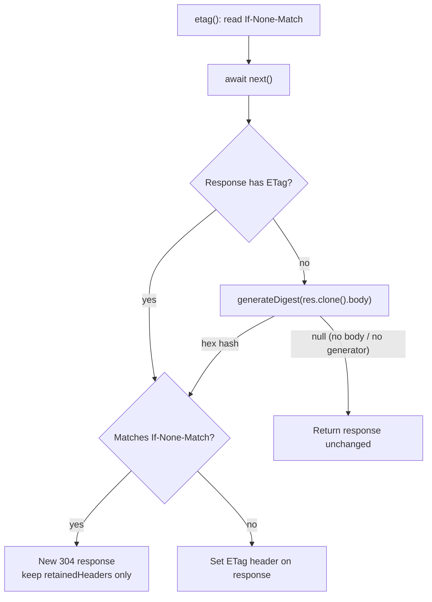
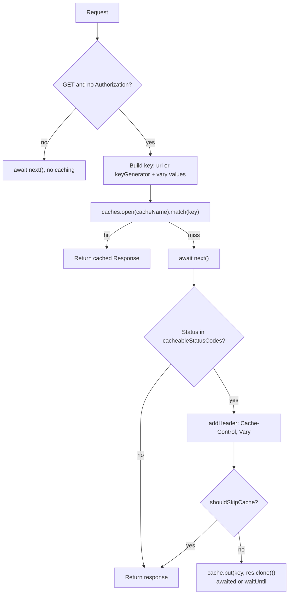

## Overview

Hono ships six built-in middleware that shape how a response is produced or delivered rather than what it contains: `compress` gzips or deflates response bodies, `etag` adds entity tags and answers conditional requests with `304 Not Modified`, `cache` stores responses in the Web Cache API, `bodyLimit` rejects oversized request bodies, `timeout` bounds how long the downstream chain may run, and `timing` writes a `Server-Timing` header. Each is a factory returning a `MiddlewareHandler`, imported from its own subpath (`hono/compress`, `hono/etag`, `hono/cache`, `hono/body-limit`, `hono/timeout`, `hono/timing`).

Sources: [package.json:84-137](repo://package.json#L84-L137), [package.json:219-227](repo://package.json#L219-L227)

All six follow the onion model described in [[Middleware Composition]]: `bodyLimit` acts before `await next()`, while `compress`, `etag`, `cache` and `timing` mostly act after it by rewriting `c.res`. That makes registration order matter. For example, `etag` must sit outside (registered before) `compress` if it should hash the uncompressed body, and `compress` already downgrades a strong ETag to a weak one when it re-encodes the body.

Sources: [src/middleware/compress/index.ts:86-122](repo://src/middleware/compress/index.ts#L86-L122), [src/middleware/etag/index.ts:79-129](repo://src/middleware/etag/index.ts#L79-L129)

## Compress

### Compress options

`compress` uses the standard `CompressionStream`, so it works on every runtime that implements Compression Streams without native modules. Only `gzip` and `deflate` are candidates.

Sources: [src/middleware/compress/index.ts:12-22](repo://src/middleware/compress/index.ts#L12-L22)

| Option | Type | Default | Description |
| --- | --- | --- | --- |
| `encoding` | `'gzip' \| 'deflate'` | both, gzip first | Restricts compression to one scheme. Without it, the scheme is negotiated from `Accept-Encoding`. |
| `threshold` | `number` | `1024` | Minimum `Content-Length` in bytes. Responses that declare a smaller length are left alone. |
| `contentTypeFilter` | `RegExp \| ((contentType: string) => boolean)` | `COMPRESSIBLE_CONTENT_TYPE_REGEX` | Decides from the response `Content-Type` whether to compress. A response with no `Content-Type` is never compressed. |

Sources: [src/middleware/compress/index.ts:70-84](repo://src/middleware/compress/index.ts#L70-L84)

`COMPRESSIBLE_CONTENT_TYPE_REGEX` is re-exported from `hono/compress` so a custom filter can extend it. It matches `text/*` except `text/event-stream` (compressing SSE would buffer events), common `application/*` types such as `json`, `javascript`, `xml`, `wasm` and `x-www-form-urlencoded`, a few font and image types, and any structured-syntax suffix `+json`, `+xml`, `+text`, `+yaml` or `+msgpack`.

Sources: [src/utils/compress.ts:6-10](repo://src/utils/compress.ts#L6-L10), [src/middleware/compress/index.ts:8-10](repo://src/middleware/compress/index.ts#L8-L10)

```ts
import { compress, COMPRESSIBLE_CONTENT_TYPE_REGEX } from 'hono/compress'

app.use(compress())

// Compress only JSON responses
app.use(compress({ contentTypeFilter: /^application\/json/ }))

// Compress based on custom Content-Type logic
app.use(compress({ contentTypeFilter: (type) => COMPRESSIBLE_CONTENT_TYPE_REGEX.test(type) || type === "application/x-myformat" }))
```

Sources: [src/middleware/compress/index.ts:57-68](repo://src/middleware/compress/index.ts#L57-L68)

### When a response is compressed

The middleware runs the rest of the chain first, then inspects `ctx.res`. It returns without touching the response when any of these hold: status is `206` (the `Content-Range` refers to uncompressed bytes), a `Content-Encoding` or `Transfer-Encoding` header is already set, the request method is `HEAD`, a `Content-Length` below `threshold` is declared, the content type fails the filter, or `Cache-Control` contains `no-transform`. A streamed response without `Content-Length` passes the threshold check, so it is compressed whatever its size.

Sources: [src/middleware/compress/index.ts:86-102](repo://src/middleware/compress/index.ts#L86-L102), [src/middleware/compress/index.ts:124-129](repo://src/middleware/compress/index.ts#L124-L129)

`selectEncoding` parses `Accept-Encoding` with `parseAccept` and walks the candidates in order (`gzip` then `deflate`). An explicit entry supplies its quality value; otherwise the `*` wildcard's quality applies, or `0`. The first candidate with `q=1` wins immediately; otherwise the highest positive `q` wins. A missing header, or every candidate at `q=0`, means no compression.

Sources: [src/middleware/compress/index.ts:24-44](repo://src/middleware/compress/index.ts#L24-L44)

When an encoding is chosen and the body is not null, the body is piped through `new CompressionStream(encoding)`, `Content-Length` is deleted (the compressed size is unknown up front), and `Content-Encoding` is set. A strong `ETag` such as `"abc"` is rewritten to `W/"abc"` because the compressed bytes are no longer identical to what the tag described.

Sources: [src/middleware/compress/index.ts:104-121](repo://src/middleware/compress/index.ts#L104-L121)

## ETag

### ETag options

`etag` gives responses an entity tag so clients can revalidate with `If-None-Match` and receive an empty `304` instead of the full body.

Sources: [src/middleware/etag/index.ts:9-13](repo://src/middleware/etag/index.ts#L9-L13)

| Option | Type | Default | Description |
| --- | --- | --- | --- |
| `weak` | `boolean` | `false` | Prefix generated tags with `W/`. |
| `retainedHeaders` | `string[]` | `RETAINED_304_HEADERS` | Lower-case header names kept on a `304` response; all others are removed. |
| `generateDigest` | `(body: Uint8Array) => ArrayBuffer \| Promise<ArrayBuffer>` | SHA-1 via `crypto.subtle` | Hash function used to build the tag. |

Sources: [src/middleware/etag/index.ts:79-82](repo://src/middleware/etag/index.ts#L79-L82), [src/middleware/etag/index.ts:38-54](repo://src/middleware/etag/index.ts#L38-L54)

`RETAINED_304_HEADERS` is exported and holds the headers RFC 9110 says a `304` must carry as the equivalent `200` would: `cache-control`, `content-location`, `date`, `etag`, `expires` and `vary`. Spread it when adding your own, for example `retainedHeaders: ['x-message', ...RETAINED_304_HEADERS]`.

Sources: [src/middleware/etag/index.ts:15-28](repo://src/middleware/etag/index.ts#L15-L28)

### Tag generation and matching

The `If-None-Match` request header is read before `await next()`. After the handler, an `ETag` the handler set itself is used as is. Otherwise the middleware hashes a clone of the body; if no generator exists (no `crypto.subtle` and no `generateDigest`) or the body is empty, it leaves the response untouched.

Sources: [src/middleware/etag/index.ts:84-105](repo://src/middleware/etag/index.ts#L84-L105)

`generateDigest` in `digest.ts` reads the stream chunk by chunk and chains the hash: each step hashes the previous digest concatenated with the next chunk (`generator(mergeBuffers(result, value))`), so the whole body is never buffered at once. The final `ArrayBuffer` is rendered as lowercase hex. Because the tag depends on chunk boundaries, the same bytes delivered in different chunks can produce different tags.

Sources: [src/middleware/etag/digest.ts:1-43](repo://src/middleware/etag/digest.ts#L1-L43)



Sources: [src/middleware/etag/index.ts:84-128](repo://src/middleware/etag/index.ts#L84-L128), [src/middleware/etag/digest.ts:16-43](repo://src/middleware/etag/digest.ts#L16-L43)

Matching uses weak comparison: `If-None-Match` is split on commas and each entry is compared to the tag after stripping any `W/` prefix from both. The value `*` matches only for `GET` or `HEAD` requests whose response is `ok`. On a match the response is replaced with an empty `304 Not Modified` carrying the tag, and the middleware deletes every header not in `retainedHeaders`.

Sources: [src/middleware/etag/index.ts:30-36](repo://src/middleware/etag/index.ts#L30-L36), [src/middleware/etag/index.ts:107-126](repo://src/middleware/etag/index.ts#L107-L126)

> [!NOTE]
> Assigning `c.res` copies every header of the previous response except `Content-Type` onto the new `304`, so the retained-headers filter is what actually strips headers such as `Content-Length` or `Set-Cookie`. Add a header to `retainedHeaders` to keep it on revalidation responses.

Sources: [src/middleware/etag/index.ts:112-124](repo://src/middleware/etag/index.ts#L112-L124), [src/context.ts:414-434](repo://src/context.ts#L414-L434)

## Cache

### Cache options

`cache` stores `GET` responses in the Web Cache API (`globalThis.caches`), available in Cloudflare Workers, Deno and browsers' service workers. When `caches` is missing, the factory calls `onCacheNotAvailable` (or logs `Cache Middleware is not enabled because caches is not defined.`) and returns a pass-through middleware.

Sources: [src/middleware/cache/index.ts:64-82](repo://src/middleware/cache/index.ts#L64-L82)

| Option | Type | Default | Description |
| --- | --- | --- | --- |
| `cacheName` | `string \| ((c: Context) => Promise<string> \| string)` | required | Name passed to `caches.open`. A function can pick a store per request. |
| `wait` | `boolean` | `false` | Await `cache.put` before returning. When `false`, the put is handed to `c.executionCtx.waitUntil`. Deno needs `true`. |
| `cacheControl` | `string` | none | Comma-separated directives appended to the response `Cache-Control`, skipping names the handler already set. |
| `vary` | `string \| string[]` | none | Request headers added to the cache key and to the response `Vary` header. `*` throws at setup. |
| `keyGenerator` | `(c: Context) => Promise<string> \| string` | `c.req.url` | Builds the cache key. |
| `cacheableStatusCodes` | `StatusCode[]` | `[200]` | Statuses that may be stored. |
| `onCacheNotAvailable` | `(() => void) \| false` | logs a message | Called once at setup when `caches` is undefined; `false` silences it. |

Sources: [src/middleware/cache/index.ts:37-72](repo://src/middleware/cache/index.ts#L37-L72), [src/middleware/cache/index.ts:84-103](repo://src/middleware/cache/index.ts#L84-L103)

```ts
app.get(
  '*',
  cache({
    cacheName: 'my-app',
    cacheControl: 'max-age=3600',
  })
)
```

Sources: [src/middleware/cache/index.ts:53-62](repo://src/middleware/cache/index.ts#L53-L62)

### Lookup and store flow

Requests other than `GET`, and any request with an `Authorization` header, bypass the cache entirely. For the rest, the key is `c.req.url` or the `keyGenerator` result, and each configured `vary` header is appended as `::name=<encoded value>` so variants are stored separately. A hit returns a fresh `Response` built from the cached one without running the handler.

Sources: [src/middleware/cache/index.ts:141-164](repo://src/middleware/cache/index.ts#L141-L164)



Sources: [src/middleware/cache/index.ts:141-184](repo://src/middleware/cache/index.ts#L141-L184)

On a miss, after the handler runs, `addHeader` merges the configured `cacheControl` directives into the response, comparing directive names case-insensitively, and writes `Vary`: the configured list alone, or the union with the response's own `Vary` (collapsing to `*` if the response had `*`).

Sources: [src/middleware/cache/index.ts:105-139](repo://src/middleware/cache/index.ts#L105-L139)

`shouldSkipCache` then refuses to store the response when its `Vary` names a header the middleware was not configured to vary on (including any response `Vary` when no `vary` option is set), when `Cache-Control` contains `private`, `no-store` or `no-cache`, or when it sets a cookie. The headers are still added in those cases; only the `put` is skipped.

Sources: [src/middleware/cache/index.ts:13-35](repo://src/middleware/cache/index.ts#L13-L35), [src/middleware/cache/index.ts:170-183](repo://src/middleware/cache/index.ts#L170-L183)

## Body Limit

### Body limit options

`bodyLimit` protects handlers from oversized uploads. The check is final before the handler runs, whatever way the handler later reads the body.

Sources: [src/middleware/body-limit/index.ts:10-16](repo://src/middleware/body-limit/index.ts#L10-L16)

| Option | Type | Default | Description |
| --- | --- | --- | --- |
| `maxSize` | `number` | required | Maximum body size in bytes. |
| `onError` | `(c: Context) => Response \| Promise<Response>` | throws `HTTPException(413)` | Response to send when the limit is exceeded. |

Sources: [src/middleware/body-limit/index.ts:50-59](repo://src/middleware/body-limit/index.ts#L50-L59)

```ts
app.post(
  '/upload',
  bodyLimit({
    maxSize: 50 * 1024, // 50kb
    onError: (c) => {
      return c.text('overflow :(', 413)
    },
  }),
  async (c) => {
    const body = await c.req.parseBody()
    if (body['file'] instanceof File) {
      console.log(`Got file sized: ${body['file'].size}`)
    }
    return c.text('pass :)')
  }
)
```

Sources: [src/middleware/body-limit/index.ts:28-47](repo://src/middleware/body-limit/index.ts#L28-L47)

### How the size is measured

A request without a body (typically `GET` or `HEAD`) passes straight through. When only `Content-Length` is present, the declared length is trusted and compared with `maxSize`, without reading the body. When `Transfer-Encoding` is present, or neither header is, the body is read to the end up front: the byte count is summed per chunk and `onError` fires as soon as it passes `maxSize`. Per RFC 7230, `Transfer-Encoding` wins when both headers are present, so a forged `Content-Length` cannot bypass the limit.

Sources: [src/middleware/body-limit/index.ts:61-94](repo://src/middleware/body-limit/index.ts#L61-L94)

The buffered chunks are replayed into a new `ReadableStream`, and `c.req.raw` is replaced with a new `Request` using `duplex: 'half'`, so downstream code reads the body normally. The default `onError` throws `HTTPException(413)` wrapping a `Payload Too Large` response, which the app's error handler turns into the response (see [[Error Handling and HTTPException]]).

Sources: [src/middleware/body-limit/index.ts:96-111](repo://src/middleware/body-limit/index.ts#L96-L111), [src/middleware/body-limit/index.ts:51-58](repo://src/middleware/body-limit/index.ts#L51-L58)

## Timeout

`timeout(duration, exception?)` races the downstream chain against a timer. If `next()` settles first, the timer is cleared in a `finally` block. If the timer fires first, the race rejects with the exception: either the `HTTPException` instance given, or the result of calling an `HTTPExceptionFunction` with the context. The default is a shared `HTTPException(504, { message: 'Gateway Timeout' })`.

Sources: [src/middleware/timeout/index.ts:10-14](repo://src/middleware/timeout/index.ts#L10-L14), [src/middleware/timeout/index.ts:38-58](repo://src/middleware/timeout/index.ts#L38-L58)

```ts
import { HTTPException } from 'hono/http-exception'
import { timeout } from 'hono/timeout'

app.use('/long-request', timeout(5000))

app.use(
  '/api/*',
  timeout(3000, (c) => new HTTPException(408, { message: `Timeout on ${c.req.path}` }))
)
```

Sources: [src/middleware/timeout/index.ts:10-14](repo://src/middleware/timeout/index.ts#L10-L14), [src/middleware/timeout/index.ts:38-41](repo://src/middleware/timeout/index.ts#L38-L41)

> [!WARNING]
> The timer does not cancel the handler. After a timeout the handler keeps running in the background; only the response is replaced by the error. Use an `AbortSignal` in the handler's own I/O if work must stop.

Sources: [src/middleware/timeout/index.ts:44-57](repo://src/middleware/timeout/index.ts#L44-L57)

## Server-Timing

### Timing options

`timing` stores a per-request metrics bucket in the context variable `metric` and, after the chain finishes, writes all collected entries into one `Server-Timing` response header that browser devtools display. Importing `hono/timing` augments `ContextVariableMap` with `TimingVariables`, so `c.get('metric')` is typed.

Sources: [src/middleware/timing/timing.ts:10-28](repo://src/middleware/timing/timing.ts#L10-L28), [src/middleware/timing/index.ts:1-8](repo://src/middleware/timing/index.ts#L1-L8)

| Option | Type | Default | Description |
| --- | --- | --- | --- |
| `total` | `boolean` | `true` | Record a `total` timer around the whole downstream chain. |
| `enabled` | `boolean \| ((c: Context) => boolean)` | `true` | Whether to emit the headers for this request. Metrics are still collected when disabled. |
| `totalDescription` | `string` | `'Total Response Time'` | `desc` of the `total` metric. |
| `autoEnd` | `boolean` | `true` | End every timer still open after the handler returns. |
| `crossOrigin` | `boolean \| string \| ((c: Context) => boolean \| string)` | `false` | Adds `Timing-Allow-Origin`: `*` for `true`, or the given origin string. |

Sources: [src/middleware/timing/timing.ts:76-84](repo://src/middleware/timing/timing.ts#L76-L84)

### Recording metrics

If `metric` is already set (a second `timing()` higher in the chain), the middleware only calls `next()`, so nesting does not double the header. Otherwise it creates the bucket, starts `total`, runs the chain, ends `total`, ends leftover timers when `autoEnd` is on, then appends `Server-Timing` with the entries joined by commas.

Sources: [src/middleware/timing/timing.ts:85-126](repo://src/middleware/timing/timing.ts#L85-L126)

The helpers write into that bucket. Each warns on the console and does nothing when `timing()` is not installed for the route. Times come from `performance.now()`, falling back to `Date.now()`.

Sources: [src/middleware/timing/timing.ts:30-35](repo://src/middleware/timing/timing.ts#L30-L35), [src/middleware/timing/timing.ts:156-160](repo://src/middleware/timing/timing.ts#L156-L160)

| Helper | Signature | Behavior |
| --- | --- | --- |
| `setMetric` | `(c, name, value: number, description?, precision?)` | Pushes `name;dur=<value>;desc="<description>"`, value fixed to `precision` digits (default 1). |
| `setMetric` | `(c, name, description?)` | Pushes a value-less entry `name;desc="<description>"` or just `name`. |
| `startTime` | `(c, name, description?)` | Starts a named timer. |
| `endTime` | `(c, name, precision?)` | Converts the timer into a `dur` metric and removes it; warns if the timer does not exist. |
| `wrapTime` | `(c, name, promise, description?, precision?)` | Times a promise with `startTime`/`endTime` in a `finally`, returning its result. |

Sources: [src/middleware/timing/timing.ts:128-173](repo://src/middleware/timing/timing.ts#L128-L173), [src/middleware/timing/timing.ts:187-257](repo://src/middleware/timing/timing.ts#L187-L257)

```ts
import { timing, setMetric, startTime, endTime } from 'hono/timing'

app.use(timing())

app.get('/', async (c) => {
  setMetric(c, 'region', 'europe-west3')
  setMetric(c, 'custom', 23.8, 'My custom Metric')

  startTime(c, 'db')
  const data = await db.findMany()
  endTime(c, 'db')

  return c.json({ response: data })
})
```

Sources: [src/middleware/timing/timing.ts:50-74](repo://src/middleware/timing/timing.ts#L50-L74), [src/middleware/timing/index.ts:1-8](repo://src/middleware/timing/index.ts#L1-L8)
