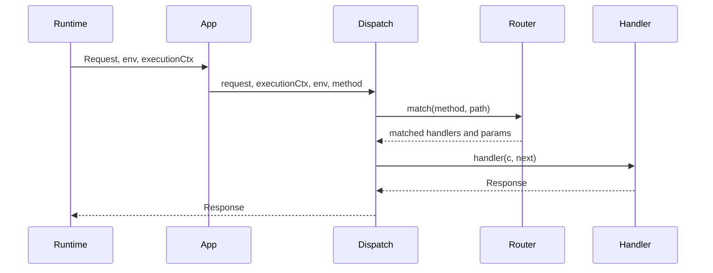

## Overview

This page builds a small Hono app from scratch: create the app, add routes and middleware, return text and JSON, run it on a runtime, and test it without a server. Everything here uses the `hono` package and the default `Hono` class, whose `fetch` method is a plain `(Request) => Response` function, which is why one app runs unchanged on every runtime.

Sources: [README.md:22-39](repo://README.md#L22-L39), [src/hono-base.ts:468-485](repo://src/hono-base.ts#L468-L485)

## Create a project

The fastest start is the `create-hono` project generator.

Sources: [README.md:35-39](repo://README.md#L35-L39)

```bash
npm create hono@latest
```

Sources: [README.md:37-39](repo://README.md#L37-L39)

To add Hono to an existing project, install the `hono` package. It has no runtime dependencies, ships both ESM (`dist/index.js`) and CommonJS (`dist/cjs/index.js`) builds and requires Node.js 16.9.0 or later when run on Node. On Deno, import it from JSR as `jsr:@hono/hono`.

Sources: [package.json:1-12](repo://package.json#L1-L12), [package.json:695-698](repo://package.json#L695-L698), [docs/MIGRATION.md:3-19](repo://docs/MIGRATION.md#L3-L19)

## Create the app and add routes

### Route methods

`new Hono()` creates an app. Its constructor defines one method per HTTP verb (`get`, `post`, `put`, `delete`, `options`, `patch`) plus `all`, each taking an optional path and one or more handlers. A handler receives the `Context` `c` and returns a `Response`. Every route method returns the app, so calls can be chained.

Sources: [src/hono-base.ts:126-141](repo://src/hono-base.ts#L126-L141), [src/router.ts:9-17](repo://src/router.ts#L9-L17)

```ts
import { Hono } from 'hono'

const app = new Hono()

app.get('/', (c) => c.text('Hello Hono!'))

app.get('/posts/:id', (c) => {
  const id = c.req.param('id')
  const page = c.req.query('page')
  return c.json({ id, page })
})

app.post('/posts', async (c) => {
  const body = await c.req.json()
  return c.json({ created: body }, 201)
})

export default app
```

Sources: [src/hono-base.ts:126-141](repo://src/hono-base.ts#L126-L141), [src/request.ts:100-115](repo://src/request.ts#L100-L115), [src/request.ts:148-152](repo://src/request.ts#L148-L152), [src/request.ts:253-255](repo://src/request.ts#L253-L255), [src/context.ts:682-721](repo://src/context.ts#L682-L721)

`c.req` is a `HonoRequest`, created lazily on first access. `c.req.param('id')` reads the named path parameter and decodes it only when it contains a `%`; `c.req.query('page')` reads one query-string value; `c.req.json()` parses the body and caches it so later reads do not fail on an already-consumed stream. See [[HonoRequest]].

Sources: [src/context.ts:366-369](repo://src/context.ts#L366-L369), [src/request.ts:102-110](repo://src/request.ts#L102-L110), [src/request.ts:148-152](repo://src/request.ts#L148-L152), [src/request.ts:253-255](repo://src/request.ts#L253-L255)

### Other ways to register routes

| Call | Effect |
| --- | --- |
| `app.all('/x', h)` | Matches every method on `/x` |
| `app.on('PURGE', '/x', h)` | Registers custom or several methods (`['GET', 'POST']`) and several paths at once; methods are upper-cased |
| `app.get('/x', h1, h2)` | Registers a chain of handlers for one route; `h1` must call `await next()` |
| `app.get(h)` | Registers on the path of the previous call (the app remembers its last path) |
| `app.route('/api', sub)` | Mounts every route of another `Hono` instance under `/api` |
| `app.basePath('/v1')` | Returns a clone whose routes are all prefixed with `/v1` |
| `app.mount('/legacy', otherApp.fetch)` | Forwards `/legacy/*` to any fetch-style handler from another framework |

Sources: [src/hono-base.ts:126-168](repo://src/hono-base.ts#L126-L168), [src/hono-base.ts:208-253](repo://src/hono-base.ts#L208-L253), [src/hono-base.ts:328-383](repo://src/hono-base.ts#L328-L383)

```ts
const books = new Hono()
books.get('/', (c) => c.text('List books'))
books.get('/:id', (c) => c.text(`Book ${c.req.param('id')}`))

const app = new Hono()
app.route('/books', books) // GET /books, GET /books/:id
```

Sources: [src/hono-base.ts:190-232](repo://src/hono-base.ts#L190-L232)

`app.get` also answers `HEAD`: dispatch reruns a `HEAD` request as `GET` and returns the response with its body dropped. There is no separate `app.head()`.

Sources: [src/hono-base.ts:412-416](repo://src/hono-base.ts#L412-L416), [docs/MIGRATION.md:34-34](repo://docs/MIGRATION.md#L34-L34)

## Return a response

`Context` has one helper per response type. Each sets a default `Content-Type` and accepts a status and headers, either as `(body, status, headers)` or `(body, init)`.

Sources: [src/context.ts:604-641](repo://src/context.ts#L604-L641)

| Helper | Content-Type | Notes |
| --- | --- | --- |
| `c.text(text, status?, headers?)` | `text/plain; charset=UTF-8` | With no status, headers or prior `c.header` calls it returns `new Response(text)` directly, the fastest path |
| `c.json(object, status?, headers?)` | `application/json` | Body is `JSON.stringify(object)`; the return type carries the JSON shape for [[RPC Client (hc)]] |
| `c.html(html, status?, headers?)` | `text/html; charset=UTF-8` | Accepts a string or a `Promise<string>` (JSX output); see [[JSX Server Rendering]] |
| `c.body(data, status?, headers?)` | none | Raw `string`, `ArrayBuffer`, `ReadableStream` or `Uint8Array` |
| `c.redirect(location, status?)` | none | Sets `Location` (non-Latin-1 URLs are `encodeURI`d); status defaults to 302 |
| `c.notFound()` | from the not-found handler | Calls the app's not-found handler |

Sources: [src/context.ts:279-286](repo://src/context.ts#L279-L286), [src/context.ts:664-733](repo://src/context.ts#L664-L733), [src/context.ts:750-779](repo://src/context.ts#L750-L779)

Headers and status can be set before the body helper runs: `c.header(name, value)` writes to prepared headers (or `append: true` to add instead of replace, `value` undefined to delete), and `c.status(code)` sets the status the next helper uses when none is passed. See [[Context]].

Sources: [src/context.ts:515-531](repo://src/context.ts#L515-L531), [src/context.ts:637-638](repo://src/context.ts#L637-L638)

## Add middleware

### Built-in and custom middleware

`app.use(path?, ...handlers)` registers middleware for all methods. Without a path it applies to `*`, every request. Middleware is a function `(c, next) => Promise<Response | void>`: code before `await next()` runs on the way in, code after it runs on the way out, when `c.res` holds the downstream response.

Sources: [src/hono-base.ts:156-168](repo://src/hono-base.ts#L156-L168), [src/types.ts:83-88](repo://src/types.ts#L83-L88)

```ts
import { Hono } from 'hono'
import { logger } from 'hono/logger'

const app = new Hono()

app.use(logger())

app.use('/api/*', async (c, next) => {
  const start = Date.now()
  await next()
  c.header('X-Response-Time', `${Date.now() - start}ms`)
})

app.get('/api/hello', (c) => c.json({ message: 'Hello' }))
```

Sources: [src/middleware/logger/index.ts:81-95](repo://src/middleware/logger/index.ts#L81-L95), [src/hono-base.ts:156-168](repo://src/hono-base.ts#L156-L168), [src/context.ts:515-527](repo://src/context.ts#L515-L527)

Handlers run in registration order. `compose` throws `next() called multiple times` when one middleware calls `next` twice, and dispatch throws `Context is not finalized. Did you forget to return a Response object or await next()?` when a chain of several handlers ends without any of them producing a response. See [[Middleware Composition]] and the middleware pages such as [[Security Middleware]] and [[Request Utility Middleware]].

Sources: [src/compose.ts:32-36](repo://src/compose.ts#L32-L36), [src/hono-base.ts:450-465](repo://src/hono-base.ts#L450-L465)

### Sharing values between middleware and handlers

`c.set(key, value)` stores a per-request variable and `c.get(key)` or the read-only `c.var` reads it. Declaring a `Variables` (and `Bindings`, for runtime environment values) type in the app's generic makes these calls type-checked; see [[Type System]].

Sources: [src/context.ts:546-602](repo://src/context.ts#L546-L602), [src/types.ts:26-33](repo://src/types.ts#L26-L33)

```ts
type Env = {
  Variables: { user: string }
}

const app = new Hono<Env>()

app.use(async (c, next) => {
  c.set('user', 'alice')
  await next()
})

app.get('/me', (c) => c.text(`Hi ${c.var.user}`))
```

Sources: [src/types.ts:30-33](repo://src/types.ts#L30-L33), [src/context.ts:546-602](repo://src/context.ts#L546-L602)

## Handle errors and 404

Without configuration an unmatched request answers `404 Not Found` as text and a thrown `Error` answers `Internal Server Error` with status 500 after logging it. An error that has a `getResponse` method, such as `HTTPException`, answers with its own response instead. `app.notFound(handler)` and `app.onError(handler)` replace those defaults.

Sources: [src/hono-base.ts:31-42](repo://src/hono-base.ts#L31-L42), [src/hono-base.ts:271-294](repo://src/hono-base.ts#L271-L294), [src/http-exception.ts:46-78](repo://src/http-exception.ts#L46-L78)

```ts
import { HTTPException } from 'hono/http-exception'

app.get('/admin', () => {
  throw new HTTPException(401, { message: 'Unauthorized' })
})

app.notFound((c) => c.text('Custom 404 Message', 404))

app.onError((err, c) => {
  if (err instanceof HTTPException) {
    return err.getResponse()
  }
  return c.text('Custom Error Message', 500)
})
```

Sources: [src/hono-base.ts:255-294](repo://src/hono-base.ts#L255-L294), [src/http-exception.ts:46-78](repo://src/http-exception.ts#L46-L78)

[[Error Handling and HTTPException]] covers how errors in sub-apps mounted with `route` use the sub-app's own `onError`.

Sources: [src/hono-base.ts:218-231](repo://src/hono-base.ts#L218-L231)

## Run it on a runtime

### The fetch export

`app.fetch(request, env?, executionCtx?)` is the whole runtime contract. Platforms that call a default export's `fetch` (Cloudflare Workers, Bun) take the app as is with `export default app`. Others call `app.fetch` themselves or go through an adapter that converts their event format to a `Request`.

Sources: [src/hono-base.ts:468-485](repo://src/hono-base.ts#L468-L485)



Sources: [src/hono-base.ts:406-485](repo://src/hono-base.ts#L406-L485)

### Runtime entry points

| Runtime | Entry code |
| --- | --- |
| Cloudflare Workers, Bun | `export default app` |
| Deno | `Deno.serve(app.fetch)` |
| Node.js | `serve(app)` from the separate `@hono/node-server` package |
| AWS Lambda | `export const handler = handle(app)` from `hono/aws-lambda` |
| Vercel, Netlify, Lambda@Edge, Cloudflare Pages | `handle(app)` from the matching `hono/<runtime>` sub-path |
| Service Worker style | `fire(app)` from `hono/service-worker` |

Sources: [README.md:26-33](repo://README.md#L26-L33), [runtime-tests/deno/stream.test.ts:21-21](repo://runtime-tests/deno/stream.test.ts#L21-L21), [runtime-tests/node/index.test.ts:1-30](repo://runtime-tests/node/index.test.ts#L1-L30), [src/adapter/aws-lambda/handler.ts:210-250](repo://src/adapter/aws-lambda/handler.ts#L210-L250), [src/adapter/service-worker/index.ts:28-36](repo://src/adapter/service-worker/index.ts#L28-L36)

Bindings passed as the second `fetch` argument become `c.env`, and the third argument becomes `c.executionCtx`, which throws `This context has no ExecutionContext` when the runtime supplied none. [[Runtime Adapters]] covers each platform's options.

Sources: [src/context.ts:352-361](repo://src/context.ts#L352-L361), [src/context.ts:391-397](repo://src/context.ts#L391-L397)

> [!WARNING]
> `app.fire()` on the app instance is deprecated. Use `fire` from `hono/service-worker`.

Sources: [src/hono-base.ts:519-542](repo://src/hono-base.ts#L519-L542)

## Test with app.request

`app.request(input, requestInit?, env?, executionCtx?)` sends a request through the app in-process, with no server or network. A path string is turned into `http://localhost<path>`; a full `http://` or `https://` URL or a `Request` object is used as is (with `requestInit` merged into a new `Request`).

Sources: [src/hono-base.ts:487-517](repo://src/hono-base.ts#L487-L517)

```ts
import { describe, expect, it } from 'vitest'
import app from './app'

describe('app', () => {
  it('GET / returns text', async () => {
    const res = await app.request('/')
    expect(res.status).toBe(200)
    expect(await res.text()).toBe('Hello Hono!')
  })

  it('POST /posts returns 201', async () => {
    const res = await app.request('/posts', {
      method: 'POST',
      body: JSON.stringify({ title: 'Hello' }),
      headers: { 'Content-Type': 'application/json' },
    })
    expect(res.status).toBe(201)
  })
})
```

Sources: [src/hono-base.ts:487-517](repo://src/hono-base.ts#L487-L517)

For typed tests, `testClient(app)` from `hono/testing` wraps `app.request` in the [[RPC Client (hc)]], so routes are called as typed methods. See [[Factory, Testing and Other Helpers]].

Sources: [src/helper/testing/index.ts:16-27](repo://src/helper/testing/index.ts#L16-L27)
