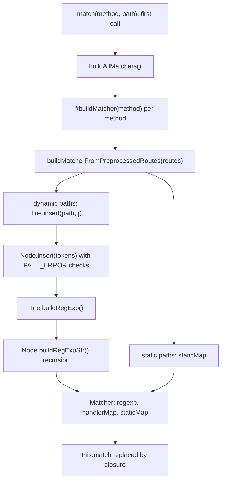

## Overview

`RegExpRouter` is the router Hono tries first in its default preset. Instead of walking a tree per request, it compiles all routes of one HTTP method into a single regular expression the first time `match` is called, plus a hash map for routes without parameters. A request is then answered by one object lookup or one `String.prototype.match` call, and the index of an empty capture group tells it which list of handlers matched.

Sources: [src/router/reg-exp-router/router.ts:122-130](repo://src/router/reg-exp-router/router.ts#L122-L130), [src/router/reg-exp-router/matcher.ts:10-33](repo://src/router/reg-exp-router/matcher.ts#L10-L33), [src/hono.ts:26-32](repo://src/hono.ts#L26-L32)

The price of a single regex is expressiveness: some route sets cannot be written as one unambiguous alternation. In those cases the router throws `UnsupportedPathError`, and `SmartRouter` falls back to `TrieRouter` (see [[Router Interface and Selection]]). The module also exports `PreparedRegExpRouter`, which loads matchers that were built and serialised ahead of time.

Sources: [src/router/reg-exp-router/router.ts:60-65](repo://src/router/reg-exp-router/router.ts#L60-L65), [src/router/reg-exp-router/index.ts:1-7](repo://src/router/reg-exp-router/index.ts#L1-L7)

| File | Contents |
| --- | --- |
| `router.ts` | `RegExpRouter`: route collection in `add`, `buildAllMatchers`, `buildMatcherFromPreprocessedRoutes` |
| `trie.ts` | `Trie`: tokenises paths and turns the tree into the final regex with capture-index maps |
| `node.ts` | `Node`: one tree node, ambiguity checks (`PATH_ERROR`), regex string generation |
| `matcher.ts` | `Matcher` types and the shared `match` function |
| `prepared-router.ts` | `PreparedRegExpRouter`, `buildInitParams`, `serializeInitParams` |

Sources: [src/router/reg-exp-router/router.ts:1-12](repo://src/router/reg-exp-router/router.ts#L1-L12), [src/router/reg-exp-router/trie.ts:1-10](repo://src/router/reg-exp-router/trie.ts#L1-L10), [src/router/reg-exp-router/node.ts:1-10](repo://src/router/reg-exp-router/node.ts#L1-L10), [src/router/reg-exp-router/matcher.ts:1-8](repo://src/router/reg-exp-router/matcher.ts#L1-L8)

## Collecting routes in add

### Two maps per method

Before the first match, the router keeps two nested records keyed by method and then by path: `#middleware` for wildcard paths (those ending in `*`) and `#routes` for everything else. Each value is a list of `[handler, paramCount]`. Both records start with an empty `ALL` entry. The first time a new method is seen, `add` creates its entry in both records by copying every list already stored under `ALL`, so a method-specific matcher also contains the `app.use()` middleware registered earlier.

Sources: [src/router/reg-exp-router/router.ts:122-147](repo://src/router/reg-exp-router/router.ts#L122-L147)

`'/*'` is normalised to `'*'`, and `paramCount` is the number of `/:` occurrences in the path. Once matchers are built both records are set to `undefined`, and a later `add` throws `MESSAGE_MATCHER_IS_ALREADY_BUILT`.

Sources: [src/router/reg-exp-router/router.ts:132-153](repo://src/router/reg-exp-router/router.ts#L132-L153), [src/router/reg-exp-router/router.ts:217-219](repo://src/router/reg-exp-router/router.ts#L217-L219)

### Wildcard paths

A path ending in `*` is compiled with `buildWildcardRegExp`, which escapes regex metacharacters and turns a trailing `/*` into `(?:|/.*)` (so `/api/*` matches `/api` and `/api/x`). The path gets its own middleware list, seeded by `findMiddleware` with a copy of the most specific existing middleware whose pattern matches it (keys are tried longest first). The handler is then appended to every middleware list and every route list, across the affected methods, whose path the wildcard regex matches. That is how middleware registered after a route still runs for it, in registration order.

Sources: [src/router/reg-exp-router/router.ts:19-32](repo://src/router/reg-exp-router/router.ts#L19-L32), [src/router/reg-exp-router/router.ts:105-120](repo://src/router/reg-exp-router/router.ts#L105-L120), [src/router/reg-exp-router/router.ts:155-187](repo://src/router/reg-exp-router/router.ts#L155-L187)

### Concrete paths

Any other path is expanded with `checkOptionalParameter`, so `/v1/:version?` produces `/v1` and `/v1/:version`. For each expanded path and each affected method, the route list is created on first use with a copy of the matching middleware and the handler is appended. Its stored param count is `paramCount - len + i + 1`, so a shorter optional expansion records fewer parameters.

Sources: [src/router/reg-exp-router/router.ts:189-204](repo://src/router/reg-exp-router/router.ts#L189-L204), [src/utils/url.ts:171-206](repo://src/utils/url.ts#L171-L206)

## Building matchers

### buildAllMatchers and buildMatcher

The first `match` call goes through the shared `match` in `matcher.ts`, which calls `buildAllMatchers()`. That builds one matcher per method seen in either record, releases both records and clears the wildcard regex cache. `#buildMatcher(method)` gathers the method's own middleware and routes; for a record that has nothing for that method it borrows the `ALL` entries instead. A method with no own routes at all gets `null`, and at match time that method falls back to the `ALL` matcher.

Sources: [src/router/reg-exp-router/router.ts:206-251](repo://src/router/reg-exp-router/router.ts#L206-L251), [src/router/reg-exp-router/matcher.ts:10-15](repo://src/router/reg-exp-router/matcher.ts#L10-L15)



Sources: [src/router/reg-exp-router/matcher.ts:10-33](repo://src/router/reg-exp-router/matcher.ts#L10-L33), [src/router/reg-exp-router/router.ts:34-103](repo://src/router/reg-exp-router/router.ts#L34-L103), [src/router/reg-exp-router/trie.ts:10-73](repo://src/router/reg-exp-router/trie.ts#L10-L73)

### buildMatcherFromPreprocessedRoutes

This function turns the list of `[path, handlers]` pairs for one method into a `Matcher<T>`, the tuple `[RegExp, HandlerData<T>[], StaticMap<T>]`.

Sources: [src/router/reg-exp-router/matcher.ts:4-7](repo://src/router/reg-exp-router/matcher.ts#L4-L7), [src/router/reg-exp-router/router.ts:34-103](repo://src/router/reg-exp-router/router.ts#L34-L103)

1. An empty route list returns `nullMatcher`, which never matches.
2. Each path is flagged static when it contains neither `*` nor `/:`. Dynamic paths are sorted first by length, static paths last.
3. A static path goes straight into `staticMap` with an empty params object per handler. It is still inserted into the trie with `pathErrorCheckOnly = true`, which runs the ambiguity checks without adding nodes.
4. A dynamic path gets the next index `j`, and `trie.insert` returns its `paramAssoc` list of `[name, varIndex]`. Each handler's `ParamIndexMap` is filled from the first `paramCount` entries, so a middleware registered on `/posts/*` sees no parameters even when it shares a list with `/posts/:id`.
5. `trie.buildRegExp()` returns the regex and two replacement maps. The param maps are rewritten from trie variable indexes to capture-group indexes, and `handlerMap[captureIndex]` is set to the handler list of the route ending there.

Sources: [src/router/reg-exp-router/router.ts:37-80](repo://src/router/reg-exp-router/router.ts#L37-L80), [src/router/reg-exp-router/router.ts:82-102](repo://src/router/reg-exp-router/router.ts#L82-L102)

> [!NOTE]
> Static routes never enter the regex, so the common case of fixed paths such as `/health` costs one property lookup. `staticMap` is created with `Object.create(null)` so a path like `/constructor` cannot hit a prototype property.

Sources: [src/router/reg-exp-router/router.ts:51-58](repo://src/router/reg-exp-router/router.ts#L51-L58), [src/router/reg-exp-router/matcher.ts:17-20](repo://src/router/reg-exp-router/matcher.ts#L17-L20)

## The Trie and Node

### Tokenising a path

`Trie.insert` first replaces every `{...}` regexp group with a placeholder mark, repeating until nothing is left, so the tokenizer does not split inside them. It then tokenises with `/(?::[^\/]+)|(?:\/\*$)|./g`: a `:label` token (with its regexp), a trailing `/*`, or a single character. Static text is therefore stored one character per node, which lets routes that share a prefix share nodes. The marks are put back into their tokens before `Node.insert` runs.

Sources: [src/router/reg-exp-router/trie.ts:10-47](repo://src/router/reg-exp-router/trie.ts#L10-L47)

### Node.insert

Each `Node` holds an optional end-of-route `#index`, an optional `#varIndex` when it captures a parameter, and `#children` keyed by either a literal character or a regex source string.

Sources: [src/router/reg-exp-router/node.ts:45-48](repo://src/router/reg-exp-router/node.ts#L45-L48)

| Token | Child key | Meaning |
| --- | --- | --- |
| `*` as the last token | `ONLY_WILDCARD_REG_EXP_STR` (`.*`) | Matches everything remaining |
| `*` elsewhere | `LABEL_REG_EXP_STR` (`[^/]+`) | One segment, no capture |
| `/*` at the end | `TAIL_WILDCARD_REG_EXP_STR` | The prefix itself or anything below it |
| `:name` | `LABEL_REG_EXP_STR` | One segment, captured |
| `:name{re}` | `re` | Custom regexp, captured |
| any other character | the character | Literal |

Sources: [src/router/reg-exp-router/node.ts:1-4](repo://src/router/reg-exp-router/node.ts#L1-L4), [src/router/reg-exp-router/node.ts:69-77](repo://src/router/reg-exp-router/node.ts#L69-L77)

A new parameter node gets `varIndex = context.varIndex++`, a counter shared by the whole trie, and every insert pushes `[name, varIndex]` into `paramMap` for the parameters along its path. Two routes that differ only in a parameter's name (`/:type/:id` and `/:class/:id`) reach the same node because the child key is the regex, not the name.

Sources: [src/router/reg-exp-router/node.ts:94-113](repo://src/router/reg-exp-router/node.ts#L94-L113)

### Ambiguity checks and PATH_ERROR

`Node.insert` throws the private `PATH_ERROR` symbol whenever the route set cannot be expressed as one ordered alternation; `buildMatcherFromPreprocessedRoutes` converts it into `UnsupportedPathError(path)`.

Sources: [src/router/reg-exp-router/node.ts:50-133](repo://src/router/reg-exp-router/node.ts#L50-L133), [src/router/reg-exp-router/router.ts:60-65](repo://src/router/reg-exp-router/router.ts#L60-L65)

| Condition | Example that triggers it |
| --- | --- |
| A route already ends at this node | `/:type/:id` and `/:class/:id` |
| A new parameter child next to a non-wildcard sibling | `/reg-exp/router` with `/reg-exp/:id`, or `/:id/:action{create}` with `/:id/:action{delete}` |
| A new literal child next to a parameter sibling | `/posts/:id` with `/:id/:action` |
| A custom regexp of `.*` | `/:path{.*}` |
| A capturing group in a custom regexp | `/foo/:capture{ba(r)}` |

Sources: [src/router/reg-exp-router/node.ts:57-67](repo://src/router/reg-exp-router/node.ts#L57-L67), [src/router/reg-exp-router/node.ts:79-130](repo://src/router/reg-exp-router/node.ts#L79-L130), [src/router/reg-exp-router/router.test.ts:40-140](repo://src/router/reg-exp-router/router.test.ts#L40-L140)

A whole-group regexp such as `{(a|b)}` is accepted because the node rewrites it to `(?:a|b)`; only a group that is part of a longer pattern is refused, since an extra capture would shift every capture index after it. Wildcard children (`.*` and `(?:|/.*)`) are exempt from the sibling checks, so `app.use('/api/*')` can coexist with any route under `/api`.

Sources: [src/router/reg-exp-router/node.ts:81-113](repo://src/router/reg-exp-router/node.ts#L81-L113)

### Generating the regex

`Node.buildRegExpStr` sorts child keys with `compareKey` (single-character literals first, then custom regexps with longer ones first, then `[^/]+`, then wildcards), so more specific branches are tried earlier. A parameter child is emitted as `(key)@varIndex`, a regex metacharacter literal is escaped, and a node where a route ends contributes `#index` before its children. Several alternatives are joined as `(?:a|b)`.

Sources: [src/router/reg-exp-router/node.ts:13-43](repo://src/router/reg-exp-router/node.ts#L13-L43), [src/router/reg-exp-router/node.ts:135-161](repo://src/router/reg-exp-router/node.ts#L135-L161)

`Trie.buildRegExp` then rewrites the markers in one pass, counting capture groups as it goes. Each `#n` becomes `$()`: an end anchor followed by an empty capture group whose position is recorded in `indexReplacementMap`. Each `@n` is removed, and the number of the capture group just before it is stored in `paramReplacementMap[n]`. The result is anchored with `^`.

Sources: [src/router/reg-exp-router/trie.ts:49-73](repo://src/router/reg-exp-router/trie.ts#L49-L73)

For `app.use('/api/*')` plus `GET /api/posts/:id`, `GET /api/posts/:id/comments/:cid`, `GET /api/about` and `GET /api/files/:name{.+\.png}`, the GET matcher is the following, with `/api/about` kept in `staticMap` instead:

Sources: [src/router/reg-exp-router/node.ts:135-161](repo://src/router/reg-exp-router/node.ts#L135-L161), [src/router/reg-exp-router/trie.ts:49-73](repo://src/router/reg-exp-router/trie.ts#L49-L73)

```text
^\/api(?:\/(?:files\/(.+\.png)$()|posts\/([^/]+)(?:$()|\/comments\/([^/]+)$()))|(?:|\/.*)$())
```

Sources: [src/router/reg-exp-router/node.ts:135-161](repo://src/router/reg-exp-router/node.ts#L135-L161), [src/router/reg-exp-router/trie.ts:49-73](repo://src/router/reg-exp-router/trie.ts#L49-L73)

## Matching a request

The shared `match` function builds the matchers once and then replaces `this.match` with a closure, so later requests skip the build check. The closure picks `matchers[method]`, falling back to `matchers.ALL`, returns the `staticMap` entry when the path is there, and otherwise runs the regex. No match returns `[[], emptyParam]`.

Sources: [src/router/reg-exp-router/matcher.ts:10-33](repo://src/router/reg-exp-router/matcher.ts#L10-L33)

```ts
    const match = path.match(matcher[0])
    if (!match) {
      return [[], emptyParam]
    }

    const index = match.indexOf('', 1)
    return [matcher[1][index], match]
```

Sources: [src/router/reg-exp-router/matcher.ts:10-33](repo://src/router/reg-exp-router/matcher.ts#L10-L33)

`match.indexOf('', 1)` finds the first capture group that matched the empty string: the `$()` of the route that matched. Parameter captures are non-empty, and the `$()` groups of other branches are `undefined`. That index selects the handler list, and the match array itself is returned as the `ParamStash`, so each handler's `ParamIndexMap` points straight into it without copying. For the regex above, `GET /api/posts/1/comments/2` returns the middleware and the comments handler with `{ cid: 5, id: 3 }` and a stash where index 3 is `'1'` and index 5 is `'2'`.

Sources: [src/router/reg-exp-router/matcher.ts:22-28](repo://src/router/reg-exp-router/matcher.ts#L22-L28), [src/router.ts:66-98](repo://src/router.ts#L66-L98), [src/request.ts:106-128](repo://src/request.ts#L106-L128)

## PreparedRegExpRouter

### Why it exists

Building matchers costs time on the first request, which matters on platforms that start a fresh isolate often. `PreparedRegExpRouter` moves that work to build time: a build step compiles the route paths into matchers and serialises them as JavaScript, and at runtime the router is constructed from that data and only has to put handlers into the prepared slots.

Sources: [src/router/reg-exp-router/prepared-router.ts:9-17](repo://src/router/reg-exp-router/prepared-router.ts#L9-L17), [src/router/reg-exp-router/prepared-router.ts:95-165](repo://src/router/reg-exp-router/prepared-router.ts#L95-L165)

### buildInitParams and serializeInitParams

`buildInitParams({ paths })` subclasses `RegExpRouter` to expose the protected `buildAllMatchers`, registers every path under `ALL` with the path string itself as the handler, and builds. It then records in a `RelocateMap` where each path's placeholder landed: numeric handler-list indexes for regex routes (with the merged `ParamIndexMap`) and `staticMap` keys for static routes, where `''` means the path's own key. Finally it empties every handler list, leaving `0` in unused slots. `serializeInitParams` emits the result as source text, embedding each `RegExp` via `toString()` so the output can be evaluated as JavaScript.

Sources: [src/router/reg-exp-router/prepared-router.ts:95-165](repo://src/router/reg-exp-router/prepared-router.ts#L95-L165)

```ts
const params = buildInitParams({
  paths: ['/hello/:name', '/hello/:name/posts/:postId'],
})
// [
//   { ALL: [/^\/hello\/([^/]+)(?:$()|\/posts\/([^/]+)$())/, [0, 0, [], 0, []], {}] },
//   {
//     '/hello/:name': [ [ [2], { name: 1 } ] ],
//     '/hello/:name/posts/:postId': [ [ [4], { name: 1, postId: 3 } ] ],
//   },
// ]
```

Sources: [src/router/reg-exp-router/prepared-router.test.ts:104-118](repo://src/router/reg-exp-router/prepared-router.test.ts#L104-L118)

### Runtime add and match

`new PreparedRegExpRouter(matchers, relocateMap)` stores both. `add(method, path, handler)` first clones the `ALL` matcher for a method it has not seen (sharing the regex, copying the handler lists and static map). A `*` or `/*` path is appended to every handler list and static entry of the method, or of all methods for `ALL`. Any other path is looked up in `relocateMap` and pushed into each recorded slot; a path that was not prepared throws `Path ${path} is not registered`. `match` is the same shared function as `RegExpRouter`'s, with `buildAllMatchers` simply returning the stored matchers.

Sources: [src/router/reg-exp-router/prepared-router.ts:19-93](repo://src/router/reg-exp-router/prepared-router.ts#L19-L93)

```ts
import { Hono } from 'hono'
import { PreparedRegExpRouter } from 'hono/router/reg-exp-router'

// generated at build time by serializeInitParams(buildInitParams({ paths }))
const params = [/* matchers */, /* relocateMap */] as ConstructorParameters<typeof PreparedRegExpRouter>

const app = new Hono({ router: new PreparedRegExpRouter(...params) })
```

Sources: [src/router/reg-exp-router/prepared-router.ts:9-17](repo://src/router/reg-exp-router/prepared-router.ts#L9-L17), [src/router/reg-exp-router/index.ts:6-7](repo://src/router/reg-exp-router/index.ts#L6-L7), [src/hono-base.ts:55-65](repo://src/hono-base.ts#L55-L65)

> [!WARNING]
> `PreparedRegExpRouter` has the same limits as `RegExpRouter` (a path that cannot be compiled fails in `buildInitParams`) and no fallback router. The list of paths given to `buildInitParams` must contain every path the app registers, including middleware paths other than `*`.

Sources: [src/router/reg-exp-router/prepared-router.ts:73-76](repo://src/router/reg-exp-router/prepared-router.ts#L73-L76), [src/router/reg-exp-router/prepared-router.test.ts:5-24](repo://src/router/reg-exp-router/prepared-router.test.ts#L5-L24)
