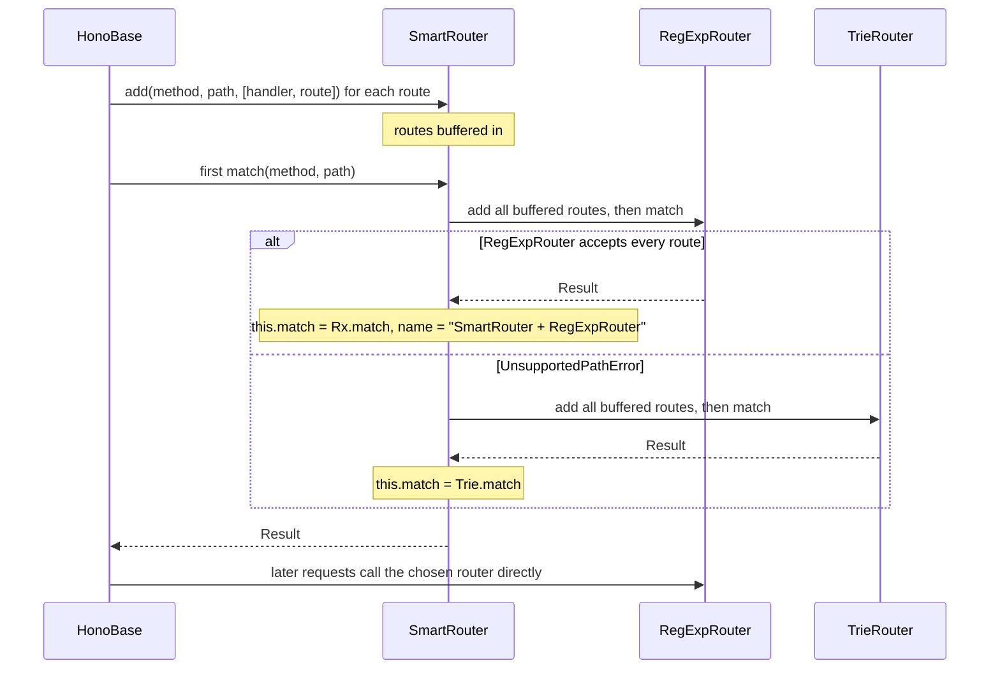

## Overview

Hono separates "which handlers answer this request" from everything else in the request lifecycle. A router is any object with a `name`, an `add(method, path, handler)` method and a `match(method, path)` method; `HonoBase` calls `add` for every registered route and middleware and calls `match` once per request. Because the contract is that small, Hono ships five interchangeable routers and lets an application pick one through the `router` option or through a preset entry point.

Sources: [src/router.ts:24-52](repo://src/router.ts#L24-L52), [src/hono-base.ts:46-65](repo://src/hono-base.ts#L46-L65)

The default `Hono` class from `hono` uses `SmartRouter` wrapping `RegExpRouter` and `TrieRouter`. `hono/quick` uses `SmartRouter` with `LinearRouter` and `TrieRouter`, and `hono/tiny` uses `PatternRouter` alone. This page covers the shared interface, how routes reach the router, the path syntax every router accepts, and how to choose. The internals are in [[RegExpRouter]] and [[TrieRouter, LinearRouter and PatternRouter]].

Sources: [src/hono.ts:16-33](repo://src/hono.ts#L16-L33), [src/preset/quick.ts:13-24](repo://src/preset/quick.ts#L13-L24), [src/preset/tiny.ts:11-20](repo://src/preset/tiny.ts#L11-L20)

## The Router interface

### Methods and constants

`src/router.ts` defines the interface, the result type and the constants the routers share.

Sources: [src/router.ts:29-52](repo://src/router.ts#L29-L52)

```ts
export interface Router<T> {
  name: string
  add(method: string, path: string, handler: T): void
  match(method: string, path: string): Result<T>
}
```

Sources: [src/router.ts:29-52](repo://src/router.ts#L29-L52)

| Export | Value | Role |
| --- | --- | --- |
| `METHOD_NAME_ALL` | `'ALL'` | Method key used for `app.use()` and `app.all()`; a route stored under it matches any request method |
| `METHOD_NAME_ALL_LOWERCASE` | `'all'` | Name of the `app.all` method installed by `HonoBase` |
| `METHODS` | `['get', 'post', 'put', 'delete', 'options', 'patch']` | Methods that get an `app.<method>()` helper |
| `MESSAGE_MATCHER_IS_ALREADY_BUILT` | error text | Thrown by routers that compile on first match when `add` is called afterwards |
| `UnsupportedPathError` | `Error` subclass | Thrown by a router that cannot represent a route; `SmartRouter` catches it to fall back |

Sources: [src/router.ts:6-22](repo://src/router.ts#L6-L22), [src/router.ts:100-103](repo://src/router.ts#L100-L103)

### The Result type

`match` returns every handler whose pattern fits the request, in registration order, together with its parameters. Two encodings are allowed so that a regex-based router can avoid building a params object per handler.

Sources: [src/router.ts:54-98](repo://src/router.ts#L54-L98)

```ts
export type Result<T> = [[T, ParamIndexMap][], ParamStash] | [[T, Params][]]
```

Sources: [src/router.ts:54-98](repo://src/router.ts#L54-L98)

| Form | Shape | Produced by |
| --- | --- | --- |
| Index form | A list of `[handler, { id: 1 }]` pairs plus a stash such as `['/user/123', '123']`: each handler maps a param name to an index into the stash | `RegExpRouter`, `PreparedRegExpRouter` |
| Object form | A list of `[handler, { id: '123' }]` pairs and no stash: each handler carries its own params object | `TrieRouter`, `LinearRouter`, `PatternRouter` |

Sources: [src/router.ts:66-98](repo://src/router.ts#L66-L98), [src/router/reg-exp-router/matcher.ts:22-28](repo://src/router/reg-exp-router/matcher.ts#L22-L28), [src/router/trie-router/node.ts:243-243](repo://src/router/trie-router/node.ts#L243-L243)

`HonoRequest` hides the difference. It indexes `matchResult[0][routeIndex][1]` for the current handler's map and, when a stash exists at `matchResult[1]`, treats the map value as an index into it; otherwise the map value is the parameter itself. Values containing `%` are decoded lazily on read.

Sources: [src/request.ts:106-128](repo://src/request.ts#L106-L128)

## How routes reach the router

### Registration

Every public registration method ends in `#addRoute`. It upper-cases the method, prefixes the path with the app's base path through `mergePath`, and calls `router.add(method, path, [handler, routerRoute])`, so the router's `T` is always a tuple of the handler and its `RouterRoute` record. `app.use()` registers under `METHOD_NAME_ALL` with path `'*'` when no path is given; `app.on()` registers each method and path combination.

Sources: [src/hono-base.ts:126-172](repo://src/hono-base.ts#L126-L172), [src/hono-base.ts:385-397](repo://src/hono-base.ts#L385-L397)

### Dispatch

On each request `#dispatch` computes the path with `getPath` (the strict variant keeps the trailing slash, `getPathNoStrict` removes it when the `strict: false` option is set), calls `this.router.match(method, path)`, and hands the result to `Context`. A `HEAD` request is dispatched as `GET` and its body dropped. A single matched handler is called directly; more than one goes through `compose` (see [[Middleware Composition]]).

Sources: [src/hono-base.ts:406-460](repo://src/hono-base.ts#L406-L460), [src/utils/url.ts:106-146](repo://src/utils/url.ts#L106-L146)



Sources: [src/router/smart-router/router.ts:4-70](repo://src/router/smart-router/router.ts#L4-L70), [src/hono-base.ts:418-419](repo://src/hono-base.ts#L418-L419)

## SmartRouter

### Deferred selection

`SmartRouter` is not a matching algorithm. Its `add` only pushes `[method, path, handler]` into a private `#routes` array. On the first `match` it walks its `routers` in order; for each it replays every buffered route with `add` and then calls `match`. If either step throws `UnsupportedPathError`, it moves to the next router. Any other error is rethrown.

Sources: [src/router/smart-router/router.ts:4-50](repo://src/router/smart-router/router.ts#L4-L50)

Once a router succeeds, `SmartRouter` overwrites its own `match` with the winner's bound `match`, keeps only that router, clears `#routes`, and renames itself (for example `SmartRouter + RegExpRouter`). Every later request therefore pays no wrapper cost. If every router refuses, it throws `Fatal error`.

Sources: [src/router/smart-router/router.ts:46-61](repo://src/router/smart-router/router.ts#L46-L61)

### Consequences

- No route can be added after the first request: `add` throws `MESSAGE_MATCHER_IS_ALREADY_BUILT` once `#routes` is cleared.
- The `activeRouter` getter throws until the first match has happened.
- `getRouterName(app)` from `hono/dev` forces a `match('GET', '/')` so it can report the resolved name.

Sources: [src/router/smart-router/router.ts:13-19](repo://src/router/smart-router/router.ts#L13-L19), [src/router/smart-router/router.ts:63-69](repo://src/router/smart-router/router.ts#L63-L69), [src/helper/dev/index.ts:76-79](repo://src/helper/dev/index.ts#L76-L79)

```ts
import { Hono } from 'hono'
import { getRouterName } from 'hono/dev'

const app = new Hono()
app.get('/users/new', (c) => c.text('form'))
app.get('/users/:id', (c) => c.text(c.req.param('id')))

getRouterName(app) // 'SmartRouter + TrieRouter'
```

Sources: [src/helper/dev/index.ts:76-79](repo://src/helper/dev/index.ts#L76-L79), [src/router/reg-exp-router/router.test.ts:88-118](repo://src/router/reg-exp-router/router.test.ts#L88-L118)

The example falls back because `RegExpRouter` refuses a literal segment and a parameter at the same position (`/users/new` next to `/users/:id`). Many real applications hit this, and the fallback is the point of the default preset: the fast router when it can, the general router when it cannot.

Sources: [src/router/reg-exp-router/node.ts:94-130](repo://src/router/reg-exp-router/node.ts#L94-L130)

## Path pattern syntax

### Supported patterns

All routers implement the same syntax, checked by the shared suite in `src/router/common.case.test.ts`.

Sources: [src/router/common.case.test.ts:345-412](repo://src/router/common.case.test.ts#L345-L412), [src/router/common.case.test.ts:496-538](repo://src/router/common.case.test.ts#L496-L538), [src/utils/url.ts:50-78](repo://src/utils/url.ts#L50-L78)

| Pattern | Example | Matches | Notes |
| --- | --- | --- | --- |
| Static | `/about` | `/about` | Exact string |
| Named parameter | `/posts/:id` | `/posts/123` | One segment, `id = '123'` |
| Regexp parameter | `/posts/:id{[0-9]+}` | `/posts/123` | The braces hold a regular expression |
| Regexp across slashes | `/js/:filename{[a-z0-9/]+.js}` | `/js/chunk/123.js` | A regexp may consume `/` |
| Optional parameter | `/api/animals/:type?` | `/api/animals`, `/api/animals/dog` | Only as trailing segments |
| Tail wildcard | `/x/*` | `/x`, `/x/a/b` | Also matches the bare prefix |
| Bare wildcard | `*` or `/*` | every path | Typical for `app.use()` |
| Inner wildcard | `/hello/*/foo` | `/hello/bar/foo` | One segment in `TrieRouter`; not every router supports it with params |

Sources: [src/router/common.case.test.ts:345-412](repo://src/router/common.case.test.ts#L345-L412), [src/router/common.case.test.ts:496-538](repo://src/router/common.case.test.ts#L496-L538), [src/utils/url.ts:50-78](repo://src/utils/url.ts#L50-L78)

### Parsing helpers

`splitRoutingPath` first swaps every `{...}` group for a placeholder so slashes inside a regexp do not split the path, splits on `/`, then puts the groups back. `getPattern` turns a segment into a pattern tuple `[key, name, matcher]`: `true` for a plain `:name`, an anchored `RegExp` for `:name{re}`, or the string `'*'`. When the next segment is a literal, the regexp gets a lookahead `(?=/next)` so a parameter like `:dirs{.+}` in `/:dirs{.+}/file.html` stops before `file.html`. Results are cached by `label#next`.

Sources: [src/utils/url.ts:16-78](repo://src/utils/url.ts#L16-L78)

`checkOptionalParameter` expands an optional route into the list of concrete routes it stands for. `/api/animals/:type?` becomes `['/api/animals', '/api/animals/:type']`, and `/v1/:version?/:platform?` becomes three paths. `RegExpRouter`, `TrieRouter` and `LinearRouter` call it in `add`; `PatternRouter` handles a trailing `?` itself by recursion.

Sources: [src/utils/url.ts:171-206](repo://src/utils/url.ts#L171-L206), [src/router/trie-router/router.ts:13-23](repo://src/router/trie-router/router.ts#L13-L23), [src/router/pattern-router/router.ts:12-20](repo://src/router/pattern-router/router.ts#L12-L20)

### Ordering and multiple matches

A router returns all matching handlers, not just the best one, in the order they were registered. Middleware registered with `*` before a route runs before it; a `*` fallback registered after a route comes after it. This is what lets [[Middleware Composition]] treat middleware and handlers uniformly.

Sources: [src/router/common.case.test.ts:193-211](repo://src/router/common.case.test.ts#L193-L211)

## Presets and choosing a router

### Entry points

| Import | Router | Strength | Limitation |
| --- | --- | --- | --- |
| `hono` | `SmartRouter` of `RegExpRouter`, `TrieRouter` | Fastest matching once built; full syntax via fallback | Builds all regexes on the first request |
| `hono/quick` | `SmartRouter` of `LinearRouter`, `TrieRouter` | No build step, so the first request is cheap; suits environments that create an app per request | Linear scan per request |
| `hono/tiny` | `PatternRouter` | Smallest bundle | Linear scan of regexes; no fallback |
| `new Hono({ router })` | Any `Router` | Full control, including `PreparedRegExpRouter` | Must handle every route you register |

Sources: [src/hono.ts:16-33](repo://src/hono.ts#L16-L33), [src/preset/quick.ts:1-24](repo://src/preset/quick.ts#L1-L24), [src/preset/tiny.ts:1-20](repo://src/preset/tiny.ts#L1-L20), [src/hono-base.ts:55-65](repo://src/hono-base.ts#L55-L65)

```ts
import { Hono } from 'hono'
import { RegExpRouter } from 'hono/router/reg-exp-router'

const app = new Hono({ router: new RegExpRouter() })
```

Sources: [src/hono-base.ts:55-65](repo://src/hono-base.ts#L55-L65), [src/hono.ts:26-32](repo://src/hono.ts#L26-L32)

> [!NOTE]
> The `hono/quick` and `hono/tiny` classes assign their router after calling `super(options)`, so a `router` passed to them in options is overwritten. Use the default `hono` class to supply a custom router.

Sources: [src/preset/quick.ts:18-23](repo://src/preset/quick.ts#L18-L23), [src/preset/tiny.ts:15-19](repo://src/preset/tiny.ts#L15-L19), [src/hono-base.ts:170-172](repo://src/hono-base.ts#L170-L172)

> [!WARNING]
> `SmartRouter` decides once, on the first request. `LinearRouter` only throws `UnsupportedPathError` while scanning a route that has both a `:param` and a `*` (a `*` inside a `{...}` regexp counts) and whose method matches, so with `hono/quick` a first request that never reaches such a route locks in `LinearRouter`, and a later request that does reach it throws. Avoid combining parameters and wildcards in one route under `hono/quick`. `PatternRouter` in `hono/tiny` throws at registration instead, for example on a duplicate parameter name.

Sources: [src/router/linear-router/router.ts:136-138](repo://src/router/linear-router/router.ts#L136-L138), [src/router/smart-router/router.ts:21-50](repo://src/router/smart-router/router.ts#L21-L50), [src/router/pattern-router/router.ts:33-41](repo://src/router/pattern-router/router.ts#L33-L41)

### Writing a custom router

A custom router only needs to satisfy `Router<T>`. It must return every match in registration order, treat `METHOD_NAME_ALL` routes as matching any method, accept the pattern syntax above, and throw `UnsupportedPathError` for routes it cannot handle if it is meant to sit inside a `SmartRouter`. The shared `runTest` suite in `src/router/common.case.test.ts` is the reference for that behaviour.

Sources: [src/router.ts:24-52](repo://src/router.ts#L24-L52), [src/router/smart-router/router.test.ts:1-13](repo://src/router/smart-router/router.test.ts#L1-L13)
