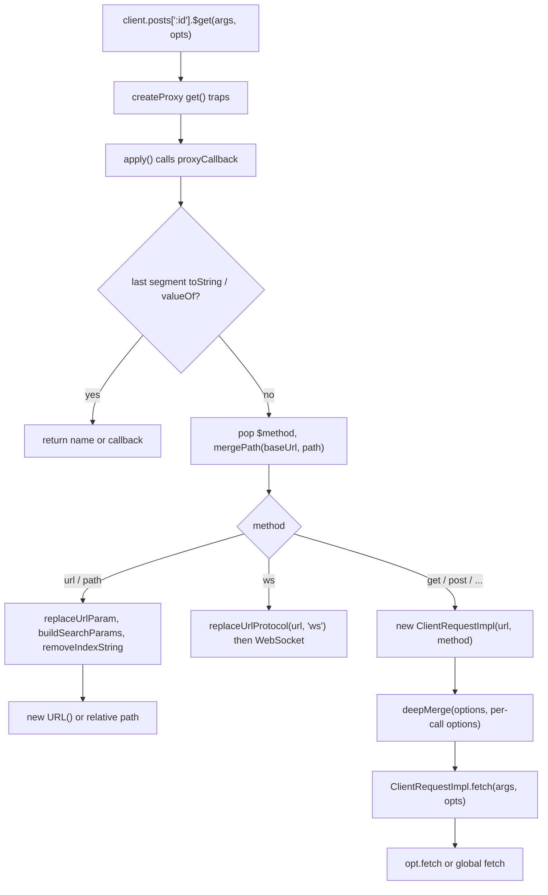

## Overview

`hc` is Hono's typed HTTP client. You export the type of a Hono app from the server (`export type AppType = typeof app`), pass it as a generic to `hc<AppType>(baseUrl)`, and get an object whose property chain mirrors the app's routes: `client.posts[':id'].$get({ param: { id: '1' } })`. Nothing is generated at build time. The route schema that Hono accumulates in its type parameters (see [[Type System]]) drives the TypeScript types, and a JavaScript `Proxy` builds the URL at runtime from whatever property names you access.

Sources: [src/client/client.ts:133-232](repo://src/client/client.ts#L133-L232), [src/client/types.ts:294-318](repo://src/client/types.ts#L294-L318)

The request shape for each endpoint comes from the `validator()` middleware on that route (see [[Validator]]), and the response shape comes from the handler's `c.json()` / `c.text()` return types. The `hono/client` entry also exports `parseResponse` for turning a response into data or a thrown `DetailedError`, plus the inference helpers `InferRequestType` and `InferResponseType`.

Sources: [src/client/index.ts:1-17](repo://src/client/index.ts#L1-L17)

## Usage

On the server, chain the route definitions so the schema type is kept, and export the app type. On the client, call `hc` with that type:

Sources: [src/client/client.ts:133-136](repo://src/client/client.ts#L133-L136), [src/client/types.ts:311-318](repo://src/client/types.ts#L311-L318)

```ts
// server.ts
import { Hono } from 'hono'
import { validator } from 'hono/validator'

const app = new Hono()
const route = app
  .get('/posts/:id', (c) => c.json({ id: c.req.param('id'), title: 'Hello' }))
  .post(
    '/posts',
    validator('json', (value) => value as { title: string }),
    (c) => c.json({ ok: true }, 201)
  )

export type AppType = typeof route

// client.ts
import { hc } from 'hono/client'
import type { AppType } from './server'

const client = hc<AppType>('http://localhost:8787')

const res = await client.posts[':id'].$get({ param: { id: '123' } })
if (res.ok) {
  const data = await res.json() // { id: string; title: string }
}
await client.posts.$post({ json: { title: 'New post' } })
```

Sources: [src/client/client.ts:133-232](repo://src/client/client.ts#L133-L232), [src/client/types.ts:67-80](repo://src/client/types.ts#L67-L80)

## Proxy-based path building

### The recursive proxy

`createProxy` wraps an empty function in a `Proxy`. Every property access (`get`) returns a new proxy with the key appended to the `path` array; calling the proxy (`apply`) hands `path` and the call arguments to the callback. Symbol keys and the key `then` return `undefined`, so `await client.posts` or a framework that probes for a thenable does not mistake the proxy for a `Promise`.

Sources: [src/client/client.ts:15-31](repo://src/client/client.ts#L15-L31)

```ts
const createProxy = (callback: Callback, path: string[]) => {
  const proxy: unknown = new Proxy(() => {}, {
    get(_obj, key) {
      if (typeof key !== 'string' || key === 'then') {
        return undefined
      }
      return createProxy(callback, [...path, key])
    },
    apply(_1, _2, args) {
      return callback({
        path,
        args,
      })
    },
  })
  return proxy
}
```

Sources: [src/client/client.ts:15-31](repo://src/client/client.ts#L15-L31)

### The dispatch callback

`proxyCallback` inspects the last path segments to decide what the call means:

Sources: [src/client/client.ts:137-232](repo://src/client/client.ts#L137-L232)

1. `toString` / `valueOf`: returns the callback itself, or with `.name.toString()` the previous segment's name, so the proxy can be printed or coerced.
2. A last segment starting with `$` is popped and becomes the method (`$get` becomes `get`).
3. The remaining segments are joined with `/` and merged onto `baseUrl` with `mergePath`, which trims trailing slashes from the base and leading slashes from the path.
4. `$url` and `$path` build a URL without sending anything; `$ws` opens a WebSocket.
5. Any other method creates a `ClientRequestImpl`, merges the per-call options over the `hc` options, and calls its `fetch`.
6. A call with no `$` method returns the `ClientRequestImpl` without sending.

Sources: [src/client/client.ts:142-231](repo://src/client/client.ts#L142-L231), [src/client/utils.ts:11-16](repo://src/client/utils.ts#L11-L16)



Sources: [src/client/client.ts:15-31](repo://src/client/client.ts#L15-L31), [src/client/client.ts:137-232](repo://src/client/client.ts#L137-L232), [src/client/utils.ts:11-60](repo://src/client/utils.ts#L11-L60)

### Path parameters and the index route

The type-level `PathToChain` splits each route path on `/` into nested properties, and a path segment that is empty becomes `index`. At runtime `removeIndexString` maps a trailing `/index` back to `/` when it is directly after the host, and strips it otherwise, so `client.index.$get()` requests `/` and `client.api.index.$get()` requests `/api`.

Sources: [src/client/types.ts:294-309](repo://src/client/types.ts#L294-L309), [src/client/utils.ts:55-60](repo://src/client/utils.ts#L55-L60)

`replaceUrlParam` substitutes each `param` entry into the matching `/:name` segment, including segments with a regex constraint (`/:id{[0-9]+}`) or an optional marker (`/:id?`). A falsy value removes the whole segment, which is how optional parameters are omitted.

Sources: [src/client/utils.ts:18-24](repo://src/client/utils.ts#L18-L24)

```ts
export const replaceUrlParam = (urlString: string, params: Record<string, string | undefined>) => {
  for (const [k, v] of Object.entries(params)) {
    const reg = new RegExp('/:' + k + '(?:{[^/]+})?\\??(?=/|$)')
    urlString = urlString.replace(reg, v ? `/${v}` : '')
  }
  return urlString
}
```

Sources: [src/client/utils.ts:18-24](repo://src/client/utils.ts#L18-L24)

## Building the request

### Arguments

The first argument of a method call carries the request data under the same target names the validator uses. `ClientRequestImpl.fetch` turns each into part of the `fetch` call:

Sources: [src/client/client.ts:53-130](repo://src/client/client.ts#L53-L130)

| Key | Effect |
| --- | --- |
| `param` | Replaces `:name` segments in the URL via `replaceUrlParam`. |
| `query` | Serialized with `buildSearchParams` (or the custom option) and appended after `?`. Arrays become repeated keys; `undefined` values are skipped. |
| `json` | Body is `JSON.stringify(args.json)` and `Content-Type` is set to `application/json`. |
| `form` | Body is a `FormData`; arrays append one entry per item, `undefined` values are skipped. `Content-Type` is left to `fetch` so the multipart boundary is set. |
| `header` | Spread into the request headers before `options.headers`. |
| `cookie` | Each pair is serialized with `path: '/'` and joined with `,` into a `Cookie` header. |

Sources: [src/client/client.ts:59-108](repo://src/client/client.ts#L59-L108), [src/client/utils.ts:26-44](repo://src/client/utils.ts#L26-L44)

The body is only attached for methods other than `GET` and `HEAD`. The method name is upper-cased, and the URL is passed to `fetch` as a string (not a `Request`) so mocking tools such as MSW and node-fetch intercept it.

Sources: [src/client/client.ts:110-129](repo://src/client/client.ts#L110-L129)

### Options

`hc(baseUrl, options)` sets defaults for every call; the second argument of each method call overrides them. `ClientRequestOptions` holds:

Sources: [src/client/types.ts:32-65](repo://src/client/types.ts#L32-L65)

| Option | Type | Default | Description |
| --- | --- | --- | --- |
| `headers` | `Record<string, string>` or a sync/async function returning one | none | Extra request headers. A function is called per request, which suits short-lived auth tokens. |
| `fetch` | `typeof fetch` or `app.request` | global `fetch` | Custom fetch implementation. Passing `app.request` calls the app in-process with no network. |
| `init` | `RequestInit` | none | Spread last into the `fetch` init, so it overrides the `body`, `method` and `headers` Hono computed. |
| `buildSearchParams` | `(query) => URLSearchParams` | repeated keys (`key=a&key=b`) | Custom query serialization, e.g. bracket notation via `qs`. |
| `webSocket` | `(...args) => WebSocket` | `new WebSocket(...)` | Factory used by `$ws`, for runtimes without a global `WebSocket` or for tests. |

Sources: [src/client/types.ts:32-65](repo://src/client/types.ts#L32-L65), [src/client/client.ts:91-129](repo://src/client/client.ts#L91-L129), [src/client/client.ts:204-211](repo://src/client/client.ts#L204-L211)

The two levels of options are combined with `deepMerge`, which recurses into plain objects and lets the per-call value win otherwise. Headers need special handling because either side may be a function: when both are set, the client replaces them with one async function that resolves both and spreads the per-call headers over the global ones.

Sources: [src/client/client.ts:217-229](repo://src/client/client.ts#L217-L229), [src/client/utils.ts:62-82](repo://src/client/utils.ts#L62-L82)

```ts
const client = hc<AppType>('http://localhost:8787', {
  headers: async () => ({ Authorization: `Bearer ${await getToken()}` }),
  init: { credentials: 'include' },
})

await client.posts.$get(undefined, { headers: { 'X-Trace': 'abc' } })
```

Sources: [src/client/client.ts:217-229](repo://src/client/client.ts#L217-L229), [src/client/types.ts:32-65](repo://src/client/types.ts#L32-L65)

> [!WARNING]
> `init.headers` replaces the whole `Headers` object Hono built, including `Content-Type: application/json` for `json` bodies. Use `headers` to add headers and keep `init` for things such as `credentials`, `signal` or `cache`.

Sources: [src/client/types.ts:35-41](repo://src/client/types.ts#L35-L41), [src/client/client.ts:123-128](repo://src/client/client.ts#L123-L128)

## URL helpers and WebSockets

### $url and $path

`$url(arg?)` returns a `URL` and `$path(arg?)` returns the path relative to `baseUrl` (always starting with `/`). Both accept the endpoint's `param` and `query` and run the same `replaceUrlParam`, `buildSearchParams` and `removeIndexString` steps as a real request.

Sources: [src/client/client.ts:171-186](repo://src/client/client.ts#L171-L186)

When `baseUrl` is a string literal, `$url` is typed as a `TypedURL` whose `protocol`, `hostname`, `port`, `pathname` and `search` are template-literal types; literal `param` values are substituted into `pathname` by `ApplyParam`. A non-literal base URL types the result as plain `URL`.

Sources: [src/client/types.ts:81-111](repo://src/client/types.ts#L81-L111), [src/client/types.ts:156-230](repo://src/client/types.ts#L156-L230)

```ts
const client = hc<AppType>('http://localhost:8787')
const url = client.posts[':id'].$url({ param: { id: '123' } })
url.pathname // typed as '/posts/123'
client.posts[':id'].$path({ param: { id: '123' }, query: { tab: 'comments' } })
// '/posts/123?tab=comments'
```

Sources: [src/client/client.ts:171-186](repo://src/client/client.ts#L171-L186), [src/client/types.ts:162-174](repo://src/client/types.ts#L162-L174)

### $ws

`$ws` only exists on a route whose `$get` endpoint has `outputFormat: 'ws'`, which is what the `upgradeWebSocket` helper produces (see [[WebSocket Helper]]). At runtime it substitutes params, swaps `http` for `ws` (so `https` becomes `wss`) with `replaceUrlProtocol`, appends query values (arrays as repeated keys), and opens the socket with `options.webSocket` or the global `WebSocket`.

Sources: [src/client/types.ts:112-118](repo://src/client/types.ts#L112-L118), [src/client/client.ts:187-212](repo://src/client/client.ts#L187-L212), [src/client/utils.ts:46-53](repo://src/client/utils.ts#L46-L53)

## Type inference

### From AppType to methods

`Client<T, Prefix>` extracts the schema `S` from the `HonoBase` type and maps each route key through `PathToChain`. At the leaf, `ClientRequest` turns each `$method` endpoint into a function: if the endpoint's `input` has required keys the `args` parameter is required, otherwise optional. A `$all` endpoint (from `app.all()`) is expanded into every standard method by `ExpandAllMethod`.

Sources: [src/client/types.ts:8-26](repo://src/client/types.ts#L8-L26), [src/client/types.ts:67-80](repo://src/client/types.ts#L67-L80), [src/client/types.ts:311-318](repo://src/client/types.ts#L311-L318)

The return type is a `ClientResponse<T, U, F>`, a `Response` lookalike whose `status` is the literal status code, whose `ok` is `true` for success codes and `false` for others, and whose `json()` / `text()` return the handler's output type depending on the response format. A route with several `c.json(..., status)` returns produces a union, so narrowing on `res.ok` or `res.status` narrows the body type.

Sources: [src/client/types.ts:120-154](repo://src/client/types.ts#L120-L154)

### InferRequestType and InferResponseType

These helpers read the types back from a client method, which is handy for form state or typed fetch wrappers.

Sources: [src/client/types.ts:251-279](repo://src/client/types.ts#L251-L279)

| Type | Result |
| --- | --- |
| `InferRequestType<typeof client.posts.$post>` | The non-nullable first argument (`{ json: { title: string } }`). |
| `InferResponseType<typeof client.posts.$post>` | The output type for all status codes. |
| `InferResponseType<typeof client.posts.$post, 201>` | Only the output of endpoints whose status extends `201`. |
| `Fetch<typeof client.posts.$post>` | A function type with the same arguments and response. |

Sources: [src/client/types.ts:234-279](repo://src/client/types.ts#L234-L279)

### Global responses and status filtering

`ApplyGlobalResponse<App, Def>` adds responses that every route may return, typically from middleware or `app.onError`, by unioning extra endpoints (one per status and format in `Def`) into each route. `PickResponseByStatusCode<App, U>` does the reverse and keeps only endpoints with the given status, useful when a custom `fetch` handles errors centrally.

Sources: [src/client/types.ts:332-393](repo://src/client/types.ts#L332-L393)

```ts
type AppWithGlobalErrors = ApplyGlobalResponse<
  typeof app,
  {
    401: { json: { error: string; message: string } }
    500: { json: { error: string; message: string } }
  }
>

const client = hc<AppWithGlobalErrors>('http://localhost')
```

Sources: [src/client/client.test.ts:1809-1817](repo://src/client/client.test.ts#L1809-L1817)

## parseResponse and DetailedError

`parseResponse(client.posts.$get())` awaits the response and returns the parsed body in one step. `fetchRP` reads the body only when there is one and the status is not 101, 204, 205 or 304; it picks `json()` when the `Content-Type` media type matches `application/json` or `application/*+json`, and `text()` otherwise (including when the header is missing). The polyfill property `_bodyInit` is checked as well as `body` so whatwg-fetch responses work.

Sources: [src/client/utils.ts:84-114](repo://src/client/utils.ts#L84-L114), [src/client/fetch-result-please.ts:7-44](repo://src/client/fetch-result-please.ts#L7-L44), [src/client/fetch-result-please.ts:77-95](repo://src/client/fetch-result-please.ts#L77-L95)

A non-`ok` response throws `DetailedError` with the message `"<status> <statusText>"`, `statusCode` set to the status, and `detail` holding `{ data, statusText }` where `data` is the already-parsed body. The return type is computed from the success (non-4xx/5xx contentful) variants only: their JSON output for `json` responses, the literal string for `text`, and `undefined` when no such variant exists.

Sources: [src/client/fetch-result-please.ts:33-75](repo://src/client/fetch-result-please.ts#L33-L75), [src/client/utils.ts:92-112](repo://src/client/utils.ts#L92-L112)

```ts
import { hc, parseResponse, DetailedError } from 'hono/client'

try {
  const post = await parseResponse(client.posts[':id'].$get({ param: { id: '1' } }))
} catch (e) {
  if (e instanceof DetailedError) {
    console.error(e.statusCode, e.detail.data)
  }
}
```

Sources: [src/client/index.ts:6-7](repo://src/client/index.ts#L6-L7), [src/client/fetch-result-please.ts:46-75](repo://src/client/fetch-result-please.ts#L46-L75)
