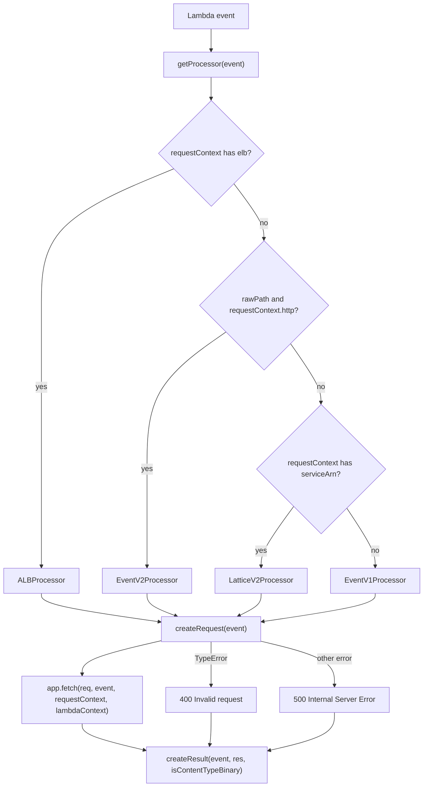

## Overview

A Hono app is a function from a Web-standard `Request` to a `Response`: `app.fetch(request, Env?, executionCtx?)`. Runtimes that already speak that interface (Cloudflare Workers, Bun, Deno, Vercel's Web handler) can call `app.fetch` directly. Runtimes that do not (AWS Lambda, Lambda@Edge, Pages Functions, service workers) need an adapter that converts their event into a `Request`, passes platform objects in as bindings, and converts the `Response` back. Each adapter lives under `src/adapter/<runtime>` and is published as its own subpath export such as `hono/aws-lambda`.

Sources: [src/hono-base.ts:479-485](repo://src/hono-base.ts#L479-L485), [package.json:344-388](repo://package.json#L344-L388)

Besides `handle()`, adapters provide the runtime-specific pieces of cross-cutting helpers: a `getConnInfo(c)` that fills the shared `ConnInfo` type (see [[Factory, Testing and Other Helpers]]), a `serveStatic` that plugs a file reader into the generic middleware described in [[Serving Static Files]], and for some runtimes `upgradeWebSocket` ([[WebSocket Helper]]) and `toSSG` ([[Static Site Generation]]).

Sources: [src/adapter/bun/index.ts:1-11](repo://src/adapter/bun/index.ts#L1-L11), [src/adapter/deno/index.ts:1-9](repo://src/adapter/deno/index.ts#L1-L9), [src/adapter/cloudflare-workers/index.ts:1-8](repo://src/adapter/cloudflare-workers/index.ts#L1-L8)

## Adapter summary

| Import | Entry point | What `c.env` holds | `getConnInfo` address source | `serveStatic` |
| --- | --- | --- | --- | --- |
| `hono/aws-lambda` | `handle(app, options?)`, `streamHandle(app)` | `event`, `requestContext`, `lambdaContext` (or `context` when streaming) | `requestContext.identity.sourceIp`, `requestContext.http.sourceIp`, or last `x-forwarded-for` entry | none |
| `hono/lambda-edge` | `handle(app)` | `event`, `context`, `callback`, `config`, `request`, `response` | `cf.request.clientIp` | none |
| `hono/cloudflare-workers` | `export default app` | Worker bindings | `cf-connecting-ip` header | KV asset manifest (deprecated) |
| `hono/cloudflare-pages` | `handle(app)`, `handleMiddleware(mw)` | Pages `env` plus `eventContext` | `cf-connecting-ip` header | `env.ASSETS.fetch` |
| `hono/bun` | `export default app` (or `{ fetch: app.fetch, websocket }`) | The Bun `Server` | `server.requestIP(req)` | `Bun.file` |
| `hono/deno` | `Deno.serve(app.fetch)` | The serve handler info | `remoteAddr` | `Deno.open` |
| `hono/netlify` | `handle(app)` | `context` (Netlify context) | `context.ip` | none |
| `hono/vercel` | `handle(app)` | nothing | `x-real-ip` header | none |
| `hono/service-worker` | `handle(app, opts?)`, `fire(app, opts?)` | `{}` | none | none |

Sources: [src/adapter/aws-lambda/handler.ts:138-193](repo://src/adapter/aws-lambda/handler.ts#L138-L193), [src/adapter/aws-lambda/handler.ts:239-276](repo://src/adapter/aws-lambda/handler.ts#L239-L276), [src/adapter/aws-lambda/conninfo.ts:45-73](repo://src/adapter/aws-lambda/conninfo.ts#L45-L73), [src/adapter/lambda-edge/handler.ts:116-147](repo://src/adapter/lambda-edge/handler.ts#L116-L147), [src/adapter/lambda-edge/conninfo.ts:1-15](repo://src/adapter/lambda-edge/conninfo.ts#L1-L15), [src/adapter/cloudflare-workers/conninfo.ts:1-7](repo://src/adapter/cloudflare-workers/conninfo.ts#L1-L7), [src/adapter/cloudflare-pages/handler.ts:32-123](repo://src/adapter/cloudflare-pages/handler.ts#L32-L123), [src/adapter/bun/conninfo.ts:10-43](repo://src/adapter/bun/conninfo.ts#L10-L43), [src/adapter/deno/conninfo.ts:1-17](repo://src/adapter/deno/conninfo.ts#L1-L17), [src/adapter/netlify/handler.ts:1-10](repo://src/adapter/netlify/handler.ts#L1-L10), [src/adapter/netlify/conninfo.ts:53-57](repo://src/adapter/netlify/conninfo.ts#L53-L57), [src/adapter/vercel/handler.ts:1-8](repo://src/adapter/vercel/handler.ts#L1-L8), [src/adapter/vercel/conninfo.ts:1-8](repo://src/adapter/vercel/conninfo.ts#L1-L8), [src/adapter/service-worker/handler.ts:18-37](repo://src/adapter/service-worker/handler.ts#L18-L37)

## AWS Lambda

### Event processors

`handle(app)` accepts four event shapes: API Gateway REST (v1), API Gateway HTTP API and Function URLs (v2), Application Load Balancer, and VPC Lattice v2. `getProcessor` picks one `EventProcessor` subclass per event by inspecting `requestContext`: an `elb` key means ALB, a `rawPath` on the event plus an `http` object on the context means v2, a `serviceArn` means Lattice, and anything else is treated as v1. The v2 check requires both fields because a v1 event behind a custom-domain base path mapping also carries `rawPath`.

Sources: [src/adapter/aws-lambda/handler.ts:23-27](repo://src/adapter/aws-lambda/handler.ts#L23-L27), [src/adapter/aws-lambda/handler.ts:625-658](repo://src/adapter/aws-lambda/handler.ts#L625-L658)



Sources: [src/adapter/aws-lambda/handler.ts:239-276](repo://src/adapter/aws-lambda/handler.ts#L239-L276), [src/adapter/aws-lambda/handler.ts:625-658](repo://src/adapter/aws-lambda/handler.ts#L625-L658)

### Event to Request

`EventProcessor.createRequest` builds an `https://` URL from the domain name and the processor's path and query string. The domain comes from `requestContext.domainName`, then the `host` header, then the multi-value `host` header. The body is base64-decoded when `isBase64Encoded` is set, otherwise UTF-8 encoded, and `content-length` is set to its byte length.

Sources: [src/adapter/aws-lambda/handler.ts:291-342](repo://src/adapter/aws-lambda/handler.ts#L291-L342)

Each processor differs in how it reads the event:

Sources: [src/adapter/aws-lambda/handler.ts:404-499](repo://src/adapter/aws-lambda/handler.ts#L404-L499), [src/adapter/aws-lambda/handler.ts:503-621](repo://src/adapter/aws-lambda/handler.ts#L503-L621)

| Processor | Path / method | Query string | Headers and cookies | Response cookies |
| --- | --- | --- | --- | --- |
| `EventV2Processor` | `rawPath`, `requestContext.http.method` | `rawQueryString` as-is | `headers`; `event.cookies` joined with `; ` into `Cookie` | `result.cookies` |
| `EventV1Processor` | `path`, `httpMethod` | Rebuilt from `multiValueQueryStringParameters` (or `queryStringParameters`), re-encoding keys and values | `multiValueHeaders` appended, then `headers` not already set | `multiValueHeaders['set-cookie']` |
| `ALBProcessor` | `path`, `httpMethod` | Rebuilt from the multi-value parameters first, without re-encoding | `multiValueHeaders` values joined with `; `, else `headers` | `multiValueHeaders['set-cookie']`, or only the first cookie in `headers` |
| `LatticeV2Processor` | `path`, `method` | always empty | multi-value `headers` appended | `headers['set-cookie']` array |

Sources: [src/adapter/aws-lambda/handler.ts:404-439](repo://src/adapter/aws-lambda/handler.ts#L404-L439), [src/adapter/aws-lambda/handler.ts:443-499](repo://src/adapter/aws-lambda/handler.ts#L443-L499), [src/adapter/aws-lambda/handler.ts:503-580](repo://src/adapter/aws-lambda/handler.ts#L503-L580), [src/adapter/aws-lambda/handler.ts:584-621](repo://src/adapter/aws-lambda/handler.ts#L584-L621)

Header values containing non-ASCII characters are passed through `sanitizeHeaderValue`, which percent-encodes them, because the `Headers` constructor rejects such values and would otherwise fail the request.

Sources: [src/adapter/aws-lambda/handler.ts:13-21](repo://src/adapter/aws-lambda/handler.ts#L13-L21)

### Response to result

`createResult` decides whether to base64-encode the body: it is binary when `isContentTypeBinary(contentType)` is true, or when a `content-encoding` other than `identity` is present (compressed bodies are never valid UTF-8 text). The default `defaultIsContentTypeBinary` treats everything as binary except `text/plain|html|css|javascript|csv` and any `*/json`, `*+json`, `*/xml` or `*+xml` type. The result uses `multiValueHeaders` when the incoming event had them and `headers` otherwise, and `Set-Cookie` values are moved into the processor's cookie field before the remaining headers are copied.

Sources: [src/adapter/aws-lambda/handler.ts:344-401](repo://src/adapter/aws-lambda/handler.ts#L344-L401), [src/adapter/aws-lambda/handler.ts:660-674](repo://src/adapter/aws-lambda/handler.ts#L660-L674)

```ts
import { Hono } from 'hono'
import { handle, defaultIsContentTypeBinary } from 'hono/aws-lambda'

const app = new Hono()
app.get('/', (c) => c.text('Hello from Lambda'))

export const handler = handle(app, {
  isContentTypeBinary: (contentType) =>
    defaultIsContentTypeBinary(contentType) || contentType === 'application/pdf',
})
```

Sources: [src/adapter/aws-lambda/handler.ts:199-241](repo://src/adapter/aws-lambda/handler.ts#L199-L241), [src/adapter/aws-lambda/index.ts:6-8](repo://src/adapter/aws-lambda/index.ts#L6-L8)

### Response streaming

`streamHandle(app)` wraps the handler in `awslambda.streamifyResponse`, for functions configured with response streaming. It sends the status, headers and cookies through `awslambda.HttpResponseStream.from`, then pipes the `ReadableStream` body chunk by chunk into the Node writable stream. If anything throws, it logs the error and writes `Internal Server Error` to the stream. Note that the Lambda context binding is named `context` here, while `handle` names it `lambdaContext`.

Sources: [src/adapter/aws-lambda/handler.ts:126-193](repo://src/adapter/aws-lambda/handler.ts#L126-L193)

### Lambda conninfo

`getConnInfo` reads `c.env.requestContext`: `identity.sourceIp` for v1, `http.sourceIp` for v2, and for ALB the last entry of `X-Forwarded-For`, which is the one the load balancer appends.

Sources: [src/adapter/aws-lambda/conninfo.ts:15-73](repo://src/adapter/aws-lambda/conninfo.ts#L15-L73)

## Lambda@Edge

The Lambda@Edge handler serves CloudFront viewer and origin triggers. `createRequest` builds the URL from the first record's `host` header (falling back to `config.distributionDomainName`) plus `uri` and `querystring`, appends every CloudFront header value, and decodes the body with `createBody`, which ignores bodies on `GET`/`HEAD` and base64-decodes when `encoding` is `base64`. The module also sets `globalThis.crypto` from `node:crypto` when it is missing.

Sources: [src/adapter/lambda-edge/handler.ts:1-8](repo://src/adapter/lambda-edge/handler.ts#L1-L8), [src/adapter/lambda-edge/handler.ts:164-212](repo://src/adapter/lambda-edge/handler.ts#L164-L212)

Edge functions often need to forward the request to the origin unchanged rather than answer it. For that, the handler passes a wrapped `callback` in the bindings: the first call records its error or result, and after `app.fetch` resolves the handler throws the recorded error or returns the recorded result instead of converting the Hono response. Otherwise `createResult` converts the response, with a string status, lower-cased CloudFront header arrays and `bodyEncoding: 'base64'` for binary types (`isContentTypeBinary` treats `image/svg+xml` and JSON/XML as text).

Sources: [src/adapter/lambda-edge/handler.ts:105-162](repo://src/adapter/lambda-edge/handler.ts#L105-L162), [src/adapter/lambda-edge/handler.ts:214-218](repo://src/adapter/lambda-edge/handler.ts#L214-L218)

```ts
import { Hono } from 'hono'
import { handle } from 'hono/lambda-edge'

const app = new Hono()

app.get('*', async (c, next) => {
  await next()
  c.env.callback(null, c.env.request) // pass the request on to the origin
})

export const handler = handle(app)
```

Sources: [src/adapter/lambda-edge/handler.test.ts:231-236](repo://src/adapter/lambda-edge/handler.test.ts#L231-L236), [src/adapter/lambda-edge/handler.ts:116-147](repo://src/adapter/lambda-edge/handler.ts#L116-L147)

## Cloudflare Workers and Pages

### Workers

Workers call `app.fetch(request, env, ctx)` directly, so the Workers adapter has no `handle`. It exports `getConnInfo` (reading the `cf-connecting-ip` header), `upgradeWebSocket`, and a `serveStatic` that is deprecated in favour of Cloudflare Static Assets. The legacy `serveStatic` looks the path up in a KV asset manifest (`options.manifest` or the global `__STATIC_CONTENT_MANIFEST`) and streams the value from the KV namespace (`options.namespace`, `c.env.__STATIC_CONTENT`, or the global `__STATIC_CONTENT`). The exported module-mode version omits the `namespace` option.

Sources: [src/adapter/cloudflare-workers/index.ts:1-8](repo://src/adapter/cloudflare-workers/index.ts#L1-L8), [src/adapter/cloudflare-workers/conninfo.ts:1-7](repo://src/adapter/cloudflare-workers/conninfo.ts#L1-L7), [src/adapter/cloudflare-workers/serve-static.ts:12-42](repo://src/adapter/cloudflare-workers/serve-static.ts#L12-L42), [src/adapter/cloudflare-workers/serve-static-module.ts:1-12](repo://src/adapter/cloudflare-workers/serve-static-module.ts#L1-L12), [src/adapter/cloudflare-workers/utils.ts:11-50](repo://src/adapter/cloudflare-workers/utils.ts#L11-L50)

### Pages Functions

`handle(app)` turns an app into a `PagesFunction`. It spreads the Pages `env` into the bindings and adds the whole `eventContext` under `c.env.eventContext`, and passes `waitUntil` and `passThroughOnException` as the execution context.

Sources: [src/adapter/cloudflare-pages/handler.ts:12-46](repo://src/adapter/cloudflare-pages/handler.ts#L12-L46)

`handleMiddleware(mw)` runs a single Hono middleware as a Pages `_middleware` function. It builds a `Context` by hand, and its `next` calls `eventContext.next()` to run the rest of the Pages chain, storing the response in `c.res`. Errors from either side are captured in `c.error`: an `HTTPException` becomes its response, any other error is rethrown, and if the middleware returned nothing the downstream response is returned.

Sources: [src/adapter/cloudflare-pages/handler.ts:48-102](repo://src/adapter/cloudflare-pages/handler.ts#L48-L102)

`serveStatic()` for Pages advanced mode fetches the request from the `ASSETS` binding and converts a 404 into `c.notFound()`, so the app's not-found handler applies.

Sources: [src/adapter/cloudflare-pages/handler.ts:104-123](repo://src/adapter/cloudflare-pages/handler.ts#L104-L123)

```ts
import { Hono } from 'hono'
import { handle, getConnInfo } from 'hono/cloudflare-pages'

const app = new Hono()
app.get('/', (c) => c.text(`Your IP: ${getConnInfo(c).remote.address}`))

export const onRequest = handle(app)
```

Sources: [src/adapter/cloudflare-pages/conninfo.ts:3-26](repo://src/adapter/cloudflare-pages/conninfo.ts#L3-L26)

## Bun and Deno

### Bun

Bun's `Bun.serve` calls `fetch(request, server)`, so `c.env` is the Bun `Server`. `getBunServer(c)` returns `c.env.server` when present (for setups that wrap the env) or `c.env` itself. `getConnInfo` calls `server.requestIP(c.req.raw)` and maps `address`, `family` (only `IPv4`/`IPv6` are kept as `addressType`) and `port`; it throws a `TypeError` if the server was not passed or lacks `requestIP`, and returns an empty `remote` when Bun returns `null` (closed request or Unix socket).

Sources: [src/adapter/bun/server.ts:1-14](repo://src/adapter/bun/server.ts#L1-L14), [src/adapter/bun/conninfo.ts:10-43](repo://src/adapter/bun/conninfo.ts#L10-L43)

`serveStatic` supplies the base middleware with `getContent` via `Bun.file(path)` (returning `null` when the file does not exist), `join` from `node:path`, and `isDir` via `fs.stat`.

Sources: [src/adapter/bun/serve-static.ts:1-32](repo://src/adapter/bun/serve-static.ts#L1-L32)

### Deno

`Deno.serve` passes a handler info object as the second argument, so `getConnInfo` reads `c.env.remoteAddr` for `hostname`, `port` and `transport`. `serveStatic` uses `Deno.lstatSync` to detect directories and `Deno.open(path).readable` for content, returning `null` for directories and missing files and logging other errors with `console.warn`.

Sources: [src/adapter/deno/conninfo.ts:1-17](repo://src/adapter/deno/conninfo.ts#L1-L17), [src/adapter/deno/serve-static.ts:1-42](repo://src/adapter/deno/serve-static.ts#L1-L42)

```ts
import { Hono } from 'hono'
import { serveStatic } from 'hono/deno'

const app = new Hono()
app.use('/static/*', serveStatic({ root: './' }))

Deno.serve(app.fetch)
```

Sources: [src/adapter/deno/serve-static.ts:8-42](repo://src/adapter/deno/serve-static.ts#L8-L42), [src/hono-base.ts:479-485](repo://src/hono-base.ts#L479-L485)

## Netlify and Vercel

Both adapters are one-line wrappers because these platforms already pass a `Request`. Netlify's `handle` forwards Netlify's second argument as `c.env.context`, and its `getConnInfo` reads `context.ip`. Vercel's `handle` calls `app.fetch(req)` with no bindings, and its `getConnInfo` reads the `x-real-ip` header that Vercel's edge sets.

Sources: [src/adapter/netlify/handler.ts:1-10](repo://src/adapter/netlify/handler.ts#L1-L10), [src/adapter/netlify/conninfo.ts:1-57](repo://src/adapter/netlify/conninfo.ts#L1-L57), [src/adapter/vercel/handler.ts:1-8](repo://src/adapter/vercel/handler.ts#L1-L8), [src/adapter/vercel/conninfo.ts:1-8](repo://src/adapter/vercel/conninfo.ts#L1-L8)

```ts
import { Hono } from 'hono'
import { handle } from 'hono/vercel'

const app = new Hono().basePath('/api')
app.get('/hello', (c) => c.json({ message: 'Hello' }))

export const GET = handle(app)
export const POST = handle(app)
```

Sources: [src/adapter/vercel/handler.ts:1-8](repo://src/adapter/vercel/handler.ts#L1-L8)

## Service Worker

`handle(app, opts?)` returns a `fetch` event listener that calls `evt.respondWith` with the app's response, passing the `FetchEvent` as the execution context so `c.executionCtx.waitUntil` works. If the app answers 404 and `opts.fetch` is set, the request is sent to the network instead, so the worker only intercepts the routes it defines. `opts.fetch` defaults to `globalThis.fetch` bound to `globalThis`, because `fetch` must be called with `globalThis` as its receiver in a service worker. `fire(app, opts?)` registers the listener with `addEventListener('fetch', ...)`.

Sources: [src/adapter/service-worker/handler.ts:10-37](repo://src/adapter/service-worker/handler.ts#L10-L37), [src/adapter/service-worker/index.ts:10-36](repo://src/adapter/service-worker/index.ts#L10-L36), [src/adapter/service-worker/types.ts:1-14](repo://src/adapter/service-worker/types.ts#L1-L14)

> [!TIP]
> To make unmatched routes return the app's own 404 instead of falling through to the network, pass `{ fetch: undefined }`: the default only applies when the options argument itself is omitted.

Sources: [src/adapter/service-worker/handler.ts:18-34](repo://src/adapter/service-worker/handler.ts#L18-L34)
