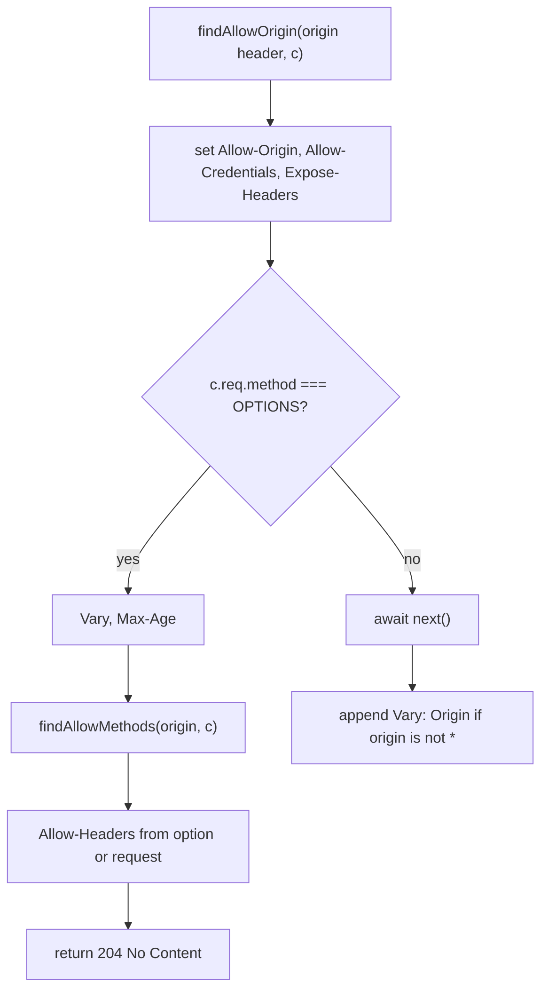
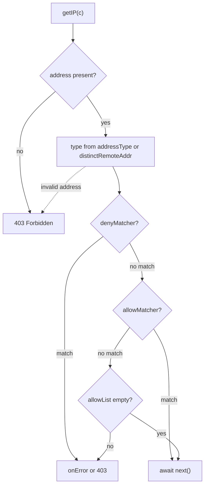

## Overview

Four built-in middleware handle browser and network security concerns that sit outside authentication: `cors` answers cross-origin preflights and adds `Access-Control-*` headers, `csrf` refuses cross-site form submissions, `secureHeaders` adds a hardened set of response headers (including a per-request CSP nonce and `Permissions-Policy`), and `ipRestriction` allows or blocks clients by IP address and CIDR range. Each is a factory that precomputes as much as it can from its options and returns a `MiddlewareHandler`. They are published as `hono/cors`, `hono/csrf`, `hono/secure-headers` and `hono/ip-restriction`.

Sources: [package.json:89-93](repo://package.json#L89-L93), [package.json:124-133](repo://package.json#L124-L133), [package.json:259-263](repo://package.json#L259-L263)

`csrf` and `ipRestriction` reject by throwing an `HTTPException` carrying a 403 response, which the default error handler returns as is (see [[Error Handling and HTTPException]]). `cors` short-circuits `OPTIONS` requests with its own 204 response, and `secureHeaders` only decorates the response after the handler runs. For credential checks see [[Authentication Middleware]].

Sources: [src/middleware/csrf/index.ts:138-150](repo://src/middleware/csrf/index.ts#L138-L150), [src/middleware/ip-restriction/index.ts:231-236](repo://src/middleware/ip-restriction/index.ts#L231-L236), [src/middleware/cors/index.ts:114-148](repo://src/middleware/cors/index.ts#L114-L148), [src/middleware/secure-headers/secure-headers.ts:215-228](repo://src/middleware/secure-headers/secure-headers.ts#L215-L228)

## cors

### CORS options

`cors(options?)` spreads the options over defaults: `origin: '*'`, the six methods `GET, HEAD, PUT, POST, DELETE, PATCH`, and empty `allowHeaders` and `exposeHeaders`.

Sources: [src/middleware/cors/index.ts:9-22](repo://src/middleware/cors/index.ts#L9-L22), [src/middleware/cors/index.ts:63-70](repo://src/middleware/cors/index.ts#L63-L70)

| Option | Type | Default | Description |
| --- | --- | --- | --- |
| `origin` | `string \| string[] \| (origin, c) => string \| null \| undefined \| Promise<...>` | `'*'` | Allowed origin(s); a function returns the value to echo, or a falsy value to omit the header. |
| `allowMethods` | `string[] \| (origin, c) => string[] \| Promise<string[]>` | `['GET', 'HEAD', 'PUT', 'POST', 'DELETE', 'PATCH']` | Sent as `Access-Control-Allow-Methods` on preflight. |
| `allowHeaders` | `string[]` | `[]` | Sent as `Access-Control-Allow-Headers`; empty means reflect the request's `Access-Control-Request-Headers`. |
| `maxAge` | `number` | none | Sent as `Access-Control-Max-Age` on preflight. |
| `credentials` | `boolean` | none | When true, sends `Access-Control-Allow-Credentials: true`. |
| `exposeHeaders` | `string[]` | `[]` | Sent as `Access-Control-Expose-Headers`. |

Sources: [src/middleware/cors/index.ts:24-62](repo://src/middleware/cors/index.ts#L24-L62)

### Origin and method resolution

At setup, `findAllowOrigin` turns `origin` into a function. `'*'` always returns `'*'`. Any other string returns the request origin only when it equals the configured value exactly, and otherwise `null`. An array returns the request origin when it is included. A function is used as is and receives the request's `Origin` header (or `''`) and the context. `findAllowMethods` does the same for `allowMethods`, wrapping a static array in a function.

Sources: [src/middleware/cors/index.ts:72-94](repo://src/middleware/cors/index.ts#L72-L94)

### CORS request flow

Headers are written to `c.res.headers` before the handler runs; the context merges them into whatever response the handler later sets. `Access-Control-Allow-Origin`, `Access-Control-Allow-Credentials` and `Access-Control-Expose-Headers` go on every response. An `OPTIONS` request never reaches the handler: the middleware adds `Vary: Origin` (unless `origin` is `'*'`), `Access-Control-Max-Age`, `Access-Control-Allow-Methods`, and `Access-Control-Allow-Headers` (appending `Vary: Access-Control-Request-Headers`), drops `Content-Length` and `Content-Type`, and returns `204 No Content`. For other methods it calls `next()` and then appends `Vary: Origin` when the origin is not the wildcard, so caches keep per-origin copies.

Sources: [src/middleware/cors/index.ts:96-157](repo://src/middleware/cors/index.ts#L96-L157), [src/context.ts:414-434](repo://src/context.ts#L414-L434)



Sources: [src/middleware/cors/index.ts:96-157](repo://src/middleware/cors/index.ts#L96-L157)

> [!WARNING]
> Every `OPTIONS` request is answered as a preflight, even without `Access-Control-Request-Method`, so an `app.options()` route behind `cors` never runs. The middleware also does not stop you from combining `origin: '*'` with `credentials: true`, which browsers reject; use an explicit origin list or function for credentialed requests.

Sources: [src/middleware/cors/index.ts:101-148](repo://src/middleware/cors/index.ts#L101-L148)

```ts
import { Hono } from 'hono'
import { cors } from 'hono/cors'

const app = new Hono()

app.use(
  '/api/*',
  cors({
    origin: (origin) => (origin.endsWith('.example.com') ? origin : 'https://example.com'),
    allowMethods: ['GET', 'POST'],
    maxAge: 600,
    credentials: true,
  })
)
```

Sources: [src/middleware/cors/index.ts:9-22](repo://src/middleware/cors/index.ts#L9-L22), [src/middleware/cors/index.ts:72-84](repo://src/middleware/cors/index.ts#L72-L84)

## csrf

### CSRF options

`csrf(options?)` defends against cross-site request forgery using headers the browser sets and a page cannot forge: `Origin` and `Sec-Fetch-Site`. Both options accept a single value, an array, or a predicate that also receives the context.

Sources: [src/middleware/csrf/index.ts:10-26](repo://src/middleware/csrf/index.ts#L10-L26), [src/middleware/csrf/index.ts:32-54](repo://src/middleware/csrf/index.ts#L32-L54)

| Option | Type | Default | Description |
| --- | --- | --- | --- |
| `origin` | `string \| string[] \| (origin, c) => boolean \| Promise<boolean>` | same origin as `c.req.url` | Accepted values of the `Origin` header. |
| `secFetchSite` | `SecFetchSite \| SecFetchSite[] \| (value, c) => boolean \| Promise<boolean>` | `'same-origin'` | Accepted values of `Sec-Fetch-Site`: `same-origin`, `same-site`, `none`, `cross-site`. |

Sources: [src/middleware/csrf/index.ts:12-26](repo://src/middleware/csrf/index.ts#L12-L26), [src/middleware/csrf/index.ts:94-125](repo://src/middleware/csrf/index.ts#L94-L125)

### Decision logic

A request is rejected only when all four conditions hold, evaluated left to right with short-circuiting.

Sources: [src/middleware/csrf/index.ts:138-144](repo://src/middleware/csrf/index.ts#L138-L144)

1. The method is not `GET` or `HEAD` (`isSafeMethodRe`).
2. The `Content-Type` is one a plain HTML form can send without a preflight: `application/x-www-form-urlencoded`, `multipart/form-data` or `text/plain`, case-insensitive and allowing parameters such as `; charset=utf-8`. A missing header is treated as `text/plain`.
3. `Sec-Fetch-Site` is missing, not one of the four standard values, or not accepted by `secFetchSite`.
4. `Origin` is missing or not accepted by `origin`.

Sources: [src/middleware/csrf/index.ts:28-30](repo://src/middleware/csrf/index.ts#L28-L30), [src/middleware/csrf/index.ts:106-150](repo://src/middleware/csrf/index.ts#L106-L150)

The rejection is `403 Forbidden` thrown inside an `HTTPException`. Either header passing is enough to allow the request, so older browsers that send `Origin` but not `Sec-Fetch-Site` still work. Requests with other content types such as `application/json` pass through: a cross-site page cannot send them without a CORS preflight, which `cors` controls.

Sources: [src/middleware/csrf/index.ts:138-147](repo://src/middleware/csrf/index.ts#L138-L147)

```ts
if (
  !isSafeMethodRe.test(c.req.method) &&
  isRequestedByFormElementRe.test(c.req.header('content-type') || 'text/plain') &&
  !(await isAllowedSecFetchSite(c.req.header('sec-fetch-site'), c)) &&
  !(await isAllowedOrigin(c.req.header('origin'), c))
) {
  const res = new Response('Forbidden', { status: 403 })
  throw new HTTPException(403, { res })
}
```

Sources: [src/middleware/csrf/index.ts:139-147](repo://src/middleware/csrf/index.ts#L139-L147)

```ts
import { Hono } from 'hono'
import { csrf } from 'hono/csrf'

const app = new Hono()

app.use(
  '*',
  csrf({
    origin: ['https://app.example.com', 'https://admin.example.com'],
    secFetchSite: (value, c) => value === 'same-origin' || c.req.path.startsWith('/webhook/'),
  })
)
```

Sources: [src/middleware/csrf/index.ts:55-92](repo://src/middleware/csrf/index.ts#L55-L92)

## secureHeaders

### Default headers

`secureHeaders(customOptions?)` merges the options over `DEFAULT_OPTIONS`, in which every header in `HEADERS_MAP` is on except `Cross-Origin-Embedder-Policy`, and `removePoweredBy` is true. `getFilteredHeaders` keeps each enabled header with its default value, or with the option's value when that option is a string. Setting an option to `false` drops the header.

Sources: [src/middleware/secure-headers/secure-headers.ts:94-124](repo://src/middleware/secure-headers/secure-headers.ts#L94-L124), [src/middleware/secure-headers/secure-headers.ts:231-238](repo://src/middleware/secure-headers/secure-headers.ts#L231-L238)

| Option | Header | Default value | On by default |
| --- | --- | --- | --- |
| `crossOriginEmbedderPolicy` | `Cross-Origin-Embedder-Policy` | `require-corp` | no |
| `crossOriginResourcePolicy` | `Cross-Origin-Resource-Policy` | `same-origin` | yes |
| `crossOriginOpenerPolicy` | `Cross-Origin-Opener-Policy` | `same-origin` | yes |
| `originAgentCluster` | `Origin-Agent-Cluster` | `?1` | yes |
| `referrerPolicy` | `Referrer-Policy` | `no-referrer` | yes |
| `strictTransportSecurity` | `Strict-Transport-Security` | `max-age=15552000; includeSubDomains` | yes |
| `xContentTypeOptions` | `X-Content-Type-Options` | `nosniff` | yes |
| `xDnsPrefetchControl` | `X-DNS-Prefetch-Control` | `off` | yes |
| `xDownloadOptions` | `X-Download-Options` | `noopen` | yes |
| `xFrameOptions` | `X-Frame-Options` | `SAMEORIGIN` | yes |
| `xPermittedCrossDomainPolicies` | `X-Permitted-Cross-Domain-Policies` | `none` | yes |
| `xXssProtection` | `X-XSS-Protection` | `0` | yes |
| `removePoweredBy` | removes `X-Powered-By` | n/a | yes |

Sources: [src/middleware/secure-headers/secure-headers.ts:94-124](repo://src/middleware/secure-headers/secure-headers.ts#L94-L124)

Further options add headers that have no default: `contentSecurityPolicy`, `contentSecurityPolicyReportOnly`, `permissionsPolicy`, `reportingEndpoints` (rendered as `name="url"` pairs) and `reportTo` (each group JSON-stringified, comma-joined).

Sources: [src/middleware/secure-headers/secure-headers.ts:46-88](repo://src/middleware/secure-headers/secure-headers.ts#L46-L88), [src/middleware/secure-headers/secure-headers.ts:184-213](repo://src/middleware/secure-headers/secure-headers.ts#L184-L213), [src/middleware/secure-headers/secure-headers.ts:320-328](repo://src/middleware/secure-headers/secure-headers.ts#L320-L328)

### Secure headers request flow

The header list is computed once, at setup. Per request, the handler first runs any CSP callbacks (needed for nonces) to produce this request's list, then awaits `next()`, then writes every header with `ctx.res.headers.set` and deletes `X-Powered-By` if `removePoweredBy` is on. Because the headers are set after the handler, they overwrite same-named headers the handler set.

Sources: [src/middleware/secure-headers/secure-headers.ts:179-229](repo://src/middleware/secure-headers/secure-headers.ts#L179-L229), [src/middleware/secure-headers/secure-headers.ts:330-334](repo://src/middleware/secure-headers/secure-headers.ts#L330-L334)

### Content-Security-Policy

`contentSecurityPolicy` (and `contentSecurityPolicyReportOnly`) take camelCase directive names whose values are arrays of strings or `ContentSecurityPolicyOptionHandler` functions `(ctx, directive) => string`. `getCSPDirectives` converts each name to kebab case (`scriptSrc` to `script-src`), and builds a flat array of tokens: the directive name, then `' '` and a value for each entry, then `'; '`, removing the final separator. When no value is a function, the array is joined once into a static header string.

Sources: [src/middleware/secure-headers/secure-headers.ts:15-44](repo://src/middleware/secure-headers/secure-headers.ts#L15-L44), [src/middleware/secure-headers/secure-headers.ts:240-269](repo://src/middleware/secure-headers/secure-headers.ts#L240-L269)

When a value is a function, its slot index in the token array is recorded (`i * 2 + 2 + resultValues.length`), and a callback is returned instead of a string. Per request, that callback clones the token array for each CSP header, calls every function with the context and directive name to fill its slot, and joins the clone. This keeps the per-request cost to one array copy and the function calls.

Sources: [src/middleware/secure-headers/secure-headers.ts:246-288](repo://src/middleware/secure-headers/secure-headers.ts#L246-L288)

### CSP nonce

`NONCE` is a ready-made handler. It generates 16 random bytes with `crypto.getRandomValues`, base64-encodes them, stores the value in the context as `secureHeadersNonce` (reusing an existing one, so `scriptSrc` and `styleSrc` share a nonce), and returns `'nonce-<value>'`. Because the callbacks run before `next()`, the handler can read the nonce with `c.get('secureHeadersNonce')` and put it on its inline `script` tags. `hono/secure-headers` adds `SecureHeadersVariables` to `ContextVariableMap` so this read is typed.

Sources: [src/middleware/secure-headers/secure-headers.ts:11-13](repo://src/middleware/secure-headers/secure-headers.ts#L11-L13), [src/middleware/secure-headers/secure-headers.ts:131-145](repo://src/middleware/secure-headers/secure-headers.ts#L131-L145), [src/middleware/secure-headers/secure-headers.ts:215-222](repo://src/middleware/secure-headers/secure-headers.ts#L215-L222), [src/middleware/secure-headers/index.ts:1-8](repo://src/middleware/secure-headers/index.ts#L1-L8)

```tsx
import { Hono } from 'hono'
import { secureHeaders, NONCE } from 'hono/secure-headers'

const app = new Hono()

app.use(
  secureHeaders({
    contentSecurityPolicy: {
      defaultSrc: ["'self'"],
      scriptSrc: ["'self'", NONCE],
      upgradeInsecureRequests: [],
    },
    xFrameOptions: 'DENY',
  })
)

app.get('/', (c) => {
  const nonce = c.get('secureHeadersNonce')
  return c.html(`<script nonce="${nonce}">console.log('ok')</script>`)
})
```

Sources: [src/middleware/secure-headers/secure-headers.ts:137-145](repo://src/middleware/secure-headers/secure-headers.ts#L137-L145), [src/middleware/secure-headers/secure-headers.ts:179-190](repo://src/middleware/secure-headers/secure-headers.ts#L179-L190), [src/middleware/secure-headers/index.ts:1-8](repo://src/middleware/secure-headers/index.ts#L1-L8)

### Permissions-Policy

`permissionsPolicy` maps camelCase feature names to a boolean or an allowlist array. The names are typed by `PermissionsPolicyDirective`, which unions the standardized, proposed and experimental features from the W3C feature list. The header is added only when the object has at least one key.

Sources: [src/middleware/secure-headers/permissions-policy.ts:1-11](repo://src/middleware/secure-headers/permissions-policy.ts#L1-L11), [src/middleware/secure-headers/permissions-policy.ts:59-86](repo://src/middleware/secure-headers/permissions-policy.ts#L59-L86), [src/middleware/secure-headers/secure-headers.ts:61-65](repo://src/middleware/secure-headers/secure-headers.ts#L61-L65), [src/middleware/secure-headers/secure-headers.ts:200-205](repo://src/middleware/secure-headers/secure-headers.ts#L200-L205)

`getPermissionsPolicyDirectives` converts each name with `camelToKebab` and serialises the value as below; entries are joined with `, `.

Sources: [src/middleware/secure-headers/secure-headers.ts:290-318](repo://src/middleware/secure-headers/secure-headers.ts#L290-L318)

| Value | Output for `camera` |
| --- | --- |
| `true` | `camera=*` |
| `false` | `camera=none` |
| `[]` | `camera=()` |
| `['*']` or `['none']` | `camera=*` / `camera=none` |
| `['self', 'https://a.example']` | `camera=(self "https://a.example")` |

Sources: [src/middleware/secure-headers/secure-headers.ts:295-307](repo://src/middleware/secure-headers/secure-headers.ts#L295-L307)

`self` and `src` stay bare tokens and every other entry is quoted as an origin. To deny a feature in the standard structured-header form, use `[]` (giving `()`) rather than `false`.

Sources: [src/middleware/secure-headers/secure-headers.ts:299-307](repo://src/middleware/secure-headers/secure-headers.ts#L299-L307)

## ipRestriction

### Signature and rules

`ipRestriction(getIP, { denyList, allowList }, onError?)` takes a function that returns the client address: either a runtime adapter's `getConnInfo` (returning `ConnInfo` with `remote.address` and `remote.addressType`) or a plain `(c) => string`. Each rule is `'*'`, a static IPv4 or IPv6 address, a CIDR range, or a predicate receiving `{ addr, type }`. `onError` replaces the default 403 for blocked requests. See [[Runtime Adapters]] for the `getConnInfo` of each runtime.

Sources: [src/middleware/ip-restriction/index.ts:20-38](repo://src/middleware/ip-restriction/index.ts#L20-L38), [src/middleware/ip-restriction/index.ts:169-225](repo://src/middleware/ip-restriction/index.ts#L169-L225), [src/helper/conninfo/types.ts:1-45](repo://src/helper/conninfo/types.ts#L1-L45)

### Compiling rules

`buildMatcher` compiles each list once into a single matching function. A `'*'` rule returns a matcher that always matches and ignores every other rule in the list. Functions are kept in `functionRules`. A string with a `/` is parsed as CIDR: the prefix must be one to three digits and at most 32 or 128, otherwise a `TypeError` is thrown at setup. A `/32` or `/128` becomes a static rule. An IPv4-mapped IPv6 range (`::ffff:a.b.c.d/n` with `n >= 96`) is rewritten to an IPv4 range with prefix `n - 96`. Other ranges are stored as `[isIPv4, addr & mask, mask]` with a `bigint` mask.

Sources: [src/middleware/ip-restriction/index.ts:40-120](repo://src/middleware/ip-restriction/index.ts#L40-L120)

Static rules are stored three ways so a match is a set lookup: the literal string, the binary value, and the other address family's form. An IPv4 rule also registers `::ffff:<ip>` and its mapped binary, and an IPv4-mapped IPv6 rule also registers the plain IPv4 form. IPv6 strings are normalised through `convertIPv6BinaryToString` (RFC 5952 compression), so `0:0:0:0:0:0:0:1` and `::1` match the same rule.

Sources: [src/middleware/ip-restriction/index.ts:59-80](repo://src/middleware/ip-restriction/index.ts#L59-L80), [src/utils/ipaddr.ts:327-373](repo://src/utils/ipaddr.ts#L327-L373)

### Matching a request

The compiled matcher checks, in order: the literal string set; the binary set for the remote's family (converting the address lazily and caching it in `binaryAddr`); each CIDR rule, where IPv4 ranges are also matched against the IPv4 part of an IPv4-mapped remote address; and finally each predicate.

Sources: [src/middleware/ip-restriction/index.ts:122-167](repo://src/middleware/ip-restriction/index.ts#L122-L167)

### Decision order

The deny list always wins. A request is blocked when it has no address, when it matches `denyList`, or when `allowList` is non-empty and it does not match. With an empty allow list, anything not denied passes. An address that fails to parse (a `TypeError` with code `ERR_INVALID_IP_ADDRESS`) is blocked with the default 403, even if `onError` is set; other errors propagate.

Sources: [src/middleware/ip-restriction/index.ts:238-279](repo://src/middleware/ip-restriction/index.ts#L238-L279)



Sources: [src/middleware/ip-restriction/index.ts:238-279](repo://src/middleware/ip-restriction/index.ts#L238-L279)

```ts
import { Hono } from 'hono'
import { ipRestriction } from 'hono/ip-restriction'
import { getConnInfo } from 'hono/cloudflare-workers'

const app = new Hono()

app.use(
  '/admin/*',
  ipRestriction(
    getConnInfo,
    { denyList: ['192.168.0.5'], allowList: ['127.0.0.1', '::1', '10.0.0.0/8'] },
    (remote, c) => c.text(`Access denied for ${remote.addr}`, 403)
  )
)
```

Sources: [src/middleware/ip-restriction/index.ts:187-217](repo://src/middleware/ip-restriction/index.ts#L187-L217)

### IP address utilities

`src/utils/ipaddr.ts` holds the parsers. `distinctRemoteAddr` classifies a string as `IPv4` (strict dotted-quad regex) or `IPv6` (contains `:`), or returns `undefined`. `convertIPv4ToBinary` and `convertIPv6ToBinary` are hand-written character scanners that return a `bigint`; they reject leading zeros in IPv4 octets, more than one `::`, more than four hex digits per group, and a zone ID (`%eth0`) on anything but a link-local `fe80::/10` address. IPv6 input may end in an embedded IPv4 (`::ffff:1.2.3.4`). Failures throw a `TypeError` tagged with `INVALID_IP_ADDRESS_ERROR_CODE`.

Sources: [src/utils/ipaddr.ts:39-81](repo://src/utils/ipaddr.ts#L39-L81), [src/utils/ipaddr.ts:83-126](repo://src/utils/ipaddr.ts#L83-L126), [src/utils/ipaddr.ts:141-150](repo://src/utils/ipaddr.ts#L141-L150), [src/utils/ipaddr.ts:157-231](repo://src/utils/ipaddr.ts#L157-L231), [src/utils/ipaddr.ts:232-293](repo://src/utils/ipaddr.ts#L232-L293)

| Function | Purpose |
| --- | --- |
| `distinctRemoteAddr(addr)` | Return `'IPv4'`, `'IPv6'` or `undefined`. |
| `convertIPv4ToBinary(ip)` | Parse dotted-quad to a 32-bit `bigint`. |
| `convertIPv6ToBinary(ip)` | Parse IPv6 (with `::`, embedded IPv4, zone ID) to a 128-bit `bigint`. |
| `convertIPv4BinaryToString(n)` | Format a 32-bit value as dotted-quad. |
| `convertIPv6BinaryToString(n)` | Format with RFC 5952 compression; IPv4-mapped values as `::ffff:a.b.c.d`. |
| `isIPv4MappedIPv6(n)` | True when the upper 96 bits are `::ffff`. |
| `convertIPv4MappedIPv6ToIPv4(n)` | Take the low 32 bits. |
| `expandIPv6(ip)` | Expand to eight zero-padded groups. |

Sources: [src/utils/ipaddr.ts:13-37](repo://src/utils/ipaddr.ts#L13-L37), [src/utils/ipaddr.ts:59-67](repo://src/utils/ipaddr.ts#L59-L67), [src/utils/ipaddr.ts:148-157](repo://src/utils/ipaddr.ts#L148-L157), [src/utils/ipaddr.ts:300-373](repo://src/utils/ipaddr.ts#L300-L373)
