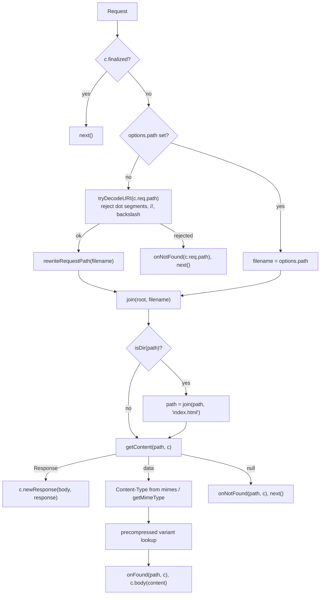

## Overview

Hono has no built-in file system access, because it runs on runtimes that read files in different ways or not at all. Static file serving is therefore split in two: a runtime-neutral `serveStatic` in `src/middleware/serve-static` that resolves the path, validates it, picks a MIME type and handles precompressed variants, and thin per-runtime wrappers that supply a `getContent` function (and optionally `join` and `isDir`) to actually read the file.

Sources: [src/middleware/serve-static/index.ts:32-53](repo://src/middleware/serve-static/index.ts#L32-L53)

Applications import the wrapper for their runtime: `serveStatic` from `hono/bun`, `hono/deno` or `hono/cloudflare-workers`. The generic middleware is exported as `hono/serve-static` for adapter authors and is "not directly used by the user". See [[Runtime Adapters]] for the rest of each adapter.

Sources: [src/adapter/bun/index.ts:6-6](repo://src/adapter/bun/index.ts#L6-L6), [src/adapter/deno/index.ts:6-6](repo://src/adapter/deno/index.ts#L6-L6), [src/adapter/cloudflare-workers/index.ts:6-6](repo://src/adapter/cloudflare-workers/index.ts#L6-L6), [package.json:339-363](repo://package.json#L339-L363)

## Options

### User-facing options

Every wrapper accepts `ServeStaticOptions` and passes them through to the base middleware unchanged.

Sources: [src/middleware/serve-static/index.ts:13-21](repo://src/middleware/serve-static/index.ts#L13-L21)

| Option | Type | Default | Description |
| --- | --- | --- | --- |
| `root` | `string` | `'./'` | Directory the request path is joined onto. |
| `path` | `string` | none | Serve this one file for every matching request. The request path, its safety check and `rewriteRequestPath` are all skipped. |
| `rewriteRequestPath` | `(path: string) => string` | none | Maps the decoded request path before it is joined with `root`, for example to strip a mount prefix. Ignored when `path` is set. |
| `mimes` | `Record<string, string>` | none | Extra extension-to-MIME mappings, consulted before the built-in table. |
| `precompressed` | `boolean` | `false` | Look for `.br`, `.zst` and `.gz` siblings and serve one the client accepts. |
| `onFound` | `(path: string, c: Context<E>) => void \| Promise<void>` | none | Called with the resolved path just before the file is sent; set response headers such as `Cache-Control` here. |
| `onNotFound` | `(path: string, c: Context<E>) => void \| Promise<void>` | none | Called when no file is found or the path is rejected, before falling through to `next()`. |

Sources: [src/middleware/serve-static/index.ts:13-21](repo://src/middleware/serve-static/index.ts#L13-L21), [src/middleware/serve-static/index.ts:50-79](repo://src/middleware/serve-static/index.ts#L50-L79), [src/middleware/serve-static/index.ts:92-124](repo://src/middleware/serve-static/index.ts#L92-L124)

```ts
import { serveStatic } from 'hono/bun'

app.use('/static/*', serveStatic({ root: './' }))
app.use('/favicon.ico', serveStatic({ path: './favicon.ico' }))

app.get(
  '/static/*',
  serveStatic({
    root: './',
    rewriteRequestPath: (path) => path.replace(/^\/static/, '/statics'),
    mimes: { m3u8: 'application/vnd.apple.mpegurl' },
    onFound: (_path, c) => {
      c.header('Cache-Control', 'public, immutable, max-age=31536000')
    },
    onNotFound: (path, c) => {
      console.log(`${path} is not found, you access ${c.req.path}`)
    },
  })
)
```

Sources: [src/adapter/bun/serve-static.ts:8-32](repo://src/adapter/bun/serve-static.ts#L8-L32), [src/middleware/serve-static/index.ts:13-21](repo://src/middleware/serve-static/index.ts#L13-L21)

### Adapter-only options

The base `serveStatic` adds options that only wrappers set. `getContent` is required and returns file data (`Data`: a string, `ArrayBuffer`, `ReadableStream` and so on), a ready `Response`, or `null` for "not found". `join` defaults to `defaultJoin`; `isDir` lets the middleware append `index.html` to directories. `pathResolve` is deprecated and unused.

Sources: [src/middleware/serve-static/index.ts:35-49](repo://src/middleware/serve-static/index.ts#L35-L49)

## Request flow

The middleware is a no-op when an earlier middleware already finalized the response. Otherwise it derives a file name, joins it with `root`, reads the content, and either sends it or falls through to `next()` so later routes, or the app's 404 handler, answer.

Sources: [src/middleware/serve-static/index.ts:54-58](repo://src/middleware/serve-static/index.ts#L54-L58)



Sources: [src/middleware/serve-static/index.ts:54-125](repo://src/middleware/serve-static/index.ts#L54-L125)

When `getContent` returns a `Response`, it is passed through with `c.newResponse(content.body, content)`, keeping its status and headers; this is how adapters such as Cloudflare Pages can delegate to a platform asset server. Any other non-null value becomes the body with `Content-Type` set from the file extension, falling back to `application/octet-stream`.

Sources: [src/middleware/serve-static/index.ts:85-94](repo://src/middleware/serve-static/index.ts#L85-L94)

## Path safety

The request path is decoded with `tryDecodeURI`, which decodes what it can and leaves invalid percent sequences as they are, so `%2e%2e` becomes `..` before it is checked. The decoded name is then rejected when it contains a `.` or `..` path segment, two or more consecutive slashes or backslashes, or any backslash at all. A rejected path calls `onNotFound` with the raw `c.req.path` and continues with `next()`; it never reaches `getContent`.

Sources: [src/middleware/serve-static/index.ts:60-74](repo://src/middleware/serve-static/index.ts#L60-L74), [src/utils/url.ts:81-104](repo://src/utils/url.ts#L81-L104)

```ts
if (/(?:^|[\/\\])\.{1,2}(?:$|[\/\\])|[\/\\]{2,}|\\/.test(filename)) {
  throw new Error()
}
```

Sources: [src/middleware/serve-static/index.ts:67-69](repo://src/middleware/serve-static/index.ts#L67-L69)

`defaultJoin`, used when a wrapper gives no `join`, drops empty parts, joins them with `/`, collapses repeated slashes and resolves `.` and `..` segments. It always uses `/`, so Windows paths need `join` from `node:path`, which the Bun and Deno wrappers pass. The traversal check runs before the join, so `..` in `root` is allowed while `..` from the request is not.

Sources: [src/middleware/serve-static/path.ts:1-25](repo://src/middleware/serve-static/path.ts#L1-L25)

> [!WARNING]
> The `path` and `rewriteRequestPath` options are trusted. A `rewriteRequestPath` that reintroduces `..` from user input runs after the safety check, so keep rewrites to fixed prefix changes.

Sources: [src/middleware/serve-static/index.ts:62-79](repo://src/middleware/serve-static/index.ts#L62-L79)

## MIME types

`getMimeType(filename, mimes = baseMimes)` takes the extension after the last dot, lower-cases it and looks it up. The middleware first consults the user's `mimes`, then the built-in table. Text types in the table carry `; charset=utf-8`, for example `html`, `css`, `js`, `mjs`, `json` maps to `application/json`, and `svg` to `image/svg+xml; charset=utf-8`. A file without a matching extension is sent as `application/octet-stream`.

Sources: [src/utils/mime.ts:6-16](repo://src/utils/mime.ts#L6-L16), [src/utils/mime.ts:35-94](repo://src/utils/mime.ts#L35-L94), [src/middleware/serve-static/index.ts:92-94](repo://src/middleware/serve-static/index.ts#L92-L94)

The same module exports `getExtension(mimeType)`, the reverse lookup that matches on the base type without parameters, and re-exports the table as `mimes`.

Sources: [src/utils/mime.ts:18-28](repo://src/utils/mime.ts#L18-L28)

## Precompressed files

With `precompressed: true`, and only for files whose MIME type is unknown or matches `COMPRESSIBLE_CONTENT_TYPE_REGEX` (images and archives are skipped), the middleware checks the request's `Accept-Encoding` tokens in the fixed preference order `br`, `zstd`, `gzip`. For each accepted encoding it calls `getContent` on the sibling file (`.br`, `.zst`, `.gz`). The first that exists replaces the content, `Content-Encoding` is set, and `Accept-Encoding` is appended to `Vary` so caches keep the variants apart. `Content-Type` stays that of the original file.

Sources: [src/middleware/serve-static/index.ts:23-28](repo://src/middleware/serve-static/index.ts#L23-L28), [src/middleware/serve-static/index.ts:96-117](repo://src/middleware/serve-static/index.ts#L96-L117)

> [!NOTE]
> `Accept-Encoding` is split on commas and compared exactly after trimming. A token with parameters such as `br;q=0.9` does not match `br`, so that encoding is not considered.

Sources: [src/middleware/serve-static/index.ts:97-107](repo://src/middleware/serve-static/index.ts#L97-L107)

## Runtime wrappers

### Bun

The Bun wrapper reads files with `Bun.file(path)`, returning the `BunFile` (a `Blob`) when `file.exists()` is true and `null` otherwise. Directories are detected with `stat` from `node:fs/promises`, so `/docs/` serves `docs/index.html`. It passes `join` from `node:path`.

Sources: [src/adapter/bun/serve-static.ts:1-32](repo://src/adapter/bun/serve-static.ts#L1-L32)

### Deno

The Deno wrapper opens files with `Deno.open` and returns `file.readable`, a stream. `isDir` uses `Deno.lstatSync`, and `getContent` returns `null` for directories itself, so the base middleware's `index.html` step does the directory case. Errors other than `Deno.errors.NotFound`, such as permission errors, are logged with `console.warn` and treated as not found.

Sources: [src/adapter/deno/serve-static.ts:1-42](repo://src/adapter/deno/serve-static.ts#L1-L42)

### Cloudflare Workers

The Workers wrapper is deprecated in favour of Cloudflare Static Assets. It serves from the Workers Sites KV namespace: `getContentFromKVAsset` looks the joined path up in the asset manifest (the `manifest` option, or the global `__STATIC_CONTENT_MANIFEST`, parsed from JSON when it is a string) to get the hashed KV key, then streams the value from the namespace (`namespace` option, `c.env.__STATIC_CONTENT`, or the global `__STATIC_CONTENT`). Paths missing from the manifest return `null`. No `isDir` is passed, so directories are not mapped to `index.html`.

Sources: [src/adapter/cloudflare-workers/serve-static.ts:1-42](repo://src/adapter/cloudflare-workers/serve-static.ts#L1-L42), [src/adapter/cloudflare-workers/utils.ts:1-50](repo://src/adapter/cloudflare-workers/utils.ts#L1-L50)

`hono/cloudflare-workers` exports the ES module variant, whose options omit `namespace` and rely on `c.env.__STATIC_CONTENT`. The global `__STATIC_CONTENT_MANIFEST` exists only in service-worker mode, so in module mode pass `manifest`, typically `import manifest from '__STATIC_CONTENT_MANIFEST'`.

Sources: [src/adapter/cloudflare-workers/serve-static-module.ts:1-12](repo://src/adapter/cloudflare-workers/serve-static-module.ts#L1-L12)

```ts
import { Hono } from 'hono'
import { serveStatic } from 'hono/cloudflare-workers'
import manifest from '__STATIC_CONTENT_MANIFEST'

const app = new Hono()

app.get('/static/*', serveStatic({ root: './', manifest }))
```

Sources: [src/adapter/cloudflare-workers/serve-static-module.ts:6-12](repo://src/adapter/cloudflare-workers/serve-static-module.ts#L6-L12), [src/adapter/cloudflare-workers/serve-static.ts:6-10](repo://src/adapter/cloudflare-workers/serve-static.ts#L6-L10)

### Cloudflare Pages

The Pages adapter has its own `serveStatic()` with no options, for Pages advanced mode. It does not use the base middleware: it forwards the raw request to `c.env.ASSETS.fetch` and returns the result, turning a `404` into `c.notFound()`.

Sources: [src/adapter/cloudflare-pages/handler.ts:109-123](repo://src/adapter/cloudflare-pages/handler.ts#L109-L123)
