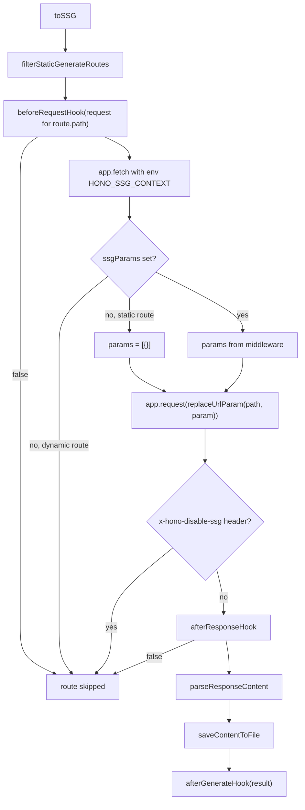

## Overview

`hono/ssg` turns a Hono application into a folder of static files. `toSSG(app, fs, options)` walks the app's registered GET routes, requests each one through `app.fetch`, and writes every successful response to disk through a pluggable file system module. The same app keeps working as a normal server, so pages can be served dynamically in development and pre-rendered for deployment.

Sources: [src/helper/ssg/index.ts:1-14](repo://src/helper/ssg/index.ts#L1-L14), [src/helper/ssg/ssg.ts:363-470](repo://src/helper/ssg/ssg.ts#L363-L470)

The module exports `toSSG`, `fetchRoutesContent`, `saveContentToFile`, `defaultExtensionMap` and the hook types from `ssg.ts`; the `ssgParams`, `isSSGContext`, `disableSSG` and `onlySSG` middleware with `X_HONO_DISABLE_SSG_HEADER_KEY`; and the `defaultPlugin` and `redirectPlugin` plugins. The Bun and Deno adapters wrap `toSSG` with their own file system module. All of it is marked experimental.

Sources: [src/helper/ssg/index.ts:6-14](repo://src/helper/ssg/index.ts#L6-L14), [src/adapter/bun/index.ts:7-7](repo://src/adapter/bun/index.ts#L7-L7), [src/adapter/deno/index.ts:7-7](repo://src/adapter/deno/index.ts#L7-L7)

## Usage

### Generating files on Node.js

`toSSG` needs an object with `writeFile` and `mkdir`, the shape of `node:fs/promises`.

Sources: [src/helper/ssg/ssg.ts:29-48](repo://src/helper/ssg/ssg.ts#L29-L48)

```ts
import fs from 'node:fs/promises'
import { Hono } from 'hono'
import { toSSG, ssgParams } from 'hono/ssg'

const app = new Hono()

app.get('/', (c) => c.html('<h1>Home</h1>'))

app.get(
  '/posts/:id',
  ssgParams(async () => [{ id: '1' }, { id: '2' }]),
  (c) => c.html(`<h1>Post ${c.req.param('id')}</h1>`)
)

const result = await toSSG(app, fs, { dir: './static' })
console.log(result.success, result.files)
```

Sources: [src/helper/ssg/ssg.ts:363-470](repo://src/helper/ssg/ssg.ts#L363-L470), [src/helper/ssg/middleware.ts:40-49](repo://src/helper/ssg/middleware.ts#L40-L49)

### Options

| Option | Type | Default | Description |
| --- | --- | --- | --- |
| `dir` | `string` | `'./static'` | Output directory |
| `concurrency` | `number` | `2` | Maximum `app.fetch` calls running at once |
| `extensionMap` | `Record<string, string>` | `defaultExtensionMap` | MIME type to file extension; replaces the default map entirely |
| `plugins` | `SSGPlugin[]` | `[defaultPlugin()]` | Hooks grouped by plugin |
| `beforeRequestHook` | hook or array | none | Deprecated; use a plugin |
| `afterResponseHook` | hook or array | none | Deprecated; use a plugin |
| `afterGenerateHook` | hook or array | none | Deprecated; use a plugin |

Sources: [src/helper/ssg/ssg.ts:17-27](repo://src/helper/ssg/ssg.ts#L17-L27), [src/helper/ssg/ssg.ts:181-198](repo://src/helper/ssg/ssg.ts#L181-L198), [src/helper/ssg/ssg.ts:368-372](repo://src/helper/ssg/ssg.ts#L368-L372), [src/helper/ssg/ssg.ts:420-423](repo://src/helper/ssg/ssg.ts#L420-L423)

`toSSG` resolves to a `ToSSGResult`: `{ success: true, files }` with the written paths, or `{ success: false, files: [], error }` when any fetch or write failed. It never rejects for errors raised during generation.

Sources: [src/helper/ssg/ssg.ts:39-48](repo://src/helper/ssg/ssg.ts#L39-L48), [src/helper/ssg/ssg.ts:450-464](repo://src/helper/ssg/ssg.ts#L450-L464)

> [!WARNING]
> Passing `plugins` replaces the default list, so `defaultPlugin()` is no longer applied. Add it yourself if non-200 responses should still be skipped.

Sources: [src/helper/ssg/ssg.ts:372-372](repo://src/helper/ssg/ssg.ts#L372-L372)

## Generation flow

### Route discovery

`filterStaticGenerateRoutes` reads `app.routes` and keeps routes whose method is `GET` or `ALL` and whose final handler is not a middleware. A handler counts as middleware when it declares more than one parameter (`(c, next)`); `findTargetHandler` unwraps composed handlers first. `isDynamicRoute` marks a path as dynamic when any segment starts with `:` or contains `*`.

Sources: [src/helper/ssg/utils.ts:57-75](repo://src/helper/ssg/utils.ts#L57-L75), [src/utils/handler.ts:8-15](repo://src/utils/handler.ts#L8-L15)

### Fetching routes

`fetchRoutesContent` is a generator that yields one promise per route, so `toSSG` can schedule saves as soon as each route resolves. All `app.fetch` calls go through a `createPool({ concurrency })` pool, which defers calls with `setTimeout` while the number of running calls is at the limit.

Sources: [src/helper/ssg/ssg.ts:200-302](repo://src/helper/ssg/ssg.ts#L200-L302), [src/utils/concurrent.ts:12-55](repo://src/utils/concurrent.ts#L12-L55)



Sources: [src/helper/ssg/ssg.ts:205-302](repo://src/helper/ssg/ssg.ts#L205-L302), [src/helper/ssg/ssg.ts:420-470](repo://src/helper/ssg/ssg.ts#L420-L470)

For each route the steps are as follows.

Sources: [src/helper/ssg/ssg.ts:225-232](repo://src/helper/ssg/ssg.ts#L225-L232)

1. Build a `Request` for `http://localhost` plus the raw route path (for example `/posts/:id`) and pass it through the combined `beforeRequestHook`; a falsy result skips the route.
2. Call `app.fetch(request, { HONO_SSG_CONTEXT: true })`. This first request exists to collect parameters: `ssgParams` stores them on the request object as `ssgParams`.
3. If no parameters were stored, a dynamic route is skipped and a static route gets `[{}]`.
4. For every parameter set, fill the path with `replaceUrlParam` and call `app.request` with the original method and headers and the same SSG env.
5. Skip the response if it carries the `x-hono-disable-ssg` header, then pass it through the combined `afterResponseHook`; a falsy result skips it.
6. Take the MIME type from `Content-Type` before `;`, defaulting to `text/plain`, and read the body as text when the type contains `text` or `json`, otherwise as an `ArrayBuffer`.

Sources: [src/helper/ssg/ssg.ts:222-302](repo://src/helper/ssg/ssg.ts#L222-L302), [src/helper/ssg/ssg.ts:74-88](repo://src/helper/ssg/ssg.ts#L74-L88)

> [!NOTE]
> A static route is requested twice: once to discover parameters and once to render. Keep side effects in handlers idempotent, or check `isSSGContext`.

Sources: [src/helper/ssg/ssg.ts:243-269](repo://src/helper/ssg/ssg.ts#L243-L269)

The default MIME type is `text/plain` rather than `text/plain; charset=UTF-8` because Bun omits `Content-Type` for text responses for performance; treating a missing header as plain text keeps output consistent across runtimes.

Sources: [src/helper/ssg/ssg.ts:19-25](repo://src/helper/ssg/ssg.ts#L19-L25)

### Saving files

`saveContentToFile` awaits each content promise, ignores `undefined` (skipped) entries, builds the file path, creates the directory once, and writes strings directly or `ArrayBuffer`s as `Uint8Array`. Directories already created are remembered in a module-level `Set`, so `mkdir` runs once per directory for the life of the process.

Sources: [src/helper/ssg/ssg.ts:304-334](repo://src/helper/ssg/ssg.ts#L304-L334)

`generateFilePath` picks the extension with `determineExtension`, which looks the MIME type up in the extension map, then in Hono's MIME table via `getExtension`, and falls back to `html`. The path is chosen from the route path.

Sources: [src/helper/ssg/ssg.ts:50-72](repo://src/helper/ssg/ssg.ts#L50-L72), [src/helper/ssg/ssg.ts:99-108](repo://src/helper/ssg/ssg.ts#L99-L108)

| Route path | File |
| --- | --- |
| already ends with `.<ext>` (e.g. `/feed.xml`) | `<dir>/feed.xml` |
| `/` | `<dir>/index.<ext>` |
| ends with `/` (e.g. `/docs/`) | `<dir>/docs/index.<ext>` |
| anything else (e.g. `/about`) | `<dir>/about.<ext>` |

Sources: [src/helper/ssg/ssg.ts:50-72](repo://src/helper/ssg/ssg.ts#L50-L72), [src/helper/ssg/ssg.ts:90-108](repo://src/helper/ssg/ssg.ts#L90-L108), [src/utils/mime.ts:18-26](repo://src/utils/mime.ts#L18-L26)

| MIME type | Extension in `defaultExtensionMap` |
| --- | --- |
| `text/html` | `html` |
| `text/xml`, `application/xml`, `application/atom+xml`, `application/rss+xml` | `xml` |
| `application/yaml` | `yaml` |

Sources: [src/helper/ssg/ssg.ts:90-97](repo://src/helper/ssg/ssg.ts#L90-L97)

`joinPaths` normalizes backslashes, `.` and `..` segments, and `ensureWithinOutDir` throws `Path traversal detected` when the resolved file path is not inside the output directory, which guards against parameter values such as `../../etc`. The thrown error is captured and reported in the result.

Sources: [src/helper/ssg/utils.ts:16-55](repo://src/helper/ssg/utils.ts#L16-L55), [src/helper/ssg/utils.ts:77-87](repo://src/helper/ssg/utils.ts#L77-L87)

### Error collection

Each save promise is wrapped with `.catch((e) => e)`. After all route promises settle, `toSSG` awaits the saves in order: strings are added to `files`, and the first error found is thrown and turned into `{ success: false, files: [], error }`. A non-`Error` value is wrapped in `new Error(String(error))`. The `afterGenerateHook` chain runs with that result in both cases.

Sources: [src/helper/ssg/ssg.ts:436-470](repo://src/helper/ssg/ssg.ts#L436-L470)

## Middleware

### ssgParams

`ssgParams(params)` accepts an array of parameter objects or a function `(c) => SSGParams | Promise<SSGParams>`. It only acts when `c.req.path` is still a pattern (the discovery request): it stores the parameters on the raw request and returns `c.notFound()` so the real handler does not run. On the render request the path is concrete, so it calls `next()`.

Sources: [src/helper/ssg/middleware.ts:24-49](repo://src/helper/ssg/middleware.ts#L24-L49)

```ts
app.get(
  '/shops/:id',
  ssgParams(async (c) => {
    const shops = await getShops()
    return shops.map((shop) => ({ id: shop.id }))
  }),
  async (c) => c.html(await renderShop(c.req.param('id')))
)
```

Sources: [src/helper/ssg/middleware.ts:29-49](repo://src/helper/ssg/middleware.ts#L29-L49)

### isSSGContext, disableSSG and onlySSG

`toSSG` marks its requests by passing `{ HONO_SSG_CONTEXT: true }` as the env. `isSSGContext(c)` reads `c.env?.[SSG_CONTEXT]`, and two middleware build on it.

Sources: [src/helper/ssg/middleware.ts:5-6](repo://src/helper/ssg/middleware.ts#L5-L6), [src/helper/ssg/middleware.ts:51-56](repo://src/helper/ssg/middleware.ts#L51-L56)

| Middleware | During `toSSG` | During normal serving |
| --- | --- | --- |
| `disableSSG()` | sets `x-hono-disable-ssg: true` and returns 404, so the route is not written | calls `next()` |
| `onlySSG()` | calls `next()` | returns 404 |

Sources: [src/helper/ssg/middleware.ts:58-83](repo://src/helper/ssg/middleware.ts#L58-L83)

`SSG_DISABLED_RESPONSE` is a deprecated prebuilt 404 response with the same header; use `X_HONO_DISABLE_SSG_HEADER_KEY` instead.

Sources: [src/helper/ssg/middleware.ts:8-22](repo://src/helper/ssg/middleware.ts#L8-L22)

## Plugins and hooks

### Hook types

A plugin is an object with up to three hooks, each a single function or an array. `toSSG` gathers hooks from the deprecated top-level options first, then from each plugin in order, and combines each kind into one function.

Sources: [src/helper/ssg/ssg.ts:110-116](repo://src/helper/ssg/ssg.ts#L110-L116), [src/helper/ssg/ssg.ts:175-179](repo://src/helper/ssg/ssg.ts#L175-L179), [src/helper/ssg/ssg.ts:373-419](repo://src/helper/ssg/ssg.ts#L373-L419)

| Hook | Signature | Combination rule |
| --- | --- | --- |
| `beforeRequestHook` | `(req: Request)` returning `Request` or `false`, sync or async | runs in order; `false` stops and skips the route; a returned `Request` replaces the current one |
| `afterResponseHook` | `(res: Response)` returning `Response` or `false`, sync or async | runs in order; `false` stops and skips the response; a returned `Response` replaces the current one |
| `afterGenerateHook` | `(result, fsModule, options?)` returning nothing, sync or async | every hook runs in order with the final result |

Sources: [src/helper/ssg/ssg.ts:110-173](repo://src/helper/ssg/ssg.ts#L110-L173)

When no request or response hooks were registered, an identity hook is used. `afterGenerateHook` hooks only run when at least one exists.

Sources: [src/helper/ssg/ssg.ts:424-435](repo://src/helper/ssg/ssg.ts#L424-L435), [src/helper/ssg/ssg.ts:465-468](repo://src/helper/ssg/ssg.ts#L465-L468)

### Built-in plugins

`defaultPlugin()` adds an `afterResponseHook` that returns `false` for any status other than 200, so 404s, redirects and errors are not written. `redirectPlugin()` converts 301, 302, 303, 307 and 308 responses that have a `Location` header into a 200 HTML page with a `meta http-equiv="refresh"` tag, a canonical link and `noindex`; a redirect without `Location` is skipped.

Sources: [src/helper/ssg/plugins.ts:1-72](repo://src/helper/ssg/plugins.ts#L1-L72)

```ts
import { toSSG, redirectPlugin, defaultPlugin } from 'hono/ssg'

// redirectPlugin must come first: defaultPlugin drops non-200 responses
await toSSG(app, fs, { plugins: [redirectPlugin(), defaultPlugin()] })
```

Sources: [src/helper/ssg/plugins.ts:38-55](repo://src/helper/ssg/plugins.ts#L38-L55)

A custom plugin can, for instance, add a header to each request and write a sitemap after generation.

Sources: [src/helper/ssg/ssg.ts:110-116](repo://src/helper/ssg/ssg.ts#L110-L116), [src/helper/ssg/ssg.ts:175-179](repo://src/helper/ssg/ssg.ts#L175-L179)

```ts
import type { SSGPlugin } from 'hono/ssg'

const sitemapPlugin: SSGPlugin = {
  beforeRequestHook: (req) => {
    req.headers.set('x-ssg', '1')
    return req
  },
  afterGenerateHook: async (result, fsModule, options) => {
    if (!result.success) return
    const urls = result.files.map((f) => `<url><loc>${f}</loc></url>`).join('')
    await fsModule.writeFile(`${options?.dir ?? './static'}/sitemap.xml`, `<urlset>${urls}</urlset>`)
  },
}
```

Sources: [src/helper/ssg/ssg.ts:110-116](repo://src/helper/ssg/ssg.ts#L110-L116), [src/helper/ssg/ssg.ts:34-37](repo://src/helper/ssg/ssg.ts#L34-L37)

## Runtime wrappers

### Bun and Deno

`hono/bun` and `hono/deno` export a `toSSG(app, options?)` that matches `ToSSGAdaptorInterface` and calls the base `toSSG` with a runtime file system module. See [[Runtime Adapters]] for the rest of each adapter.

Sources: [src/helper/ssg/ssg.ts:350-361](repo://src/helper/ssg/ssg.ts#L350-L361), [src/adapter/bun/ssg.ts:20-27](repo://src/adapter/bun/ssg.ts#L20-L27), [src/adapter/deno/ssg.ts:20-27](repo://src/adapter/deno/ssg.ts#L20-L27)

| Module | `writeFile` | `mkdir` |
| --- | --- | --- |
| `bunFileSystemModule` | `Bun.write(path, data)` | no-op; directories are left to `Bun.write` |
| `denoFileSystemModule` | encodes strings with `TextEncoder`, then `Deno.writeFile` | `Deno.mkdir(path, { recursive })` |

Sources: [src/adapter/bun/ssg.ts:1-18](repo://src/adapter/bun/ssg.ts#L1-L18), [src/adapter/deno/ssg.ts:1-18](repo://src/adapter/deno/ssg.ts#L1-L18)

```ts
import { toSSG } from 'hono/bun'
import app from './app'

await toSSG(app, { dir: './dist' })
```

Sources: [src/adapter/bun/ssg.ts:25-27](repo://src/adapter/bun/ssg.ts#L25-L27)
