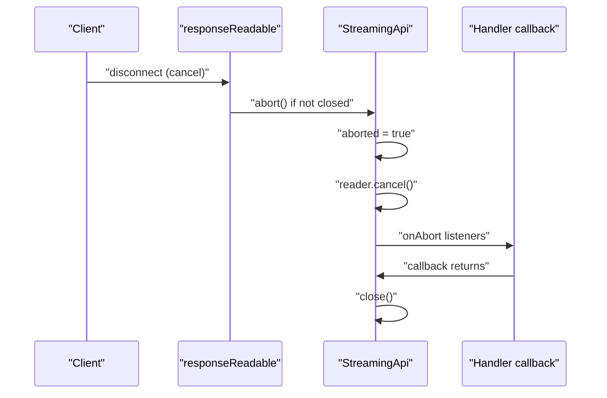

## Overview

`hono/streaming` lets a handler return a `Response` immediately and keep writing its body afterwards. It exports three entry points, `stream`, `streamText` and `streamSSE`, plus the `SSEStreamingApi` class and the `SSEMessage` type. All of them hand the callback a `StreamingApi` object, defined in `src/utils/stream.ts`, that wraps a `TransformStream` with convenience methods for writing, piping, sleeping and reacting to client disconnects.

Sources: [src/helper/streaming/index.ts:1-9](repo://src/helper/streaming/index.ts#L1-L9), [src/utils/stream.ts:1-98](repo://src/utils/stream.ts#L1-L98)

The helpers exist because a Web-standard `Response` body is a `ReadableStream`, and building one by hand means handling encoding, backpressure, cancellation and error reporting each time. The helpers do this once and work on every runtime Hono supports, with a workaround for older Bun versions. The response is created through `c.newResponse`, so headers set on the [[Context]] before or inside the helper are kept.

Sources: [src/helper/streaming/stream.ts:7-45](repo://src/helper/streaming/stream.ts#L7-L45), [src/context.ts:641-641](repo://src/context.ts#L641-L641)

## Helpers

### stream

`stream(c, cb, onError?)` creates a `TransformStream`, wraps it in a `StreamingApi`, starts `cb(stream)` in a detached async function and returns `c.newResponse(stream.responseReadable)` without waiting for the callback. When the callback finishes, successfully or not, the `finally` block calls `stream.close()`.

Sources: [src/helper/streaming/stream.ts:7-45](repo://src/helper/streaming/stream.ts#L7-L45)

```ts
import { Hono } from 'hono'
import { stream } from 'hono/streaming'

const app = new Hono()

app.get('/stream', (c) => {
  return stream(c, async (stream) => {
    stream.onAbort(() => {
      console.log('Aborted!')
    })
    await stream.write(new Uint8Array([0x48, 0x65, 0x6c, 0x6c, 0x6f]))
    await stream.pipe(anotherReadableStream)
  })
})
```

Sources: [src/helper/streaming/stream.ts:7-45](repo://src/helper/streaming/stream.ts#L7-L45), [src/utils/stream.ts:48-86](repo://src/utils/stream.ts#L48-L86)

No `Content-Type` is set by `stream`; set one with `c.header()` before calling it if the client needs it.

Sources: [src/helper/streaming/stream.ts:7-45](repo://src/helper/streaming/stream.ts#L7-L45)

### streamText

`streamText` sets three headers and then delegates to `stream` with the same callback and error handler.

Sources: [src/helper/streaming/text.ts:1-15](repo://src/helper/streaming/text.ts#L1-L15)

| Header | Value |
| --- | --- |
| `Content-Type` | `text/plain; charset=UTF-8` (`TEXT_PLAIN`) |
| `X-Content-Type-Options` | `nosniff` |
| `Transfer-Encoding` | `chunked` |

Sources: [src/helper/streaming/text.ts:11-14](repo://src/helper/streaming/text.ts#L11-L14), [src/context.ts:279-279](repo://src/context.ts#L279-L279)

```ts
import { streamText } from 'hono/streaming'

app.get('/text', (c) => {
  return streamText(c, async (stream) => {
    await stream.writeln('Hello')
    await stream.sleep(1000)
    await stream.write('Hono!')
  })
})
```

Sources: [src/helper/streaming/text.ts:6-15](repo://src/helper/streaming/text.ts#L6-L15), [src/utils/stream.ts:48-67](repo://src/utils/stream.ts#L48-L67)

### streamSSE helper

`streamSSE(c, cb, onError?)` works like `stream` but builds an `SSEStreamingApi`, sets the Server-Sent Events headers and runs the callback through its own `run` function.

Sources: [src/helper/streaming/sse.ts:72-100](repo://src/helper/streaming/sse.ts#L72-L100)

| Header | Value |
| --- | --- |
| `Transfer-Encoding` | `chunked` |
| `Content-Type` | `text/event-stream` |
| `Cache-Control` | `no-cache` |
| `Connection` | `keep-alive` |

Sources: [src/helper/streaming/sse.ts:92-95](repo://src/helper/streaming/sse.ts#L92-L95)

```ts
import { streamSSE } from 'hono/streaming'

let id = 0

app.get('/sse', (c) => {
  return streamSSE(c, async (stream) => {
    while (true) {
      const message = `It is ${new Date().toISOString()}`
      await stream.writeSSE({
        data: message,
        event: 'time-update',
        id: String(id++),
      })
      await stream.sleep(1000)
    }
  })
})
```

Sources: [src/helper/streaming/sse.ts:6-45](repo://src/helper/streaming/sse.ts#L6-L45), [src/helper/streaming/sse.ts:72-100](repo://src/helper/streaming/sse.ts#L72-L100)

## Writing SSE messages

### SSEMessage fields

`writeSSE(message)` takes an `SSEMessage` and writes one event block.

Sources: [src/helper/streaming/sse.ts:6-11](repo://src/helper/streaming/sse.ts#L6-L11)

| Field | Type | Required | Description |
| --- | --- | --- | --- |
| `data` | `string` or `Promise<string>` | yes | Payload; may also be an `html` result or a JSX element |
| `event` | `string` | no | Event name, written as `event: ...` |
| `id` | `string` | no | Event id, written as `id: ...` |
| `retry` | `number` | no | Reconnection delay in ms, written as `retry: ...` |

Sources: [src/helper/streaming/sse.ts:6-11](repo://src/helper/streaming/sse.ts#L6-L11)

### Formatting rules

`writeSSE` first resolves `data` with `resolveCallback(message.data, HtmlEscapedCallbackPhase.Stringify, false, {})`, so a `Promise<string>`, an `html` template or a rendered JSX element (including async components and CSS callbacks) is turned into its final string. The data is then split on `\r\n`, `\r` or `\n` and each line is prefixed with `data: `, which is how SSE carries multi-line payloads.

Sources: [src/helper/streaming/sse.ts:18-25](repo://src/helper/streaming/sse.ts#L18-L25), [src/utils/html.ts:142-182](repo://src/utils/html.ts#L142-L182)

`event`, `id` and `retry` must not contain a carriage return or line feed, because that would let a value start a new field; `writeSSE` throws `Error('<key> must not contain "\r" or "\n"')` in that case. The fields are joined in the order `event`, data lines, `id`, `retry`, with falsy fields dropped, and the block ends with a blank line (`\n\n`).

Sources: [src/helper/streaming/sse.ts:27-44](repo://src/helper/streaming/sse.ts#L27-L44)

```ts
const sseData =
  [
    message.event && `event: ${message.event}`,
    dataLines,
    message.id && `id: ${message.id}`,
    message.retry && `retry: ${message.retry}`,
  ]
    .filter(Boolean)
    .join('\n') + '\n\n'
```

Sources: [src/helper/streaming/sse.ts:33-41](repo://src/helper/streaming/sse.ts#L33-L41)

> [!NOTE]
> Because the fields are filtered with `Boolean`, `retry: 0` and an empty `id` are omitted from the output.

Sources: [src/helper/streaming/sse.ts:33-41](repo://src/helper/streaming/sse.ts#L33-L41)

## StreamingApi

### Methods and properties

`StreamingApi` holds a writer for the writable side of the `TransformStream` and a `TextEncoder`. Its constructor also builds `responseReadable`, a new `ReadableStream` that pulls from the transform's readable side; this is the stream given to the `Response`.

Sources: [src/utils/stream.ts:6-46](repo://src/utils/stream.ts#L6-L46)

| Member | Description |
| --- | --- |
| `write(input)` | Encodes a string with `TextEncoder` (or takes a `Uint8Array`) and writes it; write errors are swallowed; returns `this` |
| `writeln(input)` | `write(input + '\n')` |
| `sleep(ms)` | Promise resolved after `setTimeout(ms)` |
| `pipe(body)` | Releases the writer lock, `body.pipeTo(writable, { preventClose: true })`, then takes a new writer |
| `onAbort(listener)` | Registers a listener run once when the stream is aborted |
| `abort()` | Sets `aborted` and calls all abort subscribers, only the first time |
| `close()` | Sets `closed` and closes the writer; errors are swallowed |
| `aborted` | `true` after `abort()` |
| `closed` | `true` after `close()` |
| `responseReadable` | The `ReadableStream` used as the response body |

Sources: [src/utils/stream.ts:11-97](repo://src/utils/stream.ts#L11-L97)

`write` returns the instance, so calls can be chained after `await`. Since write errors are ignored, a write after the client has gone away does not throw; check `stream.aborted` or use `onAbort` to stop producing data.

Sources: [src/utils/stream.ts:48-63](repo://src/utils/stream.ts#L48-L63)

`pipe` uses `preventClose: true` so the response stays open after the piped body ends, letting the callback write more data or pipe another stream.

Sources: [src/utils/stream.ts:78-82](repo://src/utils/stream.ts#L78-L82)

## Abort handling

### Client disconnects

When the client disconnects, the runtime cancels the response body, which triggers the `cancel` hook of `responseReadable`. If the stream has not been closed normally, it calls `abort()`. The constructor registers one built-in subscriber that cancels the reader of the transform's readable side, so pending `write` calls stop blocking on backpressure; user listeners added with `onAbort` run after it.

Sources: [src/utils/stream.ts:21-46](repo://src/utils/stream.ts#L21-L46), [src/utils/stream.ts:84-97](repo://src/utils/stream.ts#L84-L97)



Sources: [src/utils/stream.ts:21-97](repo://src/utils/stream.ts#L21-L97), [src/helper/streaming/stream.ts:26-42](repo://src/helper/streaming/stream.ts#L26-L42)

### Bun compatibility

Bun before v1.1.27 did not call `cancel()` on a response body. `isOldBunVersion` detects Bun versions starting with `1.1`, `1.0` or `0.` (caching the result by replacing itself), and for those `stream` and `streamSSE` listen to `c.req.raw.signal` and call `stream.abort()` on `abort` instead. Both helpers also keep the `Context` alive in a `WeakMap` keyed by `responseReadable`, because Bun releases `c` once the response is returned.

Sources: [src/helper/streaming/utils.ts:1-11](repo://src/helper/streaming/utils.ts#L1-L11), [src/helper/streaming/stream.ts:5-25](repo://src/helper/streaming/stream.ts#L5-L25), [src/helper/streaming/sse.ts:70-90](repo://src/helper/streaming/sse.ts#L70-L90)

## Error callbacks

### stream and streamText

The callback runs after the response has been returned, so a thrown error cannot reach `app.onError` (see [[Error Handling and HTTPException]]). `stream` handles it itself.

Sources: [src/helper/streaming/stream.ts:26-44](repo://src/helper/streaming/stream.ts#L26-L44)

1. If the rejection value is `undefined`, nothing happens: this is what `pipeTo` rejects with when the reader was cancelled by an abort, and the stream is already closed.
2. If it is an `Error` and `onError` was given, `await onError(e, stream)` runs; the handler can still write to the stream.
3. Otherwise the value is logged with `console.error`.
4. In every case `stream.close()` runs in `finally`.

Sources: [src/helper/streaming/stream.ts:26-42](repo://src/helper/streaming/stream.ts#L26-L42)

### SSE error events

`streamSSE` uses `run`, which follows the same pattern but, after `onError` returns, also sends an SSE event with `event: 'error'` and the error's `message` as data, so the browser's `EventSource` can react. Without `onError` the error is only logged, and there is no special case for an `undefined` rejection.

Sources: [src/helper/streaming/sse.ts:47-68](repo://src/helper/streaming/sse.ts#L47-L68)

```ts
app.get('/sse', (c) =>
  streamSSE(
    c,
    async (stream) => {
      await stream.writeSSE({ data: 'start' })
      throw new Error('boom')
    },
    async (err, stream) => {
      console.error(err)
      await stream.writeln('cleanup')
    }
  )
)
```

Sources: [src/helper/streaming/sse.ts:47-100](repo://src/helper/streaming/sse.ts#L47-L100)

> [!TIP]
> An invalid `event`, `id` or `retry` value makes `writeSSE` throw inside your callback, so it is reported through the same `onError` path.

Sources: [src/helper/streaming/sse.ts:27-31](repo://src/helper/streaming/sse.ts#L27-L31), [src/helper/streaming/sse.ts:52-64](repo://src/helper/streaming/sse.ts#L52-L64)
