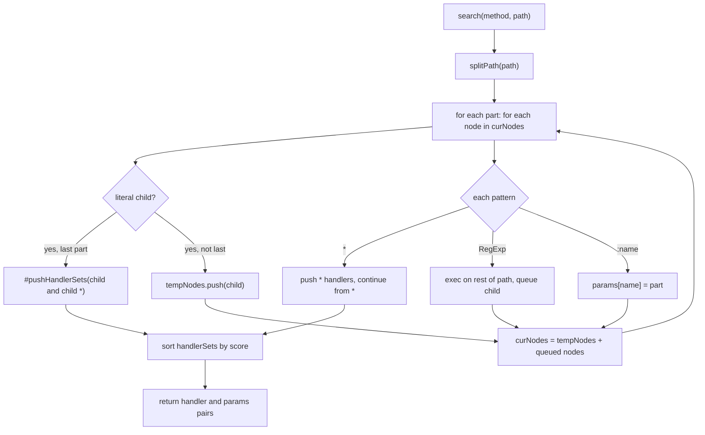

## Overview

Besides `RegExpRouter`, Hono ships three routers that return the object form of `Result` (a list of `[handler, params]` pairs) and need no build step. `TrieRouter` stores routes in a segment tree and supports every path pattern, which is why it is the fallback in both `SmartRouter` presets. `LinearRouter` keeps a flat list and parses each route against the path on every request, so registering routes costs almost nothing. `PatternRouter` turns each route into one regular expression with named groups and tests them in order; it is the smallest of the routers and is the only one in `hono/tiny`.

Sources: [src/router/trie-router/router.ts:1-28](repo://src/router/trie-router/router.ts#L1-L28), [src/router/linear-router/router.ts:11-23](repo://src/router/linear-router/router.ts#L11-L23), [src/router/pattern-router/router.ts:1-20](repo://src/router/pattern-router/router.ts#L1-L20), [src/preset/quick.ts:13-24](repo://src/preset/quick.ts#L13-L24), [src/preset/tiny.ts:11-20](repo://src/preset/tiny.ts#L11-L20)

All three can accept routes after matching has started, unlike `RegExpRouter` and `SmartRouter`. How a router is chosen, and the path syntax they share, is covered in [[Router Interface and Selection]].

Sources: [src/router/trie-router/router.ts:13-27](repo://src/router/trie-router/router.ts#L13-L27), [src/router/linear-router/router.ts:15-23](repo://src/router/linear-router/router.ts#L15-L23), [src/router/pattern-router/router.ts:12-42](repo://src/router/pattern-router/router.ts#L12-L42)

## TrieRouter

### Node structure

`TrieRouter` is a thin wrapper around a root `Node`. Its `add` expands optional parameters with `checkOptionalParameter` and inserts each resulting path; its `match` calls `node.search`. Each `Node` holds:

Sources: [src/router/trie-router/router.ts:5-28](repo://src/router/trie-router/router.ts#L5-L28), [src/router/trie-router/node.ts:6-42](repo://src/router/trie-router/node.ts#L6-L42)

| Field | Type | Purpose |
| --- | --- | --- |
| `#children` | `Record<string, Node>` | Child per segment key: a literal segment, `*`, or a pattern key |
| `#patterns` | `Pattern[]` | The non-literal children of this node, in insertion order |
| `#methods` | `Record<string, HandlerSet>[]` | Handlers ending here, one record per registration |
| `#order` | `number` | Counter on the root, incremented on every insert, used as the score |
| `#params` | `Record<string, string>` | Scratch space for parameters collected during one search |

Sources: [src/router/trie-router/router.ts:5-28](repo://src/router/trie-router/router.ts#L5-L28), [src/router/trie-router/node.ts:6-42](repo://src/router/trie-router/node.ts#L6-L42)

### insert

`insert(method, path, handler)` splits the route with `splitRoutingPath`, which keeps `{...}` regexps intact even when they contain `/`. For each segment it asks `getPattern(segment, nextSegment)` for a pattern tuple `[key, name, matcher]`. The child key is the pattern's key for parameters (so `:id` and `:id{[0-9]+}` get different nodes) and the raw segment otherwise. An existing child is reused; a new child is created and, when the segment is a pattern, the pattern is appended to the parent's `#patterns`. Parameter names met along the way are collected into `possibleKeys`.

Sources: [src/router/trie-router/node.ts:44-74](repo://src/router/trie-router/node.ts#L44-L74), [src/utils/url.ts:16-78](repo://src/utils/url.ts#L16-L78)

At the last node a `{ [method]: { handler, possibleKeys, score } }` record is pushed onto `#methods`. The score is the root's incremented `#order`, so it equals the global registration order. Registering the same path twice keeps both handlers in order.

Sources: [src/router/trie-router/node.ts:45-45](repo://src/router/trie-router/node.ts#L45-L45), [src/router/trie-router/node.ts:76-84](repo://src/router/trie-router/node.ts#L76-L84), [src/router/common.case.test.ts:689-702](repo://src/router/common.case.test.ts#L689-L702)

### search

`search(method, path)` splits the request path on `/` and advances a frontier `curNodes`, starting at the root, one segment at a time. For each node in the frontier it tries, in this order:

Sources: [src/router/trie-router/node.ts:114-131](repo://src/router/trie-router/node.ts#L114-L131)

1. Literal child: if `#children[part]` exists it joins the next frontier. On the last segment its handlers are collected instead, and so are those of its `*` child, which is how `/hello/*` matches `/hello`.
2. Wildcard pattern `*`: the handlers of the `*` child are collected straight away and the `*` child also joins the next frontier. Collecting them immediately is what lets `/x/*` match any depth below `/x`, and continuing from it is what lets `/hello/*/foo` match `/hello/bar/foo`.
3. Plain parameter (`matcher === true`): an empty segment is skipped, so `/posts/` does not match `/posts/:id`. Otherwise the segment is stored under the name, and the child joins the frontier or, on the last segment, contributes its handlers and those of its `*` child.
4. Regexp parameter: the matcher is run against the rest of the path from this segment's offset (offsets are computed once, lazily), not just the segment, so `:filename{[a-z0-9/]+.js}` can capture `chunk/123.js`. On a match the child's handlers are collected (plus its `*` child's when the match consumed the whole rest), and if the child has children it is queued in `curNodesQueue` to rejoin the frontier later. A failed regexp test falls through to a per-segment test.

Sources: [src/router/trie-router/node.ts:132-235](repo://src/router/trie-router/node.ts#L132-L235)



Sources: [src/router/trie-router/node.ts:114-180](repo://src/router/trie-router/node.ts#L114-L180), [src/router/trie-router/node.ts:181-244](repo://src/router/trie-router/node.ts#L181-L244)

### Parameters and ordering

`#pushHandlerSets` picks the handler registered for the method, or for `ALL`, from each record on a node. Each matched handler gets a fresh params object holding only the names in its own `possibleKeys`, filled from the parameters gathered along the path. A middleware on `/entry/:id/*` therefore sees `id`, while the action handler on `/entry/:id/:action` sees both `id` and `action`.

Sources: [src/router/trie-router/node.ts:87-112](repo://src/router/trie-router/node.ts#L87-L112), [src/router/common.case.test.ts:268-298](repo://src/router/common.case.test.ts#L268-L298)

Handlers are found in tree order, not registration order, so `search` finishes by sorting the collected sets by `score`. The result for `GET /posts/new`, with `ALL *`, `GET /posts/:id`, `GET /posts/*` and `GET /posts/new` registered in that order, lists all four handlers in exactly that order, with `id: 'new'` for the parameter route.

Sources: [src/router/trie-router/node.ts:237-243](repo://src/router/trie-router/node.ts#L237-L243)

> [!NOTE]
> Per-search state is written onto nodes (`#params`) and onto the shared handler-set objects (`params`). That is safe because `search` is synchronous and returns fresh `[handler, params]` tuples, but it means a `Node` tree is not meant to be searched re-entrantly.

Sources: [src/router/trie-router/node.ts:94-111](repo://src/router/trie-router/node.ts#L94-L111), [src/router/trie-router/node.ts:114-117](repo://src/router/trie-router/node.ts#L114-L117)

> [!WARNING]
> After a regexp parameter matches, the child is queued by `componentCount`, computed as `m[0].match(/\//)?.length ?? 0`. That expression is `1` when the match contains any `/` and `0` otherwise, so a regexp parameter followed by more route segments resumes at most one segment later. `/:dirs{.+}/file.html` matches `/a/file.html` and `/a/b/file.html` but not `/a/b/c/file.html`. A regexp parameter at the end of a route is not affected.

Sources: [src/router/trie-router/node.ts:201-206](repo://src/router/trie-router/node.ts#L201-L206), [src/router/common.case.test.ts:527-538](repo://src/router/common.case.test.ts#L527-L538)

## LinearRouter

### Storing routes

`LinearRouter.add` appends `[method, path, handler]` to `#routes`, once per path produced by `checkOptionalParameter`. Nothing is parsed or compiled at registration time, which keeps start-up cost close to zero. That is the reason `hono/quick` pairs it with `TrieRouter` inside a `SmartRouter`.

Sources: [src/router/linear-router/router.ts:11-23](repo://src/router/linear-router/router.ts#L11-L23), [src/preset/quick.ts:13-24](repo://src/preset/quick.ts#L13-L24)

### Scanning routes per request

`match` walks every route on every request and keeps those whose method equals the request method or `ALL`. Each route is classified by whether it contains `*` and `:`:

Sources: [src/router/linear-router/router.ts:25-36](repo://src/router/linear-router/router.ts#L25-L36)

| Route kind | How it is tested |
| --- | --- |
| `*` or `/*` | Always matches with empty params |
| Static (no `*`, no `:`) | `routePath === path` or `routePath + '/' === path` |
| Wildcard only | A trailing `/*` is cut off and the rest is split on `*`; each piece must appear exactly at the current position, and an inner `*` skips to the next `/`. Without a trailing star the last piece must end the path, allowing one trailing slash |
| Parameters only | The route is split with `splitPathRe`; literal pieces must appear at the current position, `:name` takes the characters up to the next `/` (an empty value fails), and `:name{re}` compiles `new RegExp(re + lookahead, 'd')` and requires a non-empty match at offset 0 |
| Parameters and wildcard | Throws `UnsupportedPathError`; any `*`, including one inside a `{...}` regexp, counts as a wildcard |

Sources: [src/router/linear-router/router.ts:30-138](repo://src/router/linear-router/router.ts#L30-L138)

For a regexp parameter the lookahead is the next route piece when it is a literal, so `:dirs{.+}` in `/:dirs{.+}/file.html` stops before `/file.html`. The match uses the `d` flag so the router can read `match.indices` and advance its position by the exact length consumed. When a name repeats, `params[name] ||= value` keeps the first value.

Sources: [src/router/linear-router/router.ts:86-116](repo://src/router/linear-router/router.ts#L86-L116)

```ts
        } else if (hasLabel && hasStar) {
          throw new UnsupportedPathError()
        }
```

Sources: [src/router/linear-router/router.ts:136-138](repo://src/router/linear-router/router.ts#L136-L138)

Because this check happens inside the per-request scan, a mixed route such as `/entry/:id/*` only fails when a request of its method reaches it. Inside `SmartRouter` that can happen after `LinearRouter` has already been selected; see the warning on [[Router Interface and Selection]].

Sources: [src/router/linear-router/router.test.ts:27-43](repo://src/router/linear-router/router.test.ts#L27-L43), [src/router/smart-router/router.ts:21-50](repo://src/router/smart-router/router.ts#L21-L50)

## PatternRouter

### Compiling each route

`PatternRouter.add` turns one route into one `RegExp` and pushes `[regexp, method, handler]` onto `#routes`.

Sources: [src/router/pattern-router/router.ts:4-12](repo://src/router/pattern-router/router.ts#L4-L12)

1. A trailing `*` is removed together with the character before it, and the route is marked as a prefix match.
2. A trailing `?` is removed and `add` recurses with the last segment dropped, which registers the shorter optional variant first.
3. The path is split into pieces. `/:name{re}` becomes a named group `/(?<name>re)`, with `[^/]+` as the default; an inner `/*` becomes `/[^/]+`; anything else is escaped.
4. The pieces are joined as `^...` followed by `/?$` for a full match, or by nothing for a prefix match.
5. If the `RegExp` constructor throws, for instance because the same name is used twice, the error is rethrown as `UnsupportedPathError` at registration time.

Sources: [src/router/pattern-router/router.ts:12-42](repo://src/router/pattern-router/router.ts#L12-L42)

### Running the regexes

`match` runs every route regex whose method is the request method or `ALL`, and returns `match.groups` (or a shared empty object) as each handler's params.

Sources: [src/router/pattern-router/router.ts:44-59](repo://src/router/pattern-router/router.ts#L44-L59)

```ts
      if (routeMethod === method || routeMethod === METHOD_NAME_ALL) {
        const match = pattern.exec(path)
        if (match) {
          handlers.push([handler, match.groups || emptyParams])
        }
      }
```

Sources: [src/router/pattern-router/router.ts:44-59](repo://src/router/pattern-router/router.ts#L44-L59)

```ts
import { Hono } from 'hono/tiny'

const app = new Hono()
app.get('/posts/:id{[0-9]+}', (c) => c.text(c.req.param('id')))
```

Sources: [src/preset/tiny.ts:11-20](repo://src/preset/tiny.ts#L11-L20), [src/router/pattern-router/router.ts:22-31](repo://src/router/pattern-router/router.ts#L22-L31)

## Behavioural differences and tradeoffs

### Edge cases that differ

The routers pass the same shared test suite, but each skips some cases, and a few behaviours differ in ways an application can notice.

Sources: [src/router/trie-router/router.test.ts:1-8](repo://src/router/trie-router/router.test.ts#L1-L8), [src/router/linear-router/router.test.ts:5-24](repo://src/router/linear-router/router.test.ts#L5-L24), [src/router/pattern-router/router.test.ts:5-18](repo://src/router/pattern-router/router.test.ts#L5-L18)

| Behaviour | TrieRouter | LinearRouter | PatternRouter |
| --- | --- | --- | --- |
| `GET /book/` against a `/book` route | no match | matches | matches |
| `/x/*` against `/xyz` | no match | matches (prefix test) | matches (no `$` anchor) |
| `/x/*` against `/x` | matches | matches | matches |
| Parameter plus wildcard in one route | supported | `UnsupportedPathError` at match | supported |
| Duplicate parameter name (`/:id/:id`) | first value kept | first value kept | `UnsupportedPathError` at add |
| `:name{.*}` regexp parameter | supported | `UnsupportedPathError` at match: the `*` inside the regexp counts as a wildcard | supported |
| Add routes after first match | yes | yes | yes |

Sources: [src/router/common.case.test.ts:672-688](repo://src/router/common.case.test.ts#L672-L688), [src/router/linear-router/router.ts:41-69](repo://src/router/linear-router/router.ts#L41-L69), [src/router/pattern-router/router.ts:13-41](repo://src/router/pattern-router/router.ts#L13-L41), [src/router/pattern-router/router.test.ts:20-41](repo://src/router/pattern-router/router.test.ts#L20-L41), [src/router/linear-router/router.test.ts:45-58](repo://src/router/linear-router/router.test.ts#L45-L58), [src/router/common.case.test.ts:299-306](repo://src/router/common.case.test.ts#L299-L306), [src/router/linear-router/router.ts:35-37](repo://src/router/linear-router/router.ts#L35-L37)

> [!TIP]
> Because `/x/*` also matches `/xyz` in `LinearRouter` and `PatternRouter`, a middleware on `/admin/*` in `hono/tiny`, or in `hono/quick` while `LinearRouter` is active, also runs for `/administrator`. Under those presets, check `c.req.path` inside such middleware, or use the default `hono` preset, whose routers respect the segment boundary.

Sources: [src/router/linear-router/router.ts:41-69](repo://src/router/linear-router/router.ts#L41-L69), [src/router/pattern-router/router.ts:13-16](repo://src/router/pattern-router/router.ts#L13-L16), [src/router/pattern-router/router.ts:33-37](repo://src/router/pattern-router/router.ts#L33-L37)

### Cost model

| Router | Registration | Per request | Best fit |
| --- | --- | --- | --- |
| `TrieRouter` | Builds nodes per segment | Walks one tree level per segment, regexps only for regexp params | General fallback; any route set |
| `LinearRouter` | Push to an array | Scans every route, string comparisons, a new `RegExp` for each regexp parameter checked | Short-lived apps where start-up dominates |
| `PatternRouter` | One `RegExp` per route | One `exec` per route with a matching method | Smallest bundle, small route sets |

Sources: [src/router/trie-router/node.ts:44-85](repo://src/router/trie-router/node.ts#L44-L85), [src/router/linear-router/router.ts:25-143](repo://src/router/linear-router/router.ts#L25-L143), [src/router/pattern-router/router.ts:12-59](repo://src/router/pattern-router/router.ts#L12-L59)
