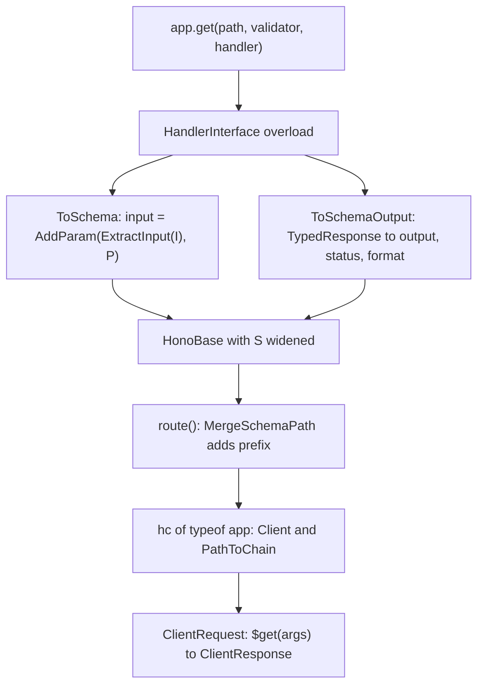

## Overview

Hono carries a lot of information in TypeScript generics so that handlers, middleware and the RPC client agree without code generation. Three type parameters travel with every app: `E` (the environment, holding `Bindings` and `Variables`), `S` (the schema, a map of every route's input and output) and `BasePath`. Each call such as `app.get(...)`, `app.use(...)` or `app.route(...)` returns a new `HonoBase` type with those parameters widened, so the type of the final app value describes every route that was chained onto it.

Sources: [src/hono-base.ts:98-114](repo://src/hono-base.ts#L98-L114), [src/types.ts:26-49](repo://src/types.ts#L26-L49)

The types live in `src/types.ts` (values, handlers, the `HandlerInterface` overloads, schema building, path parameters) and `src/utils/types.ts` (generic helpers such as `UnionToIntersection`, `Simplify`, `IsAny` and the `JSONParsed` transform). Nothing in these files exists at runtime except the `FetchEventLike` abstract class; the rest is erased on build. [[Context]] and [[HonoRequest]] consume these types, and [[RPC Client (hc)]] reads the schema back out.

Sources: [src/types.ts:1-18](repo://src/types.ts#L1-L18), [src/types.ts:2767-2778](repo://src/types.ts#L2767-L2778), [src/utils/types.ts:1-21](repo://src/utils/types.ts#L1-L21)

## Env, Bindings and Variables

### The Env shape

`Env` is an object type with two optional keys. `Bindings` describes what the runtime passes as the second argument of `fetch` (Cloudflare KV namespaces, secrets, D1 databases and so on); it surfaces as `c.env`. `Variables` describes the per-request values that middleware stores with `c.set()` and handlers read back with `c.get()` or `c.var`. The default for a plain `new Hono()` is `BlankEnv`, an empty object.

Sources: [src/types.ts:26-33](repo://src/types.ts#L26-L33)

```ts
export type Bindings = object
export type Variables = object

export type BlankEnv = {}
export type Env = {
  Bindings?: Bindings
  Variables?: Variables
}
```

Sources: [src/types.ts:26-33](repo://src/types.ts#L26-L33)

| Key | Where it appears | Typed by |
| --- | --- | --- |
| `Bindings` | `c.env`, the `env` argument of `app.fetch` and `getPath` | `E['Bindings']` |
| `Variables` | `c.set(key, value)`, `c.get(key)`, `c.var.key` | `E['Variables']`, merged with `ContextVariableMap` |

Sources: [src/context.ts:293-316](repo://src/context.ts#L293-L316), [src/context.ts:546-598](repo://src/context.ts#L546-L598), [src/hono-base.ts:44-44](repo://src/hono-base.ts#L44-L44)

### Typing c.get, c.set and c.var

`Context` picks its getter and setter signatures from `E`. Each of `Get` and `Set` has two overloads: one keyed by `keyof E['Variables']` and one keyed by `keyof ContextVariableMap`. When `E` is `any` (an untyped handler) the context falls back to `ContextVariableMap & Record<string, any>`, so arbitrary keys are accepted instead of rejected.

Sources: [src/context.ts:90-108](repo://src/context.ts#L90-L108), [src/context.ts:546-578](repo://src/context.ts#L546-L578)

```ts
interface Get<E extends Env> {
  <Key extends keyof E['Variables']>(key: Key): E['Variables'][Key]
  <Key extends keyof ContextVariableMap>(key: Key): ContextVariableMap[Key]
}
```

Sources: [src/context.ts:90-108](repo://src/context.ts#L90-L108), [src/context.ts:546-578](repo://src/context.ts#L546-L578)

`ContextVariableMap` is an empty exported interface meant for declaration merging. A middleware package that always sets a variable can augment it once with `declare module 'hono'` so every app sees the key without repeating it in `Env`. `c.var` is typed `Readonly` and combines both sources.

Sources: [src/context.ts:54-57](repo://src/context.ts#L54-L57), [src/context.ts:593-598](repo://src/context.ts#L593-L598)

```ts
type AppEnv = {
  Bindings: { DB: D1Database; API_KEY: string }
  Variables: { user: { id: string } }
}

const app = new Hono<AppEnv>()

app.get('/me', (c) => {
  const key = c.env.API_KEY // string
  const user = c.get('user') // { id: string }
  return c.json(c.var.user)
})
```

Sources: [src/hono.ts:16-33](repo://src/hono.ts#L16-L33), [src/context.ts:571-598](repo://src/context.ts#L571-L598)

### Env widening through middleware

Middleware can declare its own `Env` and the app's `E` grows to include it. Every `use` overload takes a fresh `E2` (and `E3`, `E4` for several handlers) and returns `HonoBase<IntersectNonAnyTypes<[E, E2]>, ...>`. `IntersectNonAnyTypes` walks the tuple and intersects each element after `ProcessHead` turns `any` and the bare `Env` type into `{}`, so an untyped middleware does not collapse the result to `any`.

Sources: [src/types.ts:2762-2765](repo://src/types.ts#L2762-L2765), [src/utils/types.ts:21-21](repo://src/utils/types.ts#L21-L21), [src/types.ts:1080-1108](repo://src/types.ts#L1080-L1108)

```ts
type ProcessHead<T> = IfAnyThenEmptyObject<T extends Env ? (Env extends T ? {} : T) : T>
export type IntersectNonAnyTypes<T extends any[]> = T extends [infer Head, ...infer Rest]
  ? ProcessHead<Head> & IntersectNonAnyTypes<Rest>
  : {}
```

Sources: [src/types.ts:2762-2765](repo://src/types.ts#L2762-L2765), [src/utils/types.ts:21-21](repo://src/utils/types.ts#L21-L21), [src/types.ts:1080-1108](repo://src/types.ts#L1080-L1108)

Inside a single route call the same mechanism applies across positional handlers: in `app.get(path, mw1, mw2, handler)` the third handler's context is typed with the intersection of the environments of the earlier ones, which is how `c.var.user` set by an authentication middleware is visible to the final handler of that route.

Sources: [src/types.ts:184-205](repo://src/types.ts#L184-L205), [src/types.ts:274-304](repo://src/types.ts#L274-L304)

## Handler and middleware types

### Handler, MiddlewareHandler and H

A handler is a function of `(c, next)`. The two named shapes differ in what they may return: `Handler` returns anything allowed by `HandlerResponse` (a `Response`, a `TypedResponse`, or a promise of either), while `MiddlewareHandler` is always async and may resolve to `void` after calling `next()`. `H` is the union both are accepted as when registering a route.

Sources: [src/types.ts:70-95](repo://src/types.ts#L70-L95)

```ts
export type HandlerResponse<O> =
  | Response
  | TypedResponse<O>
  | Promise<Response | TypedResponse<O>>
  | Promise<void>

export type Handler<
  E extends Env = any,
  P extends string = any,
  I extends Input = BlankInput,
  R extends HandlerResponse<any> = any,
> = (c: Context<E, P, I>, next: Next) => R

export type MiddlewareHandler<
  E extends Env = any,
  P extends string = string,
  I extends Input = {},
  R extends HandlerResponse<any> = Response,
> = (c: Context<E, P, I>, next: Next) => Promise<R | void>
```

Sources: [src/types.ts:70-95](repo://src/types.ts#L70-L95)

| Parameter | Meaning | Default in `Handler` |
| --- | --- | --- |
| `E` | Environment (`Bindings`, `Variables`) | `any` |
| `P` | Route path literal, used for `c.req.param()` typing | `any` |
| `I` | Validated input (`in` for the client, `out` for `c.req.valid()`) | `BlankInput` |
| `R` | Return type, inspected to build the route's output in the schema | `any` |

Sources: [src/types.ts:76-81](repo://src/types.ts#L76-L81), [src/types.ts:37-46](repo://src/types.ts#L37-L46)

`createMiddleware` from the factory helper is an identity function whose only job is to fix these generics for a middleware written outside a route call; see [[Factory, Testing and Other Helpers]].

Sources: [src/helper/factory/index.ts:368-375](repo://src/helper/factory/index.ts#L368-L375)

### Error and not-found handlers

`NotFoundHandler` and `ErrorHandler` take the context (and the error) and must return a `Response`. `NotFoundResponse` is an empty interface: when an application augments it to extend `Response` and a `TypedResponse`, the not-found handler's return type and the client's view of 404 responses follow it. `HTTPResponseError` is the structural type the default error handler checks for a `getResponse()` method, described in [[Error Handling and HTTPException]].

Sources: [src/types.ts:97-119](repo://src/types.ts#L97-L119)

### HandlerInterface overloads

`app.get`, `app.post` and the other method helpers are typed by `HandlerInterface<E, M, S, BasePath, CurrentPath>`. It declares one overload per handler count, with and without a leading path string, up to ten handlers, followed by variadic `(...handlers)` and `(path, ...handlers)` fallbacks in which every handler shares one `E`, `I` and `R`. Each overload threads `P` (the merged path), `I` (each handler's input, intersected from left to right) and `R` (the final return type) into `ToSchema` and returns a new `HonoBase` whose `S` is `S & ToSchema<...>`. The path-only overload `app.get(path)` sets `CurrentPath` so later chained calls without a path inherit it. `MiddlewareHandlerInterface` types `app.use` and `OnHandlerInterface` types `app.on`, which accepts a method string or array and a path string or array.

Sources: [src/types.ts:127-182](repo://src/types.ts#L127-L182), [src/types.ts:1043-1072](repo://src/types.ts#L1043-L1072), [src/types.ts:1457-1479](repo://src/types.ts#L1457-L1479)

The runtime implementation of those methods lives in the `HonoBase` constructor, which assigns one function per entry of `METHODS` plus `all`; the overloads describe what that loosely typed function does.

Sources: [src/hono-base.ts:126-142](repo://src/hono-base.ts#L126-L142)

## Input and validation targets

### The Input type

`Input` has two halves. `in` is what a caller must send (used by the client to type request arguments), and `out` is what the handler receives after validation (used by `c.req.valid()`). `outputFormat` lets a validator override the format recorded in the schema. `ExtractInput` takes the `in` half, or `{}` when it is unknown.

Sources: [src/types.ts:37-46](repo://src/types.ts#L37-L46)

```ts
export type ExtractInput<I extends Input | Input['in']> = I extends Input
  ? unknown extends I['in']
    ? {}
    : I['in']
  : I
export type Input = {
  in?: {}
  out?: {}
  outputFormat?: ResponseFormat
}
```

Sources: [src/types.ts:37-46](repo://src/types.ts#L37-L46)

The `validator()` middleware fills both halves. For a target `U` it builds `V` with `in: { [K in U]: ... }` from the raw input type and `out: { [K in U]: ExtractValidatorOutput<VF> }` from the validation function's return, and returns `MiddlewareHandler<E, P, V, ...>`. Because that `V` sits in the `I` position of the route's handlers, the next handler's `c.req.valid('json')` is typed by `InputToDataByTarget<I['out'], 'json'>`. See [[Validator]].

Sources: [src/validator/validator.ts:64-88](repo://src/validator/validator.ts#L64-L88), [src/request.ts:351-354](repo://src/request.ts#L351-L354), [src/types.ts:2720-2727](repo://src/types.ts#L2720-L2727)

### ValidationTargets

`ValidationTargets` lists the six places a validator can read from and the raw value type of each. The `param` record marks optional keys (`name?`) as `string | undefined`.

Sources: [src/types.ts:2680-2690](repo://src/types.ts#L2680-L2690)

```ts
export type ValidationTargets<T extends FormValue = ParsedFormValue, P extends string = string> = {
  json: any
  form: Record<string, T | T[]>
  query: Record<string, string | string[]>
  param: Record<P, P extends `${infer _}?` ? string | undefined : string>
  header: Record<RequestHeader | CustomHeader, string>
  cookie: Record<string, string>
}
```

Sources: [src/types.ts:2680-2690](repo://src/types.ts#L2680-L2690)

## Path parameter inference

### ParamKeys and ParamKeyToRecord

Path parameters are extracted from the route string with template literal types. `ParamKeys` splits the path on `/` and maps each segment through `ParamKey`, which keeps segments starting with `:`, strips a `{regexp}` suffix, and preserves a trailing `?` as a marker of optionality. `ParamKeyToRecord` then turns each key into a record entry, `string` for required keys and `string | undefined` for optional ones.

Sources: [src/types.ts:2698-2712](repo://src/types.ts#L2698-L2712)

```ts
type ParamKey<Component> = Component extends `:${infer NameWithPattern}`
  ? NameWithPattern extends `${infer Name}{${infer Rest}`
    ? Rest extends `${infer _Pattern}?`
      ? `${Name}?`
      : Name
    : NameWithPattern
  : never

export type ParamKeys<Path> = Path extends `${infer Component}/${infer Rest}`
  ? ParamKey<Component> | ParamKeys<Rest>
  : ParamKey<Path>

export type ParamKeyToRecord<T extends string> = T extends `${infer R}?`
  ? Record<R, string | undefined>
  : { [K in T]: string }
```

Sources: [src/types.ts:2698-2712](repo://src/types.ts#L2698-L2712)

For `'/posts/:id/:slug{[a-z-]+}/:page?'`, `ParamKeys` yields `'id' | 'slug' | 'page?'`, and `ParamKeyToRecord` turns that into `{ id: string } | { slug: string } | Record<'page', string | undefined>`; `UnionToIntersection` merges the union into one object.

Sources: [src/types.ts:2698-2712](repo://src/types.ts#L2698-L2712), [src/utils/types.ts:12-16](repo://src/utils/types.ts#L12-L16)

### c.req.param overloads

`HonoRequest<P, I>` uses those helpers in four `param` overloads. A required key returns `string`; a key that is optional in the path (`RemoveQuestion` strips the marker before comparison) returns `string | undefined`; an unknown path (`string extends P`) accepts any key; calling `param()` with no argument returns the whole simplified record.

Sources: [src/request.ts:94-101](repo://src/request.ts#L94-L101), [src/types.ts:2729-2729](repo://src/types.ts#L2729-L2729)

```ts
  param<P2 extends ParamKeys<P> = ParamKeys<P>>(
    key: string extends P ? never : P2 extends `${infer _}?` ? never : P2
  ): string
  param<P2 extends RemoveQuestion<ParamKeys<P>> = RemoveQuestion<ParamKeys<P>>>(
    key: P2
  ): string | undefined
  param(key: string): string | undefined
  param<P2 extends string = P>(): Simplify<UnionToIntersection<ParamKeyToRecord<ParamKeys<P2>>>>
```

Sources: [src/request.ts:94-101](repo://src/request.ts#L94-L101), [src/types.ts:2729-2729](repo://src/types.ts#L2729-L2729)

The `P` that reaches `HonoRequest` is the merged path. Every `app.get(path, ...)` overload computes `MergedPath extends MergePath<BasePath, P>` and passes it as the handler's `P`, so parameters declared in `basePath('/orgs/:orgId')` are typed in handlers registered below it.

Sources: [src/types.ts:167-182](repo://src/types.ts#L167-L182), [src/hono-base.ts:247-253](repo://src/hono-base.ts#L247-L253)

### MergePath

`MergePath<A, B>` mirrors the runtime `mergePath` helper at the type level: it drops a duplicated slash at the join, treats `''` like `'/'`, and returns `A` unchanged when `B` is `'/'`.

Sources: [src/types.ts:2610-2624](repo://src/types.ts#L2610-L2624), [src/utils/url.ts:158-169](repo://src/utils/url.ts#L158-L169)

```ts
export type MergePath<A extends string, B extends string> = B extends ''
  ? MergePath<A, '/'>
  : A extends ''
    ? B
    : A extends '/'
      ? B
      : A extends `${infer P}/`
        ? B extends `/${infer Q}`
          ? `${P}/${Q}`
          : `${P}/${B}`
        : B extends `/${infer Q}`
          ? Q extends ''
            ? A
            : `${A}/${Q}`
          : `${A}/${B}`
```

Sources: [src/types.ts:2610-2624](repo://src/types.ts#L2610-L2624), [src/utils/url.ts:158-169](repo://src/utils/url.ts#L158-L169)

## Schema

### Schema and Endpoint

A `Schema` maps each path to an object keyed by `$`-prefixed lowercase method names (`$get`, `$post`, `$all`), and each of those holds an `Endpoint` with the route's `input`, `output`, `outputFormat` and `status`.

Sources: [src/types.ts:2531-2551](repo://src/types.ts#L2531-L2551)

```ts
export type Schema = {
  [Path: string]: {
    [Method: `$${Lowercase<string>}`]: Endpoint
  }
}
```

Sources: [src/types.ts:2531-2551](repo://src/types.ts#L2531-L2551)

### Building a route with ToSchema

`ToSchema<M, P, I, RorO>` creates the entry for one route. The input is `AddParam<ExtractInput<I>, P>`: the validator's `in` types plus a `param` record inferred from the path when the input does not already declare one. The output half comes from `ToSchemaOutput`, which unpacks a `TypedResponse<T, U, F>` into `output: T`, `status: U` and `outputFormat: F`. A plain `Response` gives `output: {}` and `status: StatusCode`; a handler typed `any` gives a permissive entry; a handler resolving only to `Promise<void>` adds nothing.

Sources: [src/types.ts:2483-2529](repo://src/types.ts#L2483-L2529), [src/types.ts:2601-2608](repo://src/types.ts#L2601-L2608)

`TypedResponse` is a phantom type: `c.json()`, `c.text()` and `c.redirect()` return a `Response` intersected with `{ _data, _status, _format }`. The format defaults from the data type (`'text'` for strings, `'json'` for JSON values). `MergeTypedResponse` normalises the handler's return (unwrapping promises), and in multi-handler overloads `MergeMiddlewareResponse` adds any `TypedResponse` a middleware can return early, so the client sees, for example, a validator's 400 response next to the handler's 200.

Sources: [src/types.ts:2632-2672](repo://src/types.ts#L2632-L2672), [src/types.ts:149-165](repo://src/types.ts#L149-L165)

### Sub-apps and MergeSchemaPath

`app.route(path, subApp)` returns `MergeSchemaPath<SubSchema, MergePath<BasePath, SubPath>> | S`. `MergeSchemaPath` re-keys every path of the sub-app's schema with the prefix, and `MergeEndpointParamsWithPath` adds the prefix's own `:params` (extracted by `ExtractParams`, with `{regexp}` suffixes stripped from the keys) to each endpoint's `input.param`.

Sources: [src/hono-base.ts:209-233](repo://src/hono-base.ts#L209-L233), [src/types.ts:2553-2600](repo://src/types.ts#L2553-L2600)

> [!NOTE]
> Because `route()` returns a union (`... | S`) rather than an intersection, `ExtractSchema` applies `UnionToIntersection` when it reads the schema back. Keep chaining off the returned value (`const app = new Hono().route(...).get(...)`): calling methods on a variable declared earlier and discarding the result leaves those routes out of the type.

Sources: [src/types.ts:2737-2739](repo://src/types.ts#L2737-L2739), [src/hono-base.ts:209-217](repo://src/hono-base.ts#L209-L217)

## From the schema to the RPC client

### How hc reads the types

`hc<typeof app>(baseUrl)` returns `Client<typeof app, Prefix>`. `Client` infers `S` from `HonoBase<any, infer S, any>` and passes each path key to `PathToChain`, which splits the path on `/` into nested properties (an empty last segment becomes `index`) and puts a `ClientRequest` at the leaf.

Sources: [src/client/types.ts:294-318](repo://src/client/types.ts#L294-L318), [src/client/client.ts:133-137](repo://src/client/client.ts#L133-L137)

`ClientRequest` turns each `$method` of the endpoint map into a function. Its first argument is the endpoint's `input` type, required when `HasRequiredKeys` finds required keys and optional otherwise, and its promise resolves to `ClientResponse<output, status, outputFormat>`. `$all` is expanded into every standard method by `ExpandAllMethod`. The `$url()` and `$path()` helpers take the `param` and `query` parts of the input.

Sources: [src/client/types.ts:7-26](repo://src/client/types.ts#L7-L26), [src/client/types.ts:67-127](repo://src/client/types.ts#L67-L127)



Sources: [src/types.ts:167-182](repo://src/types.ts#L167-L182), [src/types.ts:2483-2529](repo://src/types.ts#L2483-L2529), [src/types.ts:2563-2569](repo://src/types.ts#L2563-L2569), [src/client/types.ts:294-318](repo://src/client/types.ts#L294-L318)

### Worked example

The example below shows the full flow: the path parameter, the environment and the JSON output all end up in the client signature. [[RPC Client (hc)]] covers the runtime proxy and request options.

Sources: [src/types.ts:2500-2529](repo://src/types.ts#L2500-L2529), [src/types.ts:2563-2600](repo://src/types.ts#L2563-L2600), [src/client/types.ts:67-80](repo://src/client/types.ts#L67-L80)

```ts
type AppEnv = { Variables: { user: string } }

const posts = new Hono<AppEnv>().get('/:id', (c) => {
  const id = c.req.param('id') // string
  return c.json({ id, user: c.var.user }, 200)
})

const app = new Hono().route('/posts', posts)
export type AppType = typeof app

// Schema of AppType:
// { '/posts/:id': { $get: { input: { param: { id: string } }
//                         output: { id: string; user: string }
//                         outputFormat: 'json'; status: 200 } } }

const client = hc<AppType>('http://localhost:8787')
const res = await client.posts[':id'].$get({ param: { id: '1' } })
```

Sources: [src/types.ts:2500-2529](repo://src/types.ts#L2500-L2529), [src/types.ts:2563-2600](repo://src/types.ts#L2563-L2600), [src/client/types.ts:67-80](repo://src/client/types.ts#L67-L80)

### Schema utilities

| Type | Purpose |
| --- | --- |
| `ExtractSchema<T>` | Reads `S` from a Hono type and intersects union members |
| `ExtractSchemaForStatusCode<T, Status>` | Keeps only endpoints whose `status` matches |
| `ExtractHandlerResponse<T>` | The non-void `Response` or `TypedResponse` a handler returns |
| `InferResponseType`, `InferRequestType` | Client-side helpers that read an endpoint function's output or input |

Sources: [src/types.ts:2737-2760](repo://src/types.ts#L2737-L2760), [src/client/types.ts:251-272](repo://src/client/types.ts#L251-L272)

## Utility types

`src/utils/types.ts` holds the generic helpers the rest of the codebase leans on. `JSONParsed<T>` models what survives `JSON.stringify` then `JSON.parse`: it follows `toJSON()` (so a `Date` becomes `string`), drops functions, symbols and `undefined` properties, turns invalid array items into `null`, maps `Set` and `Map` to `{}`, and rejects `bigint` by default through the `TError` parameter. It is what makes `c.json(data)` report a JSON-compatible output to the client.

Sources: [src/utils/types.ts:23-87](repo://src/utils/types.ts#L23-L87)

| Helper | Behaviour |
| --- | --- |
| `UnionToIntersection<U>` | Turns a union into an intersection via contravariant inference |
| `Simplify<T>` | Flattens an intersection into one object type for editor hints |
| `IsAny<T>` | `true` only for `any` |
| `IfAnyThenEmptyObject<T>` | Replaces `any` with `{}` |
| `RemoveBlankRecord<T>` | `never` for records without string keys |
| `HasRequiredKeys<T>` | Used by the client to make the argument required or optional |
| `Equal`, `Expect`, `NotEqual` | Compile-time assertions used by the type tests |

Sources: [src/utils/types.ts:7-21](repo://src/utils/types.ts#L7-L21), [src/utils/types.ts:89-114](repo://src/utils/types.ts#L89-L114)
