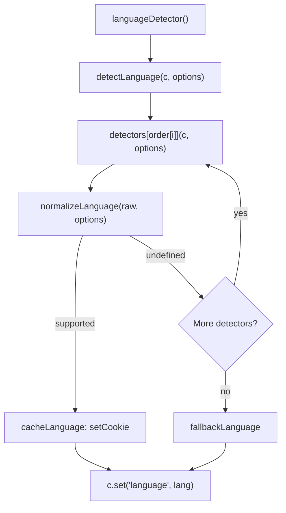

## Overview

These built-in middleware handle cross-cutting request chores that most apps need but no handler should repeat: `logger` prints each request, `requestId` tags it with an ID, `languageDetector` resolves a locale, `methodOverride` lets HTML forms send `DELETE` or `PUT`, `trimTrailingSlash` and `appendTrailingSlash` canonicalise URLs, `prettyJSON` indents JSON on demand, and `poweredBy` sets `X-Powered-By`. Two more are building blocks: `some`, `every` and `except` from `hono/combine` assemble other middleware under conditions, and `contextStorage` makes the current `Context` reachable from code that was not passed `c`.

Sources: [package.json:119-143](repo://package.json#L119-L143), [package.json:229-268](repo://package.json#L229-L268)

Each is a factory returning a `MiddlewareHandler`, registered with `app.use` and run in the onion order described in [[Middleware Composition]]. Those that publish values (`requestId`, `language`) augment `ContextVariableMap` when their module is imported, so `c.get('requestId')` and `c.get('language')` are typed without extra generics (see [[Context]]).

Sources: [src/middleware/request-id/index.ts:1-7](repo://src/middleware/request-id/index.ts#L1-L7), [src/middleware/language/index.ts:1-12](repo://src/middleware/language/index.ts#L1-L12)

## Logger

`logger(fn = console.log)` writes one line when a request arrives and one when its response leaves. The path is taken from `c.req.url` after the origin (the slice starts at the first `/` after index 8, past `https://`), so it includes the query string.

Sources: [src/middleware/logger/index.ts:81-95](repo://src/middleware/logger/index.ts#L81-L95)

```text
<-- GET /posts?page=2
--> GET /posts?page=2 200 12ms
```

Sources: [src/middleware/logger/index.ts:9-13](repo://src/middleware/logger/index.ts#L9-L13), [src/middleware/logger/index.ts:50-63](repo://src/middleware/logger/index.ts#L50-L63)

Elapsed time is printed as milliseconds below one second and rounded seconds above, with thousands separators added by `humanize`. The status code is coloured with ANSI escapes by class (5xx red, 4xx yellow, 3xx cyan, 2xx green) unless colour is disabled: `getColorEnabledAsync` honours `NO_COLOR` in `process.env`, `Deno.noColor`, or, on Cloudflare Workers, the `env` exported by `cloudflare:workers`. Pass any `(str, ...rest) => void` as `fn` to route lines to another logger.

Sources: [src/middleware/logger/index.ts:15-46](repo://src/middleware/logger/index.ts#L15-L46), [src/utils/color.ts:14-56](repo://src/utils/color.ts#L14-L56)

> [!NOTE]
> The `-->` line is written after `await next()`. If a handler throws and the error is handled by `app.onError`, the line still shows the final status, because the compose step turns the error into `c.res` before control returns to the logger.

Sources: [src/middleware/logger/index.ts:87-93](repo://src/middleware/logger/index.ts#L87-L93), [src/compose.ts:49-69](repo://src/compose.ts#L49-L69)

## Request ID

`requestId` assigns every request an identifier, stores it as the `requestId` context variable and echoes it in a response header, which makes log lines from one request easy to correlate.

Sources: [src/middleware/request-id/request-id.ts:9-17](repo://src/middleware/request-id/request-id.ts#L9-L17)

| Option | Type | Default | Description |
| --- | --- | --- | --- |
| `limitLength` | `number` | `255` | Incoming IDs longer than this are replaced. |
| `headerName` | `string` | `'X-Request-Id'` | Header read from the request and written to the response. An empty string disables both. |
| `generator` | `(c: Context) => string` | `() => crypto.randomUUID()` | Creates a new ID. |

Sources: [src/middleware/request-id/request-id.ts:41-45](repo://src/middleware/request-id/request-id.ts#L41-L45)

An incoming header value is reused only when it is present, within `limitLength`, and made of word characters, `-` and `=`; anything else (spaces, slashes, CRLF) is discarded and `generator(c)` is called instead. This keeps attacker-supplied IDs from injecting content into logs.

Sources: [src/middleware/request-id/request-id.ts:46-58](repo://src/middleware/request-id/request-id.ts#L46-L58)

```ts
import { requestId } from 'hono/request-id'

app.use(requestId())
app.get('/', (c) => {
  console.log(c.get('requestId'))
  return c.text('Hello World!')
})
```

Sources: [src/middleware/request-id/request-id.ts:29-39](repo://src/middleware/request-id/request-id.ts#L29-L39)

## Language Detector

### Detector options

`languageDetector` picks the response language from the request and stores it as the `language` context variable. User options are merged over `DEFAULT_OPTIONS` (with `cookieOptions` merged separately), then `validateOptions` throws at setup if `fallbackLanguage` is not in `supportedLanguages`, if `lookupFromPathIndex` is negative, or if `order` names an unknown detector.

Sources: [src/middleware/language/language.ts:283-300](repo://src/middleware/language/language.ts#L283-L300), [src/middleware/language/language.ts:195-207](repo://src/middleware/language/language.ts#L195-L207)

| Option | Type | Default | Description |
| --- | --- | --- | --- |
| `order` | `DetectorType[]` | `['querystring', 'cookie', 'header']` | Detectors tried in turn: `path`, `querystring`, `cookie`, `header`. |
| `lookupQueryString` | `string` | `'lang'` | Query parameter read by `querystring`. |
| `lookupCookie` | `string` | `'language'` | Cookie read by `cookie` and written when caching. |
| `lookupFromPathIndex` | `number` | `0` | Path segment index read by `path`. |
| `lookupFromHeaderKey` | `string` | `'accept-language'` | Header read by `header`. |
| `caches` | `CacheType[] \| false` | `['cookie']` | Where to persist a detected language. |
| `cookieOptions` | object | `sameSite: 'Strict'`, `secure: true`, `httpOnly: true`, `maxAge` one year | Attributes for the cache cookie. |
| `ignoreCase` | `boolean` | `true` | Compare codes case-insensitively. |
| `fallbackLanguage` | `string` | `'en'` | Used when nothing matches. Must be supported. |
| `supportedLanguages` | `string[]` | `['en']` | Allowed codes; the returned value uses this list's spelling. |
| `convertDetectedLanguage` | `(lang: string) => string` | none | Maps a raw code before matching, such as `en_US` to `en-US`. |
| `debug` | `boolean` | `false` | Log detection steps and errors. |

Sources: [src/middleware/language/language.ts:10-68](repo://src/middleware/language/language.ts#L10-L68)

### Detection flow

`detectLanguage` walks `order`, calling each detector and stopping at the first that returns a supported language; a detector that throws is skipped. If one matched and `caches` includes `'cookie'`, the result is written with `setCookie` using `lookupCookie` and `cookieOptions`, so later requests resolve from the cookie. The fallback language is never cached.

Sources: [src/middleware/language/language.ts:209-258](repo://src/middleware/language/language.ts#L209-L258)



Sources: [src/middleware/language/language.ts:84-123](repo://src/middleware/language/language.ts#L84-L123), [src/middleware/language/language.ts:212-258](repo://src/middleware/language/language.ts#L212-L258), [src/middleware/language/language.ts:295-299](repo://src/middleware/language/language.ts#L295-L299)

`normalizeLanguage` trims the code, applies `convertDetectedLanguage`, then looks for an exact match in `supportedLanguages`. Failing that it truncates subtags from the right, per RFC 4647 Lookup: `zh-Hant-TW` tries `zh-Hant`, then `zh`. The `header` detector parses `Accept-Language` with `parseAccept`, which orders entries by quality, and returns the first entry that normalises to a supported code. The `path` detector reads `pathname.split('/')` with empty segments removed.

Sources: [src/middleware/language/language.ts:74-172](repo://src/middleware/language/language.ts#L74-L172), [src/utils/accept.ts:211-236](repo://src/utils/accept.ts#L211-L236)

```ts
import { languageDetector } from 'hono/language'

app.use(
  languageDetector({
    supportedLanguages: ['en', 'ja'], // Must include fallback
    fallbackLanguage: 'en', // Required
  })
)

app.get('/', (c) => {
  const lang = c.get('language')
  return c.text(`Current language: ${lang}`)
})
```

Sources: [src/middleware/language/language.ts:265-282](repo://src/middleware/language/language.ts#L265-L282)

## Method Override

`methodOverride({ app, ... })` lets clients that can only send `GET` and `POST`, such as HTML forms, reach `DELETE`, `PUT` or `PATCH` routes. It needs the `Hono` instance because it does not rewrite the current request in place: it builds a new `Request` with the overridden method and dispatches it through `app.fetch` with the same `env` and execution context, so the new request runs the whole app again.

Sources: [src/middleware/method-override/index.ts:11-33](repo://src/middleware/method-override/index.ts#L11-L33), [src/middleware/method-override/index.ts:140-148](repo://src/middleware/method-override/index.ts#L140-L148)

| Source | Option | How the method is read and removed |
| --- | --- | --- |
| Form (default) | `form?: string`, default `'_method'` | For `multipart/form-data` or `application/x-www-form-urlencoded` bodies, the field is read from a clone, deleted, and the body is rebuilt without it. |
| Header | `header: string` | The header value is used; the header is removed from the forwarded request. |
| Query | `query: string` | The query parameter is used and deleted from the URL; the body is streamed through with `duplex: 'half'`. |

Sources: [src/middleware/method-override/index.ts:60-138](repo://src/middleware/method-override/index.ts#L60-L138)

The three sources are mutually exclusive in the type. `GET` requests are never overridden, and a request without the field, header or parameter simply continues with `next()`.

Sources: [src/middleware/method-override/index.ts:14-31](repo://src/middleware/method-override/index.ts#L14-L31), [src/middleware/method-override/index.ts:61-64](repo://src/middleware/method-override/index.ts#L61-L64)

```ts
import { methodOverride } from 'hono/method-override'

const app = new Hono()

// If no options are specified, the value of `_method` in the form,
// e.g. DELETE, is used as the method.
app.use('/posts', methodOverride({ app }))

app.delete('/posts', (c) => {
  // ....
})
```

Sources: [src/middleware/method-override/index.ts:47-58](repo://src/middleware/method-override/index.ts#L47-L58)

## Trailing Slash

`hono/trailing-slash` exports two opposite middleware that answer `301` redirects so each resource has one canonical URL. Both only act on `GET` and `HEAD`.

Sources: [src/middleware/trailing-slash/index.ts:44-74](repo://src/middleware/trailing-slash/index.ts#L44-L74), [src/middleware/trailing-slash/index.ts:128-158](repo://src/middleware/trailing-slash/index.ts#L128-L158)

| Middleware | Option | Default | Behavior |
| --- | --- | --- | --- |
| `trimTrailingSlash` | `alwaysRedirect?: boolean` | `false` | Redirects `/about/` to `/about`. The root `/` is never trimmed. |
| `appendTrailingSlash` | `alwaysRedirect?: boolean` | `false` | Redirects `/about` to `/about/`. |
| `appendTrailingSlash` | `skip?: (path: string) => boolean` | none | Returning `true` leaves the path alone, for example for paths with file extensions. |

Sources: [src/middleware/trailing-slash/index.ts:8-17](repo://src/middleware/trailing-slash/index.ts#L8-L17), [src/middleware/trailing-slash/index.ts:76-101](repo://src/middleware/trailing-slash/index.ts#L76-L101)

By default both run the handler first and only replace a `404` response with the redirect, so a route registered with the other form still answers directly. With `alwaysRedirect: true` the redirect is sent before `next()`, which is what wildcard routes need: `/my-path/*` would otherwise match `/my-path/` and never produce a 404.

Sources: [src/middleware/trailing-slash/index.ts:45-73](repo://src/middleware/trailing-slash/index.ts#L45-L73), [src/middleware/trailing-slash/index.ts:129-157](repo://src/middleware/trailing-slash/index.ts#L129-L157)

```ts
import { appendTrailingSlash } from 'hono/trailing-slash'

app.use(appendTrailingSlash({
  alwaysRedirect: true,
  skip: (path) => /\.\w+$/.test(path),
}))
```

Sources: [src/middleware/trailing-slash/index.ts:91-100](repo://src/middleware/trailing-slash/index.ts#L91-L100)

## Pretty JSON and Powered By

`prettyJSON` re-serialises JSON responses with indentation when the request carries the trigger query parameter (`?pretty` or `?pretty=1`; an empty value counts) or when `force` is set. After the handler, if the response `Content-Type` starts with `application/json`, the body is parsed and replaced by `JSON.stringify(obj, null, space)`.

Sources: [src/middleware/pretty-json/index.ts:46-56](repo://src/middleware/pretty-json/index.ts#L46-L56)

| Middleware | Option | Type | Default | Description |
| --- | --- | --- | --- | --- |
| `prettyJSON` | `space` | `number` | `2` | Indentation width. |
| `prettyJSON` | `query` | `string` | `'pretty'` | Query parameter that enables formatting. |
| `prettyJSON` | `force` | `boolean` | `false` | Format every JSON response. |
| `poweredBy` | `serverName` | `string` | `'Hono'` | Value of `X-Powered-By`. |

Sources: [src/middleware/pretty-json/index.ts:8-26](repo://src/middleware/pretty-json/index.ts#L8-L26), [src/middleware/powered-by/index.ts:7-13](repo://src/middleware/powered-by/index.ts#L7-L13)

`poweredBy` sets `X-Powered-By` on the response after `next()`, so it overrides any value set by the handler.

Sources: [src/middleware/powered-by/index.ts:30-35](repo://src/middleware/powered-by/index.ts#L30-L35)

## Combining Middleware

### some

`some(...middleware)` runs its entries in order and stops at the first that succeeds, which expresses "any of these is enough", such as a valid token or passing a rate limit. Entries may be middleware or `Condition` functions `(c) => boolean`.

Sources: [src/middleware/combine/index.ts:12-38](repo://src/middleware/combine/index.ts#L12-L38)

For each entry, `some` passes a wrapped `next` that records whether it was called. A condition returning `true` calls `next()` (unless the response is already finalized) and stops; `false` records `No successful middleware found` and moves on. A middleware that returns without throwing stops the loop. A thrown error is remembered and the next entry is tried, unless `next()` had already been called, in which case the error came from downstream and is rethrown. If no entry succeeded, the last error is thrown.

Sources: [src/middleware/combine/index.ts:38-69](repo://src/middleware/combine/index.ts#L38-L69)

### every

`every(...middleware)` requires all entries to pass. It composes them with the same `compose` function the app uses, so each one's `next` leads to the following entry and the last leads to the outer `next`. A condition returning `false` throws `Unmet condition`. The current `c.req.routeIndex` is restored before each entry so parameter lookups stay pointed at the outer route.

Sources: [src/middleware/combine/index.ts:99-117](repo://src/middleware/combine/index.ts#L99-L117)

### except

`except(condition, ...middleware)` runs the middleware unless a condition matches. String conditions are path patterns added to a private `TrieRouter` and matched against `c.req.path`; function conditions are called with the context. Internally it is `some(anyConditionMatches, every(...middleware))`: a matching condition skips straight to `next()`, otherwise all the middleware run.

Sources: [src/middleware/combine/index.ts:141-165](repo://src/middleware/combine/index.ts#L141-L165)

```ts
import { some, every, except } from 'hono/combine'
import { bearerAuth } from 'hono/bearer-auth'

// Local clients skip both checks; others need a token and a rate limit.
app.use('/api/*', some(
  myCheckLocalNetwork(),
  every(
    bearerAuth({ token }),
    myRateLimit({ limit: 100 }),
  ),
))

// Public endpoints skip authentication.
app.use('/api/*', except(
  '/api/public/*',
  bearerAuth({ token }),
))
```

Sources: [src/middleware/combine/index.ts:81-97](repo://src/middleware/combine/index.ts#L81-L97), [src/middleware/combine/index.ts:128-140](repo://src/middleware/combine/index.ts#L128-L140)

## Context Storage

`contextStorage()` runs the rest of the chain inside `AsyncLocalStorage.run(c, next)` from `node:async_hooks`, so any function called during the request can fetch the context with `getContext()` without being passed `c`. `tryGetContext()` returns `undefined` outside a request; `getContext()` throws `Context is not available`. Both accept an `Env` type parameter for typed `var` access.

Sources: [src/middleware/context-storage/index.ts:6-59](repo://src/middleware/context-storage/index.ts#L6-L59)

```ts
import { contextStorage, getContext } from 'hono/context-storage'

type Env = {
  Variables: {
    message: string
  }
}

const app = new Hono<Env>()

app.use(contextStorage())

app.use(async (c, next) => {
  c.set('message', 'Hono is hot!!')
  await next()
})

app.get('/', async (c) => c.text(getMessage()))

const getMessage = () => {
  return getContext<Env>().var.message
}
```

Sources: [src/middleware/context-storage/index.ts:19-41](repo://src/middleware/context-storage/index.ts#L19-L41)

> [!WARNING]
> The module imports `node:async_hooks` at load time. It works on Node.js, Bun, Deno and Cloudflare Workers with the `nodejs_compat` flag, but fails to load on runtimes without `AsyncLocalStorage`.

Sources: [src/middleware/context-storage/index.ts:6-10](repo://src/middleware/context-storage/index.ts#L6-L10)
