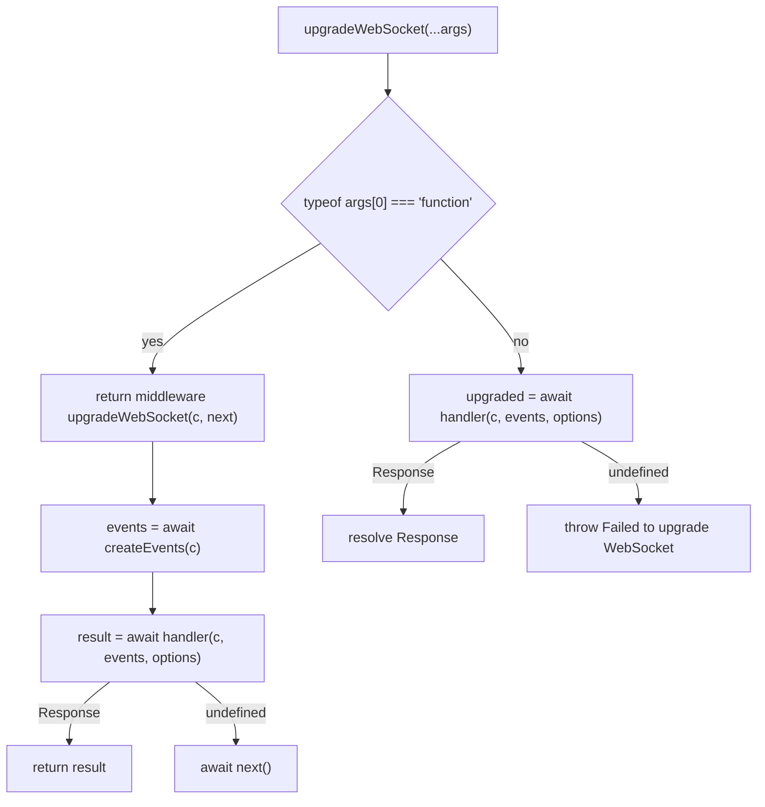

## Overview

Every JavaScript runtime upgrades an HTTP request to a WebSocket in its own way: Bun calls `server.upgrade()` and delivers events to a separate `websocket` handler object, Deno returns a `{ response, socket }` pair from `Deno.upgradeWebSocket`, and Cloudflare Workers creates a `WebSocketPair`. `hono/ws` hides those differences behind one interface. An adapter defines `upgradeWebSocket` with `defineWebSocketHelper`, and application code passes it a set of `WSEvents` callbacks that receive a runtime-neutral `WSContext`.

Sources: [src/helper/websocket/index.ts:1-91](repo://src/helper/websocket/index.ts#L1-L91), [src/helper/websocket/index.ts:101-140](repo://src/helper/websocket/index.ts#L101-L140)

The adapters export `upgradeWebSocket` from `hono/bun`, `hono/deno` and `hono/cloudflare-workers`; Bun also exports the `websocket` handler that must be passed to `Bun.serve`. See [[Runtime Adapters]] for the rest of each adapter.

Sources: [src/adapter/bun/index.ts:8-9](repo://src/adapter/bun/index.ts#L8-L9), [src/adapter/deno/index.ts:8-8](repo://src/adapter/deno/index.ts#L8-L8), [src/adapter/cloudflare-workers/index.ts:7-7](repo://src/adapter/cloudflare-workers/index.ts#L7-L7)

## Usage

### Middleware form

The common form takes a factory `(c) => WSEvents` (sync or async) and returns a middleware. The factory runs once per upgrade request, so it can read params, headers or variables from the [[Context]] and close over them.

Sources: [src/helper/websocket/index.ts:21-40](repo://src/helper/websocket/index.ts#L21-L40), [src/helper/websocket/index.ts:119-128](repo://src/helper/websocket/index.ts#L119-L128)

```ts
import { Hono } from 'hono'
import { upgradeWebSocket } from 'hono/cloudflare-workers'

const app = new Hono()

app.get(
  '/ws',
  upgradeWebSocket((c) => {
    const room = c.req.query('room')
    return {
      onMessage(event, ws) {
        ws.send(`[${room}] ${event.data}`)
      },
      onClose: () => {
        console.log('Connection closed')
      },
    }
  })
)

export default app
```

Sources: [src/adapter/cloudflare-workers/websocket.ts:5-53](repo://src/adapter/cloudflare-workers/websocket.ts#L5-L53), [src/helper/websocket/index.ts:14-19](repo://src/helper/websocket/index.ts#L14-L19)

The returned middleware is typed with `outputFormat: 'ws'`, which lets the [[RPC Client (hc)]] expose a `$ws()` method for that route. `$ws` rewrites the URL scheme from `http` to `ws`, fills path params and appends query params before creating a `WebSocket`.

Sources: [src/helper/websocket/index.ts:28-34](repo://src/helper/websocket/index.ts#L28-L34), [src/client/types.ts:112-118](repo://src/client/types.ts#L112-L118), [src/client/client.ts:187-200](repo://src/client/client.ts#L187-L200)

### Direct form

`upgradeWebSocket(c, events, options?)` upgrades from inside an ordinary handler and returns `Promise<Response>`. It is useful when the upgrade depends on logic that already ran in the handler. If the adapter could not upgrade, the promise rejects with `Error('Failed to upgrade WebSocket')`.

Sources: [src/helper/websocket/index.ts:35-39](repo://src/helper/websocket/index.ts#L35-L39), [src/helper/websocket/index.ts:129-138](repo://src/helper/websocket/index.ts#L129-L138)

```ts
app.get('/ws', async (c) => {
  if (!(await isAllowed(c))) {
    return c.text('Forbidden', 403)
  }
  return upgradeWebSocket(c, {
    onMessage(event, ws) {
      ws.send(String(event.data))
    },
  })
})
```

Sources: [src/helper/websocket/index.ts:129-138](repo://src/helper/websocket/index.ts#L129-L138)

## Core types

### WSEvents

All callbacks are optional and receive the native event plus the `WSContext`.

Sources: [src/helper/websocket/index.ts:11-19](repo://src/helper/websocket/index.ts#L11-L19)

| Callback | Event type | Fired when |
| --- | --- | --- |
| `onOpen` | `Event` | the connection is open (not on Cloudflare Workers) |
| `onMessage` | `MessageEvent<WSMessageReceive>` | a message arrives; `data` is `string`, `Blob` or `ArrayBufferLike` |
| `onClose` | `CloseEvent` | the connection closes |
| `onError` | `Event` | an error occurs (not wired by the Bun adapter) |

Sources: [src/helper/websocket/index.ts:14-19](repo://src/helper/websocket/index.ts#L14-L19), [src/helper/websocket/index.ts:93-93](repo://src/helper/websocket/index.ts#L93-L93), [src/adapter/cloudflare-workers/websocket.ts:34-44](repo://src/adapter/cloudflare-workers/websocket.ts#L34-L44), [src/adapter/bun/websocket.ts:76-104](repo://src/adapter/bun/websocket.ts#L76-L104)

### WSContext

`WSContext<T>` is a thin wrapper over a `WSContextInit<T>` supplied by the adapter. It keeps the init object in a private field and forwards `send` and `close` to it, so each adapter decides how those map to the native socket.

Sources: [src/helper/websocket/index.ts:47-91](repo://src/helper/websocket/index.ts#L47-L91)

| Member | Type | Description |
| --- | --- | --- |
| `send(source, options?)` | `string`, `ArrayBuffer` or `Uint8Array` | forwards to the adapter; `options` defaults to `{}` |
| `close(code?, reason?)` | method | forwards to the adapter |
| `readyState` | `0`, `1`, `2` or `3` | getter reading the init object's `readyState` |
| `raw` | `T` | the native socket (`WebSocket` on Deno and Workers, Bun's `ServerWebSocket`) |
| `url` | `URL` or `null` | built from `init.url` when present |
| `protocol` | `string` or `null` | `init.protocol`, or `null` |
| `binaryType` | `BinaryType` | always `'arraybuffer'` |

Sources: [src/helper/websocket/index.ts:70-91](repo://src/helper/websocket/index.ts#L70-L91)

`SendOptions` currently holds a single field, `compress?: boolean`; only the Bun adapter uses it.

Sources: [src/helper/websocket/index.ts:60-65](repo://src/helper/websocket/index.ts#L60-L65), [src/adapter/bun/websocket.ts:33-46](repo://src/adapter/bun/websocket.ts#L33-L46)

## defineWebSocketHelper

### Dispatch between the two forms

`defineWebSocketHelper(handler)` takes an adapter function `(c, events, options?) => Response | void` (or a promise of one) and returns a function that supports both call forms. It tells them apart by checking whether the first argument is a function.

Sources: [src/helper/websocket/index.ts:101-140](repo://src/helper/websocket/index.ts#L101-L140)



Sources: [src/helper/websocket/index.ts:111-140](repo://src/helper/websocket/index.ts#L111-L140)

In the middleware form, an adapter that returns nothing (for example because the request has no `Upgrade: websocket` header) lets the request continue to the next handler, so the same path can also serve normal HTTP. The `createEvents` factory still runs for such requests, because it is called before the adapter checks the headers.

Sources: [src/helper/websocket/index.ts:119-128](repo://src/helper/websocket/index.ts#L119-L128)

`createWSMessageEvent(source)` builds a `MessageEvent('message', { data: source })` for adapters whose runtime does not deliver a native `MessageEvent`, as Bun does not.

Sources: [src/helper/websocket/index.ts:95-99](repo://src/helper/websocket/index.ts#L95-L99)

### Writing a custom adapter

A new runtime only needs to implement the handler: build a `WSContext` around the native socket, wire the `events` callbacks, and return the upgrade `Response`, or `undefined` when it cannot upgrade.

Sources: [src/helper/websocket/index.ts:101-113](repo://src/helper/websocket/index.ts#L101-L113)

```ts
import { defineWebSocketHelper, WSContext } from 'hono/ws'

export const upgradeWebSocket = defineWebSocketHelper(async (c, events) => {
  if (c.req.header('upgrade') !== 'websocket') {
    return
  }
  const { response, socket } = runtimeUpgrade(c.req.raw)
  const ws = new WSContext({
    send: (data) => socket.send(data),
    close: (code, reason) => socket.close(code, reason),
    get readyState() {
      return socket.readyState
    },
    raw: socket,
  })
  socket.onmessage = (evt) => events.onMessage?.(evt, ws)
  return response
})
```

Sources: [src/helper/websocket/index.ts:47-58](repo://src/helper/websocket/index.ts#L47-L58), [src/helper/websocket/index.ts:111-140](repo://src/helper/websocket/index.ts#L111-L140)

## Adapter implementations

### Bun

Bun separates the upgrade from the event handling. `upgradeWebSocket` gets the Bun server with `getBunServer(c)`, which reads `c.env.server` or `c.env` itself, and throws `TypeError('env has to include the 2nd argument of fetch.')` when it is missing. It calls `server.upgrade(c.req.raw, { data })`, storing the `events`, the request `URL` and the first `Sec-WebSocket-Protocol` value in the socket's `data`. On success it returns `new Response(null)`; on failure it returns nothing.

Sources: [src/adapter/bun/websocket.ts:48-74](repo://src/adapter/bun/websocket.ts#L48-L74), [src/adapter/bun/server.ts:13-14](repo://src/adapter/bun/server.ts#L13-L14)

The exported `websocket` object implements Bun's `open`, `close` and `message` callbacks. Each one reads `ws.data.events`, creates a fresh `WSContext` with `createWSContext(ws)` and calls the matching listener. `close` builds a `CloseEvent` from the code and reason, and `message` turns a binary payload into its `buffer` and wraps it with `createWSMessageEvent`. There is no `error` callback, so `onError` is never called on Bun.

Sources: [src/adapter/bun/websocket.ts:33-46](repo://src/adapter/bun/websocket.ts#L33-L46), [src/adapter/bun/websocket.ts:76-104](repo://src/adapter/bun/websocket.ts#L76-L104)

```ts
import { Hono } from 'hono'
import { upgradeWebSocket, websocket } from 'hono/bun'

const app = new Hono()

app.get(
  '/ws',
  upgradeWebSocket(() => ({
    onMessage(event, ws) {
      ws.send(`echo: ${event.data}`)
    },
  }))
)

export default {
  fetch: app.fetch,
  websocket,
}
```

Sources: [src/adapter/bun/websocket.ts:48-104](repo://src/adapter/bun/websocket.ts#L48-L104)

> [!NOTE]
> On Bun the `WSContext` copies `readyState` when it is created rather than reading it live, and a new context is created for every event. `createBunWebSocket()` is deprecated; import `upgradeWebSocket` and `websocket` directly.

Sources: [src/adapter/bun/websocket.ts:33-46](repo://src/adapter/bun/websocket.ts#L33-L46), [src/adapter/bun/websocket.ts:106-113](repo://src/adapter/bun/websocket.ts#L106-L113)

### Deno

The Deno adapter returns early unless the `upgrade` header is `websocket`. It takes the first requested subprotocol and passes it as `protocol` to `Deno.upgradeWebSocket`, because browsers such as Chrome reject a connection whose response lacks `Sec-WebSocket-Protocol` after one was requested. The adapter's `options` (`Deno.UpgradeWebSocketOptions`) are spread afterwards and can override it.

Sources: [src/adapter/deno/websocket.ts:4-18](repo://src/adapter/deno/websocket.ts#L4-L18)

One `WSContext` is created per connection with live getters for `protocol` and `readyState`, and the four `events` callbacks are assigned to `socket.onopen`, `onmessage`, `onclose` and `onerror`. The `response` from Deno is returned as the upgrade response. `send` ignores `SendOptions`.

Sources: [src/adapter/deno/websocket.ts:20-38](repo://src/adapter/deno/websocket.ts#L20-L38)

### Cloudflare Workers

The Workers adapter checks the `Upgrade` header, creates a `WebSocketPair`, keeps the server end and hands the client end to the runtime in `new Response(null, { status: 101, webSocket: client })`. It registers `close`, `message` and `error` listeners only for callbacks that are defined, then calls `server.accept()`.

Sources: [src/adapter/cloudflare-workers/websocket.ts:10-53](repo://src/adapter/cloudflare-workers/websocket.ts#L10-L53)

Workers emits no `open` event on the server socket, so the adapter's type is `Omit<WSEvents<WebSocket>, 'onOpen'>` and passing `onOpen` is a type error. Code that should run on connect can run in the `createEvents` factory instead.

Sources: [src/adapter/cloudflare-workers/websocket.ts:4-9](repo://src/adapter/cloudflare-workers/websocket.ts#L4-L9), [src/adapter/cloudflare-workers/websocket.ts:34-35](repo://src/adapter/cloudflare-workers/websocket.ts#L34-L35)

### Comparison

| Aspect | Bun | Deno | Cloudflare Workers |
| --- | --- | --- | --- |
| Upgrade call | `server.upgrade(req, { data })` | `Deno.upgradeWebSocket(req, options)` | `new WebSocketPair()` |
| Upgrade response | `new Response(null)` | Deno's `response` | status 101 with `webSocket: client` |
| Header check | done by `server.upgrade` | `upgrade: websocket` | `Upgrade: websocket` |
| `onOpen` | yes | yes | no |
| `onError` | no | yes | yes |
| `send` compress | yes | ignored | ignored |
| `WSContext` lifetime | new per event | one per connection | one per connection |
| Extra export | `websocket` for `Bun.serve` | none | none |

Sources: [src/adapter/bun/websocket.ts:33-104](repo://src/adapter/bun/websocket.ts#L33-L104), [src/adapter/deno/websocket.ts:4-38](repo://src/adapter/deno/websocket.ts#L4-L38), [src/adapter/cloudflare-workers/websocket.ts:5-53](repo://src/adapter/cloudflare-workers/websocket.ts#L5-L53)
