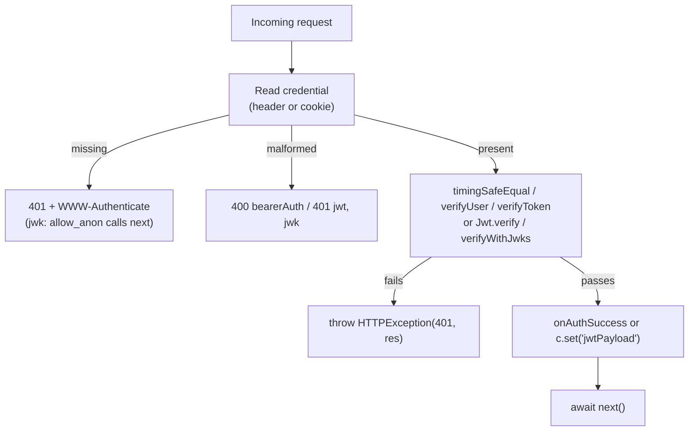

## Overview

Hono ships four authentication middleware, each published as its own entry point: `basicAuth` (`hono/basic-auth`), `bearerAuth` (`hono/bearer-auth`), `jwt` (`hono/jwt`) and `jwk` (`hono/jwk`). All four follow the same contract: they read a credential from the request, check it, and either call `next()` or throw an `HTTPException` carrying a ready-made `401` (or `400`) `Response` with a `WWW-Authenticate` challenge. Because the failure is a thrown `HTTPException` with a `res`, the app's error handler returns that response unchanged unless you override it (see [[Error Handling and HTTPException]]).

Sources: [package.json:74-83](repo://package.json#L74-L83), [package.json:209-218](repo://package.json#L209-L218)

`basicAuth` and `bearerAuth` compare shared secrets with `timingSafeEqual`, which hashes both values (SHA-256 by default) and compares the hashes and the raw strings in constant time. `jwt` and `jwk` delegate to the [[JWT Utilities]] (`Jwt.verify` and `Jwt.verifyWithJwks`) and, on success, store the decoded claims in the context as `jwtPayload`.

Sources: [src/utils/buffer.ts:29-63](repo://src/utils/buffer.ts#L29-L63), [src/middleware/jwt/jwt.ts:131-156](repo://src/middleware/jwt/jwt.ts#L131-L156)



Sources: [src/middleware/basic-auth/index.ts:105-152](repo://src/middleware/basic-auth/index.ts#L105-L152), [src/middleware/bearer-auth/index.ts:156-220](repo://src/middleware/bearer-auth/index.ts#L156-L220), [src/middleware/jwk/jwk.ts:75-168](repo://src/middleware/jwk/jwk.ts#L75-L168)

## Basic authentication

### Options for basicAuth

`basicAuth(options, ...users)` takes either a fixed `username`/`password` pair or a `verifyUser` callback. The factory throws a plain `Error` at setup time if neither is present, so a misconfigured route fails on startup rather than on the first request.

Sources: [src/middleware/basic-auth/index.ts:14-29](repo://src/middleware/basic-auth/index.ts#L14-L29), [src/middleware/basic-auth/index.ts:80-103](repo://src/middleware/basic-auth/index.ts#L80-L103)

| Option | Type | Default | Description |
| --- | --- | --- | --- |
| `username` / `password` | `string` | none | The accepted credentials. Extra pairs can be passed as rest arguments after `options`. |
| `verifyUser` | `(username, password, c) => boolean \| Promise<boolean>` | none | Custom check, used instead of the pair list. |
| `realm` | `string` | `'Secure Area'` | Placed in `WWW-Authenticate: Basic realm="..."`; double quotes are escaped. |
| `hashFunction` | `Function` | SHA-256 | Hash used by `timingSafeEqual` before the constant-time comparison. |
| `invalidUserMessage` | `string \| object \| (c) => string \| object` | `'Unauthorized'` | Body of the 401. An object is sent as JSON with `content-type: application/json`. |
| `onAuthSuccess` | `(c, username) => void \| Promise<void>` | none | Called after a successful check and before `next()`. |

Sources: [src/middleware/basic-auth/index.ts:31-45](repo://src/middleware/basic-auth/index.ts#L31-L45), [src/middleware/basic-auth/index.ts:93-99](repo://src/middleware/basic-auth/index.ts#L93-L99)

### How credentials are parsed and checked

The `auth` helper in `src/utils/basic-auth.ts` matches the `Authorization` header against `Basic <base64>` (the scheme is matched case-insensitively), base64-decodes it, UTF-8 decodes the bytes and splits on the first `:`. Invalid base64 makes `atob` throw; the helper swallows that and returns `undefined`, so a garbage header is treated exactly like a missing one.

Sources: [src/utils/basic-auth.ts:1-26](repo://src/utils/basic-auth.ts#L1-L26)

With `verifyUser`, the callback decides alone. Otherwise the middleware walks the user list (the `username`/`password` from options is unshifted to the front of the rest arguments) and runs `timingSafeEqual` on the username and password in parallel for each entry. Any failure, including a missing header, falls through to the same 401 response.

Sources: [src/middleware/basic-auth/index.ts:105-131](repo://src/middleware/basic-auth/index.ts#L105-L131)

### Failure response for basicAuth

The response is built once and thrown as `new HTTPException(401, { res })`. A string message becomes the plain body; anything else is `JSON.stringify`-ed with a JSON content type.

Sources: [src/middleware/basic-auth/index.ts:132-152](repo://src/middleware/basic-auth/index.ts#L132-L152)

```ts
import { Hono } from 'hono'
import { basicAuth } from 'hono/basic-auth'

const app = new Hono()

app.use(
  '/auth/*',
  basicAuth(
    {
      username: 'hono',
      password: 'ahotproject',
      invalidUserMessage: { message: 'Who are you?' },
      onAuthSuccess: (c, username) => {
        c.set('user', { name: username })
      },
    },
    { username: 'second', password: 'another-password' }
  )
)
```

Sources: [src/middleware/basic-auth/index.ts:80-83](repo://src/middleware/basic-auth/index.ts#L80-L83), [src/middleware/basic-auth/index.ts:14-22](repo://src/middleware/basic-auth/index.ts#L14-L22)

## Bearer token authentication

### Options for bearerAuth

`bearerAuth` takes either `token` (one string or an array) or `verifyToken(token, c)`. Missing both throws at setup. `realm` defaults to the empty string and `prefix` to `'Bearer'`; setting `prefix: ''` accepts the raw header value as the token and drops the scheme from the generated challenge.

Sources: [src/middleware/bearer-auth/index.ts:22-66](repo://src/middleware/bearer-auth/index.ts#L22-L66), [src/middleware/bearer-auth/index.ts:104-120](repo://src/middleware/bearer-auth/index.ts#L104-L120)

| Option | Type | Default | Description |
| --- | --- | --- | --- |
| `token` | `string \| string[]` | none | Accepted token(s), compared with `timingSafeEqual`. |
| `verifyToken` | `(token, c) => boolean \| Promise<boolean>` | none | Custom check, used instead of `token`. |
| `realm` | `string` | `''` | Realm in the challenge sent when the header is missing. |
| `prefix` | `string` | `'Bearer'` | Scheme expected before the token, matched case-insensitively. |
| `headerName` | `string` | `'Authorization'` | Header the token is read from. |
| `hashFunction` | `Function` | SHA-256 | Hash used for the safe comparison. |
| `noAuthenticationHeader` | `{ message?, wwwAuthenticateHeader? }` | `'Unauthorized'`, `Bearer realm=""` | Response when the header is absent (401). |
| `invalidAuthenticationHeader` | `{ message?, wwwAuthenticateHeader? }` | `'Bad Request'`, `Bearer error="invalid_request"` | Response when the header is malformed (400). |
| `invalidToken` | `{ message?, wwwAuthenticateHeader? }` | `'Unauthorized'`, `Bearer error="invalid_token"` | Response when the token does not match (401). |

Sources: [src/middleware/bearer-auth/index.ts:68-89](repo://src/middleware/bearer-auth/index.ts#L68-L89)

The older flat options `noAuthenticationHeaderMessage`, `invalidAuthenticationHeaderMessage` and `invalidTokenMessage` are deprecated but still read as fallbacks after the nested `message`.

Sources: [src/middleware/bearer-auth/index.ts:29-43](repo://src/middleware/bearer-auth/index.ts#L29-L43), [src/middleware/bearer-auth/index.ts:163-167](repo://src/middleware/bearer-auth/index.ts#L163-L167)

### Request checks in bearerAuth

The handler distinguishes three outcomes:

Sources: [src/middleware/bearer-auth/index.ts:156-158](repo://src/middleware/bearer-auth/index.ts#L156-L158)

1. No header: 401 with the `noAuthenticationHeader` challenge.
2. Header present but the prefix does not match (it must be followed by a space), or the token fails the RFC 6750 `b64token` pattern `[A-Za-z0-9._~+/-]+=*`: 400 with `error="invalid_request"`.
3. Well-formed token that `verifyToken`, the single `token`, or none of the array entries accepts: 401 with `error="invalid_token"`.

Sources: [src/middleware/bearer-auth/index.ts:12-14](repo://src/middleware/bearer-auth/index.ts#L12-L14), [src/middleware/bearer-auth/index.ts:156-220](repo://src/middleware/bearer-auth/index.ts#L156-L220)

### Customising the bearerAuth challenge

Each `wwwAuthenticateHeader` and `message` may be a value or a function of the context. A string header is used verbatim; an object is rendered as `key="value"` pairs joined by commas after the prefix. Messages follow the same string-or-JSON rule as `basicAuth`.

Sources: [src/middleware/bearer-auth/index.ts:122-154](repo://src/middleware/bearer-auth/index.ts#L122-L154)

```ts
import { bearerAuth } from 'hono/bearer-auth'

app.use(
  '/api/*',
  bearerAuth({
    verifyToken: async (token, c) => token === (await c.env.KV.get('api-token')),
    invalidToken: {
      wwwAuthenticateHeader: { error: 'invalid_token', error_description: 'expired' },
      message: { error: 'token rejected' },
    },
  })
)
```

Sources: [src/middleware/bearer-auth/index.ts:45-66](repo://src/middleware/bearer-auth/index.ts#L45-L66), [src/middleware/bearer-auth/index.ts:133-140](repo://src/middleware/bearer-auth/index.ts#L133-L140)

## JWT middleware

### Options for jwt

`jwt` verifies a token signed with a key you hold. `secret` and `alg` are both required, and the factory also throws if `crypto.subtle.importKey` is unavailable in the runtime.

Sources: [src/middleware/jwt/jwt.ts:53-74](repo://src/middleware/jwt/jwt.ts#L53-L74)

| Option | Type | Default | Description |
| --- | --- | --- | --- |
| `secret` | `string \| HonoJsonWebKey \| CryptoKey` | required | Verification key: HMAC secret, PEM, JWK or `CryptoKey`. |
| `alg` | `SignatureAlgorithm` | required | Expected algorithm; a token whose header names another `alg` is rejected. |
| `headerName` | `string` | `'Authorization'` | Header holding `Bearer <token>`. |
| `cookie` | `string \| { key, secret?, prefixOptions? }` | none | Cookie to read when the header is absent; with `secret` the cookie is read with `getSignedCookie`. |
| `verification` | `VerifyOptions` | `{}` | Claim checks (`iss`, `aud`, `exp`, `nbf`, `iat`) passed to `Jwt.verify`. |

Sources: [src/middleware/jwt/jwt.ts:27-32](repo://src/middleware/jwt/jwt.ts#L27-L32), [src/utils/jwt/jwt.ts:78-89](repo://src/utils/jwt/jwt.ts#L78-L89)

### Token extraction and verification

When the header is present it must split on whitespace into exactly two parts with a `bearer` scheme (case-insensitive); otherwise the request fails with `invalid credentials structure`. Only when there is no header does the middleware consult `cookie`, choosing `getCookie` or `getSignedCookie` (with optional `__Secure-`/`__Host-` `prefixOptions`) as configured. See [[Cookies]] for those helpers.

Sources: [src/middleware/jwt/jwt.ts:76-129](repo://src/middleware/jwt/jwt.ts#L76-L129)

The token is then passed to `Jwt.verify(token, secret, { alg, ...verification })`. Any thrown error (bad signature, expired, wrong issuer, and so on) is caught and kept as the `cause` of the resulting `HTTPException`, so an `onError` handler can inspect which check failed. On success the payload is stored with `ctx.set('jwtPayload', payload)`.

Sources: [src/middleware/jwt/jwt.ts:131-158](repo://src/middleware/jwt/jwt.ts#L131-L158)

### Reading jwtPayload

`hono/jwt` augments `ContextVariableMap` with `JwtVariables<unknown>`, so `c.get('jwtPayload')` is typed `unknown` anywhere once the module is imported. Declare `Variables: JwtVariables<YourClaims>` on the app to get a concrete type. The entry point also re-exports `sign`, `verify`, `decode`, `verifyWithJwks` and `AlgorithmTypes`.

Sources: [src/middleware/jwt/index.ts:1-9](repo://src/middleware/jwt/index.ts#L1-L9), [src/middleware/jwt/jwt.ts:18-20](repo://src/middleware/jwt/jwt.ts#L18-L20), [src/middleware/jwt/jwt.ts:175-178](repo://src/middleware/jwt/jwt.ts#L175-L178)

```ts
import { Hono } from 'hono'
import { jwt } from 'hono/jwt'
import type { JwtVariables } from 'hono/jwt'

type Claims = { sub: string; role: 'admin' | 'user' }

const app = new Hono<{ Variables: JwtVariables<Claims> }>()

app.use(
  '/auth/*',
  jwt({
    secret: 'it-is-very-secret',
    alg: 'HS256',
    cookie: 'session',
    verification: { iss: 'https://issuer.example.com', aud: 'my-api' },
  })
)

app.get('/auth/me', (c) => c.json(c.get('jwtPayload')))
```

Sources: [src/middleware/jwt/jwt.ts:18-20](repo://src/middleware/jwt/jwt.ts#L18-L20), [src/middleware/jwt/jwt.ts:53-61](repo://src/middleware/jwt/jwt.ts#L53-L61)

## JWK middleware

### Options for jwk

`jwk` verifies tokens signed by a third party (an identity provider) using public keys looked up by the token's `kid`. It needs `keys`, `jwks_uri`, or both, plus an `alg` allow-list restricted to asymmetric algorithms. The optional second argument `init` is passed to `fetch` when the key set is downloaded.

Sources: [src/middleware/jwk/jwk.ts:48-73](repo://src/middleware/jwk/jwk.ts#L48-L73)

| Option | Type | Default | Description |
| --- | --- | --- | --- |
| `keys` | `HonoJsonWebKey[] \| (c) => HonoJsonWebKey[] \| Promise<...>` | none | Static public keys, or a function resolving them per request. |
| `jwks_uri` | `string \| (c) => string \| Promise<string>` | none | URL of a JWKS document; its `keys` are appended to `keys`. |
| `alg` | `AsymmetricAlgorithm[]` | required | Algorithms a token may use (RS, PS, ES families and EdDSA). |
| `allow_anon` | `boolean` | `false` | When no token is found, call `next()` instead of returning 401. |
| `headerName` | `string` | `'Authorization'` | Header holding `Bearer <token>`. |
| `cookie` | `string \| { key, secret?, prefixOptions? }` | none | Cookie fallback, same rules as `jwt`. |
| `verification` | `VerifyOptions` | `{}` | Claim checks passed through to `verify`. |

Sources: [src/middleware/jwk/jwk.ts:20-31](repo://src/middleware/jwk/jwk.ts#L20-L31), [src/utils/jwt/jwa.ts:27-37](repo://src/utils/jwt/jwa.ts#L27-L37)

### Key resolution and verification in jwk

Token extraction is identical to `jwt`. If no token is found and `allow_anon` is set, the request continues without a `jwtPayload`. Otherwise `keys` and `jwks_uri` are resolved (calling them with the context when they are functions) and handed to `Jwt.verifyWithJwks` together with `allowedAlgorithms: options.alg`. Because the URI is fetched on every request, cache the JWKS yourself (for example by returning cached keys from a `keys` function) if the provider rate-limits.

Sources: [src/middleware/jwk/jwk.ts:118-146](repo://src/middleware/jwk/jwk.ts#L118-L146), [src/utils/jwt/jwt.ts:228-246](repo://src/utils/jwt/jwt.ts#L228-L246)

> [!IMPORTANT]
> Errors that are exactly of class `Error` (not a subclass), such as a failed JWKS fetch or a JWKS response without a `keys` array, are rethrown as-is instead of being turned into a 401. They reach the app's `onError` handler and normally produce a 500, which separates a provider outage from a bad token.

Sources: [src/middleware/jwk/jwk.ts:148-162](repo://src/middleware/jwk/jwk.ts#L148-L162), [src/utils/jwt/jwt.ts:230-246](repo://src/utils/jwt/jwt.ts#L230-L246)

```ts
import { jwk } from 'hono/jwk'

app.use(
  '/auth/*',
  jwk({
    jwks_uri: (c) => `https://${c.env.AUTH_DOMAIN}/.well-known/jwks.json`,
    alg: ['RS256'],
    allow_anon: true,
    verification: { aud: 'my-api' },
  })
)

app.get('/auth/page', (c) => {
  const payload = c.get('jwtPayload')
  return c.text(payload ? 'Signed in' : 'Anonymous')
})
```

Sources: [src/middleware/jwk/jwk.ts:48-64](repo://src/middleware/jwk/jwk.ts#L48-L64), [src/middleware/jwk/jwk.ts:164-166](repo://src/middleware/jwk/jwk.ts#L164-L166)

## Error responses and WWW-Authenticate

`jwt` and `jwk` share an `unauthorizedResponse` helper. Every failure is status 401 with body `Unauthorized` and a challenge of the form `Bearer realm="<request URL>",error="<code>",error_description="<text>"`. The `HTTPException` message is set to the description, and verification failures also carry the original error as `cause`.

Sources: [src/middleware/jwt/jwt.ts:160-173](repo://src/middleware/jwt/jwt.ts#L160-L173), [src/middleware/jwk/jwk.ts:170-183](repo://src/middleware/jwk/jwk.ts#L170-L183)

| Middleware | Condition | Status | `WWW-Authenticate` / body |
| --- | --- | --- | --- |
| `basicAuth` | Missing, undecodable or wrong credentials | 401 | `Basic realm="Secure Area"`, `invalidUserMessage` |
| `bearerAuth` | No header | 401 | `Bearer realm=""`, `Unauthorized` |
| `bearerAuth` | Wrong prefix or token characters | 400 | `Bearer error="invalid_request"`, `Bad Request` |
| `bearerAuth` | Token not accepted | 401 | `Bearer error="invalid_token"`, `Unauthorized` |
| `jwt`, `jwk` | Header not `Bearer <token>` | 401 | `error="invalid_request"`, `invalid credentials structure` |
| `jwt`, `jwk` | No header and no cookie token | 401 | `error="invalid_request"`, `no authorization included in request` |
| `jwt`, `jwk` | Verification threw | 401 | `error="invalid_token"`, `token verification failure` |

Sources: [src/middleware/basic-auth/index.ts:132-151](repo://src/middleware/basic-auth/index.ts#L132-L151), [src/middleware/bearer-auth/index.ts:156-218](repo://src/middleware/bearer-auth/index.ts#L156-L218), [src/middleware/jwt/jwt.ts:76-152](repo://src/middleware/jwt/jwt.ts#L76-L152)

To change the response, catch the exception in `app.onError` and inspect `err.cause` (for `jwt`/`jwk`) or call `err.getResponse()` to reuse the prepared challenge.

Sources: [src/http-exception.ts:52-78](repo://src/http-exception.ts#L52-L78)

```ts
import { HTTPException } from 'hono/http-exception'

app.onError((err, c) => {
  if (err instanceof HTTPException && err.status === 401) {
    const res = err.getResponse()
    return c.json({ error: 'unauthorized' }, 401, {
      'WWW-Authenticate': res.headers.get('WWW-Authenticate') ?? '',
    })
  }
  return c.text('Internal Server Error', 500)
})
```

Sources: [src/middleware/jwt/jwt.ts:150-152](repo://src/middleware/jwt/jwt.ts#L150-L152), [src/http-exception.ts:1-78](repo://src/http-exception.ts#L1-L78)
