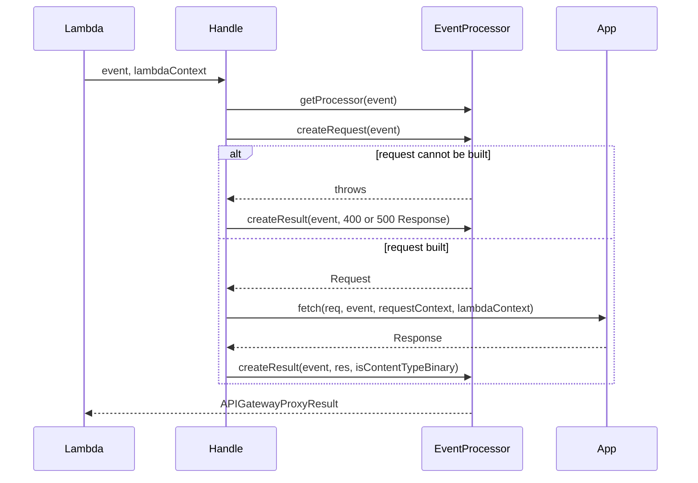
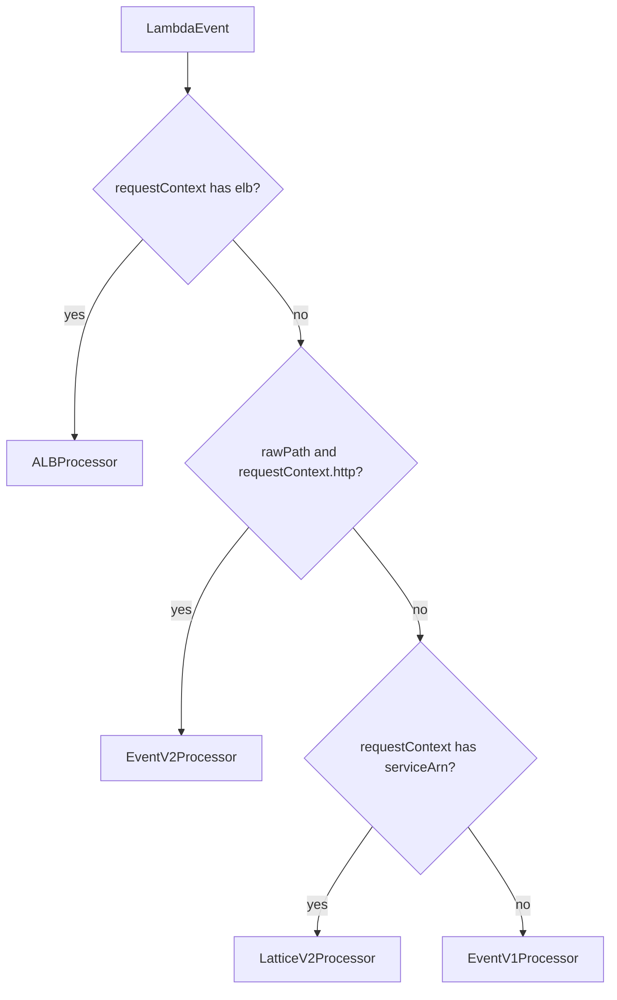

## Overview

AWS Lambda does not hand a function a Web Standard `Request`: it passes a JSON event whose shape depends on the service that invoked it, and it expects a JSON result back. The `hono/aws-lambda` adapter translates between the two so the same `Hono` app that runs on Workers or Bun can run behind API Gateway (REST API v1 and HTTP API v2), Lambda Function URLs, an Application Load Balancer or a VPC Lattice service. The `hono/lambda-edge` adapter does the same for CloudFront's Lambda@Edge event format. Other runtimes are covered in [[Runtime Adapters]].

Sources: [src/adapter/aws-lambda/index.ts:1-14](repo://src/adapter/aws-lambda/index.ts#L1-L14), [src/adapter/lambda-edge/index.ts:1-14](repo://src/adapter/lambda-edge/index.ts#L1-L14)

The `aws-lambda` adapter exports `handle`, `streamHandle`, `defaultIsContentTypeBinary` and `getConnInfo`, plus the `LambdaEvent`, `APIGatewayProxyResult`, request context and `LambdaContext` types. The work is split between a thin handler and a set of event processor classes, one per event source, that know how to build a `Request` from their event and how to write a `Response` back into a result object.

Sources: [src/adapter/aws-lambda/index.ts:6-14](repo://src/adapter/aws-lambda/index.ts#L6-L14), [src/adapter/aws-lambda/handler.ts:278-289](repo://src/adapter/aws-lambda/handler.ts#L278-L289)

## Request and response flow

`handle(app, options)` returns an async `(event, lambdaContext)` function. For each invocation it picks a processor with `getProcessor(event)`, asks it to build the `Request`, calls `app.fetch`, and asks the same processor to convert the `Response` into an `APIGatewayProxyResult`. If building the request throws, the handler logs the error and answers through `createResult` without calling the app: a `TypeError` (for example an invalid URL or header value) becomes `400 Invalid request`, anything else `500 Internal Server Error`.

Sources: [src/adapter/aws-lambda/handler.ts:239-276](repo://src/adapter/aws-lambda/handler.ts#L239-L276)



Sources: [src/adapter/aws-lambda/handler.ts:239-276](repo://src/adapter/aws-lambda/handler.ts#L239-L276), [src/adapter/aws-lambda/handler.ts:318-386](repo://src/adapter/aws-lambda/handler.ts#L318-L386)

The env passed to `app.fetch` holds the raw `event`, its `requestContext` and the `lambdaContext`, so handlers read them as `c.env.event`, `c.env.requestContext` and `c.env.lambdaContext`.

Sources: [src/adapter/aws-lambda/handler.ts:268-272](repo://src/adapter/aws-lambda/handler.ts#L268-L272)

```ts
import { Hono } from 'hono'
import { handle } from 'hono/aws-lambda'
import type { LambdaContext, LambdaEvent } from 'hono/aws-lambda'

type Bindings = { event: LambdaEvent; lambdaContext: LambdaContext }

const app = new Hono<{ Bindings: Bindings }>()
app.get('/', (c) => c.json({ requestId: c.env.lambdaContext.awsRequestId }))

export const handler = handle(app)
```

Sources: [src/adapter/aws-lambda/handler.ts:211-276](repo://src/adapter/aws-lambda/handler.ts#L211-L276), [src/adapter/aws-lambda/types.ts:35-48](repo://src/adapter/aws-lambda/types.ts#L35-L48)

## Choosing the event processor

`getProcessor` inspects the event's own properties, in this order, and returns a shared singleton processor:

Sources: [src/adapter/aws-lambda/handler.ts:625-637](repo://src/adapter/aws-lambda/handler.ts#L625-L637)

1. `requestContext` has an `elb` key: `ALBProcessor`.
2. The event has `rawPath` and `requestContext` has an `http` key: `EventV2Processor` (HTTP API or Function URL). `rawPath` alone is not enough, because a REST API event behind a custom domain base path mapping also carries it.
3. `requestContext` has a `serviceArn` key: `LatticeV2Processor`.
4. Anything else: `EventV1Processor` (REST API).

Sources: [src/adapter/aws-lambda/handler.ts:625-658](repo://src/adapter/aws-lambda/handler.ts#L625-L658)



Sources: [src/adapter/aws-lambda/handler.ts:625-658](repo://src/adapter/aws-lambda/handler.ts#L625-L658)

## Building the Request

### The shared createRequest template

`EventProcessor.createRequest` is a template method: subclasses supply `getPath`, `getMethod`, `getQueryString`, `getHeaders` and `getCookies`, and the base class assembles the URL as `https://<domain><path>?<query>`. The domain comes from `requestContext.domainName` when present, otherwise from the `host` header, then from a `host` entry in `multiValueHeaders`. A body is decoded with `decodeBase64` when `isBase64Encoded` is true and UTF-8 encoded otherwise, and `content-length` is set from the byte length.

Sources: [src/adapter/aws-lambda/handler.ts:291-342](repo://src/adapter/aws-lambda/handler.ts#L291-L342)

Header values containing non-ASCII characters are passed through `sanitizeHeaderValue`, which applies `encodeURIComponent` so that the `Headers` constructor does not reject them. The v1, ALB and Lattice processors use it; the v2 processor copies headers as given.

Sources: [src/adapter/aws-lambda/handler.ts:13-21](repo://src/adapter/aws-lambda/handler.ts#L13-L21)

### Differences per event source

| Processor | Path and method | Query string | Headers | Incoming cookies |
| --- | --- | --- | --- | --- |
| `EventV2Processor` | `rawPath`, `requestContext.http.method` | `rawQueryString` as is | `headers`, empty values skipped | `event.cookies` joined with `; ` into `Cookie` |
| `EventV1Processor` | `path`, `httpMethod` | rebuilt from `multiValueQueryStringParameters`, else `queryStringParameters`, keys and values re-encoded with `encodeURIComponent` | `multiValueHeaders` appended first, then `headers` keys not already set | none extra (they arrive in the headers) |
| `ALBProcessor` | `path`, `httpMethod` | rebuilt from `multiValueQueryStringParameters` (repeated `key=value`), else `queryStringParameters`, without re-encoding | `multiValueHeaders` values joined with `; ` if present, otherwise `headers` | `cookie` header or multi-value entry appended as `Cookie` |
| `LatticeV2Processor` | `path`, `method` | always empty | every value of each multi-value header appended | none extra |

Sources: [src/adapter/aws-lambda/handler.ts:404-501](repo://src/adapter/aws-lambda/handler.ts#L404-L501), [src/adapter/aws-lambda/handler.ts:503-582](repo://src/adapter/aws-lambda/handler.ts#L503-L582), [src/adapter/aws-lambda/handler.ts:584-623](repo://src/adapter/aws-lambda/handler.ts#L584-L623)

API Gateway v1 delivers query parameters already decoded, which is why `EventV1Processor` re-encodes them; ALB delivers them as received and so concatenates them directly. Both check the multi-value map first so that a repeated key such as `?select=amount&select=currency` keeps every value even when a framework puts both maps on the event.

Sources: [src/adapter/aws-lambda/handler.ts:452-468](repo://src/adapter/aws-lambda/handler.ts#L452-L468), [src/adapter/aws-lambda/handler.ts:534-558](repo://src/adapter/aws-lambda/handler.ts#L534-L558)

> [!NOTE]
> `LatticeV2Processor.getQueryString` returns an empty string, so query parameters on a VPC Lattice event are not visible through `c.req.query()`. Read them from `c.env.event.queryStringParameters` instead.

Sources: [src/adapter/aws-lambda/handler.ts:584-595](repo://src/adapter/aws-lambda/handler.ts#L584-L595)

## Building the result

### Binary bodies and base64

API Gateway and ALB results carry the body as a string, so `createResult` must decide whether to base64-encode it. The body is encoded when the response's `content-type` is binary according to `isContentTypeBinary` (the option, or `defaultIsContentTypeBinary`), or when a `content-encoding` other than `identity` is set (a gzip or brotli body from the compress middleware is bytes, not text). Encoded bodies are read with `res.arrayBuffer()` and `encodeBase64`, others with `res.text()`, and `isBase64Encoded` is set accordingly.

Sources: [src/adapter/aws-lambda/handler.ts:344-359](repo://src/adapter/aws-lambda/handler.ts#L344-L359), [src/adapter/aws-lambda/handler.ts:672-674](repo://src/adapter/aws-lambda/handler.ts#L672-L674)

`defaultIsContentTypeBinary` treats a content type as text when it starts with `text/plain`, `text/html`, `text/css`, `text/javascript` or `text/csv`, or ends in a `/json`, `+json`, `/xml` or `+xml` subtype (optionally followed by parameters). So `application/json; charset=UTF-8` and `image/svg+xml` count as text, while `image/png`, `application/pdf` or `application/octet-stream` are binary.

Sources: [src/adapter/aws-lambda/handler.ts:660-670](repo://src/adapter/aws-lambda/handler.ts#L660-L670)

| Option | Type | Default | Description |
| --- | --- | --- | --- |
| `isContentTypeBinary` | `(contentType: string) => boolean` | `defaultIsContentTypeBinary` | Decides whether a response with this `content-type` is base64-encoded. |

Sources: [src/adapter/aws-lambda/handler.ts:195-197](repo://src/adapter/aws-lambda/handler.ts#L195-L197), [src/adapter/aws-lambda/handler.ts:224-241](repo://src/adapter/aws-lambda/handler.ts#L224-L241)

```ts
import { handle, defaultIsContentTypeBinary } from 'hono/aws-lambda'

export const handler = handle(app, {
  isContentTypeBinary: (contentType) =>
    defaultIsContentTypeBinary(contentType) || contentType === 'application/x-ndjson',
})
```

Sources: [src/adapter/aws-lambda/handler.ts:224-241](repo://src/adapter/aws-lambda/handler.ts#L224-L241)

### Headers and cookies

The result uses `multiValueHeaders` when the incoming event had a truthy `multiValueHeaders` (API Gateway v1 or an ALB with multi-value headers enabled), and `headers` otherwise; the return type of `handle` reflects this choice. Before headers are copied, `setCookies` collects every `Set-Cookie` value with `getSetCookie()`, hands them to the processor's `setCookiesToResult`, and deletes them from the response so they are not copied twice.

Sources: [src/adapter/aws-lambda/handler.ts:361-401](repo://src/adapter/aws-lambda/handler.ts#L361-L401), [src/adapter/aws-lambda/handler.ts:242-250](repo://src/adapter/aws-lambda/handler.ts#L242-L250)

| Processor | Where `Set-Cookie` values go |
| --- | --- |
| `EventV2Processor` | `result.cookies` array |
| `EventV1Processor` | `result.multiValueHeaders['set-cookie']` |
| `ALBProcessor` | `multiValueHeaders['set-cookie']` when multi-value is on, otherwise only the first cookie in `headers['set-cookie']` |
| `LatticeV2Processor` | `headers['set-cookie']` as an array |

Sources: [src/adapter/aws-lambda/handler.ts:423-425](repo://src/adapter/aws-lambda/handler.ts#L423-L425), [src/adapter/aws-lambda/handler.ts:494-498](repo://src/adapter/aws-lambda/handler.ts#L494-L498), [src/adapter/aws-lambda/handler.ts:572-579](repo://src/adapter/aws-lambda/handler.ts#L572-L579), [src/adapter/aws-lambda/handler.ts:615-620](repo://src/adapter/aws-lambda/handler.ts#L615-L620)

> [!WARNING]
> An ALB target group without multi-value headers can return only one `Set-Cookie` header; the adapter keeps the first cookie and drops the rest.

Sources: [src/adapter/aws-lambda/handler.ts:572-579](repo://src/adapter/aws-lambda/handler.ts#L572-L579)

## Response streaming

`streamHandle(app)` wraps the handler with `awslambda.streamifyResponse`, a global that only exists in the Lambda Node.js runtime, for functions configured with response streaming (Function URLs with `RESPONSE_STREAM` invoke mode). It builds the request with the same processors, calls `app.fetch` with the env `{ event, requestContext, context }` (note the key is `context` here, not `lambdaContext`), and then:

Sources: [src/adapter/aws-lambda/handler.ts:138-157](repo://src/adapter/aws-lambda/handler.ts#L138-L157)

1. Splits response headers into a plain `headers` object and a `cookies` array of `set-cookie` values.
2. Wraps the stream with `awslambda.HttpResponseStream.from(responseStream, { statusCode, headers, cookies })` so the status and headers are sent first.
3. Pipes `res.body` chunk by chunk with `streamToNodeStream`, or writes an empty string when there is no body.
4. On any error, logs it and writes `Internal Server Error` to the stream; the stream is always ended in `finally`.

Sources: [src/adapter/aws-lambda/handler.ts:126-193](repo://src/adapter/aws-lambda/handler.ts#L126-L193)

Because the body is streamed as bytes, `streamHandle` does no base64 handling. It pairs naturally with the `stream` and `streamSSE` helpers described in [[Streaming and Server-Sent Events]].

Sources: [src/adapter/aws-lambda/handler.ts:176-184](repo://src/adapter/aws-lambda/handler.ts#L176-L184)

## Connection info on Lambda

`getConnInfo` from `hono/aws-lambda` reads `c.env.requestContext`: API Gateway v1 provides `identity.sourceIp`, v2 provides `http.sourceIp`. When neither exists (ALB, Lattice), it falls back to the last entry of `X-Forwarded-For`, because ALB appends the real client address to the end of that header.

Sources: [src/adapter/aws-lambda/conninfo.ts:34-73](repo://src/adapter/aws-lambda/conninfo.ts#L34-L73), [src/adapter/aws-lambda/types.ts:85-144](repo://src/adapter/aws-lambda/types.ts#L85-L144)

## Lambda@Edge

### Converting the CloudFront event

CloudFront invokes a Lambda@Edge function with `{ Records: [{ cf: { config, request, response? } }] }`. `createRequest` builds the URL from the `host` header (falling back to `config.distributionDomainName`), the `uri` and the raw `querystring`, and appends every value of each CloudFront header. `createBody` ignores the body for `GET` and `HEAD` and when there is no `data`, base64-decodes it when `encoding` is `base64`, and otherwise uses the text; a `content-length` header is set from the byte length. The module also assigns `node:crypto` to `globalThis.crypto` when the runtime lacks it, so Web Crypto based middleware works on older Node runtimes.

Sources: [src/adapter/lambda-edge/handler.ts:1-8](repo://src/adapter/lambda-edge/handler.ts#L1-L8), [src/adapter/lambda-edge/handler.ts:164-212](repo://src/adapter/lambda-edge/handler.ts#L164-L212)

### handle and the callback

`handle(app)` calls `app.fetch` with an env holding `event`, `context`, `callback`, and shortcuts to `config`, `request` and `response` of the first record. The `callback` passed to the app is a wrapper: it records the first `(err, result)` it receives and forwards the call to the real Lambda callback if one was given. After the app returns, the handler throws a recorded error, returns a recorded result, or otherwise converts the Hono `Response` with `createResult`. This lets an origin-request function either answer directly from Hono or forward the (possibly modified) CloudFront request to the origin.

Sources: [src/adapter/lambda-edge/handler.ts:116-147](repo://src/adapter/lambda-edge/handler.ts#L116-L147)

```ts
import { Hono } from 'hono'
import { handle } from 'hono/lambda-edge'
import type { Callback, CloudFrontRequest } from 'hono/lambda-edge'

type Bindings = { callback: Callback; request: CloudFrontRequest }

const app = new Hono<{ Bindings: Bindings }>()

app.get('/api/*', (c) => c.json({ from: 'edge' }))

app.all('*', async (c, next) => {
  await next()
  c.env.callback(null, c.env.request) // pass through to the origin
})

export const handler = handle(app)
```

Sources: [src/adapter/lambda-edge/handler.ts:83-147](repo://src/adapter/lambda-edge/handler.ts#L83-L147), [src/adapter/lambda-edge/index.ts:6-14](repo://src/adapter/lambda-edge/index.ts#L6-L14)

### CloudFront result format

`createResult` returns `status` as a string and converts headers to CloudFront's lower-cased `{ key, value }[]` form with `convertHeaders`, grouping repeated headers under one key. Lambda@Edge has its own `isContentTypeBinary`: text types are `text/plain|html|css|javascript|csv`, any `application/...json` or `application/...xml`, and `image/svg+xml`. Binary bodies, or bodies with a non-`identity` `content-encoding`, are base64-encoded and marked with `bodyEncoding: 'base64'`. Unlike the `aws-lambda` adapter, this check cannot be overridden by an option.

Sources: [src/adapter/lambda-edge/handler.ts:105-114](repo://src/adapter/lambda-edge/handler.ts#L105-L114), [src/adapter/lambda-edge/handler.ts:149-162](repo://src/adapter/lambda-edge/handler.ts#L149-L162), [src/adapter/lambda-edge/handler.ts:214-218](repo://src/adapter/lambda-edge/handler.ts#L214-L218)

### Connection info on Lambda@Edge

`getConnInfo` from `hono/lambda-edge` returns `c.env.event.Records[0].cf.request.clientIp`, the viewer address CloudFront records on the request.

Sources: [src/adapter/lambda-edge/conninfo.ts:1-15](repo://src/adapter/lambda-edge/conninfo.ts#L1-L15)
