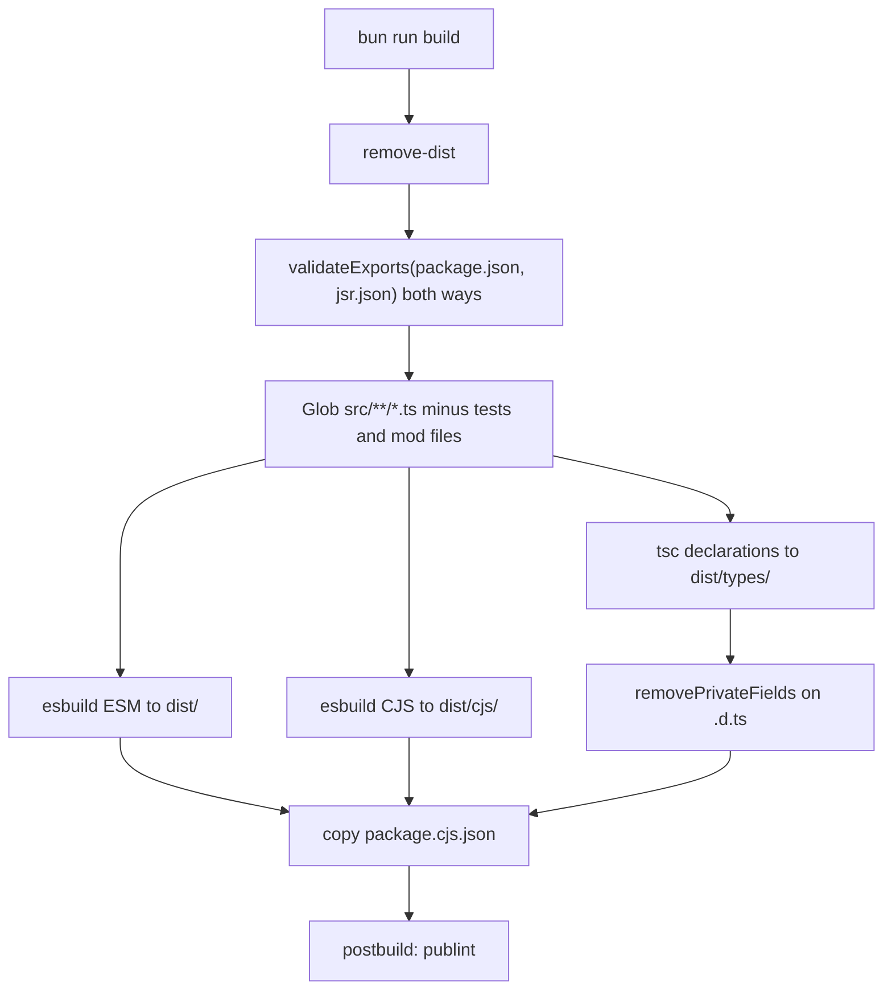

## Overview

Hono is published to npm as the `hono` package and to JSR as `@hono/hono`, and it promises to run on many JavaScript runtimes. The repository's tooling follows from that: a Bun-driven build that emits ESM, CommonJS and type declarations for every source file, a check that the npm and JSR export maps stay in sync, a Vitest workspace with one project per runtime, separate Deno and Bun test runs, and CI jobs that measure bundle size, type-checking cost and HTTP throughput on every pull request.

Sources: [package.json:1-37](repo://package.json#L1-L37), [jsr.json:1-15](repo://jsr.json#L1-L15)

The toolchain versions are pinned in `.tool-versions` (Node.js, Bun and Deno), and `package.json` declares Bun as the package manager. Bun is required for development even though the published package supports Node.js 16.9 and later.

Sources: [.tool-versions:1-3](repo://.tool-versions#L1-L3), [package.json:695-698](repo://package.json#L695-L698)

## Getting started

Clone the repository and install dependencies with Bun, using the lockfile as is:

Sources: [docs/CONTRIBUTING.md:27-35](repo://docs/CONTRIBUTING.md#L27-L35)

```bash
git clone git@github.com:honojs/hono.git && cd hono && bun install --frozen-lockfile
```

Sources: [docs/CONTRIBUTING.md:27-60](repo://docs/CONTRIBUTING.md#L27-L60)

The contribution guide asks that every pull request pass `bun run test`. The pull request template adds: add tests, run them, run `bun run format:fix && bun run lint:fix`, and document new code with TSDoc or JSDoc. Middleware that depends on other libraries or on one platform does not belong in core; it lives in the separate `honojs/middleware` monorepo under the `@hono` namespace. The guide also states an AI usage policy: AI-assisted contributions are allowed, but a maintainer may close a PR that wastes their time.

Sources: [docs/CONTRIBUTING.md:21-54](repo://docs/CONTRIBUTING.md#L21-L54), [.github/pull_request_template.md:1-6](repo://.github/pull_request_template.md#L1-L6)

## package.json scripts

| Script | Command | Purpose |
| --- | --- | --- |
| `test` | `tsc -p tsconfig.spec.json && vitest --run` | Type-check sources and tests, then run every Vitest project once |
| `test:watch` | `vitest --watch` | Re-run tests on change |
| `test:deno` | three `deno test` runs | Deno runtime tests plus JSX tests in `precompile` and `react-jsx` modes |
| `test:bun` | `bun test --jsx-import-source ../../src/jsx runtime-tests/bun/*` | Bun runtime tests with Bun's own test runner |
| `test:node`, `test:workerd`, `test:fastly`, `test:lambda`, `test:lambda-edge` | `vitest --run --project <name>` | One runtime project from the Vitest workspace |
| `test:all` | `bun run test && bun test:deno && bun test:bun` | Everything that runs locally |
| `coverage` | `vitest --run --coverage` | Vitest with coverage |
| `lint`, `lint:fix` | `eslint src runtime-tests build perf-measures benchmarks` | ESLint over all code folders |
| `format`, `format:fix` | `prettier --check` / `--write` | Prettier over the same folders |
| `editorconfig-checker` | `editorconfig-checker` | Whitespace and line-ending rules |
| `build` | `remove-dist`, `bun ./build/build.ts`, `copy:package.cjs.json` | Produce `dist/` |
| `postbuild` | `publint` | Lint the package as it would be published |
| `watch` | `build/build.ts --watch` | Rebuild on change |
| `prerelease`, `release` | `bun test:deno && bun run build`, `np --no-publish` | Release preparation |

Sources: [package.json:13-37](repo://package.json#L13-L37)

## The build

### build.ts step by step

`bun run build` deletes `dist/`, runs `build/build.ts` with Bun, and copies `package.cjs.json` (which contains only `"type": "commonjs"`) into `dist/cjs` and `dist/types` so Node treats those folders as CommonJS. `build/build.ts` itself does five things:

Sources: [package.json:29-36](repo://package.json#L29-L36), [package.cjs.json:1-3](repo://package.cjs.json#L1-L3)

1. Reads the `exports` maps of `package.json` and `jsr.json` and validates each against the other with `validateExports`, so the build fails before compiling anything if a subpath exists on only one registry.
2. Collects every `src/**/*.ts` file as an entry point, skipping tests, `src/mod.ts`, `src/middleware.ts` and `src/deno/**`. Every module is therefore its own output file, which keeps per-subpath imports such as `hono/cors` small.
3. Runs esbuild for ESM into `dist/` and CommonJS into `dist/cjs/`, both with `outbase: './src'`, and in parallel runs `tsc --emitDeclarationOnly --declaration -p tsconfig.build.json` to write `.d.ts` files into `dist/types/`.
4. In watch mode, uses esbuild's `context().watch()` and passes `-w` to `tsc` instead.
5. Scans `dist/types/**/*.d.ts` and calls `removePrivateFields` on them.

Sources: [build/build.ts:18-114](repo://build/build.ts#L18-L114), [package.json:29-36](repo://package.json#L29-L36), [package.cjs.json:1-3](repo://package.cjs.json#L1-L3)



Sources: [build/build.ts:18-114](repo://build/build.ts#L18-L114), [package.json:29-32](repo://package.json#L29-L32)

### The add-extension plugin

The ESM build sets `bundle: true` but registers the `add-extension` plugin, which resolves every import that has an importer and marks it `external`. Nothing is actually inlined; the plugin's job is to rewrite extensionless TypeScript imports into valid ESM specifiers. If `<path>.ts` exists the import becomes `<path>.js`; if `<path>/index.ts` exists it becomes `<path>/index.js`. The CommonJS build does not bundle and needs no rewriting.

Sources: [build/build.ts:41-92](repo://build/build.ts#L41-L92)

### Removing private fields from declarations

`tsc` emits ECMAScript private fields (`#name`) into class declarations. `removePrivateFields` parses each `.d.ts` file with `oxc-parser`, collects every `PropertyDefinition` whose key is a `PrivateIdentifier`, and overwrites those ranges with spaces. Replacing with spaces rather than deleting keeps every other offset valid, so the ranges can be removed in one pass. Files without private fields are left untouched.

Sources: [build/remove-private-fields.ts:5-57](repo://build/remove-private-fields.ts#L5-L57)

### Export map validation

`validateExports(source, target, fileName)` throws `Missing "<entry>" in '<fileName>'` for any key of `source` that `target` does not cover. An entry is covered when it exists in `target` verbatim, when it is a wildcard such as `./utils/*` and `target` has at least one entry under `./utils/`, or when some parent wildcard of it (`./a/b/*`, `./a/*`) exists in `target`. When adding a new subpath, add it to both `package.json` and `jsr.json`; `package.json` points at the built files under `dist/`, while `jsr.json` points straight at `src/*.ts`.

Sources: [build/validate-exports.ts:1-37](repo://build/validate-exports.ts#L1-L37), [package.json:38-58](repo://package.json#L38-L58), [jsr.json:8-15](repo://jsr.json#L8-L15)

### TypeScript configurations

| File | Used by | Notes |
| --- | --- | --- |
| `tsconfig.build.json` | `build/build.ts` | `rootDir: ./src`, `outDir: ./dist/types`, excludes tests, enables `noUnusedLocals` and `noUnusedParameters` |
| `tsconfig.spec.json` | `bun run test` | `noEmit`, JSX via `hono/jsx`, Vitest globals; type-checks sources and tests before Vitest runs |

Sources: [tsconfig.build.json:1-19](repo://tsconfig.build.json#L1-L19), [tsconfig.spec.json:1-11](repo://tsconfig.spec.json#L1-L11)

## Tests

### Vitest workspace

`vitest.config.ts` enables globals and V8 coverage (written to `coverage/raw/default`) and defines the test projects. `vitest --run` runs all of them; `--project <name>` selects one.

Sources: [vitest.config.ts:1-26](repo://vitest.config.ts#L1-L26)

| Project | Defined in | What it runs |
| --- | --- | --- |
| `main` | `vitest.config.ts` | `src/**`, `scripts/**` and `build/**` `*.test.*` / `*.spec.*` files, excluding `sandbox` folders and `*.case.test.*` |
| `jsx-runtime-default` | `vitest.config.ts` | `src/jsx/dom/**` tests and `src/jsx/hooks/dom.test.tsx` with JSX imported from `./src/jsx` |
| `jsx-runtime-dom` | `vitest.config.ts` | The same files with JSX imported from `./src/jsx/dom` |
| `node` | `runtime-tests/node/vitest.config.ts` | The app served through `@hono/node-server` |
| `workerd` | `runtime-tests/workerd/vitest.config.ts` | `runtime-tests/workerd/index.ts` started with wrangler's `unstable_dev` |
| `fastly` | `runtime-tests/fastly/vitest.config.ts` | Tests run through `vite-plugin-fastly-js-compute` |
| `lambda` | `runtime-tests/lambda/vitest.config.ts` | The `aws-lambda` adapter with a mocked `awslambda` global |
| `lambda-edge` | `runtime-tests/lambda-edge/vitest.config.ts` | The `lambda-edge` adapter |

Sources: [vitest.config.ts:1-73](repo://vitest.config.ts#L1-L73), [runtime-tests/node/vitest.config.ts:1-11](repo://runtime-tests/node/vitest.config.ts#L1-L11), [runtime-tests/fastly/vitest.config.ts:1-10](repo://runtime-tests/fastly/vitest.config.ts#L1-L10), [runtime-tests/workerd/index.test.ts:1-16](repo://runtime-tests/workerd/index.test.ts#L1-L16)

The JSX DOM tests run twice so that client components are exercised both through the default `hono/jsx` runtime and through the dedicated `hono/jsx/dom` runtime; see [[Client-side JSX (hono/jsx/dom)]]. Coverage excludes benchmarks, runtime tests, `build/build.ts`, test utilities, perf measures and type-only files such as `src/**/types.ts`.

Sources: [vitest.config.ts:5-24](repo://vitest.config.ts#L5-L24), [vitest.config.ts:45-70](repo://vitest.config.ts#L45-L70)

### Runtime tests

Each folder under `runtime-tests/` imports Hono from `../../src`, so the tests exercise the current sources on the real runtime rather than the published package. The `lambda` tests install a fake `awslambda` global with `vi.stubGlobal` so that `streamHandle` can call `awslambda.streamifyResponse` and `HttpResponseStream.from` outside AWS. The node, lambda and lambda-edge projects set `NAME=Node` in the test env; the Node tests assert it through the `env()` adapter helper.

Sources: [runtime-tests/lambda/mock.ts:1-38](repo://runtime-tests/lambda/mock.ts#L1-L38), [runtime-tests/lambda/vitest.config.ts:1-11](repo://runtime-tests/lambda/vitest.config.ts#L1-L11), [runtime-tests/workerd/index.ts:1-4](repo://runtime-tests/workerd/index.ts#L1-L4), [runtime-tests/node/index.test.ts:40-47](repo://runtime-tests/node/index.test.ts#L40-L47)

Deno and Bun are not Vitest projects. `bun run test:deno` runs `runtime-tests/deno` with `runtime-tests/deno/deno.json` (an import map for `@std/*` from JSR and `hono/jsx/jsx-runtime` mapped to the source file), then runs `runtime-tests/deno-jsx` twice, once with `jsx: "precompile"` and once with `jsx: "react-jsx"`, to cover both Deno JSX transforms. `bun run test:bun` uses `bun test`; `bunfig.toml` turns on coverage into `coverage/raw/bun`.

Sources: [package.json:16-17](repo://package.json#L16-L17), [runtime-tests/deno/deno.json:1-14](repo://runtime-tests/deno/deno.json#L1-L14), [runtime-tests/deno-jsx/deno.precompile.json:1-12](repo://runtime-tests/deno-jsx/deno.precompile.json#L1-L12), [bunfig.toml:1-4](repo://bunfig.toml#L1-L4)

```bash
bun run test              # type-check + all Vitest projects
bun run test:node         # one runtime project
bun run test:deno         # Deno runtime and JSX tests
bun run test:bun          # Bun runtime tests
bun run test:all          # all of the above
```

Sources: [package.json:14-23](repo://package.json#L14-L23)

## Continuous integration

The `ci` workflow runs on pushes to `main` and `next` and on pull requests that touch more than docs. The `main` job runs `format`, `lint`, `editorconfig-checker`, `build` and `test`. Separate jobs build first and then run a single runtime project: Node.js on 20.x, 22.x and 24.x, workerd, Fastly Compute, AWS Lambda and Lambda@Edge. Deno and Bun (also on Windows) have their own jobs, and `jsr-dry-run` runs `bunx jsr publish --dry-run` to confirm the JSR package is publishable. Coverage artifacts from the main, Bun and Deno jobs are merged and uploaded to Codecov.

Sources: [.github/workflows/ci.yml:1-104](repo://.github/workflows/ci.yml#L1-L104), [.github/workflows/ci.yml:105-182](repo://.github/workflows/ci.yml#L105-L182)

## Performance measurements

### Bundle size and type-check cost

On pull requests, the `perf-measures` composite action records three metrics and lets octocov compare them with the base branch:

Sources: [.github/actions/perf-measures/action.yml:1-19](repo://.github/actions/perf-measures/action.yml#L1-L19), [.github/workflows/ci.yml:184-192](repo://.github/workflows/ci.yml#L184-L192)

1. Type-check cost: `perf-measures/type-check/scripts/generate-app.ts` writes `generated/app.ts`, an app chaining 200 `.get('/routeN/:id')` routes, and `client.ts` builds an `hc<typeof app>` client from it, the worst case for [[Type System and Schema Inference]]. The action runs `tsc --diagnostics` and `tsgo --diagnostics`, and `process-results.ts` turns each `name: value` line into a metric keyed by `BENCHMARK_TS_IMPL_LABEL`.
2. Bundle size: after `bun run build`, `check-bundle-size.ts` bundles and minifies `dist/index.js` with esbuild (ESM, `es2022`) and reports the size in bytes and kilobytes.

Sources: [.github/actions/perf-measures/action.yml:1-53](repo://.github/actions/perf-measures/action.yml#L1-L53), [perf-measures/type-check/scripts/generate-app.ts:1-27](repo://perf-measures/type-check/scripts/generate-app.ts#L1-L27), [perf-measures/type-check/client.ts:1-5](repo://perf-measures/type-check/client.ts#L1-L5), [perf-measures/type-check/scripts/process-results.ts:1-51](repo://perf-measures/type-check/scripts/process-results.ts#L1-L51), [perf-measures/bundle-check/scripts/check-bundle-size.ts:1-52](repo://perf-measures/bundle-check/scripts/check-bundle-size.ts#L1-L52)

### HTTP benchmark

`benchmarks/http-server/benchmark.ts` compares HTTP throughput between a baseline git ref (default `origin/main`) and the current tree. It writes a small app using `RegExpRouter` with a text route, a JSON echo route and a parameter-plus-query route, serves it with Bun, and loads it with `bombardier` at 500 concurrent connections. Options are `--baseline=<ref>`, `--target=<ref>`, `--runs=<n>`, `--duration=<seconds>` and `--skip-tests`. CI runs it on every pull request and posts the result as a comment, minimising earlier benchmark comments.

Sources: [benchmarks/http-server/benchmark.ts:1-52](repo://benchmarks/http-server/benchmark.ts#L1-L52), [benchmarks/http-server/README.md:1-21](repo://benchmarks/http-server/README.md#L1-L21), [.github/workflows/ci.yml:194-250](repo://.github/workflows/ci.yml#L194-L250)

### Micro-benchmarks

The other folders under `benchmarks/` are standalone packages with their own dependencies, run by hand: `routers` and `routers-deno` compare Hono's routers with find-my-way, koa-tree-router, trek-router, `@medley/router`, rou3, memoirist and others using `mitata` (`bun run bench:node` or `bun run bench:bun`, plus `bench-includes-init` variants that also time route registration), `jsx` compares Hono JSX rendering with React, Preact and nano-jsx, `query-param` compares query parsing with `qs` and `fast-querystring`, and `utils` times helpers such as `getPath`. See [[Routers and SmartRouter]] for what the router benchmarks measure.

Sources: [benchmarks/routers/README.md:1-31](repo://benchmarks/routers/README.md#L1-L31), [benchmarks/routers/package.json:1-24](repo://benchmarks/routers/package.json#L1-L24)
