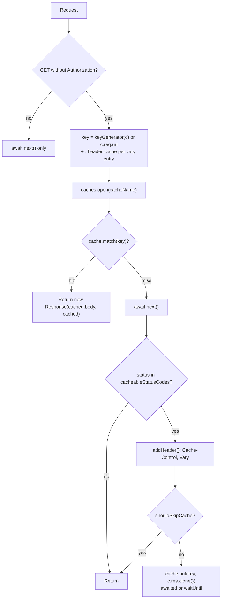
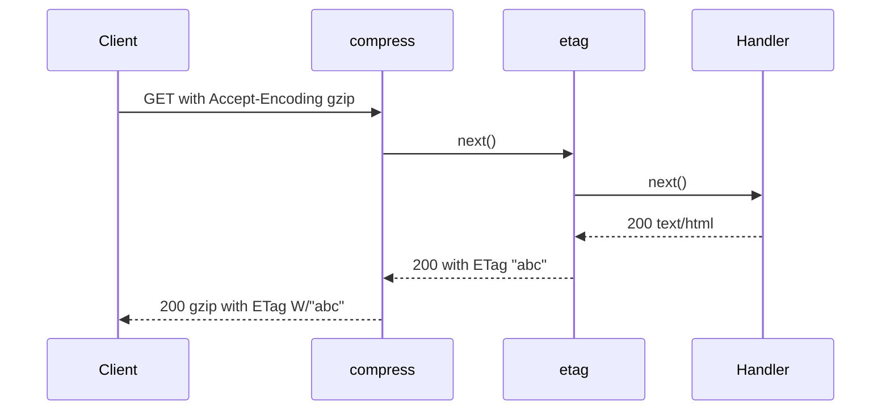

## Overview

Three middleware shape responses after the handler has produced them. `cache` stores whole responses in the Web Cache API (`globalThis.caches`) and serves later `GET` requests from it, `etag` computes an `ETag` and answers matching conditional requests with `304 Not Modified`, and `compress` gzips or deflates bodies with the standard `CompressionStream`. All three call `await next()` first and then inspect or replace `c.res`, so they must be registered before the routes whose responses they handle. See [[Request Lifecycle and Middleware Composition]] for that ordering.

Sources: [src/middleware/cache/index.ts:141-184](repo://src/middleware/cache/index.ts#L141-L184), [src/middleware/etag/index.ts:79-129](repo://src/middleware/etag/index.ts#L79-L129), [src/middleware/compress/index.ts:70-122](repo://src/middleware/compress/index.ts#L70-L122)

```ts
import { Hono } from 'hono'
import { cache } from 'hono/cache'
import { etag } from 'hono/etag'
import { compress } from 'hono/compress'

const app = new Hono()
app.use(compress())
app.use('/static/*', etag())
app.get('/api/*', cache({ cacheName: 'my-app', cacheControl: 'max-age=3600' }))
```

Sources: [src/middleware/cache/index.ts:53-72](repo://src/middleware/cache/index.ts#L53-L72), [src/middleware/etag/index.ts:69-79](repo://src/middleware/etag/index.ts#L69-L79), [src/middleware/compress/index.ts:57-70](repo://src/middleware/compress/index.ts#L57-L70)

## Cache middleware

### cache options

`cache(options)` targets runtimes that expose the Cache API, such as Cloudflare Workers and Deno.

Sources: [src/middleware/cache/index.ts:37-72](repo://src/middleware/cache/index.ts#L37-L72)

| Option | Type | Default | Description |
| --- | --- | --- | --- |
| `cacheName` | `string` or `(c) => string \| Promise<string>` | required | Name passed to `caches.open()`. A function lets you pick a cache per request. |
| `wait` | `boolean` | `false` | Await `cache.put()` instead of handing it to `c.executionCtx.waitUntil()`. Deno needs `true`. |
| `cacheControl` | `string` | none | Comma-separated directives added to the response `Cache-Control` header. |
| `vary` | `string` or `string[]` | none | Request headers that become part of the cache key and of the response `Vary` header. `'*'` is rejected. |
| `keyGenerator` | `(c) => string \| Promise<string>` | `c.req.url` | Builds the cache key. |
| `cacheableStatusCodes` | `StatusCode[]` | `[200]` | Status codes that may be stored. |
| `onCacheNotAvailable` | `() => void` or `false` | logs a message | Called when `globalThis.caches` is missing; `false` silences it. |

Sources: [src/middleware/cache/index.ts:10-13](repo://src/middleware/cache/index.ts#L10-L13), [src/middleware/cache/index.ts:42-51](repo://src/middleware/cache/index.ts#L42-L51), [src/middleware/cache/index.ts:64-103](repo://src/middleware/cache/index.ts#L64-L103)

### Setup-time checks

When `globalThis.caches` is undefined (for example on Node.js), `cache()` reports it through `onCacheNotAvailable` (or `console.log`) and returns a pass-through middleware, so the same app code runs everywhere. Otherwise it lower-cases the `cacheControl` directives, normalises `vary` into a lower-cased `Set`, and throws `Error('Middleware vary configuration cannot include "*", ...')` when that set holds `*`, because RFC 7231 forbids a wildcard `Vary` from being useful for caching.

Sources: [src/middleware/cache/index.ts:73-103](repo://src/middleware/cache/index.ts#L73-L103), [src/middleware/cache/index.ts:18-25](repo://src/middleware/cache/index.ts#L18-L25)

### Request flow



Sources: [src/middleware/cache/index.ts:141-184](repo://src/middleware/cache/index.ts#L141-L184)

Only `GET` requests without an `Authorization` header are cached, which keeps per-user authenticated responses out of a shared cache. For each `vary` header the key gets a `::name=value` suffix with the URI-encoded request header value, so `Accept-Language: en` and `fr` are stored separately. A hit is wrapped in a new `Response` so its headers are mutable for later middleware.

Sources: [src/middleware/cache/index.ts:141-164](repo://src/middleware/cache/index.ts#L141-L164)

### Response headers

`addHeader` runs for every cacheable status, whether or not the response is then stored. It appends each configured `Cache-Control` directive unless the handler already set a directive with that name (compared case-insensitively), so a handler's own `max-age` wins. It then writes `Vary`: the configured headers alone, or merged with the handler's `Vary` values, collapsing to `Vary: *` if the handler sent `*`.

Sources: [src/middleware/cache/index.ts:105-139](repo://src/middleware/cache/index.ts#L105-L139)

### When a response is not stored

`shouldSkipCache` refuses to store a response that has a `Set-Cookie` header, a `Cache-Control` containing `private`, `no-store` or `no-cache`, or a `Vary` naming any header that is not in the configured `vary` list (or any `Vary` at all when no `vary` option is set). The last rule prevents serving one variant to a client that asked for another, since the key only encodes the configured headers.

Sources: [src/middleware/cache/index.ts:15-35](repo://src/middleware/cache/index.ts#L15-L35), [src/middleware/cache/index.ts:167-175](repo://src/middleware/cache/index.ts#L167-L175)

> [!WARNING]
> With `wait: false` the write is passed to `c.executionCtx.waitUntil()`, and the `executionCtx` getter throws `This context has no ExecutionContext` on runtimes that provide none. Set `wait: true` there.

Sources: [src/middleware/cache/index.ts:177-183](repo://src/middleware/cache/index.ts#L177-L183), [src/context.ts:391-397](repo://src/context.ts#L391-L397)

## ETag middleware

### etag options

| Option | Type | Default | Description |
| --- | --- | --- | --- |
| `weak` | `boolean` | `false` | Emit `W/"<hash>"` instead of `"<hash>"`. |
| `retainedHeaders` | `string[]` | `RETAINED_304_HEADERS` | Lower-case header names kept on a `304` response. |
| `generateDigest` | `(body: Uint8Array) => ArrayBuffer \| Promise<ArrayBuffer>` | SHA-1 via `crypto.subtle.digest` | Hash function used to build the tag. |

Sources: [src/middleware/etag/index.ts:9-13](repo://src/middleware/etag/index.ts#L9-L13), [src/middleware/etag/index.ts:56-82](repo://src/middleware/etag/index.ts#L56-L82)

`RETAINED_304_HEADERS` is exported and lists `cache-control`, `content-location`, `date`, `etag`, `expires` and `vary`, the headers the HTTP spec says a 304 must repeat from the equivalent 200.

Sources: [src/middleware/etag/index.ts:15-28](repo://src/middleware/etag/index.ts#L15-L28)

### Computing the tag

The middleware reads `If-None-Match` before calling `next()`. Afterwards, if the handler already set an `ETag` header, that value is used as is. Otherwise `initializeGenerator` has chosen the hash function (SHA-1 from `crypto.subtle` unless you passed one; with neither, the middleware does nothing), and `generateDigest` reads a clone of the response body. A response without a body gets no tag.

Sources: [src/middleware/etag/index.ts:38-54](repo://src/middleware/etag/index.ts#L38-L54), [src/middleware/etag/index.ts:84-105](repo://src/middleware/etag/index.ts#L84-L105)

`generateDigest` hashes the stream chunk by chunk: each step hashes the previous digest concatenated with the next chunk (`mergeBuffers`), so the whole body never has to be held in memory at once. The final digest is hex-encoded. The tag is therefore stable for the same body and chunking, not a plain SHA-1 of the body.

Sources: [src/middleware/etag/digest.ts:1-43](repo://src/middleware/etag/digest.ts#L1-L43)

### Conditional responses

`If-None-Match: *` matches any successful `GET` or `HEAD` response. Otherwise the header is split on commas and each entry is compared to the tag with any `W/` prefix stripped on both sides, the weak comparison that `If-None-Match` requires. On a match, `c.res` is replaced by an empty `304 Not Modified`; because the `c.res` setter copies the previous response's headers onto the new one, the middleware then deletes every header not in `retainedHeaders`. Without a match the tag is set on the response as the `ETag` header.

Sources: [src/middleware/etag/index.ts:30-36](repo://src/middleware/etag/index.ts#L30-L36), [src/middleware/etag/index.ts:107-128](repo://src/middleware/etag/index.ts#L107-L128), [src/context.ts:414-434](repo://src/context.ts#L414-L434)

## Compress middleware

### compress options

| Option | Type | Default | Description |
| --- | --- | --- | --- |
| `encoding` | `'gzip' \| 'deflate'` | both, gzip preferred | Restrict compression to one encoding. |
| `threshold` | `number` | `1024` | Minimum `Content-Length` in bytes to compress. |
| `contentTypeFilter` | `RegExp` or `(contentType: string) => boolean` | `COMPRESSIBLE_CONTENT_TYPE_REGEX` | Decides whether a `Content-Type` is compressible. |

Sources: [src/middleware/compress/index.ts:12-22](repo://src/middleware/compress/index.ts#L12-L22), [src/middleware/compress/index.ts:46-84](repo://src/middleware/compress/index.ts#L46-L84)

`COMPRESSIBLE_CONTENT_TYPE_REGEX` lives in `src/utils/compress.ts` and is re-exported from `hono/compress`. It matches every `text/*` type except `text/event-stream` (compressing an SSE stream would buffer events), common `application/*` text formats such as JSON, JavaScript, XML and WASM, a few font and image types, and any `+json`, `+xml`, `+text`, `+yaml` or `+msgpack` suffix. [[Serving Static Files]] reuses the same regex to decide when to look for precompressed files.

Sources: [src/utils/compress.ts:1-10](repo://src/utils/compress.ts#L1-L10), [src/middleware/compress/index.ts:8-10](repo://src/middleware/compress/index.ts#L8-L10), [src/middleware/serve-static/index.ts:8](repo://src/middleware/serve-static/index.ts#L8-L8)

### Skip conditions

After `next()`, the response is left untouched when any of these holds: status `206 Partial Content` (its `Content-Range` describes uncompressed bytes), an existing `Content-Encoding` or `Transfer-Encoding` header, a `HEAD` request, a `Content-Length` below `threshold`, a `Content-Type` rejected by the filter (or missing), or `Cache-Control: no-transform`. A response with no `Content-Length`, such as a stream, is not subject to the threshold.

Sources: [src/middleware/compress/index.ts:86-102](repo://src/middleware/compress/index.ts#L86-L102), [src/middleware/compress/index.ts:124-129](repo://src/middleware/compress/index.ts#L124-L129)

### Encoding negotiation

`selectEncoding` parses `Accept-Encoding` with `parseAccept` and walks the candidates in order (`gzip`, then `deflate`, or only the configured `encoding`). A candidate's quality is its explicit `q`, or the `*` entry's `q`, or 0. The first candidate with `q=1` wins immediately; otherwise the highest positive `q` wins. No header, or every candidate at `q=0`, means no compression.

Sources: [src/middleware/compress/index.ts:24-44](repo://src/middleware/compress/index.ts#L24-L44), [src/utils/accept.ts:211-216](repo://src/utils/accept.ts#L211-L216)

### Applying compression

The body is piped through `new CompressionStream(encoding)` into a new `Response` built from the old one, `Content-Length` is removed because the compressed size is unknown, and `Content-Encoding` is set. A strong `ETag` is downgraded to `W/"..."` since the compressed bytes differ from the ones the tag was computed for, which keeps conditional requests working when `etag` runs inside `compress`.

Sources: [src/middleware/compress/index.ts:104-121](repo://src/middleware/compress/index.ts#L104-L121)



Sources: [src/middleware/etag/index.ts:84-128](repo://src/middleware/etag/index.ts#L84-L128), [src/middleware/compress/index.ts:86-121](repo://src/middleware/compress/index.ts#L86-L121)

> [!TIP]
> Register `compress` before `etag` (outermost first) as above. The tag is then computed from the uncompressed body and stays valid for every encoding, and `compress` marks it weak on the compressed variant.

Sources: [src/middleware/compress/index.ts:116-120](repo://src/middleware/compress/index.ts#L116-L120), [src/middleware/etag/index.ts:30-36](repo://src/middleware/etag/index.ts#L30-L36)
