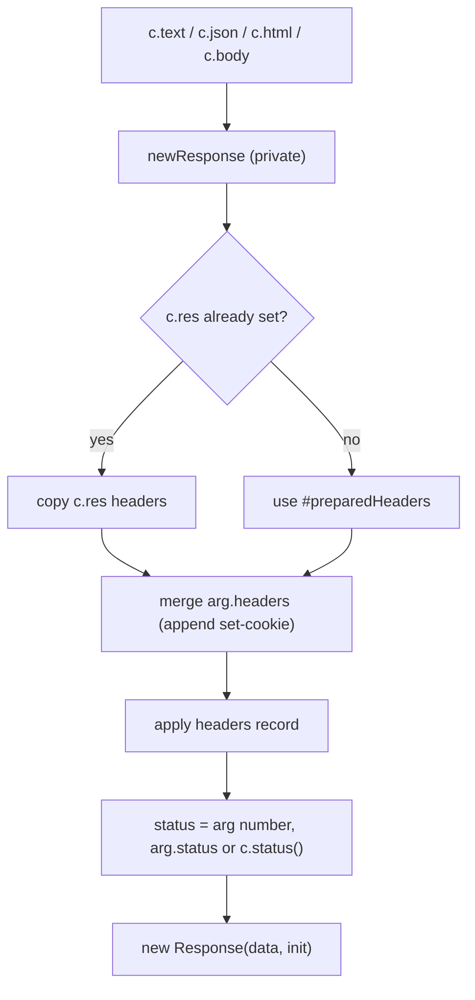

## Overview

Every handler and middleware in Hono receives one `Context` object, conventionally named `c`. It wraps the incoming `Request`, carries the runtime bindings and execution context, holds per-request variables, and builds the outgoing `Response` through helpers such as `c.text()`, `c.json()` and `c.html()`. The class is generic over the app's `Env`, the matched path `P` and the validated `Input` `I`, so `c.req`, `c.env` and `c.var` are typed from the route definition (see [[Type System and Schema Inference]]).

Sources: [src/context.ts:293-345](repo://src/context.ts#L293-L345)

The app creates one `Context` per request in `#dispatch`, after the router has matched the path. It passes the computed path, the router's match result, the bindings, the execution context and the app's not-found handler, so the context can lazily build a [[HonoRequest]] and answer `c.notFound()` the same way the app would.

Sources: [src/hono-base.ts:406-427](repo://src/hono-base.ts#L406-L427), [src/context.ts:237-252](repo://src/context.ts#L237-L252)

```ts
app.get('/hello/:name', (c) => {
  const name = c.req.param('name')
  c.header('X-Message', 'Hello!')
  return c.json({ message: `Hello ${name}` }, 200)
})
```

Sources: [src/context.ts:366-369](repo://src/context.ts#L366-L369), [src/context.ts:515-527](repo://src/context.ts#L515-L527), [src/context.ts:708-721](repo://src/context.ts#L708-L721)

## Construction and request access

### Constructor options

The constructor stores the raw `Request` and, when options are given, copies them into private fields. Nothing else is computed up front: the `HonoRequest` wrapper, the variable map, the prepared headers and the response are all created on first use, which keeps the per-request cost low for handlers that touch little of the context.

Sources: [src/context.ts:352-361](repo://src/context.ts#L352-L361)

| Option | Type | Description |
| --- | --- | --- |
| `env` | `E['Bindings']` | Runtime bindings (environment variables, KV, D1, ...), exposed as `c.env`. |
| `executionCtx` | `FetchEventLike \| ExecutionContext \| undefined` | Cloudflare-style execution context or a Service Worker `FetchEvent`. |
| `notFoundHandler` | `NotFoundHandler<E>` | Handler used by `c.notFound()`. |
| `matchResult` | `Result<[H, RouterRoute]>` | Router output, used by `c.req` for params and matched routes. |
| `path` | `string` | Path the router matched, used as `c.req.path`. |

Sources: [src/context.ts:237-252](repo://src/context.ts#L237-L252)

### c.req

`c.req` is a getter that builds a `HonoRequest` from the raw request, the path and the match result the first time it is read, then caches it with `??=`. Its type is `HonoRequest<P, I['out']>`, so `c.req.param()` and `c.req.valid()` know the route's parameter names and validated input.

Sources: [src/context.ts:366-369](repo://src/context.ts#L366-L369)

### env, executionCtx and event

`c.env` is a public field defaulting to `{}` and overwritten with the bindings passed in by the adapter (for example the second argument of `app.fetch` on Cloudflare Workers). `c.executionCtx` returns the stored execution context and throws `This context has no ExecutionContext` if the runtime did not provide one. `c.event` returns it only when it has a `respondWith` method, that is a Service Worker `FetchEvent`, and throws `This context has no FetchEvent` otherwise.

Sources: [src/context.ts:315-315](repo://src/context.ts#L315-L315), [src/context.ts:377-397](repo://src/context.ts#L377-L397)

The `ExecutionContext` interface declares `waitUntil(promise)`, `passThroughOnException()`, `props` and an optional `exports`, matching the Cloudflare Workers shape. Use `waitUntil` to keep work running after the response is sent:

Sources: [src/context.ts:31-52](repo://src/context.ts#L31-L52)

```ts
app.get('/log', (c) => {
  c.executionCtx.waitUntil(fetch('https://logs.example.com', { method: 'POST' }))
  return c.text('ok')
})
```

Sources: [src/context.ts:391-397](repo://src/context.ts#L391-L397)

## Response helpers

### How a response is built

All body helpers funnel into the private `#newResponse(data, arg, headers)`. It starts from the headers already on `c.res` if one exists, otherwise from the headers prepared by earlier `c.header()` calls. If `arg` is an object with `headers` (a `ResponseInit` or a `Response`), those are merged in, with `set-cookie` appended rather than replaced. The `headers` record is applied next: a string value sets the header, an array value deletes it and appends each item. The status is the numeric `arg`, else `arg.status`, else the status set by `c.status()`.

Sources: [src/context.ts:604-641](repo://src/context.ts#L604-L641)



Sources: [src/context.ts:604-694](repo://src/context.ts#L604-L694), [src/context.ts:708-733](repo://src/context.ts#L708-L733)

### Helper reference

Each helper accepts either `(data, status?, headers?)` or `(data, init?)`, where `init` is a `ResponseInit` or an existing `Response`. The content helpers only accept a `ContentfulStatusCode`, so a status such as 204 that forbids a body is a type error.

Sources: [src/context.ts:121-230](repo://src/context.ts#L121-L230), [src/context.ts:271-277](repo://src/context.ts#L271-L277)

| Helper | Default `Content-Type` | Notes |
| --- | --- | --- |
| `c.body(data, ...)` | none | Raw `string`, `ArrayBuffer`, `ReadableStream`, `Uint8Array` or `null`. |
| `c.text(text, ...)` | `text/plain; charset=UTF-8` | Fast path returns `new Response(text)` when no headers, status or init were set. |
| `c.json(object, ...)` | `application/json` | Body is `JSON.stringify(object)`; typed as `TypedResponse<JSONParsed<T>, U, 'json'>`. |
| `c.html(html, ...)` | `text/html; charset=UTF-8` | Accepts a `Promise<string>` (JSX output) and resolves its callbacks first. |
| `c.redirect(location, status?)` | none | Sets `Location`, default status 302. |
| `c.notFound()` | from handler | Calls the app's not-found handler. |
| `c.newResponse(data, ...)` | none | Untyped variant of `c.body`. |

Sources: [src/context.ts:641-733](repo://src/context.ts#L641-L733), [src/context.ts:750-779](repo://src/context.ts#L750-L779)

The headers passed to a helper are spread over the default content type in `setDefaultContentType`, so an explicit `Content-Type` in the record wins over the helper's default.

Sources: [src/context.ts:279-286](repo://src/context.ts#L279-L286)

### text fast path

`c.text()` skips `#newResponse` entirely when there are no prepared headers, no status, no extra arguments and the context is not finalized. In that case it returns `new Response(text)` and lets the runtime set `text/plain;charset=UTF-8`. This is the hottest path in benchmarks such as `app.get('/', (c) => c.text('Hi'))`.

Sources: [src/context.ts:682-694](repo://src/context.ts#L682-L694)

### html with JSX

When `c.html()` receives an object (a promise produced by async JSX), it calls `resolveCallback` with `HtmlEscapedCallbackPhase.Stringify` and builds the response once the string resolves, so the return type is `Promise<Response>`. A plain string returns a `Response` synchronously.

Sources: [src/context.ts:723-733](repo://src/context.ts#L723-L733), [src/context.ts:220-230](repo://src/context.ts#L220-L230)

### redirect and notFound

`c.redirect()` converts the location to a string and percent-encodes it with `encodeURI` only if it contains characters above `\xFF`, then sets the `Location` header and returns a body-less response with status 302 unless another `RedirectStatusCode` is given. `c.notFound()` calls the handler passed at construction, falling back to an empty `Response` when the context was built without one.

Sources: [src/context.ts:750-779](repo://src/context.ts#L750-L779)

```ts
app.get('/old', (c) => c.redirect('/new', 301))
app.get('/missing', (c) => c.notFound())
```

Sources: [src/context.ts:750-779](repo://src/context.ts#L750-L779)

## Headers and status

`c.header(name, value, options)` writes to the headers of `c.res` if a response already exists, otherwise to a lazily created `#preparedHeaders` object that later seeds the response. An `undefined` value deletes the header and `{ append: true }` appends instead of replacing. If the context is already finalized, the response is first cloned with `new Response(body, res)` so its headers become mutable (headers of a `Response` returned by `fetch` can be immutable).

Sources: [src/context.ts:515-527](repo://src/context.ts#L515-L527)

`c.status(code)` only records the code in `#status`; it is applied by the next response helper that does not get an explicit status.

Sources: [src/context.ts:529-531](repo://src/context.ts#L529-L531), [src/context.ts:637-638](repo://src/context.ts#L637-L638)

```ts
app.post('/posts', (c) => {
  c.status(201)
  c.header('Location', '/posts/1')
  c.header('Set-Cookie', 'a=1', { append: true })
  return c.text('Created')
})
```

Sources: [src/context.ts:515-531](repo://src/context.ts#L515-L531)

## The res property and finalization

### Reading c.res

Reading `c.res` before any handler has produced a response returns an empty `Response` with status 200 whose headers are the prepared headers. Middleware that runs after `await next()` reads the final response through it.

Sources: [src/context.ts:403-407](repo://src/context.ts#L403-L407)

### Assigning c.res

Assigning `c.res` replaces the response and sets `c.finalized = true`. When a response already existed, the new one is cloned and every header from the old response except `content-type` is copied onto it; `set-cookie` values are copied one by one with `getSetCookie()` so multiple cookies survive. This is how headers set by middleware before `next()` stay on the response a later handler returns.

Sources: [src/context.ts:414-434](repo://src/context.ts#L414-L434)

### Who sets it

`compose` assigns the value a handler returns to `context.res` when the context is not finalized yet, or when the value came from the error handler. After the chain, `#dispatch` throws `Context is not finalized. Did you forget to return a Response object or await next()?` if no response was set. The `c.error` field holds the error caught by `compose` before `onError` runs, so middleware can inspect it after `await next()`. See [[Request Lifecycle and Middleware Composition]] and [[Error Handling and HTTPException]].

Sources: [src/compose.ts:50-72](repo://src/compose.ts#L50-L72), [src/hono-base.ts:450-466](repo://src/hono-base.ts#L450-L466), [src/context.ts:317-333](repo://src/context.ts#L317-L333)

```ts
app.use('*', async (c, next) => {
  await next()
  c.res.headers.set('X-Response-Time', '12ms')
  if (c.error) {
    console.error(c.error)
  }
})
```

Sources: [src/context.ts:403-434](repo://src/context.ts#L403-L434)

## Variables: set, get and var

`c.set(key, value)` stores a value in a per-request `Map` created on first write; `c.get(key)` reads it back and returns `undefined` when nothing was set. `c.var` returns a read-only plain object built with `Object.fromEntries` from the same map, which is convenient for destructuring but creates a new object on each read.

Sources: [src/context.ts:546-602](repo://src/context.ts#L546-L602)

The keys and value types come from two places: the `Variables` of the app's `Env` generic, and the global `ContextVariableMap` interface. Middleware packages augment `ContextVariableMap` through module declaration so their variables are typed in every app that imports them; `requestId` does this for `requestId`. When `E` is `any`, `set` and `get` accept any string key.

Sources: [src/context.ts:57-57](repo://src/context.ts#L57-L57), [src/context.ts:95-108](repo://src/context.ts#L95-L108), [src/middleware/request-id/index.ts:1-7](repo://src/middleware/request-id/index.ts#L1-L7)

```ts
type Env = { Variables: { user: { id: string } } }

const app = new Hono<Env>()

app.use('*', async (c, next) => {
  c.set('user', { id: '42' })
  await next()
})

app.get('/me', (c) => c.json({ id: c.get('user').id, again: c.var.user.id }))
```

Sources: [src/context.ts:546-602](repo://src/context.ts#L546-L602)

## Rendering and layouts

`c.render(...args)` calls the current renderer. Without one it defaults to `(content) => c.html(content)`. Middleware installs a renderer with `c.setRenderer(fn)`; the renderer's signature comes from the `ContextRenderer` interface, which apps augment to type extra props, falling back to `DefaultRenderer` (content in, `Response` out).

Sources: [src/context.ts:62-86](repo://src/context.ts#L62-L86), [src/context.ts:448-451](repo://src/context.ts#L448-L451), [src/context.ts:495-497](repo://src/context.ts#L495-L497)

`c.setLayout(layout)` and `c.getLayout()` store and read a layout component. The `jsxRenderer` middleware uses them to nest layouts: it reads the outer layout with `getLayout()`, registers its own component as the new layout wrapping the outer one, then installs its renderer. See [[JSX Server Rendering]].

Sources: [src/context.ts:459-472](repo://src/context.ts#L459-L472), [src/middleware/jsx-renderer/index.ts:116-129](repo://src/middleware/jsx-renderer/index.ts#L116-L129)

```ts
declare module 'hono' {
  interface ContextRenderer {
    (content: string | Promise<string>, props: { title: string }): Response | Promise<Response>
  }
}

app.use('*', async (c, next) => {
  c.setRenderer((content, props) =>
    c.html(`<html><head><title>${props.title}</title></head><body>${content}</body></html>`)
  )
  await next()
})

app.get('/', (c) => c.render('Hello!', { title: 'Home' }))
```

Sources: [src/context.ts:62-86](repo://src/context.ts#L62-L86), [src/context.ts:448-497](repo://src/context.ts#L448-L497)
