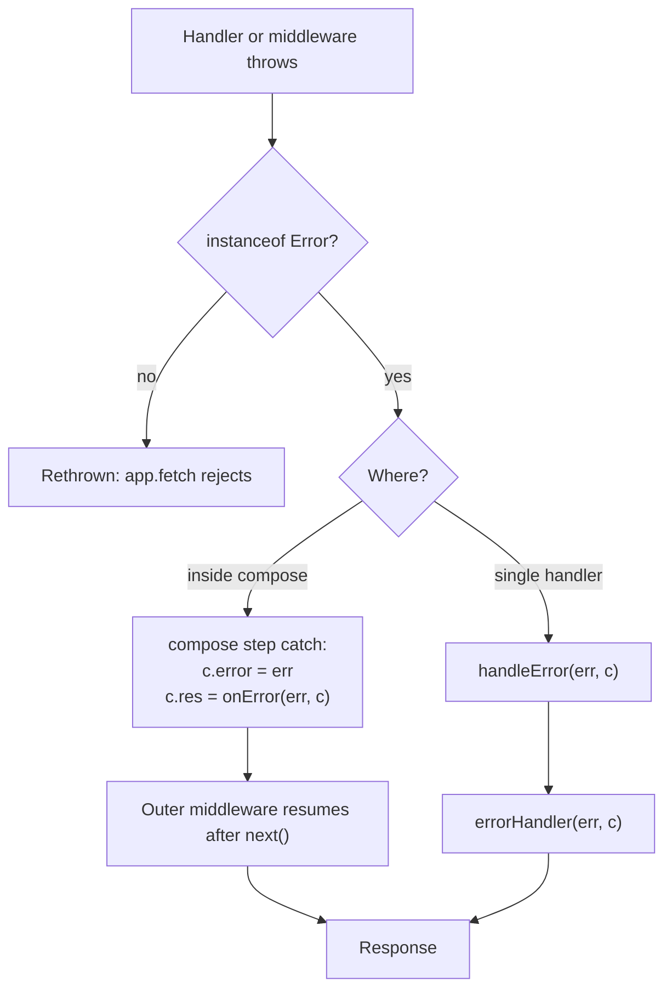

## Overview

Hono turns failures into responses in two places. An `Error` thrown by any middleware or handler is passed to the app's error handler, set with `app.onError`; a request that no handler answers goes to the not-found handler, set with `app.notFound`. `HTTPException` from `hono/http-exception` is the error type built for this: it carries an HTTP status and optionally a ready-made `Response`, and the default error handler sends that response instead of a generic 500. Most built-in middleware reports rejection by throwing one.

Sources: [src/hono-base.ts:31-42](repo://src/hono-base.ts#L31-L42), [src/hono-base.ts:255-294](repo://src/hono-base.ts#L255-L294), [src/http-exception.ts:20-78](repo://src/http-exception.ts#L20-L78)

## HTTPException

### Constructor

`new HTTPException(status?, options?)` extends `Error`. `status` defaults to 500 and is typed `ContentfulStatusCode`, every status except 101, 204, 205 and 304. The options are passed on to `Error` (`message`, and `cause` as the standard error cause) and kept on the instance as the read-only `res` and `status`.

Sources: [src/http-exception.ts:46-60](repo://src/http-exception.ts#L46-L60), [src/utils/http-status.ts:71-72](repo://src/utils/http-status.ts#L71-L72)

| Option | Type | Description |
| --- | --- | --- |
| `res` | `Response` | A response to send for this error. Its body and headers are used; the status is replaced by the exception's `status`. |
| `message` | `string` | The error message. Used as the response body when `res` is not given. |
| `cause` | `unknown` | The underlying error, stored as the standard `Error.cause`. |

Sources: [src/http-exception.ts:8-18](repo://src/http-exception.ts#L8-L18)

### getResponse

`getResponse()` builds the response for the exception. With `res`, it returns `new Response(res.body, { status: this.status, headers: res.headers })`, so the exception's status always wins over the status of `res`. Without `res`, it returns `new Response(this.message, { status: this.status })`.

Sources: [src/http-exception.ts:61-77](repo://src/http-exception.ts#L61-L77)

```ts
getResponse(): Response {
  if (this.res) {
    const newResponse = new Response(this.res.body, {
      status: this.status,
      headers: this.res.headers,
    })
    return newResponse
  }
  return new Response(this.message, {
    status: this.status,
  })
}
```

Sources: [src/http-exception.ts:66-77](repo://src/http-exception.ts#L66-L77)

### Throwing one

Throw an `HTTPException` from a handler or middleware to stop the request. Passing `res` gives full control over the body and headers, for example a `WWW-Authenticate` header on a 401.

Sources: [src/http-exception.ts:31-44](repo://src/http-exception.ts#L31-L44)

```ts
import { HTTPException } from 'hono/http-exception'

app.post('/auth', async (c, next) => {
  if (authorized === false) {
    throw new HTTPException(401, { message: 'Custom error message' })
  }
  await next()
})

app.get('/private', () => {
  const res = new Response('Unauthorized', {
    status: 401,
    headers: { 'WWW-Authenticate': 'Basic realm="example"' },
  })
  throw new HTTPException(401, { res })
})
```

Sources: [src/http-exception.ts:31-44](repo://src/http-exception.ts#L31-L44)

## Built-in sources of HTTPException

Several modules signal rejection by throwing, which lets an app restyle every such response in one `onError`.

Sources: [src/middleware/basic-auth/index.ts:141-151](repo://src/middleware/basic-auth/index.ts#L141-L151), [src/validator/validator.ts:95-128](repo://src/validator/validator.ts#L95-L128)

| Module | Status | Carries |
| --- | --- | --- |
| `hono/basic-auth` | 401 | `res` with the unauthorized message and `WWW-Authenticate` |
| `hono/bearer-auth` | 400 or 401 | `res` built from the configured messages |
| `hono/jwt`, `hono/jwk` | 401 | `message` and a `res` with `WWW-Authenticate` |
| `hono/csrf` | 403 | `res` with `Forbidden` |
| `hono/ip-restriction` | 403 | `res` from `c.text('Forbidden', 403)` |
| `hono/body-limit` | 413 | `res` with the payload-too-large message |
| `hono/timeout` | 504 | `message: 'Gateway Timeout'` (or a custom exception) |
| `hono/validator` | 400 | `message` for malformed JSON or form data |
| `hono/proxy` | 400 | `message` |

Sources: [src/middleware/basic-auth/index.ts:141-151](repo://src/middleware/basic-auth/index.ts#L141-L151), [src/middleware/bearer-auth/index.ts:122-215](repo://src/middleware/bearer-auth/index.ts#L122-L215), [src/middleware/jwt/jwt.ts:80-90](repo://src/middleware/jwt/jwt.ts#L80-L90), [src/middleware/jwt/jwt.ts:165-172](repo://src/middleware/jwt/jwt.ts#L165-L172), [src/middleware/csrf/index.ts:140-150](repo://src/middleware/csrf/index.ts#L140-L150), [src/middleware/ip-restriction/index.ts:231-236](repo://src/middleware/ip-restriction/index.ts#L231-L236), [src/middleware/body-limit/index.ts:50-58](repo://src/middleware/body-limit/index.ts#L50-L58), [src/middleware/timeout/index.ts:12-14](repo://src/middleware/timeout/index.ts#L12-L14), [src/validator/validator.ts:95-128](repo://src/validator/validator.ts#L95-L128), [src/helper/proxy/index.ts:65-75](repo://src/helper/proxy/index.ts#L65-L75)

## The error handler

### Default behaviour

The default `errorHandler` checks whether the error has a `getResponse` method rather than testing `instanceof HTTPException`, so any error matching the `HTTPResponseError` interface is accepted. For such errors it returns `c.newResponse(res.body, res)`: the response is rebuilt through the context, so headers already set with `c.header()` (for example by a CORS middleware before the error) are kept. Any other error is logged with `console.error` and answered with `Internal Server Error` and status 500.

Sources: [src/hono-base.ts:35-42](repo://src/hono-base.ts#L35-L42), [src/types.ts:113-119](repo://src/types.ts#L113-L119), [src/context.ts:604-641](repo://src/context.ts#L604-L641)

### Custom handler with onError

`app.onError(handler)` replaces the handler. It receives `(err, c)` and must return a `Response` or a promise of one. Once replaced, `HTTPException` responses are no longer produced automatically, so a custom handler usually forwards them itself.

Sources: [src/hono-base.ts:255-274](repo://src/hono-base.ts#L255-L274), [src/types.ts:116-119](repo://src/types.ts#L116-L119)

```ts
import { HTTPException } from 'hono/http-exception'

app.onError((err, c) => {
  if (err instanceof HTTPException) {
    return err.getResponse()
  }
  console.error(err)
  return c.json({ error: 'Internal Server Error' }, 500)
})
```

Sources: [src/hono-base.ts:263-274](repo://src/hono-base.ts#L263-L274), [src/http-exception.ts:66-77](repo://src/http-exception.ts#L66-L77)

## How a thrown error reaches the handler

### In the middleware chain

When several handlers matched, they run inside `compose`. Each step wraps its handler call in `try`/`catch`. A caught `Error` is stored in `c.error`, the error handler's response is assigned to `c.res` even if the context was already finalized, and the step returns normally. The middleware that called `next()` therefore resumes as usual and can look at `c.error` and `c.res`.

Sources: [src/compose.ts:49-71](repo://src/compose.ts#L49-L71), [src/context.ts:318-333](repo://src/context.ts#L318-L333)

```ts
app.use(async (c, next) => {
  await next()
  if (c.error) {
    c.header('X-Error', c.error.message)
  }
})
```

Sources: [src/context.ts:319-333](repo://src/context.ts#L319-L333)

### Outside the chain

`#dispatch` catches what `compose` does not handle, and every error of the single-handler fast path (both synchronous throws and rejected promises), and passes it to `#handleError`. That method calls the error handler for `Error` instances and rethrows anything else, so throwing a string or a plain object rejects `app.fetch` instead of producing a 500. The "Context is not finalized" error, thrown when no response was produced, also goes through this path.

Sources: [src/hono-base.ts:399-404](repo://src/hono-base.ts#L399-L404), [src/hono-base.ts:429-465](repo://src/hono-base.ts#L429-L465)



Sources: [src/compose.ts:49-71](repo://src/compose.ts#L49-L71), [src/hono-base.ts:399-465](repo://src/hono-base.ts#L399-L465)

### Sub-apps mounted with route

A sub-app's error handler is honoured only if it was changed. When `app.route(path, subApp)` copies a route from a sub-app whose `errorHandler` is not the default, it wraps the handler in `compose([], subApp.errorHandler)`, so errors from that route reach the sub-app's `onError` first. Routes of a sub-app with the default handler are copied unwrapped and fall through to the parent's handler.

Sources: [src/hono-base.ts:208-232](repo://src/hono-base.ts#L208-L232)

## Not found

### When the not-found handler runs

The default not-found handler answers `c.text('404 Not Found', 404)`. It runs when:

Sources: [src/hono-base.ts:31-33](repo://src/hono-base.ts#L31-L33)

1. no route matched, so `compose` reaches the end of an empty chain;
2. every matched entry called `next()` and none set a response;
3. a single matched handler returned nothing, or called `next()`.

Sources: [src/hono-base.ts:31-33](repo://src/hono-base.ts#L31-L33), [src/hono-base.ts:429-450](repo://src/hono-base.ts#L429-L450), [src/compose.ts:61-65](repo://src/compose.ts#L61-L65)

### Custom handler with notFound

`app.notFound(handler)` replaces it. The handler is also passed to every `Context`, so a handler can call `c.notFound()` to send the same response explicitly. When a `Context` has no not-found handler (one built outside an app), `c.notFound()` returns an empty `Response`.

Sources: [src/hono-base.ts:276-294](repo://src/hono-base.ts#L276-L294), [src/hono-base.ts:421-427](repo://src/hono-base.ts#L421-L427), [src/context.ts:764-779](repo://src/context.ts#L764-L779)

```ts
app.notFound((c) => c.json({ error: 'Not Found', path: c.req.path }, 404))

app.get('/posts/:id', async (c) => {
  const post = await findPost(c.req.param('id'))
  if (!post) {
    return c.notFound()
  }
  return c.json(post)
})
```

Sources: [src/hono-base.ts:284-294](repo://src/hono-base.ts#L284-L294), [src/context.ts:764-779](repo://src/context.ts#L764-L779)

> [!WARNING]
> A sub-app's `notFound` is not copied by `app.route()` or kept per base path: the not-found handler of the app whose `fetch` is called answers unmatched requests. Set it on the top-level app.

Sources: [src/hono-base.ts:175-232](repo://src/hono-base.ts#L175-L232)

The full dispatch path is on [[Request Lifecycle and Middleware Composition]]; [[The Hono App]] lists `onError` and `notFound` with the other app methods.

Sources: [src/hono-base.ts:406-466](repo://src/hono-base.ts#L406-L466)
