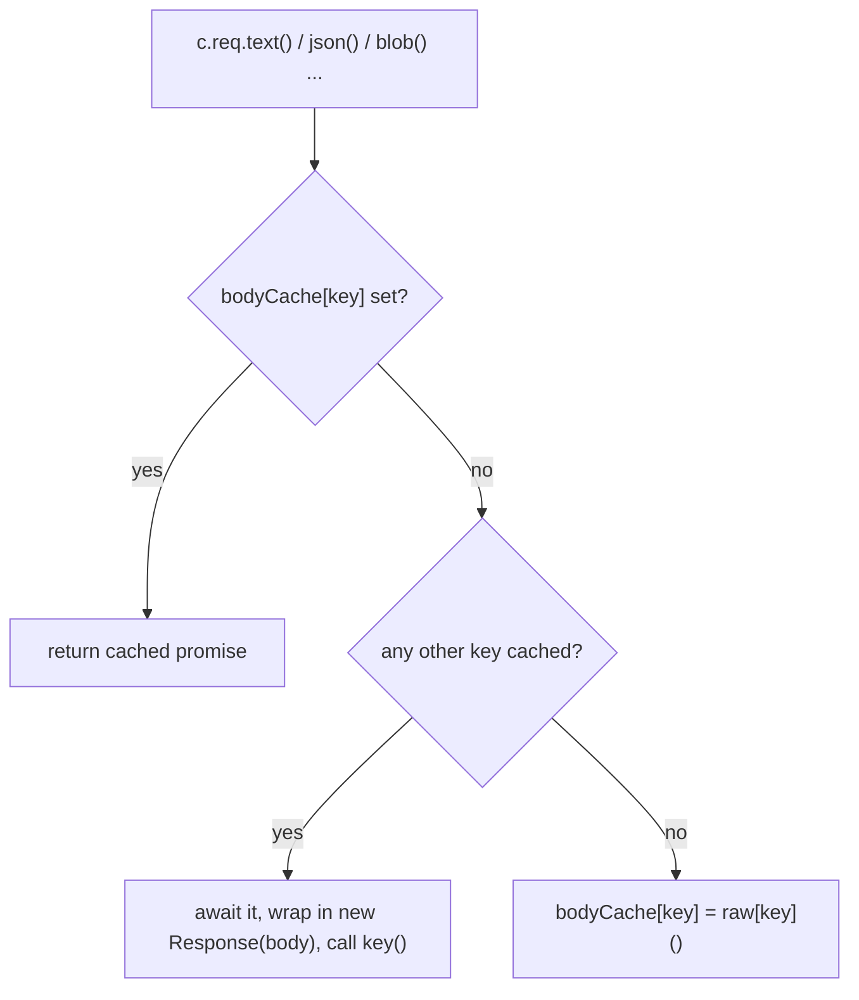

## Overview

`HonoRequest` is the object behind `c.req`. It wraps the standard `Request` (kept as `c.req.raw`) and adds what a router-based framework needs: typed path parameters from the route match, fast query-string parsing, form body parsing, a body cache so middleware and handlers can each read the body, and access to data stored by validators. The [[Context]] creates it lazily the first time `c.req` is read, passing the routed path and the router's match result.

Sources: [src/request.ts:36-80](repo://src/request.ts#L36-L80), [src/context.ts:366-369](repo://src/context.ts#L366-L369)

The class takes two generics: `P`, the route path string such as `/posts/:id`, which types `param()`; and `I`, the validated output map (`Input['out']`), which types `valid()`. Both come from the route definition, as described in [[Type System and Schema Inference]].

Sources: [src/request.ts:36-36](repo://src/request.ts#L36-L36), [src/request.ts:94-104](repo://src/request.ts#L94-L104), [src/request.ts:351-354](repo://src/request.ts#L351-L354)

## Public interface

### Members at a glance

| Member | Returns | Description |
| --- | --- | --- |
| `raw` | `Request` | The original request object. |
| `path` | `string` | The path the router matched (from `getPath`, without query string). |
| `url` | `string` | `raw.url`. |
| `method` | `string` | `raw.method`. |
| `param(key?)` | `string`, `string \| undefined` or a record | Decoded path parameters of the current route. |
| `query(key?)` | `string \| undefined` or `Record<string, string>` | First value of each query key. |
| `queries(key?)` | `string[] \| undefined` or `Record<string, string[]>` | All values of each query key. |
| `header(name?)` | `string \| undefined` or a record | One request header, or all of them as a plain object. |
| `parseBody(options?)` | `Promise<BodyData>` | Parses `multipart/form-data` and `application/x-www-form-urlencoded` bodies. |
| `json()`, `text()`, `arrayBuffer()`, `bytes()`, `blob()`, `formData()` | `Promise<...>` | Cached body readers. |
| `valid(target)` | validated data | Data stored by a validator for `json`, `form`, `query`, `param`, `header` or `cookie`. |
| `routeIndex` | `number` | Index of the handler currently running in the matched list. |
| `matchedRoutes`, `routePath` | `RouterRoute[]`, `string` | Deprecated; use the `hono/route` helper. |

Sources: [src/request.ts:51-80](repo://src/request.ts#L51-L80), [src/request.ts:148-218](repo://src/request.ts#L148-L218), [src/request.ts:253-354](repo://src/request.ts#L253-L354), [src/request.ts:369-387](repo://src/request.ts#L369-L387), [src/request.ts:420-442](repo://src/request.ts#L420-L442)

### Usage

```ts
app.post('/posts/:id', async (c) => {
  const id = c.req.param('id')           // string
  const page = c.req.query('page')        // string | undefined
  const tags = c.req.queries('tag')       // string[] | undefined
  const ua = c.req.header('User-Agent')   // string | undefined
  const body = await c.req.parseBody()    // Record<string, string | File>
  return c.json({ id, page, tags, ua, body })
})
```

Sources: [src/request.ts:94-171](repo://src/request.ts#L94-L171), [src/request.ts:185-218](repo://src/request.ts#L185-L218)

## Path parameters

### How param() reads the match result

The router returns a `Result` that comes in two shapes. RegExpRouter returns handlers paired with a map from parameter name to an index, plus a shared array of captured values (the "param stash"). TrieRouter and the other routers return handlers paired with a map from name directly to value. `#getParamValue` hides the difference: when the result has a stash (`matchResult[1]`), it looks the index up there, otherwise it returns the map value itself. See [[Routers and SmartRouter]].

Sources: [src/router.ts:54-97](repo://src/router.ts#L54-L97), [src/request.ts:126-128](repo://src/request.ts#L126-L128)

Parameters are read from `this.#matchResult[0][this.routeIndex]`, the entry for the handler that is currently running. `compose` sets `c.req.routeIndex` before calling each handler, so a middleware mounted at `/api/*` and a handler at `/api/:id` each see their own parameters.

Sources: [src/request.ts:106-124](repo://src/request.ts#L106-L124), [src/compose.ts:40-46](repo://src/compose.ts#L40-L46)

### Decoding

Values are decoded only when they contain a `%`, using `tryDecode` with `decodeURIComponent`. If the whole string fails to decode, `tryDecode` decodes each run of `%XX` sequences separately and leaves invalid ones untouched, so a malformed escape never throws. `param()` with no key returns every parameter of the route, skipping those whose value is `undefined` (an optional parameter that did not match).

Sources: [src/request.ts:34-34](repo://src/request.ts#L34-L34), [src/request.ts:106-124](repo://src/request.ts#L106-L124), [src/utils/url.ts:80-93](repo://src/utils/url.ts#L80-L93)

### Typing

The overloads make `param('id')` return `string` for a required parameter of `P`, and `string | undefined` for an optional one (`:id?`), using `ParamKeys<P>` and `RemoveQuestion`. Calling `param()` without a key returns a simplified intersection of `ParamKeyToRecord` for each key. When `P` is plain `string` the typed overload resolves to `never`, so the untyped `param(key: string)` overload applies.

Sources: [src/request.ts:94-104](repo://src/request.ts#L94-L104)

## Query strings

### query and queries

`query()` and `queries()` both delegate to `_getQueryParam` in the URL utilities, working directly on `c.req.url` without building a `URL` or `URLSearchParams` object. `query()` keeps the first value for each key (`results[name] ??= value`), while `queries()` collects every value into an array. A key without `=` yields an empty string.

Sources: [src/request.ts:148-171](repo://src/request.ts#L148-L171), [src/utils/url.ts:255-315](repo://src/utils/url.ts#L255-L315)

### Fast path for a single key

When a single, unencoded key is requested with `query(key)`, `_getQueryParam` searches the URL string for `?key` or `&key` and checks the next character: `=` means a value follows (sliced up to the next `&`), `&` or end of string means an empty value. Only if the key is not found and the URL contains `%` or `+` does it fall back to the full scan, since the key might appear encoded. The full scan splits on `&` and `=`, and decodes names and values with `_decodeURI` (which turns `+` into a space and percent-decodes) only if the URL has any `%` or `+`.

Sources: [src/utils/url.ts:208-253](repo://src/utils/url.ts#L208-L253)

```ts
// GET /search?q=hono&tag=a&tag=b&empty
c.req.query('q')       // 'hono'
c.req.query()          // { q: 'hono', tag: 'a', empty: '' }
c.req.queries('tag')   // ['a', 'b']
```

Sources: [src/utils/url.ts:219-315](repo://src/utils/url.ts#L219-L315)

## Headers

`header(name)` returns `raw.headers.get(name)`, converting `null` to `undefined`. `header()` with no argument copies every header into a plain object; because `Headers` iterates lower-cased names, keys in that object are lower case. The `RequestHeader` type gives autocompletion for standard header names while still allowing any string.

Sources: [src/request.ts:185-198](repo://src/request.ts#L185-L198)

## Reading the body

### Body cache

A `Request` body can be consumed only once, but in Hono a validator, a middleware and the handler may each want it. Each body reader goes through `#cachedBody(key)`, which stores the promise returned by `raw[key]()` in `bodyCache` under that key. A second call for the same key returns the stored promise. A call for a different key reuses whichever body was cached first: it awaits that value, re-serializes it with `JSON.stringify` if it was cached as `json`, and converts it with `new Response(body)[key]()`.

Sources: [src/request.ts:20-27](repo://src/request.ts#L20-L27), [src/request.ts:220-239](repo://src/request.ts#L220-L239)



Sources: [src/request.ts:220-239](repo://src/request.ts#L220-L239)

### Readers

`json()` reads through the `text` cache and calls `JSON.parse`, so `c.req.json()` followed by `c.req.text()` reads the stream once. `bytes()` reads through the `arrayBuffer` cache and wraps the result in a `Uint8Array`. `text()`, `arrayBuffer()`, `blob()` and `formData()` map directly to their cache key.

Sources: [src/request.ts:253-331](repo://src/request.ts#L253-L331)

> [!WARNING]
> Reading `c.req.raw` directly (for example `c.req.raw.json()`) bypasses the cache. Later calls to the `c.req` readers then fail because the stream is already used.

Sources: [src/request.ts:220-239](repo://src/request.ts#L220-L239), [src/request.ts:476-487](repo://src/request.ts#L476-L487)

### Cloning a consumed request

`cloneRawRequest(req)` builds a fresh `Request` that can be forwarded, for example to `fetch` or another app. If the raw body is unused it just calls `raw.clone()`. Otherwise it takes the first cached body key, awaits that body through the matching `HonoRequest` reader, and copies the method, headers and other `RequestInit` fields from the raw request. If the body was consumed but nothing is cached, it throws an `HTTPException` 500 explaining that `req.raw` was read directly.

Sources: [src/request.ts:476-505](repo://src/request.ts#L476-L505)

## parseBody

### Algorithm

`c.req.parseBody(options)` calls `parseBody` from `src/utils/body.ts`, which also accepts a plain `Request`. It reads the `Content-Type`, takes the media type before `;`, and only for `multipart/form-data` or `application/x-www-form-urlencoded` parses the body; any other type (including JSON) returns `{}`.

Sources: [src/request.ts:212-218](repo://src/request.ts#L212-L218), [src/utils/body.ts:97-113](repo://src/utils/body.ts#L97-L113)

1. `parseFormData` reads the body with `request.arrayBuffer()`, which on a `HonoRequest` goes through the body cache.
2. `bufferToFormData` wraps the buffer in a `Response` with a normalized `Content-Type` (lower-cased media type, boundary kept) and calls `formData()`.
3. For a `HonoRequest`, the `FormData` promise is stored in `bodyCache.formData`, so a later `c.req.formData()` or a form validator reuses it.
4. `convertFormDataToBodyData` builds a null-prototype object from the entries, then applies the `all` and `dot` rules.

Sources: [src/utils/body.ts:123-179](repo://src/utils/body.ts#L123-L179), [src/utils/buffer.ts:106-117](repo://src/utils/buffer.ts#L106-L117)

### Options

| Option | Type | Default | Description |
| --- | --- | --- | --- |
| `all` | `boolean` | `false` | Collect repeated fields into arrays. Without it the last value wins. Keys ending in `[]` are always arrays. |
| `dot` | `boolean` | `false` | Turn dotted keys such as `obj.key1` into nested objects. |

Sources: [src/utils/body.ts:43-75](repo://src/utils/body.ts#L43-L75), [src/utils/body.ts:151-206](repo://src/utils/body.ts#L151-L206)

With `dot`, `handleParsingNestedValues` walks the key segments, creating null-prototype objects for intermediate levels and replacing any intermediate value that is a string, array or `File`. Keys containing a `__proto__.` segment are ignored to prevent prototype pollution.

Sources: [src/utils/body.ts:215-242](repo://src/utils/body.ts#L215-L242)

The return type follows the options: `BodyData<{ all: true }>` allows `(string | File)[]` values and `BodyData<{ dot: true }>` allows nested objects, while the default is `Record<string, string | File>`.

Sources: [src/utils/body.ts:9-41](repo://src/utils/body.ts#L9-L41)

```ts
// form: tag=a, tag=b, user.name=Ann, file=<File>
const body = await c.req.parseBody({ all: true, dot: true })
// { tag: ['a', 'b'], user: { name: 'Ann' }, file: File }
```

Sources: [src/utils/body.ts:151-206](repo://src/utils/body.ts#L151-L206)

## Validated data

`addValidatedData(target, data)` is called by the `validator` middleware after a successful validation, storing the output per target. `valid(target)` returns it, typed by `InputToDataByTarget<I, T>` so only the targets declared by validators on the route are accepted. See [[Validator]].

Sources: [src/request.ts:339-354](repo://src/request.ts#L339-L354)

```ts
app.post('/posts', validator('json', (value) => value as { title: string }), (c) => {
  const { title } = c.req.valid('json')
  return c.json({ title }, 201)
})
```

Sources: [src/request.ts:351-354](repo://src/request.ts#L351-L354)

## Path, URL and routes

### path and getPath

`c.req.path` is the string the app's `getPath` extracted for routing. The default `getPath` scans `request.url` from the first `/` after the scheme and host up to `?` or `#`. If it meets a `%`, it finds the end with `indexOf` and runs `tryDecodeURI` on the path, first escaping `%25` as `%2525` so an encoded `%` stays encoded. With `strict: false`, `getPathNoStrict` also drops a trailing `/`. A custom `getPath` option on the app replaces it, for example to route by host.

Sources: [src/utils/url.ts:104-146](repo://src/utils/url.ts#L104-L146), [src/hono-base.ts:168-173](repo://src/hono-base.ts#L168-L173)

### Matched routes

`matchedRoutes` maps each matched handler to its `RouterRoute` (`basePath`, `path`, `method`, `handler`), and `routePath` returns the `path` of the route at `routeIndex`. Both are deprecated in favor of the `hono/route` helper, which reads the same match result through the `GET_MATCH_RESULT` symbol getter. See [[Factory, Testing, Proxy and Other Helpers]].

Sources: [src/request.ts:389-442](repo://src/request.ts#L389-L442), [src/request/constants.ts:1-1](repo://src/request/constants.ts#L1-L1), [src/helper/route/index.ts:32-34](repo://src/helper/route/index.ts#L32-L34)
