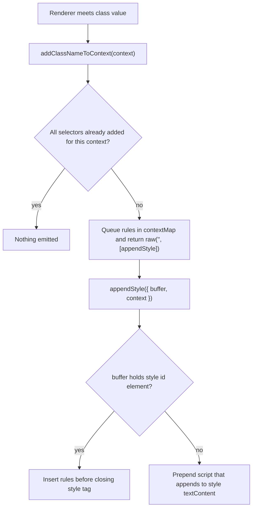

## Overview

Hono ships two template helpers for server-rendered markup without JSX. `hono/html` provides the `html` tagged template, which escapes interpolated values, and `raw`, which marks a string as already safe. `hono/css` provides CSS-in-JS: `css` and `cx` turn template literals into hashed class names, `keyframes` and `viewTransition` produce animation and view-transition rules, and the `Style` component emits the `<style>` element that collects the rules.

Sources: [src/helper/html/index.ts:1-57](repo://src/helper/html/index.ts#L1-L57), [src/helper/css/index.ts:1-30](repo://src/helper/css/index.ts#L1-L30), [package.json:144-153](repo://package.json#L144-L153)

Both helpers share the `HtmlEscapedString` model from `src/utils/html.ts`: a `String` object flagged `isEscaped: true` that can carry `callbacks`. The JSX renderer uses the same model (see [[JSX Server Rendering]]), so `html` output, JSX output and `css` class names can be mixed freely, and `c.html` resolves their callbacks before sending the response (see [[Context]]).

Sources: [src/utils/html.ts:6-46](repo://src/utils/html.ts#L6-L46), [src/context.ts:723-733](repo://src/context.ts#L723-L733)

## HtmlEscapedString and callbacks

### The escaped string type

`raw(value, callbacks?)` wraps `value` in `new String(...)` and sets `isEscaped = true` and `callbacks`. Any code that builds HTML checks `isEscaped` to decide whether a value still needs escaping, so wrapping a string with `raw` is how you insert trusted markup.

Sources: [src/utils/html.ts:17-46](repo://src/utils/html.ts#L17-L46)

`escapeToBuffer(str, buffer)` appends `str` to `buffer[0]`, replacing `"` with `&quot;`, `'` with `&#39;`, `&` with `&amp;`, `<` with `&lt;` and `>` with `&gt;`. It searches for the first special character once and returns early when there is none, so plain text costs a single regex scan. The algorithm follows `react-dom`'s `escapeTextForBrowser`.

Sources: [src/utils/html.ts:48-127](repo://src/utils/html.ts#L48-L127)

### Callback phases

An `HtmlEscapedCallback` receives `{ phase, buffer, context }` and may return a promise of extra HTML. `context` is an object unique to one render, used as a `WeakMap` key; `buffer` is a one-element array holding the HTML produced so far, which a callback may rewrite in place.

Sources: [src/utils/html.ts:6-16](repo://src/utils/html.ts#L6-L16)

| Phase | Value | Used when |
| --- | --- | --- |
| `Stringify` | `1` | The whole output is being turned into one string: `c.html`, `writeSSE`, `resolveCallbackSync`. |
| `BeforeStream` | `2` | Streaming JSX resolves content before the first chunk is sent. |
| `Stream` | `3` | Streaming JSX resolves content after the response started. |

Sources: [src/utils/html.ts:6-10](repo://src/utils/html.ts#L6-L10), [src/context.ts:723-733](repo://src/context.ts#L723-L733), [src/jsx/streaming.ts:120-130](repo://src/jsx/streaming.ts#L120-L130)

`resolveCallback(str, phase, preserveCallbacks, context, buffer?)` awaits `str` if it is a promise, returns it unchanged when it has no callbacks, and otherwise runs every callback with a shared `buffer`. Strings returned by callbacks are themselves resolved recursively with the same buffer, and the final `buffer[0]` is the result. With `preserveCallbacks` the callbacks stay attached to the returned `raw` string. `resolveCallbackSync` is the synchronous variant used when a result is known to need no awaiting; it runs callbacks once in the `Stringify` phase.

Sources: [src/utils/html.ts:129-182](repo://src/utils/html.ts#L129-L182)

## The html tagged template

### How html builds its output

`html` keeps a `StringBufferWithCallbacks`, an array whose first element is the string being built. For each interpolated value it first flattens arrays deeply, then handles each child:

Sources: [src/helper/html/index.ts:15-48](repo://src/helper/html/index.ts#L15-L48)

1. A string is escaped into `buffer[0]`.
2. A number is appended as is.
3. `true`, `false`, `null` and `undefined` render nothing, so a `cond && value` interpolation is safe.
4. An `HtmlEscapedString` with callbacks is pushed onto the buffer unchanged so the callbacks survive; one without callbacks is appended raw, or pushed if its `toString()` returns a promise.
5. A promise is pushed onto the buffer to be awaited later.
6. Any other object is escaped via its `toString()`.

Sources: [src/helper/html/index.ts:11-50](repo://src/helper/html/index.ts#L11-L50)

Pushing uses `buffer.unshift('', child)`: the child moves behind a fresh empty string at the front, so the array grows in reverse order, alternating strings and pending values. When the buffer still has one element, `html` returns a synchronous `raw` string. Otherwise it returns `stringBufferToString(buffer, buffer.callbacks)`, which awaits all entries, walks the array from the tail to rebuild the original order, escapes resolved values not flagged `isEscaped`, and collects the callbacks of every child into the result.

Sources: [src/helper/html/index.ts:52-56](repo://src/helper/html/index.ts#L52-L56), [src/utils/html.ts:23-88](repo://src/utils/html.ts#L23-L88)

> [!NOTE]
> The return type is `HtmlEscapedString | Promise<HtmlEscapedString>`. It is a promise as soon as any interpolated value is a promise or carries callbacks; `c.html` accepts both forms.

Sources: [src/helper/html/index.ts:11-14](repo://src/helper/html/index.ts#L11-L14), [src/context.ts:723-733](repo://src/context.ts#L723-L733)

### Usage

```ts
import { Hono } from 'hono'
import { html, raw } from 'hono/html'

const app = new Hono()

const Layout = (title: string, body: unknown) => html`<!doctype html>
  <html>
    <head><title>${title}</title></head>
    <body>${body}</body>
  </html>`

app.get('/:name', (c) => {
  const name = c.req.param('name') // escaped: <script> becomes &lt;script&gt;
  const items = ['a', 'b'].map((i) => html`<li>${i}</li>`)
  return c.html(
    Layout(`Hello ${name}`, html`<h1>Hi ${name}</h1><ul>${items}</ul>${raw('<hr>')}`)
  )
})
```

Sources: [src/helper/html/index.ts:9-57](repo://src/helper/html/index.ts#L9-L57), [src/context.ts:723-733](repo://src/context.ts#L723-L733)

> [!WARNING]
> `raw` disables escaping entirely. Never pass user input to it.

Sources: [src/utils/html.ts:40-46](repo://src/utils/html.ts#L40-L46)

## The css helper

### Defining styles

`css` is a tagged template returning a `Promise<string>` that resolves to a class name. Use it as a JSX `class` value and render `<Style />` in the document head. A leading `/* label */` comment becomes the label passed to a custom slug function. Nesting a class inside another `css` call copies its declarations; a class followed by `{` is used as a selector. A rule written as `:-hono-global { ... }` is emitted without a class wrapper, for global styles.

Sources: [src/helper/css/common.ts:139-199](repo://src/helper/css/common.ts#L139-L199), [src/helper/css/index.ts:169-171](repo://src/helper/css/index.ts#L169-L171)

```tsx
import { css, cx, keyframes, Style } from 'hono/css'

const fadeIn = keyframes`
  from { opacity: 0; }
  to { opacity: 1; }
`
const base = css`/* card */ padding: 1rem; animation: ${fadeIn} 0.3s;`
const active = css`${base} border: 1px solid blue;`

app.get('/', (c) =>
  c.html(
    <html>
      <head><Style /></head>
      <body>
        <div class={cx(base, isActive && active, 'external-class')}>Hi</div>
      </body>
    </html>
  )
)
```

Sources: [src/helper/css/common.ts:139-199](repo://src/helper/css/common.ts#L139-L199), [src/helper/css/index.ts:169-181](repo://src/helper/css/index.ts#L169-L181)

### Building the style string

`buildStyleString` concatenates the template with its values. Booleans, `null` and `undefined` are skipped. Strings are appended with `\`, `"`, `'` and a `/` that follows `<` backslash-escaped, so a value cannot close a quoted string or emit `</style>`. Numbers are appended directly, and a `rawCssString(value)` object is appended without escaping. A keyframes object contributes its name and is recorded as a selector. A nested class name is inlined as its declarations (with a `;` added if needed) unless the next template chunk starts with `{`, in which case it becomes `.className` as a selector. The result is minified by `minify`, which strips comments and redundant whitespace while leaving quoted strings intact.

Sources: [src/helper/css/common.ts:79-106](repo://src/helper/css/common.ts#L79-L106), [src/helper/css/common.ts:139-199](repo://src/helper/css/common.ts#L139-L199), [src/helper/css/common.ts:27-36](repo://src/helper/css/common.ts#L27-L36)

`cssCommon` then hashes `label + styleString` with a goober-style multiplicative hash into `css-<number>`, so identical styles always share a class. With a `classNameSlug` function the hash, normalized label and style string are passed to it; a returned slug is used only if it matches `/^-?[_a-zA-Z][_a-zA-Z0-9-]*$/`, otherwise `onInvalidSlug` (default `console.warn`) is called and the hash is kept. The returned `CssClassName` stores the selector, class name, style string, nested selectors and external class names under private symbols.

Sources: [src/helper/css/common.ts:38-77](repo://src/helper/css/common.ts#L38-L77), [src/helper/css/common.ts:201-238](repo://src/helper/css/common.ts#L201-L238)

### Emitting rules at render time

The server-side `css` wraps the `CssClassName` in a resolved promise of an `HtmlEscapedString` whose callback is `addClassNameToContext`. Rules reach the page in two steps.

Sources: [src/helper/css/index.ts:124-166](repo://src/helper/css/index.ts#L124-L166)



Sources: [src/helper/css/index.ts:83-167](repo://src/helper/css/index.ts#L83-L167)

`contextMap` keeps, per render `context`, the rules still to add and the selectors already added, so a class used many times is emitted once per response. `appendStyle` formats each queued rule as `.className{...}` (or as is for `@keyframes` and `:-hono-global` rules) and, when the buffer already contains `<style id="hono-css">`, splices them in with a regex. When that element has already been flushed, as in streamed JSX, it instead emits a `<script>` that appends the text to the element's `textContent`, adding the `nonce` given to `Style`.

Sources: [src/helper/css/index.ts:86-122](repo://src/helper/css/index.ts#L86-L122)

### cx, keyframes and viewTransition

`cx(...args)` composes classes: falsy values are dropped, and plain strings become external class names that are appended to the generated class but contribute no rules. A string containing `<`, `{` or `}` is discarded because it could break out of the style element when used as a selector, and the final class name is HTML-escaped if it contains `&<>'"`.

Sources: [src/helper/css/index.ts:149-178](repo://src/helper/css/index.ts#L149-L178), [src/helper/css/common.ts:58-60](repo://src/helper/css/common.ts#L58-L60), [src/helper/css/common.ts:240-258](repo://src/helper/css/common.ts#L240-L258)

`keyframes` returns a `CssClassName` whose class name is `@keyframes <hash>`, synchronously, so it can be interpolated into a `css` template. A custom slug for it must also avoid CSS-wide keywords such as `none` or `inherit`.

Sources: [src/helper/css/common.ts:62-73](repo://src/helper/css/common.ts#L62-L73), [src/helper/css/common.ts:260-288](repo://src/helper/css/common.ts#L260-L288)

`viewTransition` creates a class that sets `view-transition-name` to a generated name. Called with no arguments it uses an incrementing `/* h-v-t N */` label; called with a template it also emits the template as a global rule in which every empty `::view-transition-*()` pseudo-element is filled with the generated name.

Sources: [src/helper/css/common.ts:290-333](repo://src/helper/css/common.ts#L290-L333)

### Style and createCssContext

`Style({ children?, nonce? })` returns `<style id="hono-css">` with optional global CSS from a `css` value passed as children, plus a callback that records the `nonce` for the render context. It also carries a `DOM_RENDERER` so that [[Client-side JSX (hono/jsx/dom)]] renders it with the DOM implementation from `src/jsx/dom/css.ts`.

Sources: [src/helper/css/index.ts:192-206](repo://src/helper/css/index.ts#L192-L206), [src/jsx/dom/css.ts:1-20](repo://src/jsx/dom/css.ts#L1-L20)

The exported `css`, `cx`, `keyframes`, `viewTransition` and `Style` come from a default context with id `hono-css`. `createCssContext` builds an independent set, for example to use two style elements on one page or a custom class naming scheme. All of these APIs are marked experimental.

Sources: [src/helper/css/index.ts:63-81](repo://src/helper/css/index.ts#L63-L81), [src/helper/css/index.ts:208-262](repo://src/helper/css/index.ts#L208-L262)

| Option | Type | Default | Description |
| --- | --- | --- | --- |
| `id` | `string` | required | `id` of the `<style>` element the context writes to. |
| `classNameSlug` | `(hash, label, styleString) => string` | none | Returns a custom class name; invalid results fall back to the hash. |
| `onInvalidSlug` | `(slug) => void` | `console.warn` | Called when `classNameSlug` returns an invalid identifier. |

Sources: [src/helper/css/index.ts:63-80](repo://src/helper/css/index.ts#L63-L80), [src/helper/css/common.ts:120-137](repo://src/helper/css/common.ts#L120-L137)
