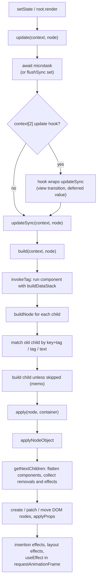

## Overview

`hono/jsx/dom` is a small virtual-DOM renderer that runs the same JSX components as [[JSX Server Rendering]] in the browser, with a React-compatible API (`render`, `createRoot`, hooks, `Suspense`, `ErrorBoundary`, `createPortal`, `flushSync`). It keeps a tree of `NodeObject`s mirroring the JSX, rebuilds the parts whose state changed, and patches the real DOM. The work is split in two phases: `build` runs components and reconciles the virtual children, and `apply` turns the virtual tree into DOM operations and runs effects.

Sources: [src/jsx/dom/index.ts:6-125](repo://src/jsx/dom/index.ts#L6-L125), [src/jsx/dom/render.ts:497-511](repo://src/jsx/dom/render.ts#L497-L511)

Components are plain functions; hooks store their state on the `NodeObject` being built (see [[JSX Hooks]]). Because server and client share `hono/jsx` components, the same `FC` can be rendered to a string on the server and mounted in the browser.

Sources: [src/jsx/dom/render.ts:274-291](repo://src/jsx/dom/render.ts#L274-L291)

## Entry points

### render

`render(jsxNode, container)` wraps the node in a fragment (`tag: ''`) and calls `renderNode`. `renderNode` creates a fresh render context (with an empty error-handler stack at index 5 and the "top-level render" flag at index 4 set during `build`), builds the whole tree, applies it into a new `DocumentFragment`, rewrites the containers recorded on nodes from the fragment to the real container (`replaceContainer`), and finally calls `container.replaceChildren(fragment)`.

Sources: [src/jsx/dom/render.ts:706-799](repo://src/jsx/dom/render.ts#L706-L799)

```tsx
/** @jsxImportSource hono/jsx/dom */
import { render, useState } from 'hono/jsx/dom'

const Counter = () => {
  const [count, setCount] = useState(0)
  return <button onClick={() => setCount(count + 1)}>{count}</button>
}

render(<Counter />, document.getElementById('root')!)
```

Sources: [src/jsx/dom/render.ts:796-799](repo://src/jsx/dom/render.ts#L796-L799), [src/jsx/hooks/index.ts:182-243](repo://src/jsx/hooks/index.ts#L182-L243)

### createRoot and hydrateRoot

`hono/jsx/dom/client` mirrors `react-dom/client`. `createRoot(element)` returns `{ render, unmount }`. The first `render` mounts an internal component that holds the JSX in `useState` and captures its setter; later `render` calls just call that setter, so updates go through the normal state-update path. `unmount` sets the state to `null` and marks the root unusable: a subsequent `render` throws `Cannot update an unmounted root`. Passing any options logs a warning, since none are supported.

Sources: [src/jsx/dom/client.ts:11-66](repo://src/jsx/dom/client.ts#L11-L66)

`hydrateRoot(element, node)` is `createRoot` followed by `render`. There is no attach-to-existing-markup hydration: the first render replaces the container's children.

Sources: [src/jsx/dom/client.ts:68-89](repo://src/jsx/dom/client.ts#L68-L89), [src/jsx/dom/render.ts:783-794](repo://src/jsx/dom/render.ts#L783-L794)

## Virtual node model

### NodeObject and NodeString

The DOM JSX runtime (`hono/jsx/dom/jsx-runtime`) produces plain objects `{ tag, type, props, key, ref }` instead of `JSXNode` instances, substituting the DOM intrinsic-element components for `title`, `form` and the other special tags. `buildNode` then turns each child into a virtual node:

Sources: [src/jsx/dom/jsx-dev-runtime.ts:1-23](repo://src/jsx/dom/jsx-dev-runtime.ts#L1-L23), [src/jsx/dom/render.ts:667-704](repo://src/jsx/dom/render.ts#L667-L704)

- `null`, `undefined` and booleans are dropped.
- strings and numbers become a `NodeString` `{ t: text, d: true }` (the `d` flag marks dirty text).
- objects become a `NodeObject`; function components get a hook stash `[DOM_STASH] = [0, []]`; `svg` and `math` get their children wrapped in a namespace context provider so descendants are created with `createElementNS`.
- a node that was already built (has `vR`) is shallow-copied, remembering the original in `o`, so a JSX element reused across renders is not mutated.

Sources: [src/jsx/dom/jsx-dev-runtime.ts:1-23](repo://src/jsx/dom/jsx-dev-runtime.ts#L1-L23), [src/jsx/dom/render.ts:667-704](repo://src/jsx/dom/render.ts#L667-L704)

| Field | Meaning |
| --- | --- |
| `vC` | current virtual children |
| `pC` | previous children, kept while building with explicit children (error fallback) |
| `vR` | children to remove on the next apply |
| `pP` | previous props, used to diff attributes |
| `nN` | next sibling node, used to find the insertion point |
| `e` / `c` | rendered DOM element / container |
| `f` / `s` | force rebuild / skip build and apply |
| `p` | preserve the element on unmount (`1` self, `2` self and children) |
| `a` | abort: set when the node was removed so a pending update is dropped |
| `DOM_STASH` | `[hookIndex, hookData, contextSnapshot, nearestErrorHandler]` |

Sources: [src/jsx/dom/render.ts:41-80](repo://src/jsx/dom/render.ts#L41-L80)

### The render Context tuple

`build` and `update` share a `Context` tuple: index 0 is the pending type (`0` normal, `1` transition from `startTransition`, `2` from `useTransition`), index 1 records an error during a low-priority render, index 2 is an optional update hook (used by view transitions and `useDeferredValue`), index 4 flags the top-level render, and index 5 is the stack of active error handlers. `buildDataStack` holds `[context, node]` for the component currently running, which is how hooks find their node.

Sources: [src/jsx/dom/render.ts:82-106](repo://src/jsx/dom/render.ts#L82-L106)

## The build/apply pipeline

### Flow



Sources: [src/jsx/dom/render.ts:293-386](repo://src/jsx/dom/render.ts#L293-L386), [src/jsx/dom/render.ts:387-481](repo://src/jsx/dom/render.ts#L387-L481), [src/jsx/dom/render.ts:497-604](repo://src/jsx/dom/render.ts#L497-L604), [src/jsx/dom/render.ts:713-781](repo://src/jsx/dom/render.ts#L713-L781)

### build: running components and reconciling

`build(context, node, children?)` computes the new children: for a function component it calls `invokeTag`, which resets the hook index, pushes `[context, node]` on `buildDataStack`, calls the component's `DOM_RENDERER` override (if any) or the component itself with `defaultProps` merged, and pops the stack. For an element it uses `props.children`. If the first child carries `DOM_ERROR_HANDLER` (an `ErrorBoundary`, `Suspense` or context provider fragment), that handler is pushed on `context[5]` for the duration of the build.

Sources: [src/jsx/dom/render.ts:274-291](repo://src/jsx/dom/render.ts#L274-L291), [src/jsx/dom/render.ts:497-512](repo://src/jsx/dom/render.ts#L497-L512)

Then, for each child (nested arrays are flattened in place):

Sources: [src/jsx/dom/render.ts:513-609](repo://src/jsx/dom/render.ts#L513-L609), [src/jsx/dom/render.ts:483-491](repo://src/jsx/dom/render.ts#L483-L491)

1. `buildNode` creates the virtual node. User components record a snapshot of all context values (`DOM_STASH[2]`) and the nearest error handler (`DOM_STASH[3]`).
2. A matching old child is searched in the previous children: by `key` and `tag` when a key is present, otherwise by `tag`, and any text node for text. A match is removed from the candidates so it is used only once.
3. When reused, the old node keeps its DOM element and hook state: its props move to `pP`, the new props are installed, and for a component the node is marked `s` (skip) when it is not forced and either it is the same original element or its `memo` comparator (`DOM_MEMO`) says props are equal, and the context snapshot is unchanged.
4. Unskipped object nodes are built recursively; consecutive siblings are linked through `nN`.
5. Old children that were not matched become `vR` and are removed during apply.

Sources: [src/jsx/dom/render.ts:513-609](repo://src/jsx/dom/render.ts#L513-L609), [src/jsx/dom/render.ts:483-491](repo://src/jsx/dom/render.ts#L483-L491)

### getNextChildren

`getNextChildren` flattens the virtual tree below a node into the list of nodes that actually own DOM elements: function components and fragments are transparent, so their children are inlined, and their containers are set to the current DOM container. Along the way it collects every `vR` list for removal and every component's effect data for the effect phase. If a transparent node was skipped, the skip flag is propagated to its flattened children so their DOM is left untouched.

Sources: [src/jsx/dom/render.ts:293-332](repo://src/jsx/dom/render.ts#L293-L332)

### apply and applyNodeObject

`apply(node, container, isNew)` records the container and calls `applyNodeObject`, which:

Sources: [src/jsx/dom/render.ts:334-367](repo://src/jsx/dom/render.ts#L334-L367), [src/jsx/dom/render.ts:386-481](repo://src/jsx/dom/render.ts#L386-L481)

1. Calls `getNextChildren`, then `removeNode` on everything to remove. `removeNode` runs effect cleanups and ref cleanups recursively and removes the element unless the node is preserved (`p`); for components it clears pending updates and sets `a`.
2. Computes the starting offset in `container.childNodes` from the next sibling (`findInsertBefore`, which skips portals and element-less nodes) or from the first existing child.
3. For each next child: reuses a skipped element as is; updates dirty text; otherwise creates the element (`createElementNS` when a namespace is set), calls `applyProps` with old props, recurses into it, and sets `select` values after the options exist.
4. Moves or inserts the element if it is not already at the expected position, with a fast path for swapped siblings.
5. Runs effects: `useInsertionEffect` callbacks immediately while collecting, then all `useLayoutEffect` callbacks synchronously, then `useEffect` callbacks in one `requestAnimationFrame`.

Sources: [src/jsx/dom/render.ts:334-367](repo://src/jsx/dom/render.ts#L334-L367), [src/jsx/dom/render.ts:386-481](repo://src/jsx/dom/render.ts#L386-L481)

### applyProps

`applyProps(element, props, oldProps)` touches only props whose value changed:

Sources: [src/jsx/dom/render.ts:115-200](repo://src/jsx/dom/render.ts#L115-L200), [src/jsx/dom/render.ts:201-272](repo://src/jsx/dom/render.ts#L201-L272)

| Prop | Handling |
| --- | --- |
| `onX` / `onXCapture` | `addEventListener` with the lower-cased event name, removing the old listener first; `onChange` maps to `input`, `onDoubleClick` to `dblclick`; non-function values throw |
| `dangerouslySetInnerHTML` | sets `innerHTML` |
| `ref` | callback ref (its return value is the cleanup) or object ref (`current`); cleanup stored per element |
| `style` | string sets `cssText`; object resets and calls `style.setProperty` per entry |
| `value` | set as a property on `input`/`textarea` (and text content for `textarea`); deferred for `select` |
| `checked` / `selected` | set as properties on `input` / `option` |
| others | `null`, `undefined`, `false` remove the attribute; `true` sets an empty attribute; otherwise `setAttribute` (camelCase SVG presentation attributes become kebab-case) |

Sources: [src/jsx/dom/render.ts:115-200](repo://src/jsx/dom/render.ts#L115-L200), [src/jsx/dom/render.ts:201-272](repo://src/jsx/dom/render.ts#L201-L272)

Props present before but missing now are removed: listeners are detached, a removed `ref` runs its cleanup, and attributes are removed. Invalid attribute names raising `InvalidCharacterError` are ignored rather than validated up front.

Sources: [src/jsx/dom/render.ts:250-272](repo://src/jsx/dom/render.ts#L250-L272), [src/jsx/dom/render.ts:158-162](repo://src/jsx/dom/render.ts#L158-L162)

## Update scheduling

### update and updateSync

A state change calls `update(context, node)` for the component's node. `update` keeps one pending entry per node in `updateMap`; a newer call resolves the older promise with `undefined`, so only the latest update for a node runs. Outside `flushSync` it then awaits a microtask before running, which batches several `setState` calls made in the same tick. If the context carries an update hook (`context[2]`), the hook decides when `updateSync` runs; otherwise it runs directly.

Sources: [src/jsx/dom/render.ts:734-781](repo://src/jsx/dom/render.ts#L734-L781)

`updateSync` re-pushes the context values the node saw when it was built (so `useContext` sees the same providers), rebuilds the node, and returns early if the build threw or the node was removed meanwhile (`a`). It then pops the context values and applies the node in place, except during a low-priority transition (`context[0] === 1`) that hit an error.

Sources: [src/jsx/dom/render.ts:713-732](repo://src/jsx/dom/render.ts#L713-L732)

### flushSync

`flushSync(callback)` pushes a `Set` on `currentUpdateSets`; updates requested inside the callback are added to the set instead of waiting for a microtask, and are run synchronously right after the callback returns.

Sources: [src/jsx/dom/render.ts:801-813](repo://src/jsx/dom/render.ts#L801-L813)

## Errors, Suspense and context in the DOM

### Error handlers

When `build` throws, the node is marked for forced rebuild and the nearest handler stored in `DOM_STASH[3]` is called with the error and a `retry` function. If it returns a fallback, the boundary node is rebuilt with `[fallback]` as explicit children (keeping the previous children in `pC` to restore later) and, when appropriate, applied immediately; the inner build is aborted by throwing the internal `cancelBuild` symbol. During a `startTransition` render the error is only recorded in `context[1]`, so the current UI stays on screen.

Sources: [src/jsx/dom/render.ts:610-665](repo://src/jsx/dom/render.ts#L610-L665)

The DOM `ErrorBoundary` is a fragment whose `DOM_ERROR_HANDLER` rethrows promises, calls `onError`, and returns `fallbackRender(err)` or `fallback`. The DOM `Suspense` rethrows anything that is not a promise, schedules `retry` with `promise.finally`, and returns `fallback`. On the client, the server-side `ErrorBoundary` and `Suspense` are replaced by these through their `DOM_RENDERER` property.

Sources: [src/jsx/dom/components.ts:1-39](repo://src/jsx/dom/components.ts#L1-L39), [src/jsx/streaming.ts:138-138](repo://src/jsx/streaming.ts#L138-L138)

### Context providers

On the client, a context provider renders a fragment framed by two internal-tag components: the first pushes the value onto `context.values`, the last pops it. Because children are built in order between them, `useContext` inside reads the provided value. Its `DOM_ERROR_HANDLER` pops the value and rethrows, so a throwing child does not leave the stack unbalanced.

Sources: [src/jsx/dom/context.ts:1-52](repo://src/jsx/dom/context.ts#L1-L52), [src/jsx/dom/utils.ts:1-7](repo://src/jsx/dom/utils.ts#L1-L7)

### Portals

`createPortal(children, container, key)` returns a node with tag `_hp`, its element preset to the target container and `p: 1` so unmounting never removes the target. Its children render into that container; `applyNodeObject` does not insert the portal element itself, and `findInsertBefore` skips portals when computing sibling positions.

Sources: [src/jsx/dom/render.ts:815-825](repo://src/jsx/dom/render.ts#L815-L825), [src/jsx/dom/render.ts:444-446](repo://src/jsx/dom/render.ts#L444-L446)

## DOM intrinsic elements

### Document metadata

`title`, `meta`, `script` (with `src` and `async`), `style` (with `href` and `precedence`) and `link` render through `documentMetadataTag`, which places them in `document.head` via `createPortal`. Elements already in the head with the same dedupe key (`src`, `href`, `data-href`) are reused, newly created ones are cached per key, and stylesheets with `precedence` are inserted next to their precedence group. With `blocking="render"`, the component calls `use()` on a promise resolved by the element's `load` event, so the nearest `Suspense` shows its fallback until the resource has loaded. `onLoad`/`onError` are wired to a shared per-resource promise.

Sources: [src/jsx/dom/intrinsic-element/components.ts:56-160](repo://src/jsx/dom/intrinsic-element/components.ts#L56-L160), [src/jsx/dom/intrinsic-element/components.ts:161-256](repo://src/jsx/dom/intrinsic-element/components.ts#L161-L256), [src/jsx/dom/intrinsic-element/components.ts:257-316](repo://src/jsx/dom/intrinsic-element/components.ts#L257-L316)

### Form actions

A `form` whose `action` is a function gets a `submit` listener: it prevents the default submission, builds `FormData` from the form, sets pending state, calls the action, registers a returned promise with `registerAction` (so `useOptimistic` knows an action is in flight), and clears the pending state when it settles. The form is wrapped in a `FormContext` provider whose value `{ pending, data, method, action }` is what `useFormStatus` reads.

Sources: [src/jsx/dom/intrinsic-element/components.ts:318-386](repo://src/jsx/dom/intrinsic-element/components.ts#L318-L386)

`input` and `button` with a function `formAction` intercept clicks and dispatch a synthetic `submit` `CustomEvent` on their form carrying that function in `detail`; the form's handler uses it instead of `action` because the event is not trusted. All these components are registered in `domRenderers`, which `jsxFn` copies onto the server components' `DOM_RENDERER` slot.

Sources: [src/jsx/dom/intrinsic-element/components.ts:388-438](repo://src/jsx/dom/intrinsic-element/components.ts#L388-L438), [src/jsx/base.ts:318-328](repo://src/jsx/base.ts#L318-L328)

```tsx
import { useActionState, useFormStatus } from 'hono/jsx/dom'

const SubmitButton = () => {
  const { pending } = useFormStatus()
  return <button disabled={pending}>Save</button>
}

const Form = () => {
  const [state, action] = useActionState(async (_prev: string, data: FormData) => {
    await fetch('/api', { method: 'POST', body: data })
    return 'saved'
  }, '')
  return (
    <form action={action}>
      <input name='title' />
      <SubmitButton />
      <p>{state}</p>
    </form>
  )
}
```

Sources: [src/jsx/dom/intrinsic-element/components.ts:319-386](repo://src/jsx/dom/intrinsic-element/components.ts#L319-L386), [src/jsx/dom/hooks/index.ts:1-91](repo://src/jsx/dom/hooks/index.ts#L1-L91)

## Module exports

| Import path | Provides |
| --- | --- |
| `hono/jsx/dom` | `render`, hooks, `Suspense`, `ErrorBoundary`, `createContext`, `useContext`, `memo`, `createElement`/`jsx`, `cloneElement`, `Children`, `Fragment`/`StrictMode`, `flushSync`, `createPortal`, `useFormStatus`, `useActionState`, `useOptimistic` |
| `hono/jsx/dom/client` | `createRoot`, `hydrateRoot` |
| `hono/jsx/dom/jsx-runtime`, `hono/jsx/dom/jsx-dev-runtime` | automatic runtime for `jsxImportSource: "hono/jsx/dom"` |
| `hono/jsx/dom/server` | `renderToString` (sync only) and `renderToReadableStream`, `react-dom/server` style |
| `hono/jsx/dom/css` | client-side counterpart of the `css` helper |

Sources: [src/jsx/dom/index.ts:39-125](repo://src/jsx/dom/index.ts#L39-L125), [src/jsx/dom/jsx-runtime.ts:1-8](repo://src/jsx/dom/jsx-runtime.ts#L1-L8), [src/jsx/dom/server.ts:1-30](repo://src/jsx/dom/server.ts#L1-L30), [src/jsx/dom/client.ts:86-89](repo://src/jsx/dom/client.ts#L86-L89)

The DOM `memo` differs from the server one: it does not cache output itself and only sets `DOM_MEMO`, letting `build` skip the subtree when the comparator returns true.

Sources: [src/jsx/dom/index.ts:76-83](repo://src/jsx/dom/index.ts#L76-L83)
