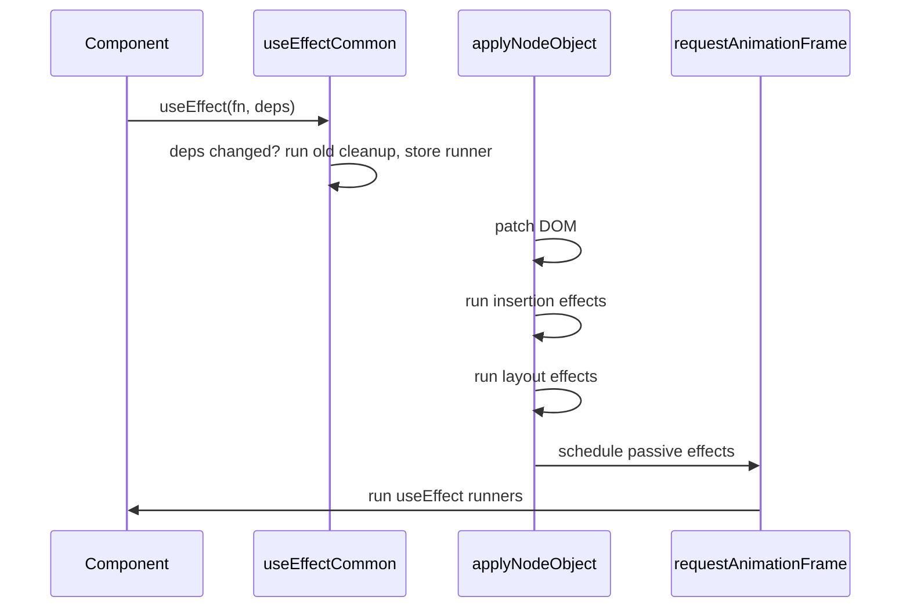

## Overview

Hono's JSX ships React-style hooks in `src/jsx/hooks/index.ts`, exported from both `hono/jsx` and `hono/jsx/dom`, plus three form-related hooks in `src/jsx/dom/hooks/index.ts`. The hooks are written for the client renderer described in [[Client-side JSX (hono/jsx/dom)]]: each one looks up the component currently being built on `buildDataStack` and keeps its data on that component's `NodeObject`. A state change schedules a rebuild of that node through `update()`. During server rendering ([[JSX Server Rendering]]) there is no build stack entry, so most hooks fall back to a harmless static behaviour, which is what lets one component render on both sides.

Sources: [src/jsx/hooks/index.ts:1-20](repo://src/jsx/hooks/index.ts#L1-L20), [src/jsx/index.ts:11-33](repo://src/jsx/index.ts#L11-L33), [src/jsx/dom/index.ts:11-35](repo://src/jsx/dom/index.ts#L11-L35)

## How hook state is stored

### The hook stash

Every function component node carries `node[DOM_STASH] = [hookIndex, hookData, ...]`. Before the component runs, `invokeTag` resets `hookIndex` to 0 and pushes `[context, node]` onto `buildDataStack`. Each hook call takes `node[DOM_STASH][0]++` as its position and reads or creates its slot in one of five arrays inside `hookData`, chosen by hook kind:

Sources: [src/jsx/hooks/index.ts:8-20](repo://src/jsx/hooks/index.ts#L8-L20), [src/jsx/dom/render.ts:274-291](repo://src/jsx/dom/render.ts#L274-L291)

| Slot | Constant | Used by |
| --- | --- | --- |
| 0 | `STASH_SATE` | `useState` (and hooks built on it) |
| 1 | `STASH_EFFECT` | `useEffect`, `useLayoutEffect`, `useInsertionEffect` |
| 2 | `STASH_CALLBACK` | `useCallback` |
| 3 | `STASH_MEMO` | `useMemo` (and `useId`) |
| 4 | `STASH_REF` | `useRef` |

Sources: [src/jsx/hooks/index.ts:8-20](repo://src/jsx/hooks/index.ts#L8-L20), [src/jsx/dom/render.ts:274-291](repo://src/jsx/dom/render.ts#L274-L291)

Because the index is positional, hooks must be called in the same order on every render, as in React.

Sources: [src/jsx/hooks/index.ts:194-197](repo://src/jsx/hooks/index.ts#L194-L197)

### Behaviour outside a client build

When `buildDataStack` is empty (string rendering on the server), the hooks degrade as follows.

Sources: [src/jsx/hooks/index.ts:89-99](repo://src/jsx/hooks/index.ts#L89-L99), [src/jsx/hooks/index.ts:126-131](repo://src/jsx/hooks/index.ts#L126-L131), [src/jsx/hooks/index.ts:182-191](repo://src/jsx/hooks/index.ts#L182-L191), [src/jsx/hooks/index.ts:260-268](repo://src/jsx/hooks/index.ts#L260-L268), [src/jsx/hooks/index.ts:299-363](repo://src/jsx/hooks/index.ts#L299-L363), [src/jsx/hooks/index.ts:397-409](repo://src/jsx/hooks/index.ts#L397-L409)

| Hook | Result without a build |
| --- | --- |
| `useState` | `[initialState, () => {}]` |
| `useEffect` / `useLayoutEffect` / `useInsertionEffect` | no-op |
| `useCallback` | returns the callback |
| `useMemo` | calls the factory |
| `useRef` | a new `{ current: initialValue }` |
| `useTransition` / `useViewTransition` | `[false, () => {}]` |
| `useSyncExternalStore` | `getServerSnapshot()`, or throws if it is missing |

Sources: [src/jsx/hooks/index.ts:89-99](repo://src/jsx/hooks/index.ts#L89-L99), [src/jsx/hooks/index.ts:126-131](repo://src/jsx/hooks/index.ts#L126-L131), [src/jsx/hooks/index.ts:182-191](repo://src/jsx/hooks/index.ts#L182-L191), [src/jsx/hooks/index.ts:260-268](repo://src/jsx/hooks/index.ts#L260-L268), [src/jsx/hooks/index.ts:299-363](repo://src/jsx/hooks/index.ts#L299-L363), [src/jsx/hooks/index.ts:397-409](repo://src/jsx/hooks/index.ts#L397-L409)

## State hooks

### useState

`useState(initial)` creates its slot once with the resolved initial value (calling it if it is a function) and a setter, and returns that same pair on every render. The setter:

Sources: [src/jsx/hooks/index.ts:178-243](repo://src/jsx/hooks/index.ts#L178-L243), [src/jsx/dom/render.ts:740-781](repo://src/jsx/dom/render.ts#L740-L781)

1. Applies a functional update to the current value.
2. Bails out if `Object.is(newState, current)`.
3. Stores the new value, then schedules the node's rebuild. With no pending transition it calls `update([0, false, updateHook], node)`, a normal-priority update batched to the next microtask.
4. Inside a transition (`pendingStack` not empty) it passes the transition's pending type to `update` and waits for both the update and the transition's promise. For `useTransition` (type 2) and `useDeferredValue` (type 3) it then schedules a follow-up update in `requestAnimationFrame` + `setTimeout`, skipped if the node re-rendered in the meantime.

Sources: [src/jsx/hooks/index.ts:178-243](repo://src/jsx/hooks/index.ts#L178-L243), [src/jsx/dom/render.ts:740-781](repo://src/jsx/dom/render.ts#L740-L781)

The setter captures the module-level `updateHook` at call time, which is how `startViewTransition` and `useDeferredValue` route an update through their own scheduling.

Sources: [src/jsx/hooks/index.ts:199-201](repo://src/jsx/hooks/index.ts#L199-L201)

### useReducer

`useReducer(reducer, initialArg, init?)` is `useState` initialized with `init(initialArg)` (or `initialArg`) plus a `dispatch` memoized with `useCallback` on `[reducer]` that applies `reducer(state, action)` as a functional update.

Sources: [src/jsx/hooks/index.ts:245-258](repo://src/jsx/hooks/index.ts#L245-L258)

```tsx
const [count, dispatch] = useReducer((s: number, a: 'inc' | 'dec') => (a === 'inc' ? s + 1 : s - 1), 0)
```

Sources: [src/jsx/hooks/index.ts:245-258](repo://src/jsx/hooks/index.ts#L245-L258)

## Effects

### Registering an effect

The three effect hooks share `useEffectCommon(index, effect, deps)`. Each slot holds an `EffectData` tuple `[deps, layoutEffect, cleanup, effect, insertionEffect]`. When `isDepsChanged(prevDeps, deps)` is true (no previous deps, no deps given, a length change, or any element not `===`), the previous cleanup runs right away during the render, and a new tuple is stored with a runner at the hook's position: index 1 for `useLayoutEffect`, 3 for `useEffect`, 4 for `useInsertionEffect`. The runner clears itself and stores the effect's return value as the cleanup.

Sources: [src/jsx/hooks/index.ts:14-34](repo://src/jsx/hooks/index.ts#L14-L34), [src/jsx/hooks/index.ts:260-297](repo://src/jsx/hooks/index.ts#L260-L297)

### When effects run

The renderer, not the hook, runs the runners. `getNextChildren` collects every component's effect tuples while flattening the tree, and at the end of `applyNodeObject` the DOM has been updated: insertion effects run first as they are collected, then all layout effects synchronously, then all passive effects together in one `requestAnimationFrame`. When a component is removed, `removeNode` calls each stored cleanup.

Sources: [src/jsx/dom/render.ts:293-307](repo://src/jsx/dom/render.ts#L293-L307), [src/jsx/dom/render.ts:341-344](repo://src/jsx/dom/render.ts#L341-L344), [src/jsx/dom/render.ts:462-480](repo://src/jsx/dom/render.ts#L462-L480)



Sources: [src/jsx/hooks/index.ts:260-297](repo://src/jsx/hooks/index.ts#L260-L297), [src/jsx/dom/render.ts:462-480](repo://src/jsx/dom/render.ts#L462-L480)

## Memoization and refs

### useMemo, useCallback and useId

`useMemo(factory, deps)` stores `[value, deps]` and recomputes only when `isDepsChanged` says so. `useCallback(callback, deps)` stores `[callback, deps]` and returns the stored function while deps are unchanged. `useId()` is a `useMemo` with empty deps around a global counter, producing ids like `:r0:`, `:r1:`, ... in base 32.

Sources: [src/jsx/hooks/index.ts:299-316](repo://src/jsx/hooks/index.ts#L299-L316), [src/jsx/hooks/index.ts:348-366](repo://src/jsx/hooks/index.ts#L348-L366)

### useRef, createRef, forwardRef and useImperativeHandle

`useRef(initial)` returns the same `{ current }` object across renders. `createRef()` returns a fresh `{ current: null }`. `forwardRef(Component)` returns a component that strips `ref` from props and passes it as the second argument. `useImperativeHandle(ref, createHandle, deps)` sets `ref.current` in a `useEffect` and resets it to `null` in the cleanup. `useDebugValue` exists for compatibility and does nothing.

Sources: [src/jsx/hooks/index.ts:318-330](repo://src/jsx/hooks/index.ts#L318-L330), [src/jsx/hooks/index.ts:368-395](repo://src/jsx/hooks/index.ts#L368-L395)

## Concurrency hooks

### Pending types

Transitions work through `pendingStack`. `runCallback(type, callback)` pushes `[type, promise]`, runs the callback synchronously, and pops; the promise resolves when the callback (or the promise it returns) settles. Any `setState` called synchronously inside reads the top of the stack and passes the type into the render context, where `update`/`build` treat it as a priority: type 1 renders discard errors instead of showing a fallback, type 2 marks a `useTransition` render, and type 3 marks a deferred value.

Sources: [src/jsx/hooks/index.ts:101-124](repo://src/jsx/hooks/index.ts#L101-L124), [src/jsx/dom/render.ts:82-90](repo://src/jsx/dom/render.ts#L82-L90), [src/jsx/dom/render.ts:640-645](repo://src/jsx/dom/render.ts#L640-L645)

### startTransition and useTransition

`startTransition(callback)` runs the callback with pending type 1. `useTransition()` returns `[isPending, start]`. `start(callback)` runs with type 2 and first toggles an internal state, so the component re-renders in a context whose `context[0] === 2`, which is exactly what `isPending` reports. After the transition's promise settles, the follow-up update scheduled by the setter re-renders with type 0, turning `isPending` back to `false`. If an async callback rejects, the error is stored in state and rethrown during the next render, reaching the nearest `ErrorBoundary`.

Sources: [src/jsx/hooks/index.ts:119-155](repo://src/jsx/hooks/index.ts#L119-L155), [src/jsx/hooks/index.ts:213-236](repo://src/jsx/hooks/index.ts#L213-L236)

```tsx
const [isPending, start] = useTransition()
return (
  <button onClick={() => start(async () => { await save(); setDone(true) })}>
    {isPending ? 'Saving...' : 'Save'}
  </button>
)
```

Sources: [src/jsx/hooks/index.ts:126-155](repo://src/jsx/hooks/index.ts#L126-L155)

### useDeferredValue

`useDeferredValue(value, initialValue?)` keeps `[deferred, latest]` in state. When `value` equals the latest, it returns it. Otherwise it pushes pending type 3, installs an `updateHook` that runs the rebuild and then records `value` as the deferred one, stores `[deferred, value]`, and returns the old deferred value for this render. The setter, seeing type 3, skips the immediate update and schedules a low-priority (type 1) update in the next frame, where the new value is returned.

Sources: [src/jsx/hooks/index.ts:157-176](repo://src/jsx/hooks/index.ts#L157-L176), [src/jsx/hooks/index.ts:213-232](repo://src/jsx/hooks/index.ts#L213-L232)

### startViewTransition and useViewTransition

`startViewTransition(callback)` sets `updateHook` to `viewTransitionHook` while the callback runs, so updates it triggers are applied inside `document.startViewTransition` (or directly when the API is missing). `useViewTransition()` returns `[isUpdating, startViewTransition]`; when a component calls it during a transition, the hook re-renders once more after `finished` with `isUpdating` false.

Sources: [src/jsx/hooks/index.ts:36-99](repo://src/jsx/hooks/index.ts#L36-L99)

## External data

### use

`use(promise)` returns the resolved value if the promise is cached as settled in `resolvedPromiseValueMap`, rethrows the rejection if it failed, and otherwise attaches handlers that fill the cache and throws the promise. The thrown promise is caught by `Suspense`: on the server it re-renders the children once the promise resolves, on the client the DOM `Suspense` handler shows the fallback and retries in `promise.finally`. The cache is keyed by the promise object, so create the promise outside the component (or memoize it) to avoid suspending forever.

Sources: [src/jsx/hooks/index.ts:22-25](repo://src/jsx/hooks/index.ts#L22-L25), [src/jsx/hooks/index.ts:332-346](repo://src/jsx/hooks/index.ts#L332-L346), [src/jsx/streaming.ts:54-85](repo://src/jsx/streaming.ts#L54-L85), [src/jsx/dom/components.ts:25-38](repo://src/jsx/dom/components.ts#L25-L38)

### useSyncExternalStore

`useSyncExternalStore(subscribe, getSnapshot, getServerSnapshot?)` throws `getServerSnapshot is required for server side rendering` when rendered to a string without `getServerSnapshot`. On the client it records whether this is the top-level initial render (`context[4]`) with a server snapshot available; if so it starts from `getServerSnapshot()` to match server output and swaps to `getSnapshot()` in an effect. The effect also subscribes and sets state from `getSnapshot()` on every notification, returning `subscribe`'s unsubscribe as the cleanup.

Sources: [src/jsx/hooks/index.ts:397-425](repo://src/jsx/hooks/index.ts#L397-L425), [src/jsx/dom/render.ts:783-788](repo://src/jsx/dom/render.ts#L783-L788)

## Form hooks

### useFormStatus

`useFormStatus()` reads `FormContext`. The DOM `form` component wraps its element in a `FormContext` provider whose value is `{ pending: false, data: null, method: null, action: null }` normally and `{ pending: true, data, method: 'post', action }` while a function action is running. It must be called in a component rendered inside the form, and it is only exported from `hono/jsx/dom`.

Sources: [src/jsx/dom/hooks/index.ts:11-43](repo://src/jsx/dom/hooks/index.ts#L11-L43), [src/jsx/dom/intrinsic-element/components.ts:332-386](repo://src/jsx/dom/intrinsic-element/components.ts#L332-L386)

### useActionState

`useActionState(fn, initialState, permalink?)` returns `[state, action]`. `action(formData)` awaits `fn(state, formData)` and stores the result with `setState`. The `permalink` is attached to the action under the `PERMALINK` symbol; when the form is rendered on the server, the `form`, `input` and `button` components write that permalink into the `action`/`formAction` attribute, so the form still posts somewhere before the client takes over.

Sources: [src/jsx/dom/hooks/index.ts:72-91](repo://src/jsx/dom/hooks/index.ts#L72-L91), [src/jsx/intrinsic-element/components.ts:179-210](repo://src/jsx/intrinsic-element/components.ts#L179-L210)

### useOptimistic

`useOptimistic(state, updateState)` returns `[optimisticState, addOptimistic]`. `addOptimistic(action)` applies `updateState(current, action)` immediately. On every render, the hook resets the optimistic value to `state`: right away when no form action is in flight, or once all registered actions settle. Actions are registered by the DOM `form` component with `registerAction` when a function action returns a promise.

Sources: [src/jsx/dom/hooks/index.ts:31-70](repo://src/jsx/dom/hooks/index.ts#L31-L70), [src/jsx/dom/intrinsic-element/components.ts:333-353](repo://src/jsx/dom/intrinsic-element/components.ts#L333-L353)

```tsx
const Messages = ({ messages, send }: { messages: string[]; send: (f: FormData) => Promise<void> }) => {
  const [optimistic, addOptimistic] = useOptimistic(messages, (cur, msg: string) => [...cur, msg])
  return (
    <form action={async (data: FormData) => {
      addOptimistic(data.get('text') as string)
      await send(data)
    }}>
      {optimistic.map((m) => <p>{m}</p>)}
      <input name='text' />
    </form>
  )
}
```

Sources: [src/jsx/dom/hooks/index.ts:52-70](repo://src/jsx/dom/hooks/index.ts#L52-L70)
