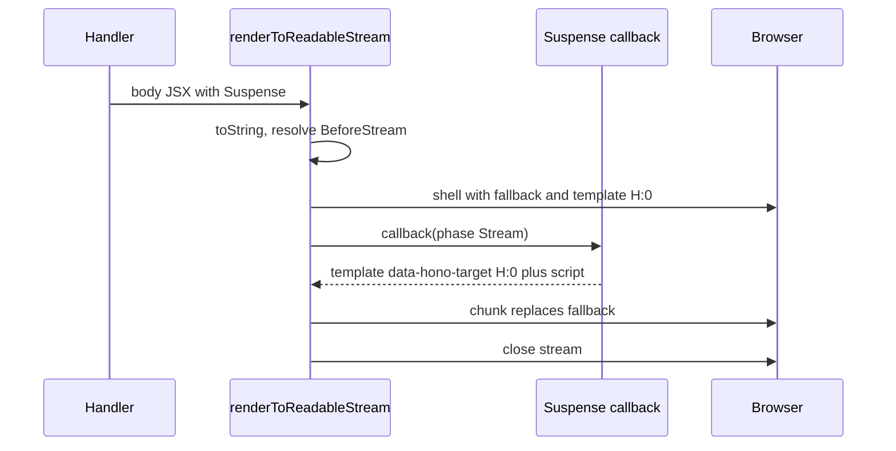

## Overview

`hono/jsx` is Hono's own JSX implementation for producing HTML strings on the server, without React. JSX expressions compile to `JSXNode` objects; calling `toString()` on a node walks the tree and writes escaped HTML into a string buffer. Async components, `Suspense` and `ErrorBoundary` are supported through promises in that buffer and through callbacks attached to the resulting `HtmlEscapedString`, which either resolve the whole page before responding (`c.html`) or stream chunks as they become ready (`renderToReadableStream`). The same module exports a React-compatible API surface (`createElement`, `memo`, `createContext`, hooks), so most components also run in the browser via [[Client-side JSX (hono/jsx/dom)]].

Sources: [src/jsx/index.ts:1-114](repo://src/jsx/index.ts#L1-L114), [src/jsx/base.ts:140-177](repo://src/jsx/base.ts#L140-L177)

```tsx
/** @jsxImportSource hono/jsx */
import { Hono } from 'hono'
import type { FC } from 'hono/jsx'

const Layout: FC = (props) => (
  <html>
    <body>{props.children}</body>
  </html>
)

const app = new Hono()
app.get('/', (c) => c.html(<Layout><h1>Hello</h1></Layout>))
```

Sources: [src/jsx/base.ts:28-32](repo://src/jsx/base.ts#L28-L32), [src/context.ts:723-733](repo://src/context.ts#L723-L733)

## Runtimes and node creation

### jsx-runtime and jsx-dev-runtime

With `"jsxImportSource": "hono/jsx"`, TypeScript imports `jsx`/`jsxs` from `hono/jsx/jsx-runtime`. Both are aliases of `jsxDEV` from the dev runtime, which takes `props.children` (array or single child) and calls `jsxFn`, then assigns `key`. The runtime also exports `jsxTemplate` (the `html` tagged template), `jsxAttr` and `jsxEscape`, used by precompiled JSX (Deno's `precompile` transform): `jsxAttr` serializes one attribute with the same style-object and escaping rules as `JSXNode`.

Sources: [src/jsx/jsx-runtime.ts:1-51](repo://src/jsx/jsx-runtime.ts#L1-L51), [src/jsx/jsx-dev-runtime.ts:1-26](repo://src/jsx/jsx-dev-runtime.ts#L1-L26)

### jsx() and jsxFn()

The classic `jsx(tag, props, ...children)` (also exported as `createElement`) folds children into `props.children`, extracts `key`, and delegates to `jsxFn`. `jsxFn` picks the node class:

Sources: [src/jsx/base.ts:304-351](repo://src/jsx/base.ts#L304-L351)

| Tag | Node created |
| --- | --- |
| a function (component) | `JSXFunctionNode` with that function |
| a name in `intrinsic-element/components` (`title`, `script`, `style`, `link`, `meta`, `form`, `input`, `button`) | `JSXFunctionNode` wrapping the special component |
| `svg` or `head` | `JSXNode` whose single child is a namespace context provider with value `svg`/`head` |
| any other string | plain `JSXNode` |

Sources: [src/jsx/base.ts:304-351](repo://src/jsx/base.ts#L304-L351)

On its first call `jsxFn` also copies DOM renderers from `domRenderers` onto the intrinsic-element components under the `DOM_RENDERER` symbol, so the client renderer can swap in its own implementations. The `JSXNode` constructor rejects invalid tag names with `Invalid JSX tag name`.

Sources: [src/jsx/base.ts:318-328](repo://src/jsx/base.ts#L318-L328), [src/jsx/base.ts:147-154](repo://src/jsx/base.ts#L147-L154)

## Rendering to a string

### toString and the string buffer

`JSXNode.toString()` creates a `StringBufferWithCallbacks`, an array whose element 0 is the string being built and whose later elements alternate promise/string for async parts. If the buffer still has one element, the result is synchronous; it runs `resolveCallbackSync` when callbacks were collected. Otherwise `stringBufferToString` awaits the promises and returns `Promise<HtmlEscapedString>`. The whole render runs inside `runWithRenderContext` (or a node's `suspendedContext`), which gives context values a per-render store.

Sources: [src/jsx/base.ts:166-177](repo://src/jsx/base.ts#L166-L177), [src/utils/html.ts:24-38](repo://src/utils/html.ts#L24-L38)

### Elements and attributes

`toStringToBuffer` writes `<tag`, then each prop after normalizing its name (`normalizeIntrinsicElementKey`, plus camelCase to kebab-case for SVG presentation attributes inside `svg`):

Sources: [src/jsx/base.ts:52-106](repo://src/jsx/base.ts#L52-L106), [src/jsx/base.ts:179-251](repo://src/jsx/base.ts#L179-L251)

- `children` is skipped; invalid attribute names are dropped.
- `style` objects become `prop:value` pairs joined by `;`, escaped.
- strings are escaped; numbers and already-escaped values are written raw; `null`/`undefined` are omitted.
- booleans are written as `key=""` only for names in `booleanAttributes` (`checked`, `disabled`, `hidden`, ...).
- `dangerouslySetInnerHTML` replaces children with `raw(v.__html)`, and throws if children were also given.
- a promise value becomes an async attribute; a function is allowed only for `on*` handlers and `ref` (ignored on the server), otherwise it throws.

Sources: [src/jsx/base.ts:52-106](repo://src/jsx/base.ts#L52-L106), [src/jsx/base.ts:179-251](repo://src/jsx/base.ts#L179-L251)

Void elements (`br`, `img`, `input`, `meta`, ...) without children close with `/>`.

Sources: [src/jsx/base.ts:52-106](repo://src/jsx/base.ts#L52-L106), [src/jsx/base.ts:179-251](repo://src/jsx/base.ts#L179-L251)

### Children and escaping

`childrenToStringToBuffer` escapes plain strings with `escapeToBuffer`, which replaces `"`, `'`, `&`, `<` and `>` with entities. Booleans, `null` and `undefined` render nothing. Nested `JSXNode`s recurse; numbers and `HtmlEscapedString`s (values with `isEscaped`, such as `raw()` output) are appended as is; promises are pushed into the buffer; arrays recurse.

Sources: [src/jsx/base.ts:108-129](repo://src/jsx/base.ts#L108-L129), [src/utils/html.ts:90-124](repo://src/utils/html.ts#L90-L124)

> [!CAUTION]
> Anything marked escaped bypasses escaping. Only pass trusted HTML to `raw()` or `dangerouslySetInnerHTML`.

Sources: [src/jsx/base.ts:220-225](repo://src/jsx/base.ts#L220-L225)

### Function components and Fragment

`JSXFunctionNode.toStringToBuffer` calls the component with its props (children folded in). A boolean or nullish result renders nothing; a `JSXNode` result renders in place; an escaped string is appended and its callbacks merged into the buffer; any other value is escaped. A promise (an `async` component) is pushed into the buffer; when contexts exist, the current render context is captured with `captureRenderContext` and attached to the resolved node as `suspendedContext`, so `useContext` inside the late subtree still sees the providers that surrounded it. `Fragment` returns a `JSXFragmentNode`, which renders only its children.

Sources: [src/jsx/base.ts:254-302](repo://src/jsx/base.ts#L254-L302), [src/jsx/base.ts:406-419](repo://src/jsx/base.ts#L406-L419)

`memo(component, propsAreEqual = shallowEqual)` caches the last result while props compare equal; it also tags the wrapper with `DOM_MEMO` so the client renderer can skip updates.

Sources: [src/jsx/base.ts:353-404](repo://src/jsx/base.ts#L353-L404)

## Context API

### createContext and useContext

`createContext(default)` returns a function component that is also its own `Provider`. When rendered it pushes `props.value` onto the context's value array for the current render, renders its children to a string, and pops the value afterwards (after the promise settles for async children). `useContext(ctx)` reads the last pushed value or the default. Every context is registered in `globalContexts` so suspended renders can capture and restore all of them.

Sources: [src/jsx/context.ts:213-261](repo://src/jsx/context.ts#L213-L261)

### Per-request isolation

Values are not stored on the context object itself during a server render but in a `RenderStore` (a `WeakMap` keyed by context) created per render by `runWithRenderContext`. When `AsyncLocalStorage` is available (probed through `process.getBuiltinModule('node:async_hooks')` or `mainModule.require`), the store follows `await`, so async components read the right values. Without it, the store exists only during synchronous work: reading after an `await` returns the default value (with a one-time console warning) rather than another request's value.

Sources: [src/jsx/context.ts:13-80](repo://src/jsx/context.ts#L13-L80), [src/jsx/context.ts:149-200](repo://src/jsx/context.ts#L149-L200)

```tsx
const ThemeContext = createContext('light')

const Button: FC = () => {
  const theme = useContext(ThemeContext)
  return <button class={theme}>OK</button>
}

const Page: FC = () => (
  <ThemeContext.Provider value='dark'>
    <Button />
  </ThemeContext.Provider>
)
```

Sources: [src/jsx/context.ts:213-261](repo://src/jsx/context.ts#L213-L261)

## Suspense and streaming

### Suspense

`Suspense` (from `hono/jsx/streaming`, also re-exported by `hono/jsx`) renders its children synchronously first. A component that suspends by throwing a promise (the `use()` hook does this) is caught; the render is retried after the promise resolves, with the context captured beforehand. A `buildDataStack` entry is pushed so `use()` has a hook slot. If every child resolved to a string, the joined result is returned. If any child is a promise, `Suspense` returns the rendered fallback preceded by an empty `<template id="H:n">` and followed by a `/$` comment marker, together with a callback that later swaps in the real content (`n` is a per-process counter).

Sources: [src/jsx/streaming.ts:36-90](repo://src/jsx/streaming.ts#L36-L90)

The callback ignores the `BeforeStream` phase. In the `Stringify` phase (when `c.html` resolves the page) it receives the whole page in `buffer` and replaces the template-to-marker span with the resolved content, so no script is emitted. In the `Stream` phase it returns a `<template data-hono-target="H:n">` holding the content and an inline script that removes the fallback nodes up to the `/$` comment and puts the content in their place. Nested callbacks from the content are forwarded so deeper `Suspense` boundaries stream later.

Sources: [src/jsx/streaming.ts:91-138](repo://src/jsx/streaming.ts#L91-L138), [src/utils/html.ts:6-10](repo://src/utils/html.ts#L6-L10)

### renderToReadableStream

`renderToReadableStream(content, onError = console.trace)` turns a node or escaped string into a `ReadableStream<Uint8Array>`:

Sources: [src/jsx/streaming.ts:140-220](repo://src/jsx/streaming.ts#L140-L220)

1. Stringify a `JSXNode` with `toString()`.
2. Resolve callbacks in the `BeforeStream` phase and enqueue the first chunk (the shell with fallbacks).
3. Invoke every callback with the `Stream` phase; each returned promise is chained so that when it settles, its own callbacks are invoked in turn and its HTML is enqueued.
4. Loop until all chunks are counted, then close the stream. A rejected chunk is logged, passed to `onError` and replaced by an empty string; cancelling the stream stops further enqueues.

Sources: [src/jsx/streaming.ts:140-220](repo://src/jsx/streaming.ts#L140-L220)



Sources: [src/jsx/streaming.ts:87-138](repo://src/jsx/streaming.ts#L87-L138), [src/jsx/streaming.ts:146-220](repo://src/jsx/streaming.ts#L146-L220)

```tsx
import { Suspense, renderToReadableStream } from 'hono/jsx/streaming'

const Data = async () => {
  const res = await fetch('https://example.com/api')
  return <p>{await res.text()}</p>
}

app.get('/', (c) =>
  c.body(
    renderToReadableStream(
      <html><body>
        <Suspense fallback={<p>Loading...</p>}><Data /></Suspense>
      </body></html>
    ),
    { headers: { 'Content-Type': 'text/html; charset=UTF-8', 'Transfer-Encoding': 'chunked' } }
  )
)
```

Sources: [src/jsx/streaming.ts:42-45](repo://src/jsx/streaming.ts#L42-L45), [src/jsx/streaming.ts:146-149](repo://src/jsx/streaming.ts#L146-L149)

### Script nonce

The inline scripts emitted by `Suspense` and `ErrorBoundary` read `useContext(StreamingContext)?.scriptNonce`; wrap the tree in `<StreamingContext.Provider value={{ scriptNonce }}>` to satisfy a Content Security Policy. See [[Security Middleware]] for generating nonces.

Sources: [src/jsx/streaming.ts:18-32](repo://src/jsx/streaming.ts#L18-L32), [src/jsx/streaming.ts:50-50](repo://src/jsx/streaming.ts#L50-L50)

## ErrorBoundary

`ErrorBoundary` accepts `fallback` (a node), `fallbackRender(error)` and `onError(error)`. It first resolves children eagerly with `resolveChildEarly`. A synchronous throw renders the fallback immediately (after calling `onError`); a thrown promise is awaited and the children re-rendered, with errors routed to the fallback. When any child is still a promise, it returns an empty `<template id="E:n">` followed by an `E:n` comment marker, plus a callback that mirrors `Suspense`: in the stringify phase it splices the content (or the fallback, if the promise rejected) into the buffer; in the stream phase it emits a `template` and script that insert the content after the marker. Errors raised by nested streamed callbacks are also caught, and the fallback replaces the region only once (`caught` flag).

Sources: [src/jsx/components.ts:47-127](repo://src/jsx/components.ts#L47-L127), [src/jsx/components.ts:128-200](repo://src/jsx/components.ts#L128-L200), [src/jsx/components.ts:201-262](repo://src/jsx/components.ts#L201-L262)

```tsx
<ErrorBoundary fallback={<p>Something went wrong</p>} onError={(e) => console.error(e)}>
  <Suspense fallback={<p>Loading...</p>}>
    <MaybeFailingAsyncComponent />
  </Suspense>
</ErrorBoundary>
```

Sources: [src/jsx/components.ts:55-61](repo://src/jsx/components.ts#L55-L61)

## Document metadata hoisting

### title, meta, link, script and style

`title`, `meta`, `link`, `script` and `style` used anywhere in the tree are rendered by special components that hoist them into `<head>`. `documentMetadataTag` renders the tag normally and attaches an `insertIntoHead` callback. During stringification that callback, once the buffer contains `</head>`, removes the tag from where it was rendered and inserts it before `</head>`. Tags are tracked per render in `metaTagMap` (keyed by the callback `context`), and duplicates are removed by the keys in `deDupeKeyMap` (`src` for scripts, `href` for links, `data-href` for styles, `name`/`httpEquiv`/`charset`/`itemProp` for meta).

Sources: [src/jsx/intrinsic-element/components.ts:17-119](repo://src/jsx/intrinsic-element/components.ts#L17-L119), [src/jsx/intrinsic-element/common.ts:1-23](repo://src/jsx/intrinsic-element/common.ts#L1-L23)

### When a tag is not hoisted

| Element | Rendered in place when |
| --- | --- |
| `title` | inside `svg` or already inside `head` |
| `meta` | already inside `head`, or has `itemProp` |
| `script` | missing `src` or `async`, or inside `head` |
| `style` | missing `href` or `precedence` |
| `link` | has `onLoad`/`onError`, or is a stylesheet without `precedence` or with `disabled` |

Sources: [src/jsx/intrinsic-element/components.ts:93-177](repo://src/jsx/intrinsic-element/components.ts#L93-L177)

Stylesheet `link`s and `style`s with `precedence` get a `data-precedence` attribute and are sorted by the order in which each precedence value first appeared, keeping insertion order within a group.

Sources: [src/jsx/intrinsic-element/components.ts:64-89](repo://src/jsx/intrinsic-element/components.ts#L64-L89)

### Form actions

On the server, `form` (`action`), `input` and `button` (`formAction`) accept a function. Since a function cannot be serialized, it is replaced with its `PERMALINK` property when present, otherwise the attribute is dropped.

Sources: [src/jsx/intrinsic-element/components.ts:179-210](repo://src/jsx/intrinsic-element/components.ts#L179-L210)

## jsxRenderer middleware

### Setting a layout

`jsxRenderer(component?, options?)` from `hono/jsx-renderer` installs a layout for `c.render()`. On each request it reads the outer layout from `c.getLayout()` (or `Fragment`), registers a new layout with `c.setLayout` that calls your component with `Layout` (the parent layout) in props, and calls `c.setRenderer(createRenderer(...))`. Nested `jsxRenderer`s therefore compose: an inner component can wrap its output in `<Layout>` to reuse the outer one.

Sources: [src/middleware/jsx-renderer/index.ts:116-129](repo://src/middleware/jsx-renderer/index.ts#L116-L129)

### What c.render does

The renderer resolves `options` (which may be a function of `c`), builds the layout node with the handler's children and props, prefixes the doctype and wraps everything in `RequestContext.Provider` with value `c`. It then responds with `c.html(body)`, or with `c.body(renderToReadableStream(body))` when streaming.

Sources: [src/middleware/jsx-renderer/index.ts:33-80](repo://src/middleware/jsx-renderer/index.ts#L33-L80)

| Option | Type | Default | Description |
| --- | --- | --- | --- |
| `docType` | `boolean \| string` | `true` | `true` emits `<!DOCTYPE html>`, `false` emits nothing, a string is used verbatim. |
| `stream` | `boolean \| Record<string, string>` | `false` | `true` streams with `Transfer-Encoding: chunked`, `Content-Type: text/html; charset=UTF-8`, `Content-Encoding: Identity`; a record sets those headers instead. |

Sources: [src/middleware/jsx-renderer/index.ts:18-21](repo://src/middleware/jsx-renderer/index.ts#L18-L21), [src/middleware/jsx-renderer/index.ts:41-78](repo://src/middleware/jsx-renderer/index.ts#L41-L78)

`useRequestContext()` reads `RequestContext` and returns the Hono `Context` from inside any component, throwing `RequestContext is not provided.` outside a `jsxRenderer` render.

Sources: [src/middleware/jsx-renderer/index.ts:131-165](repo://src/middleware/jsx-renderer/index.ts#L131-L165)

```tsx
import { jsxRenderer, useRequestContext } from 'hono/jsx-renderer'

app.use(
  '*',
  jsxRenderer(({ children, Layout }) => (
    <html>
      <head><title>My site</title></head>
      <body>{children}</body>
    </html>
  ), { stream: true })
)

const Url = () => <b>{useRequestContext().req.url}</b>
app.get('/', (c) => c.render(<Url />))
```

Sources: [src/middleware/jsx-renderer/index.ts:93-129](repo://src/middleware/jsx-renderer/index.ts#L93-L129)
