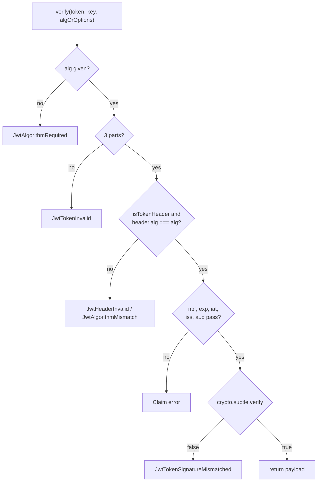

## Overview

The JWT utilities are a small, dependency-free implementation of JSON Web Tokens (RFC 7519) signed as JWS (RFC 7515) with the algorithms of JWA (RFC 7518). They run on any runtime that exposes WebCrypto (`crypto.subtle`), which is why Hono can verify tokens on Cloudflare Workers, Deno, Bun and Node.js alike. The `jwt` and `jwk` middleware in [[Authentication Middleware]] are thin wrappers over these functions.

Sources: [src/utils/jwt/jwt.ts:1-29](repo://src/utils/jwt/jwt.ts#L1-L29), [src/utils/jwt/jws.ts:1-11](repo://src/utils/jwt/jws.ts#L1-L11)

The code is split by responsibility:

Sources: [src/utils/jwt/index.ts:1-7](repo://src/utils/jwt/index.ts#L1-L7)

| File | Role |
| --- | --- |
| `src/utils/jwt/jwt.ts` | `sign`, `verify`, `verifyWithJwks`, `decode`, `decodeHeader`, header validation and claim checks |
| `src/utils/jwt/jws.ts` | Key import and `crypto.subtle.sign` / `verify` per algorithm |
| `src/utils/jwt/jwa.ts` | `AlgorithmTypes` enum and the `SignatureAlgorithm`, `SymmetricAlgorithm`, `AsymmetricAlgorithm` types |
| `src/utils/jwt/types.ts` | Error classes, `JWTPayload`, `CryptoKeyUsage` |
| `src/utils/jwt/index.ts` | The `Jwt` namespace object |
| `src/utils/encode.ts` | Base64 and base64url encoding over `btoa`/`atob` |

Sources: [src/utils/jwt/index.ts:1-7](repo://src/utils/jwt/index.ts#L1-L7), [src/utils/jwt/jwa.ts:1-37](repo://src/utils/jwt/jwa.ts#L1-L37), [src/utils/jwt/types.ts:1-11](repo://src/utils/jwt/types.ts#L1-L11), [src/utils/encode.ts:1-34](repo://src/utils/encode.ts#L1-L34)

## Public API

### Importing the functions

The four functions are grouped as `Jwt = { sign, verify, decode, verifyWithJwks }` in `hono/utils/jwt`, and re-exported individually from `hono/jwt` alongside `AlgorithmTypes`.

Sources: [src/utils/jwt/index.ts:6-7](repo://src/utils/jwt/index.ts#L6-L7), [src/middleware/jwt/index.ts:1-4](repo://src/middleware/jwt/index.ts#L1-L4), [src/middleware/jwt/jwt.ts:175-178](repo://src/middleware/jwt/jwt.ts#L175-L178)

```ts
import { sign, verify, decode } from 'hono/jwt'

const secret = 'mySecretKey'
const token = await sign(
  { sub: 'user123', role: 'admin', exp: Math.floor(Date.now() / 1000) + 60 * 5 },
  secret
) // alg defaults to HS256

const payload = await verify(token, secret, 'HS256')
const { header, payload: unverified } = decode(token)
```

Sources: [src/utils/jwt/jwt.ts:56-60](repo://src/utils/jwt/jwt.ts#L56-L60), [src/utils/jwt/jwt.ts:96-100](repo://src/utils/jwt/jwt.ts#L96-L100), [src/utils/jwt/jwt.ts:264-279](repo://src/utils/jwt/jwt.ts#L264-L279)

### Function signatures

| Function | Signature | Returns |
| --- | --- | --- |
| `sign` | `(payload: JWTPayload, privateKey: SignatureKey, alg: SignatureAlgorithm = 'HS256')` | `Promise<string>` |
| `verify` | `(token: string, publicKey: SignatureKey, algOrOptions: SignatureAlgorithm \| VerifyOptionsWithAlg)` | `Promise<JWTPayload>` |
| `verifyWithJwks` | `(token, { keys?, jwks_uri?, verification?, allowedAlgorithms }, init?: RequestInit)` | `Promise<JWTPayload>` |
| `decode` | `(token: string)` | `{ header: TokenHeader; payload: JWTPayload }` |
| `decodeHeader` | `(token: string)` | `TokenHeader` |

Sources: [src/utils/jwt/jwt.ts:56-60](repo://src/utils/jwt/jwt.ts#L56-L60), [src/utils/jwt/jwt.ts:96-100](repo://src/utils/jwt/jwt.ts#L96-L100), [src/utils/jwt/jwt.ts:197-206](repo://src/utils/jwt/jwt.ts#L197-L206), [src/utils/jwt/jwt.ts:264-291](repo://src/utils/jwt/jwt.ts#L264-L291)

`SignatureKey` is `string | HonoJsonWebKey | CryptoKey`, where `HonoJsonWebKey` is the standard `JsonWebKey` plus an optional `kid`. `JWTPayload` is an open record whose registered claims are typed: `exp`, `nbf` and `iat` as numbers (seconds since the epoch), `iss` as a string and `aud` as a string or string array.

Sources: [src/utils/jwt/jws.ts:21-27](repo://src/utils/jwt/jws.ts#L21-L27), [src/utils/jwt/types.ts:128-154](repo://src/utils/jwt/types.ts#L128-L154)

> [!WARNING]
> `decode` only base64url-decodes and `JSON.parse`s the first two segments. It does not check the signature or any claim, so never trust its output for authorization.

Sources: [src/utils/jwt/jwt.ts:264-279](repo://src/utils/jwt/jwt.ts#L264-L279)

## Signing

`sign` serialises the payload as JSON, UTF-8 encodes it and base64url-encodes it without `=` padding. If the key is a JWK object with an `alg` field, that `alg` overrides the argument and the key's `kid` is written into the header; otherwise the header is `{ alg, typ: 'JWT' }`. The signing input `header.payload` is passed to `signing`, and the signature bytes are appended as the third base64url segment.

Sources: [src/utils/jwt/jwt.ts:31-36](repo://src/utils/jwt/jwt.ts#L31-L36), [src/utils/jwt/jwt.ts:56-76](repo://src/utils/jwt/jwt.ts#L56-L76)

```ts
import { sign } from 'hono/jwt'

// A JWK private key: alg and kid in the key end up in the token header
const token = await sign({ sub: 'user123' }, privateJwk)
```

Sources: [src/utils/jwt/jwt.ts:63-68](repo://src/utils/jwt/jwt.ts#L63-L68)

## Verification

### Verification steps

`verify` checks structure and claims before touching any cryptography, so cheap failures are reported without a WebCrypto call:

Sources: [src/utils/jwt/jwt.ts:96-130](repo://src/utils/jwt/jwt.ts#L96-L130)

1. `alg` must be given (as a string or inside the options object), else `JwtAlgorithmRequired`.
2. The token must have three dot-separated parts, else `JwtTokenInvalid`.
3. The decoded header must pass `isTokenHeader`: `alg` is one of `AlgorithmTypes` and `typ`, if present, is `'JWT'`. Otherwise `JwtHeaderInvalid`.
4. The header's `alg` must equal the expected `alg`, else `JwtAlgorithmMismatch`. This blocks algorithm-substitution attacks such as a token claiming `HS256` against an RSA public key.
5. Time claims and `iss`/`aud` are checked (next section).
6. The signature is verified over the exact `header.payload` substring; a mismatch throws `JwtTokenSignatureMismatched`.

Sources: [src/utils/jwt/jwt.ts:44-54](repo://src/utils/jwt/jwt.ts#L44-L54), [src/utils/jwt/jwt.ts:96-188](repo://src/utils/jwt/jwt.ts#L96-L188)



Sources: [src/utils/jwt/jwt.ts:96-188](repo://src/utils/jwt/jwt.ts#L96-L188)

### Claim validation

Claims are compared with `now = Math.floor(Date.now() / 1000)`. A time claim that is present but not a finite number fails just like an out-of-range one. There is no clock-skew tolerance.

Sources: [src/utils/jwt/jwt.ts:130-145](repo://src/utils/jwt/jwt.ts#L130-L145)

| Option | Type | Default | Check | Error |
| --- | --- | --- | --- | --- |
| `nbf` | `boolean` | `true` | If `payload.nbf` is set, it must be `<= now` | `JwtTokenNotBefore` |
| `exp` | `boolean` | `true` | If `payload.exp` is set, it must be `> now` | `JwtTokenExpired` |
| `iat` | `boolean` | `true` | If `payload.iat` is set, it must be `<= now` | `JwtTokenIssuedAt` |
| `iss` | `string \| RegExp` | none | `payload.iss` must exist and equal the string or match the RegExp | `JwtTokenIssuer` |
| `aud` | `string \| string[] \| RegExp` | none | `payload.aud` must exist; at least one of its values must equal, be included in, or match `aud` | `JwtPayloadRequiresAud`, `JwtTokenAudience` |

Sources: [src/utils/jwt/jwt.ts:78-94](repo://src/utils/jwt/jwt.ts#L78-L94), [src/utils/jwt/jwt.ts:130-174](repo://src/utils/jwt/jwt.ts#L130-L174)

Setting `exp`, `nbf` or `iat` to `false` skips that check; a missing claim is never an error for the time checks. `iss` and `aud` are only enforced when you pass them.

Sources: [src/utils/jwt/jwt.ts:105-112](repo://src/utils/jwt/jwt.ts#L105-L112)

```ts
const payload = await verify(token, publicKeyPem, {
  alg: 'RS256',
  iss: /^https:\/\/auth\.example\.com\/?$/,
  aud: ['api', 'admin-api'],
  iat: false,
})
```

Sources: [src/utils/jwt/jwt.ts:105-112](repo://src/utils/jwt/jwt.ts#L105-L112), [src/utils/jwt/jwt.ts:146-174](repo://src/utils/jwt/jwt.ts#L146-L174)

## Verifying with a JWKS

`verifyWithJwks` picks the verification key from a JSON Web Key Set by the token's `kid`. It is meant for tokens issued by an external identity provider, and it hardens the lookup against algorithm confusion:

Sources: [src/utils/jwt/jwt.ts:197-226](repo://src/utils/jwt/jwt.ts#L197-L226)

1. Decode only the header; it must be valid and carry a `kid` (`JwtHeaderRequiresKid`).
2. Reject `HS256`, `HS384` and `HS512` outright (`JwtSymmetricAlgorithmNotAllowed`), since a public JWK must never be usable as an HMAC secret.
3. Reject any `alg` not in `allowedAlgorithms` (`JwtAlgorithmNotAllowed`).
4. Copy `keys`, then, if `jwks_uri` is set, `fetch` it with `init` and append its `keys` array. A non-OK response or a missing or non-array `keys` field throws a plain `Error`.
5. Find the key with a matching `kid` (`JwtTokenInvalid` if none). If that JWK declares an `alg` that differs from the header's, throw `JwtAlgorithmMismatch`.
6. Call `verify(token, matchingKey, { alg: header.alg, ...verification })`.

Sources: [src/utils/jwt/jwt.ts:190-262](repo://src/utils/jwt/jwt.ts#L190-L262)

```ts
import { verifyWithJwks } from 'hono/jwt'

const payload = await verifyWithJwks(token, {
  jwks_uri: 'https://auth.example.com/.well-known/jwks.json',
  allowedAlgorithms: ['RS256', 'ES256'],
  verification: { iss: 'https://auth.example.com/' },
})
```

Sources: [src/utils/jwt/jwt.ts:197-206](repo://src/utils/jwt/jwt.ts#L197-L206)

## Algorithms and keys

### Supported algorithms

`getKeyAlgorithm` maps each JWA name to WebCrypto parameters. Any other name throws `JwtAlgorithmNotImplemented`.

Sources: [src/utils/jwt/jws.ts:122-224](repo://src/utils/jwt/jws.ts#L122-L224)

| `alg` | WebCrypto algorithm | Hash | Extra |
| --- | --- | --- | --- |
| `HS256`, `HS384`, `HS512` | `HMAC` | SHA-256 / 384 / 512 | none |
| `RS256`, `RS384`, `RS512` | `RSASSA-PKCS1-v1_5` | SHA-256 / 384 / 512 | none |
| `PS256`, `PS384`, `PS512` | `RSA-PSS` | SHA-256 / 384 / 512 | `saltLength` 32 / 48 / 64 |
| `ES256`, `ES384`, `ES512` | `ECDSA` | SHA-256 / 384 / 512 | `namedCurve` P-256 / P-384 / P-521 |
| `EdDSA` | `Ed25519` | none | `namedCurve` Ed25519 |

Sources: [src/utils/jwt/jws.ts:122-220](repo://src/utils/jwt/jws.ts#L122-L220), [src/utils/jwt/jwa.ts:7-21](repo://src/utils/jwt/jwa.ts#L7-L21)

> [!NOTE]
> `EdDSA` depends on the runtime's WebCrypto supporting `Ed25519`; the source notes it is available in Safari, Deno and Node.js.

Sources: [src/utils/jwt/jws.ts:214-220](repo://src/utils/jwt/jws.ts#L214-L220)

### Key formats

`signing` and `verifying` both resolve the algorithm, import the key, and call `crypto.subtle.sign` or `crypto.subtle.verify`. Imported keys are created non-extractable and limited to the `sign` or `verify` usage.

Sources: [src/utils/jwt/jws.ts:29-48](repo://src/utils/jwt/jws.ts#L29-L48)

| Key passed | Signing (`importPrivateKey`) | Verifying (`importPublicKey`) |
| --- | --- | --- |
| `CryptoKey` | Used as-is if `type` is `private` or `secret`, else an error | Used as-is if `public` or `secret`; a private key is converted to its public JWK |
| JWK object | `importKey('jwk', ...)` | `importKey('jwk', ...)` |
| PEM string containing `PRIVATE` | `importKey('pkcs8', ...)` | Imported as PKCS#8, then its public JWK is derived |
| PEM string containing `PUBLIC` | Treated as a raw secret | `importKey('spki', ...)` |
| Any other string | `importKey('raw', ...)` (HMAC secret) | `importKey('raw', ...)` |

Sources: [src/utils/jwt/jws.ts:50-105](repo://src/utils/jwt/jws.ts#L50-L105)

Deriving a public key from a private one goes through `exportPublicJwkFrom`, which requires an extractable private `CryptoKey` and keeps only `kty`, `alg`, `e`, `n`, `crv`, `x` and `y`. This lets you verify with the same PEM you sign with. PEM bodies are turned into bytes by stripping the `BEGIN`/`END` lines and whitespace and base64-decoding the rest.

Sources: [src/utils/jwt/jws.ts:50-52](repo://src/utils/jwt/jws.ts#L50-L52), [src/utils/jwt/jws.ts:107-120](repo://src/utils/jwt/jws.ts#L107-L120)

`isCryptoKey` checks `crypto.webcrypto.CryptoKey` on Node.js (where `CryptoKey` was not a global in older versions) and the global `CryptoKey` elsewhere, using `getRuntimeKey` from the adapter helper.

Sources: [src/utils/jwt/jws.ts:226-234](repo://src/utils/jwt/jws.ts#L226-L234)

## Base64url encoding

`src/utils/encode.ts` provides the byte-level encoding. `encodeBase64` builds a binary string byte by byte and calls `btoa`; `decodeBase64` calls `atob` and fills a `Uint8Array` from both ends at once. The URL-safe variants translate `+`/`/` to `-`/`_` and back. The JWT code strips `=` padding when encoding; `atob` accepts the unpadded input when decoding.

Sources: [src/utils/encode.ts:6-34](repo://src/utils/encode.ts#L6-L34), [src/utils/jwt/jwt.ts:31-36](repo://src/utils/jwt/jwt.ts#L31-L36)

## Error types

Every failure is a named subclass of `Error`, so callers can branch with `instanceof` or on `err.name`. The `jwt` middleware stores the thrown instance as the `cause` of its 401 `HTTPException`.

Sources: [src/utils/jwt/types.ts:6-115](repo://src/utils/jwt/types.ts#L6-L115), [src/middleware/jwt/jwt.ts:140-152](repo://src/middleware/jwt/jwt.ts#L140-L152)

| Error | Thrown when |
| --- | --- |
| `JwtAlgorithmRequired` | `verify` called without `alg` |
| `JwtAlgorithmNotImplemented` | `alg` has no WebCrypto mapping |
| `JwtAlgorithmMismatch` | Header `alg` differs from the expected one, or from the matching JWK's `alg` |
| `JwtAlgorithmNotAllowed` | `verifyWithJwks`: header `alg` not in `allowedAlgorithms` |
| `JwtSymmetricAlgorithmNotAllowed` | `verifyWithJwks`: header uses an HS algorithm |
| `JwtTokenInvalid` | Not three parts, undecodable JSON, or no JWK with the token's `kid` |
| `JwtHeaderInvalid` | Header lacks a known `alg` or has a `typ` other than `JWT` |
| `JwtHeaderRequiresKid` | `verifyWithJwks`: header has no `kid` |
| `JwtTokenNotBefore` | `nbf` in the future or not a finite number |
| `JwtTokenExpired` | `exp` reached or not a finite number |
| `JwtTokenIssuedAt` | `iat` in the future or not a finite number |
| `JwtTokenIssuer` | `iss` missing or not matching |
| `JwtPayloadRequiresAud` | `aud` option set but the payload has none |
| `JwtTokenAudience` | No payload audience matches |
| `JwtTokenSignatureMismatched` | Signature check returned false |

Sources: [src/utils/jwt/types.ts:6-115](repo://src/utils/jwt/types.ts#L6-L115), [src/utils/jwt/jwt.ts:96-188](repo://src/utils/jwt/jwt.ts#L96-L188), [src/utils/jwt/jwt.ts:197-262](repo://src/utils/jwt/jwt.ts#L197-L262)

```ts
import { verify } from 'hono/jwt'
import { JwtTokenExpired } from 'hono/utils/jwt/types'

try {
  await verify(token, secret, 'HS256')
} catch (e) {
  if (e instanceof JwtTokenExpired) {
    // ask the client to refresh
  }
}
```

Sources: [src/utils/jwt/types.ts:41-46](repo://src/utils/jwt/types.ts#L41-L46), [package.json:319-323](repo://package.json#L319-L323)
