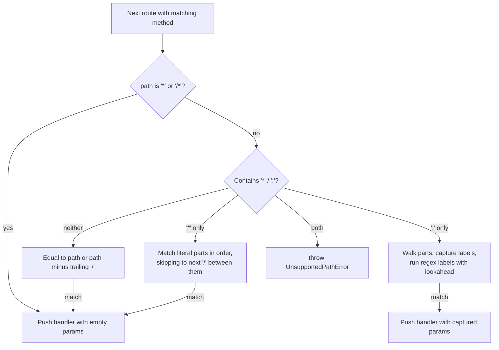

## Overview

`LinearRouter` and `PatternRouter` are the two routers that do no preprocessing. Both keep a flat array of routes and test every route against each request, so registering a route costs almost nothing and there is no compile step on the first request. The trade-off is that matching cost grows with the number of routes, unlike [[RegExpRouter]], which compiles everything into one expression, and [[TrieRouter]], which walks a tree.

Sources: [src/router/linear-router/router.ts:11-23](repo://src/router/linear-router/router.ts#L11-L23), [src/router/pattern-router/router.ts:8-42](repo://src/router/pattern-router/router.ts#L8-L42)

They back the two presets described in [[Presets: hono/tiny and hono/quick]]: `hono/quick` wraps `LinearRouter` in a `SmartRouter` with `TrieRouter` as fallback, and `hono/tiny` uses `PatternRouter` alone, which keeps the bundle small. The `SmartRouter` selection logic is covered in [[Routers and SmartRouter]].

Sources: [src/preset/quick.ts:13-23](repo://src/preset/quick.ts#L13-L23), [src/preset/tiny.ts:11-20](repo://src/preset/tiny.ts#L11-L20)

## LinearRouter

### Registering routes

`add` pushes `[method, path, handler]` onto `#routes`. When the path has optional parameters, `checkOptionalParameter` expands it first and one entry is pushed per variant, so `/api/animals/:type?` becomes two entries. Nothing else happens at registration.

Sources: [src/router/linear-router/router.ts:11-23](repo://src/router/linear-router/router.ts#L11-L23), [src/utils/url.ts:171-206](repo://src/utils/url.ts#L171-L206)

### Matching loop

`match` scans `#routes` in registration order, skipping routes whose method is neither the request method nor `ALL`. Each route is classified by whether its path contains `*` and whether it contains `:`, and a failed check jumps to the next route with `continue ROUTES_LOOP`. Matches are pushed in scan order, which is registration order, so no sorting is needed. The result uses the direct `[[handler, params][]]` form.

Sources: [src/router/linear-router/router.ts:25-36](repo://src/router/linear-router/router.ts#L25-L36), [src/router/linear-router/router.ts:139-143](repo://src/router/linear-router/router.ts#L139-L143)



Sources: [src/router/linear-router/router.ts:27-138](repo://src/router/linear-router/router.ts#L27-L138)

### Static and wildcard routes

A route with neither `*` nor `:` matches when it equals the path or when the path is the route plus a trailing `/`. A route with only `*` drops a trailing `/*` (remembering `endsWithStar`), splits the rest on `*`, and requires each literal part to appear exactly at the current position; between parts the position jumps to the next `/`, so an inner `*` consumes one segment. Without a trailing star, the last part must end the path, again allowing one trailing slash.

Sources: [src/router/linear-router/router.ts:37-69](repo://src/router/linear-router/router.ts#L37-L69)

### Parameter routes

A route with only `:` is split by `splitPathRe` into `/:name`, `/:name{pattern}` and literal `/segment` parts. A plain label takes the text up to the next `/` and rejects an empty value. A regex label compiles its pattern with the `d` flag for match indices, adding a `(?=next)` lookahead when the next part is a literal; the match must start at the current position and be non-empty, and it may contain slashes. Literal parts must appear exactly at the current position. Values are assigned with `params[name] ||= value`, so the first occurrence of a repeated name wins.

Sources: [src/router/linear-router/router.ts:9-9](repo://src/router/linear-router/router.ts#L9-L9), [src/router/linear-router/router.ts:70-135](repo://src/router/linear-router/router.ts#L70-L135)

```ts
const router = new LinearRouter<string>()
router.add('GET', '/products/:id{d+}', 'GET /products/:id{d+}')

const [res] = router.match('GET', '/products/list')
// res.length === 0: 'list' does not match the label's pattern
```

Sources: [src/router/linear-router/router.test.ts:59-70](repo://src/router/linear-router/router.test.ts#L59-L70)

### LinearRouter limits

A path that mixes a label and a wildcard, such as `/entry/:id/*`, throws `UnsupportedPathError`. The check runs inside `match`, so the error appears on the first request whose method reaches that route, which is when `SmartRouter` catches it and switches to `TrieRouter`.

Sources: [src/router/linear-router/router.ts:136-138](repo://src/router/linear-router/router.ts#L136-L138), [src/router/linear-router/router.test.ts:26-42](repo://src/router/linear-router/router.test.ts#L26-L42)

| Skipped shared case | Reason in the test file |
| --- | --- |
| `/entry/:id/*` with `/entry/:id/:action` | Label plus wildcard is unsupported. |
| `/:dir{[a-z]+}/*/file.html` | Regex label plus wildcard is unsupported. |
| `/:id{[0-9]+}/*` | Regex label plus trailing wildcard is unsupported. |
| `/files/:name{.*}` | Parameter with `{.*}` regex is unsupported. |
| `GET /book/` against `/book` and `/book/:id` | LinearRouter allows trailing slashes, so `/book` matches. |

Sources: [src/router/linear-router/router.test.ts:6-24](repo://src/router/linear-router/router.test.ts#L6-L24), [src/router/linear-router/router.test.ts:44-57](repo://src/router/linear-router/router.test.ts#L44-L57)

## PatternRouter

### Compiling each route to a RegExp

`PatternRouter.add` turns each route into its own regular expression with named capture groups and stores `[RegExp, method, handler]`. A trailing `*` is removed together with its slash and switches off the end anchor. A trailing `?` is removed and the path without its last segment is added first, recursively, which handles chains like `/v1/:version?/:platform?`.

Sources: [src/router/pattern-router/router.ts:4-20](repo://src/router/pattern-router/router.ts#L4-L20)

The remaining path is split into parts. A label becomes `/(?<name>pattern)`, with `[^/]+` when no pattern is given; an inner `/*` becomes `/[^/]+`; literal text has regex metacharacters escaped. The parts are joined, prefixed with `^`, and suffixed with `/?$` unless the route ended in a wildcard, so a trailing slash on the request is always tolerated.

Sources: [src/router/pattern-router/router.ts:22-38](repo://src/router/pattern-router/router.ts#L22-L38)

| Route | Compiled expression |
| --- | --- |
| `/entry/:id` | `^/entry/(?<id>[^/]+)/?$` |
| `/post/:date{[0-9]+}` | `^/post/(?<date>[0-9]+)/?$` |
| `/api/*` | `^/api` |
| `/wild/*/card` | `^/wild/[^/]+/card/?$` |

Sources: [src/router/pattern-router/router.ts:12-38](repo://src/router/pattern-router/router.ts#L12-L38)

### Matching

`match` runs every route whose method is the request method or `ALL`, executes its expression, and pushes `[handler, match.groups]` (or a shared empty object when there are no groups). Like `LinearRouter`, the scan is in registration order and the result is the direct `[[handler, params][]]` form.

Sources: [src/router/pattern-router/router.ts:44-59](repo://src/router/pattern-router/router.ts#L44-L59)

### PatternRouter limits

Construction of the `RegExp` is wrapped in `try`; an invalid expression throws `UnsupportedPathError` from `add`, at registration time rather than on the first request. The main case is a repeated parameter name such as `/:id/:id`, because JavaScript rejects duplicate named groups.

Sources: [src/router/pattern-router/router.ts:33-41](repo://src/router/pattern-router/router.ts#L33-L41), [src/router/pattern-router/router.test.ts:20-27](repo://src/router/pattern-router/router.test.ts#L20-L27)

```ts
const router = new PatternRouter<string>()
router.add('GET', '/book', 'GET /book')
router.add('GET', '/book/:id', 'GET /book/:id')

const [res] = router.match('GET', '/book/')
// one match: 'GET /book', because every pattern ends in '/?$'
```

Sources: [src/router/pattern-router/router.test.ts:28-42](repo://src/router/pattern-router/router.test.ts#L28-L42)

## Choosing between them

| Aspect | LinearRouter | PatternRouter |
| --- | --- | --- |
| Work in `add` | Push the route, expanding optional params | Build one `RegExp` per route |
| Work per request | Hand-written string scanning per route | One `RegExp.exec` per route |
| Label plus wildcard | Throws `UnsupportedPathError` at match time | Supported |
| Duplicate param names | First value wins | Throws `UnsupportedPathError` at add time |
| Trailing slash | Tolerated | Tolerated |
| Used by | `hono/quick`, with `TrieRouter` fallback | `hono/tiny`, alone |

Sources: [src/router/linear-router/router.ts:15-69](repo://src/router/linear-router/router.ts#L15-L69), [src/router/linear-router/router.ts:70-143](repo://src/router/linear-router/router.ts#L70-L143), [src/router/pattern-router/router.ts:12-59](repo://src/router/pattern-router/router.ts#L12-L59), [src/preset/quick.ts:18-23](repo://src/preset/quick.ts#L18-L23), [src/preset/tiny.ts:16-19](repo://src/preset/tiny.ts#L16-L19)

> [!TIP]
> Pick `hono/quick` when the app object is created often, such as per request, and startup time dominates. Pick `hono/tiny` when bundle size matters most and the route set is small enough that a linear scan stays cheap.

Sources: [src/preset/quick.ts:1-23](repo://src/preset/quick.ts#L1-L23), [src/preset/tiny.ts:1-20](repo://src/preset/tiny.ts#L1-L20)
