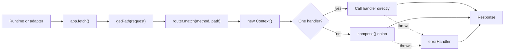

## Overview

Hono is a small web framework built only on Web Standard APIs (`Request`, `Response`, `Headers`, `URL`). Because an application is just an object with a `fetch(request, env, executionCtx)` method, the same code runs on Cloudflare Workers, Fastly Compute, Deno, Bun, Vercel, AWS Lambda, Lambda@Edge and Node.js. The package has zero runtime dependencies.

Sources: [README.md:22-47](repo://README.md#L22-L47)

The smallest application creates a `Hono` instance, registers a route whose handler returns a `Response` built through the `Context` object `c`, and exports the app. Runtimes that understand a default export with a `fetch` method (Cloudflare Workers, Bun) serve it directly; see [[Quickstart]] for the other runtimes.

Sources: [README.md:26-33](repo://README.md#L26-L33), [src/index.ts:1-15](repo://src/index.ts#L1-L15)

```ts
import { Hono } from 'hono'
const app = new Hono()

app.get('/', (c) => c.text('Hono!'))

export default app
```

Sources: [README.md:26-33](repo://README.md#L26-L33)

## Package layout

Everything lives under `src/`. The core is a handful of top-level files; every feature beyond routing is a separate module reachable through its own subpath import, so an application only bundles what it imports.

Sources: [jsr.json:7-109](repo://jsr.json#L7-L109)

| Path | Role |
| --- | --- |
| `src/hono-base.ts` | `HonoBase`: route registration, `route`, `basePath`, `mount`, `onError`, `notFound`, and the `fetch` dispatcher. Has no router of its own. |
| `src/hono.ts` | `Hono`: subclass of `HonoBase` that installs the default `SmartRouter` (`RegExpRouter` + `TrieRouter`). |
| `src/compose.ts` | `compose`: the koa-style onion runner for middleware and handlers. |
| `src/context.ts` | `Context`: per-request object holding `req`, `env`, variables and the response helpers (`text`, `json`, `html`, `redirect`, ...). |
| `src/request.ts` | `HonoRequest`: wrapper around the raw `Request` with `param`, `query`, `header`, cached body parsers. |
| `src/http-exception.ts` | `HTTPException`: an `Error` that carries an HTTP status and optional `Response`. |
| `src/router.ts`, `src/router/` | The `Router` interface plus `RegExpRouter`, `TrieRouter`, `SmartRouter`, `LinearRouter`, `PatternRouter`. |
| `src/preset/` | `hono/tiny` and `hono/quick`: `Hono` classes with other router choices. |
| `src/middleware/` | Built-in middleware (auth, CORS, CSRF, cache, ETag, compress, logger, JWT, secure headers, serve-static, timeout, ...). |
| `src/helper/` | Helpers that are not middleware (cookie, streaming, SSG, WebSocket, factory, testing, proxy, conninfo, ...). |
| `src/adapter/` | Runtime adapters: `aws-lambda`, `lambda-edge`, `bun`, `deno`, `cloudflare-workers`, `cloudflare-pages`, `netlify`, `vercel`, `service-worker`. |
| `src/jsx/` | The JSX runtime for server rendering, plus `jsx/dom` for a client-side renderer and hooks. |
| `src/client/` | `hc`, the typed RPC client that reads route types from an app. |
| `src/validator/` | The `validator` middleware used for typed request validation. |
| `src/types.ts` | Handler, middleware, env and schema types that drive type inference. |
| `src/utils/` | Shared utilities (URL/path parsing, cookies, crypto, JWT, mime, streams, ...). |

Sources: [src/hono-base.ts:98-125](repo://src/hono-base.ts#L98-L125), [src/hono.ts:16-34](repo://src/hono.ts#L16-L34), [src/compose.ts:1-24](repo://src/compose.ts#L1-L24), [jsr.json:7-109](repo://jsr.json#L7-L109)

## Public entry points

### The root module

`import ... from 'hono'` resolves to `src/index.ts`. It exports the `Hono` class, the `Context` class, and the core types: `Env`, `ErrorHandler`, `Handler`, `MiddlewareHandler`, `Next`, `NotFoundHandler`, `NotFoundResponse`, `ValidationTargets`, `Input`, `Schema`, `ToSchema`, `TypedResponse`, `ContextVariableMap`, `ContextRenderer`, `ExecutionContext`, `HonoRequest`, and the client inference types `InferRequestType`, `InferResponseType` and `ClientRequestOptions`.

Sources: [src/index.ts:17-53](repo://src/index.ts#L17-L53)

### The export map

The npm package (`package.json`) maps each subpath to three builds: an ES module in `dist/`, a CommonJS file in `dist/cjs/`, and declarations in `dist/types/`. A `typesVersions` block repeats the declaration paths for older TypeScript resolution. The package requires Node.js 16.9.0 or later.

Sources: [package.json:38-72](repo://package.json#L38-L72), [package.json:415-430](repo://package.json#L415-L430), [package.json:696-698](repo://package.json#L696-L698)

The JSR package `@hono/hono` (`jsr.json`) publishes the TypeScript sources directly, mapping each subpath to its `src/` file and excluding test files.

Sources: [jsr.json:1-111](repo://jsr.json#L1-L111)

### Commonly used subpaths

| Import | Source file | What it gives you |
| --- | --- | --- |
| `hono` | `src/index.ts` | `Hono`, `Context`, core types |
| `hono/hono-base` | `src/hono-base.ts` | `HonoBase`, for building your own preset |
| `hono/tiny` | `src/preset/tiny.ts` | `Hono` with `PatternRouter` |
| `hono/quick` | `src/preset/quick.ts` | `Hono` with `SmartRouter` of `LinearRouter` + `TrieRouter` |
| `hono/http-exception` | `src/http-exception.ts` | `HTTPException` |
| `hono/router/*` | `src/router/*/index.ts` | The individual routers |
| `hono/cors`, `hono/logger`, `hono/jwt`, ... | `src/middleware/*` | Built-in middleware |
| `hono/cookie`, `hono/streaming`, `hono/ws`, `hono/factory`, `hono/testing`, ... | `src/helper/*` | Helpers |
| `hono/jsx`, `hono/jsx/dom` | `src/jsx/` | JSX runtimes |
| `hono/client` | `src/client/index.ts` | `hc` RPC client |
| `hono/validator` | `src/validator/index.ts` | `validator` middleware |
| `hono/aws-lambda`, `hono/bun`, `hono/deno`, ... | `src/adapter/*` | Runtime adapters |

Sources: [jsr.json:7-109](repo://jsr.json#L7-L109)

## How a request flows

A runtime calls `app.fetch(request, env, executionCtx)`. `HonoBase` extracts the path with its `getPath` function, asks the router for every handler whose method and path match, wraps the request in a `Context`, and runs the matched handlers. One matched handler is called directly; several are chained by `compose`, where each middleware runs code before and after `await next()`. Whatever ends up in `c.res` is returned; a thrown `Error` goes to the app's error handler and an unmatched request to its not-found handler.

Sources: [src/hono-base.ts:406-485](repo://src/hono-base.ts#L406-L485), [src/compose.ts:15-73](repo://src/compose.ts#L15-L73)



Sources: [src/hono-base.ts:406-466](repo://src/hono-base.ts#L406-L466)

The router is pluggable. Routes are stored as `[handler, RouterRoute]` pairs through the `Router` interface's `add(method, path, handler)` and looked up with `match(method, path)`, which returns every matching handler in registration order together with the path parameters.

Sources: [src/router.ts:29-98](repo://src/router.ts#L29-L98), [src/hono-base.ts:385-397](repo://src/hono-base.ts#L385-L397)

## Where to go next

- [[Quickstart]]: build, run and test a first app.
- [[The Hono App]]: every method on the app object.
- [[Request Lifecycle and Middleware Composition]]: the dispatch path and `compose` step by step.
- [[Error Handling and HTTPException]]: `onError`, `notFound` and `HTTPException`.
- [[Presets: hono/tiny and hono/quick]]: choosing a router through a preset.
- [[Routers and SmartRouter]], [[Context]], [[HonoRequest]], [[Runtime Adapters]].

Sources: [src/index.ts:1-53](repo://src/index.ts#L1-L53)
