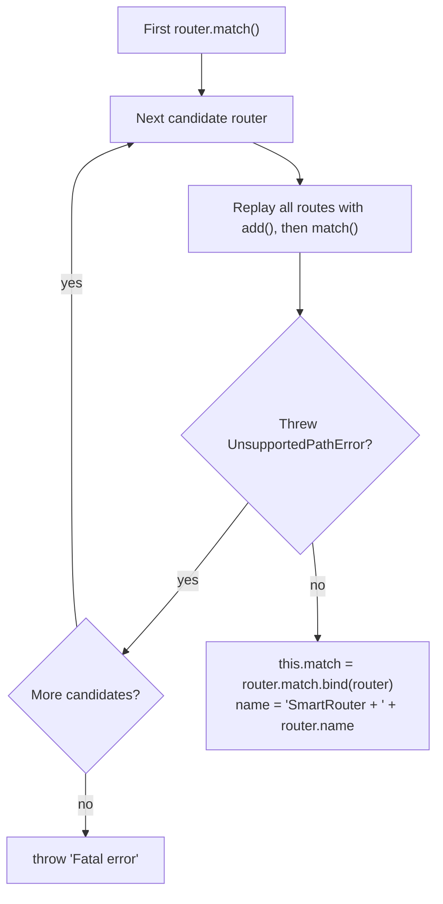

## Overview

A preset is a `Hono` class that differs from the default only in the router it installs. All three classes extend `HonoBase` and share every method, the dispatch path and the type parameters; the constructor of each one assigns a different `router` after calling `super(options)`. Choosing a preset is choosing a trade-off between matching speed, route-registration cost and bundle size, without changing application code beyond the import.

Sources: [src/hono.ts:16-34](repo://src/hono.ts#L16-L34), [src/preset/tiny.ts:1-20](repo://src/preset/tiny.ts#L1-L20), [src/preset/quick.ts:1-24](repo://src/preset/quick.ts#L1-L24)

## Comparison

| Import | Class source | Router | Router name at runtime |
| --- | --- | --- | --- |
| `hono` | `src/hono.ts` | `SmartRouter` over `RegExpRouter`, then `TrieRouter` | `SmartRouter + RegExpRouter` (or `+ TrieRouter`) |
| `hono/quick` | `src/preset/quick.ts` | `SmartRouter` over `LinearRouter`, then `TrieRouter` | `SmartRouter + LinearRouter` (or `+ TrieRouter`) |
| `hono/tiny` | `src/preset/tiny.ts` | `PatternRouter` | `PatternRouter` |

Sources: [src/hono.ts:26-33](repo://src/hono.ts#L26-L33), [src/preset/quick.ts:13-24](repo://src/preset/quick.ts#L13-L24), [src/preset/tiny.ts:11-20](repo://src/preset/tiny.ts#L11-L20), [src/router/smart-router/router.ts:57-58](repo://src/router/smart-router/router.ts#L57-L58), [src/preset/quick.test.ts:1-9](repo://src/preset/quick.test.ts#L1-L9), [src/preset/tiny.test.ts:1-9](repo://src/preset/tiny.test.ts#L1-L9)

| Preset | Registering routes | Matching a request | Suited to |
| --- | --- | --- | --- |
| default | Cheap; the matcher (one regular expression per method) is compiled on the first request | Fastest: a static-path lookup, then one regular expression test, with no loop over routes | Long-lived processes serving many requests |
| quick | Cheapest; routes are only appended to a list | Linear scan of the list on every request | Environments that build the app for very few requests, where setup time dominates |
| tiny | Each route compiled to its own regular expression when added | Linear scan, one regular expression per route | The smallest bundle (the README states under 12kB) |

Sources: [src/router/reg-exp-router/router.ts:208-252](repo://src/router/reg-exp-router/router.ts#L208-L252), [src/router/linear-router/router.ts:11-30](repo://src/router/linear-router/router.ts#L11-L30), [src/router/pattern-router/router.ts:8-60](repo://src/router/pattern-router/router.ts#L8-L60), [README.md:43-44](repo://README.md#L43-L44)

## The default Hono

`Hono` from `hono` uses `options.router` when given, otherwise `new SmartRouter({ routers: [new RegExpRouter(), new TrieRouter()] })`. `RegExpRouter` merges all routes of a method into one regular expression the first time a request is matched, then releases its route tables. Some route shapes cannot be expressed that way; for those it throws `UnsupportedPathError` and `SmartRouter` falls back to `TrieRouter`, a tree that supports every pattern.

Sources: [src/hono.ts:26-33](repo://src/hono.ts#L26-L33), [src/router/reg-exp-router/router.ts:40-70](repo://src/router/reg-exp-router/router.ts#L40-L70), [src/router/reg-exp-router/router.ts:208-223](repo://src/router/reg-exp-router/router.ts#L208-L223), [src/router/trie-router/router.ts:1-28](repo://src/router/trie-router/router.ts#L1-L28)

## How SmartRouter picks a router

Both the default class and `hono/quick` rely on `SmartRouter`, which defers the choice until the first request:

Sources: [src/router/smart-router/router.ts:4-11](repo://src/router/smart-router/router.ts#L4-L11)

1. `add()` only records `[method, path, handler]` in a list.
2. On the first `match()`, it loops over its candidate routers in order. For each one it replays every recorded route with `add()` and tries `match()`.
3. A candidate that throws `UnsupportedPathError` is skipped; any other error propagates.
4. The first candidate that succeeds becomes the only router: `SmartRouter` replaces its own `match` with that router's bound `match`, drops the route list, and renames itself `SmartRouter + <name>`.
5. Later calls to `add()` throw `Can not add a route since the matcher is already built.`

Sources: [src/router/smart-router/router.ts:4-70](repo://src/router/smart-router/router.ts#L4-L70)



Sources: [src/router/smart-router/router.ts:21-61](repo://src/router/smart-router/router.ts#L21-L61)

## hono/quick

`hono/quick` exports a `Hono` whose router is `new SmartRouter({ routers: [new LinearRouter(), new TrieRouter()] })`. `LinearRouter.add` just pushes the route onto an array (expanding optional parameters into two entries), so building an app costs almost nothing. `match` walks the array on every request, comparing static paths directly, handling `*` with string searches and parameters with a split-and-compare loop. It throws `UnsupportedPathError` for a route that combines a parameter and a wildcard, in which case `SmartRouter` switches to `TrieRouter`.

Sources: [src/preset/quick.ts:13-24](repo://src/preset/quick.ts#L13-L24), [src/router/linear-router/router.ts:11-30](repo://src/router/linear-router/router.ts#L11-L30), [src/router/linear-router/router.ts:30-70](repo://src/router/linear-router/router.ts#L30-L70), [src/router/linear-router/router.ts:134-144](repo://src/router/linear-router/router.ts#L134-L144)

```ts
import { Hono } from 'hono/quick'

const app = new Hono()
app.get('/', (c) => c.text('Hello from hono/quick'))

export default app
```

Sources: [src/preset/quick.ts:1-24](repo://src/preset/quick.ts#L1-L24)

## hono/tiny

`hono/tiny` exports a `Hono` whose router is a plain `PatternRouter`, with no `SmartRouter` and no fallback. `PatternRouter.add` converts each path into one regular expression with named groups (`:name` becomes `(?<name>[^/]+)`, or the custom pattern in `:name{...}`), handles a trailing `*` and optional parameters, and stores `[regexp, method, handler]`. `match` tests every stored expression whose method matches and returns the named groups as parameters. Because it pulls in neither `RegExpRouter` nor `TrieRouter`, this is the smallest way to ship Hono.

Sources: [src/preset/tiny.ts:1-20](repo://src/preset/tiny.ts#L1-L20), [src/router/pattern-router/router.ts:8-60](repo://src/router/pattern-router/router.ts#L8-L60)

```ts
import { Hono } from 'hono/tiny'

const app = new Hono()
app.get('/posts/:id{[0-9]+}', (c) => c.json({ id: c.req.param('id') }))

export default app
```

Sources: [src/preset/tiny.ts:11-20](repo://src/preset/tiny.ts#L11-L20), [src/router/pattern-router/router.ts:22-38](repo://src/router/pattern-router/router.ts#L22-L38)

> [!NOTE]
> `PatternRouter` throws `UnsupportedPathError` from `add()` when the generated regular expression is invalid. With no `SmartRouter` around it, that error surfaces when the route is registered.

Sources: [src/router/pattern-router/router.ts:33-42](repo://src/router/pattern-router/router.ts#L33-L42)

## Options and custom presets

### Constructor options in a preset

The presets accept the same `HonoOptions` as `Hono`, and `strict` and `getPath` behave the same way. The `router` option, however, has no effect: `HonoBase` first copies it onto the instance, then the preset's constructor overwrites `this.router` unconditionally. To choose a router yourself, use the default `Hono` with `router`.

Sources: [src/hono-base.ts:170-173](repo://src/hono-base.ts#L170-L173), [src/preset/tiny.ts:11-20](repo://src/preset/tiny.ts#L11-L20), [src/preset/quick.ts:13-24](repo://src/preset/quick.ts#L13-L24)

```ts
import { Hono } from 'hono'
import { SmartRouter } from 'hono/router/smart-router'
import { LinearRouter } from 'hono/router/linear-router'
import { PatternRouter } from 'hono/router/pattern-router'

const app = new Hono({
  router: new SmartRouter({ routers: [new LinearRouter(), new PatternRouter()] }),
})
```

Sources: [src/hono.ts:26-33](repo://src/hono.ts#L26-L33), [src/router/smart-router/router.ts:9-11](repo://src/router/smart-router/router.ts#L9-L11)

### Writing a preset

A preset is a few lines: extend `HonoBase` from `hono/hono-base` and assign a router in the constructor, as `src/preset/tiny.ts` does. Every router implements the `Router` interface (`name`, `add`, `match`) from `hono/router`, so a custom router can be dropped in the same way.

Sources: [src/preset/tiny.ts:1-20](repo://src/preset/tiny.ts#L1-L20), [src/router.ts:29-52](repo://src/router.ts#L29-L52)

```ts
import { HonoBase } from 'hono/hono-base'
import type { HonoOptions } from 'hono/hono-base'
import { TrieRouter } from 'hono/router/trie-router'
import type { BlankEnv, BlankSchema, Env, Schema } from 'hono/types'

export class Hono<
  E extends Env = BlankEnv,
  S extends Schema = BlankSchema,
  BasePath extends string = '/',
> extends HonoBase<E, S, BasePath> {
  constructor(options: HonoOptions<E> = {}) {
    super(options)
    this.router = new TrieRouter()
  }
}
```

Sources: [src/preset/tiny.ts:6-20](repo://src/preset/tiny.ts#L6-L20)

The routers themselves are described on [[Routers and SmartRouter]], [[RegExpRouter]], [[TrieRouter]] and [[LinearRouter and PatternRouter]]; the shared app API is on [[The Hono App]].

Sources: [src/router.ts:24-52](repo://src/router.ts#L24-L52)
