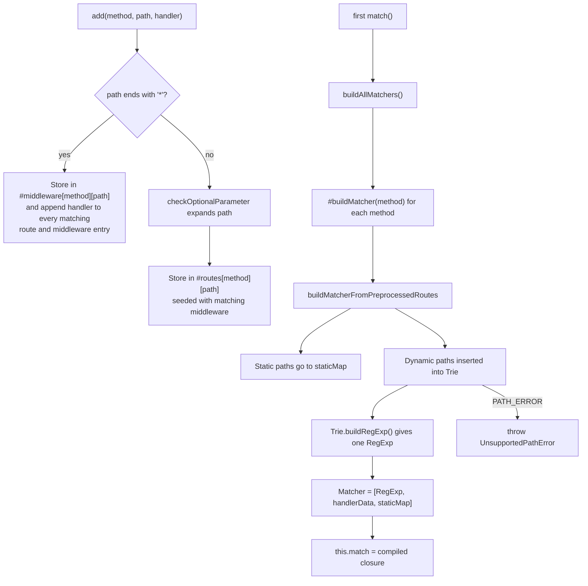

## Overview

`RegExpRouter` is the first router the default `Hono` app tries. Instead of walking a tree per request, it compiles every route registered for a method into a single regular expression plus a static lookup table, and a request costs one object lookup or one `RegExp` execution. The price is that some route sets cannot be expressed unambiguously in one regex; for those it throws `UnsupportedPathError`, and `SmartRouter` falls back to [[TrieRouter]] (see [[Routers and SmartRouter]]).

Sources: [src/router/reg-exp-router/router.ts:122-130](repo://src/router/reg-exp-router/router.ts#L122-L130), [src/hono.ts:26-33](repo://src/hono.ts#L26-L33)

The module exports `RegExpRouter` and the build-time variant `PreparedRegExpRouter` with its helpers `buildInitParams` and `serializeInitParams`.

Sources: [src/router/reg-exp-router/index.ts:1-7](repo://src/router/reg-exp-router/index.ts#L1-L7)

## Lifecycle

The router has two phases. While routes are being added it keeps plain maps keyed by method and path. On the first `match`, `buildAllMatchers` compiles one `Matcher` per method, drops the maps, and replaces `match` with a closure over the compiled matchers.

Sources: [src/router/reg-exp-router/router.ts:122-130](repo://src/router/reg-exp-router/router.ts#L122-L130), [src/router/reg-exp-router/router.ts:206-222](repo://src/router/reg-exp-router/router.ts#L206-L222), [src/router/reg-exp-router/matcher.ts:10-33](repo://src/router/reg-exp-router/matcher.ts#L10-L33)



Sources: [src/router/reg-exp-router/router.ts:132-251](repo://src/router/reg-exp-router/router.ts#L132-L251), [src/router/reg-exp-router/matcher.ts:10-33](repo://src/router/reg-exp-router/matcher.ts#L10-L33)

## Registering routes

### Method tables

The router starts with `#middleware` and `#routes`, each holding an `ALL` table. The first time a new method is seen, both maps get a table for it, pre-filled with copies of every `ALL` entry, so method-specific tables always include handlers registered for all methods. `'/*'` is normalised to `'*'`, and `paramCount` is the number of `/:` occurrences in the path.

Sources: [src/router/reg-exp-router/router.ts:122-153](repo://src/router/reg-exp-router/router.ts#L122-L153)

### Wildcard paths become middleware

A path ending in `*` is treated as middleware. `buildWildcardRegExp` converts it into a test regex: `*` alone becomes an empty regex that matches anything, and a trailing `/*` becomes `(?:|/.*)` so `/api/*` matches `/api` too. The router creates a middleware entry for the path, seeded by `findMiddleware` with the handlers of the longest already-registered wildcard that covers it, then appends the new handler to every middleware entry and every route entry whose path the regex matches.

Sources: [src/router/reg-exp-router/router.ts:19-32](repo://src/router/reg-exp-router/router.ts#L19-L32), [src/router/reg-exp-router/router.ts:105-120](repo://src/router/reg-exp-router/router.ts#L105-L120), [src/router/reg-exp-router/router.ts:155-187](repo://src/router/reg-exp-router/router.ts#L155-L187)

### Ordinary routes

Other paths go through `checkOptionalParameter`, so an optional parameter yields one entry per variant. A new route entry is seeded with copies of the middleware that already covers its path, then the handler is appended. Because middleware registered before the route was copied in, and middleware registered after the route is appended to it, each entry's handler list is already in registration order: no sorting is needed at match time. The stored `paramCount` is reduced for shorter optional variants so it counts only the parameters present in that variant.

Sources: [src/router/reg-exp-router/router.ts:189-204](repo://src/router/reg-exp-router/router.ts#L189-L204)

## Compiling matchers

### Per-method route list

`#buildMatcher(method)` collects the method's own middleware and routes; when a method has no entries in one of the two maps, it borrows the `ALL` entries instead. A method with no own entries returns `null`, and `match` then uses the `ALL` matcher. After all methods are built, `buildAllMatchers` sets both maps to `undefined` (so later `add` calls throw `MESSAGE_MATCHER_IS_ALREADY_BUILT`) and clears the wildcard regex cache.

Sources: [src/router/reg-exp-router/router.ts:208-251](repo://src/router/reg-exp-router/router.ts#L208-L251)

### Static map and handler data

`buildMatcherFromPreprocessedRoutes` flags each path as static when it has no `*` and no `/:`, then sorts dynamic paths before static ones and shorter dynamic paths first. Static paths go straight into `staticMap` as ready-made results with empty param maps; they are still inserted into the trie with `pathErrorCheckOnly` so conflicts with dynamic routes are detected. Each dynamic path gets a sequential index `j`, and its handlers get a `ParamIndexMap` built from the trie's param associations.

Sources: [src/router/reg-exp-router/router.ts:34-80](repo://src/router/reg-exp-router/router.ts#L34-L80)

After the trie is turned into a regex, two replacement maps translate the trie's numbering into capture-group positions: `paramReplacementMap` rewrites each param's variable index into its capture index, and `indexReplacementMap` places each route's handler list at the capture index of its end marker. An empty route list returns `nullMatcher`, whose regex `/^$/` never matches a real path.

Sources: [src/router/reg-exp-router/router.ts:82-103](repo://src/router/reg-exp-router/router.ts#L82-L103), [src/router/reg-exp-router/router.ts:15-17](repo://src/router/reg-exp-router/router.ts#L15-L17)

### Trie tokenisation

`Trie.insert` first hides `{...}` regex bodies behind `@\N` marks, then tokenises the path into parameter tokens (`:name` or `:name{re}`), a trailing `/*`, or single characters, and puts the regex bodies back. The trie therefore branches per character for static text, which lets routes share prefixes inside one alternation.

Sources: [src/router/reg-exp-router/trie.ts:10-47](repo://src/router/reg-exp-router/trie.ts#L10-L47)

### Node insertion

`Node.insert` consumes one token per level. `*` becomes `.*` when last or `[^/]+` otherwise, `/*` becomes `(?:|/.*)`, and `:name` becomes `[^/]+` or the given pattern. A capture group like `(a|b)` that spans the whole pattern is rewritten to `(?:a|b)`. Each new named node receives a `varIndex` from a shared counter, and the `(name, varIndex)` pair is pushed onto the route's param list. Reaching the end of the tokens records the route index; a second route ending at the same node throws `PATH_ERROR`.

Sources: [src/router/reg-exp-router/node.ts:1-9](repo://src/router/reg-exp-router/node.ts#L1-L9), [src/router/reg-exp-router/node.ts:50-133](repo://src/router/reg-exp-router/node.ts#L50-L133)

### Building the expression

`buildRegExpStr` sorts children with `compareKey` (single characters first, then longer custom patterns, then the plain label `[^/]+`, then wildcards) and joins them into `(?:a|b|...)`. Parameter nodes are emitted as `(pattern)@varIndex`, regex metacharacters in literals are escaped, and a node that ends a route prepends `#index`. `Trie.buildRegExp` then rewrites the markers in one pass: `#N` becomes `$()`, an empty capture group anchored at the end of the path, and `@N` is removed after recording which capture holds parameter `N`. The result is anchored with `^`.

Sources: [src/router/reg-exp-router/node.ts:13-43](repo://src/router/reg-exp-router/node.ts#L13-L43), [src/router/reg-exp-router/node.ts:135-161](repo://src/router/reg-exp-router/node.ts#L135-L161), [src/router/reg-exp-router/trie.ts:49-73](repo://src/router/reg-exp-router/trie.ts#L49-L73)

## Matching

### Matcher format

A `Matcher<T>` is the tuple `[RegExp, HandlerData<T>[], StaticMap<T>]`: the compiled expression, handler lists indexed by capture position, and a map from static path to a precomputed `Result`.

Sources: [src/router/reg-exp-router/matcher.ts:1-7](repo://src/router/reg-exp-router/matcher.ts#L1-L7)

### The match function

The shared `match` function calls `buildAllMatchers` once and installs a closure as `this.match`. The closure selects the matcher for the method, falling back to `ALL`. It returns `staticMap[path]` when present. Otherwise it runs the regex; on a miss it returns `[[], emptyParam]`. On a hit, `match.indexOf('', 1)` finds the first empty capture, which is the `$()` marker of the route that matched, and the result is `[handlerData[index], match]`: the match array itself is the `ParamStash`.

Sources: [src/router/reg-exp-router/matcher.ts:10-33](repo://src/router/reg-exp-router/matcher.ts#L10-L33)

```ts
const router = new RegExpRouter<string>()
router.add('GET', '/posts/:id', 'get post')

const [res, stash] = router.match('GET', '/posts/1')
// res   => [['get post', { id: 1 }]]
// stash[1] => '1'
```

Sources: [src/router/reg-exp-router/router.test.ts:28-38](repo://src/router/reg-exp-router/router.test.ts#L28-L38)

## Unsupported route sets

`PATH_ERROR` is thrown during insertion whenever one regex alternation could not tell routes apart, and `buildMatcherFromPreprocessedRoutes` converts it into `UnsupportedPathError(path)`. Because compilation happens on the first `match`, the error surfaces there, which is where `SmartRouter` catches it.

Sources: [src/router/reg-exp-router/router.ts:100-105](repo://src/router/reg-exp-router/router.ts#L100-L105), [src/router/reg-exp-router/node.ts:79-130](repo://src/router/reg-exp-router/node.ts#L79-L130)

| Case | Example routes | Why it fails |
| --- | --- | --- |
| Static next to a parameter | `/reg-exp/router` and `/reg-exp/:id` | A literal child cannot sit beside a pattern child at the same node. |
| Different labels at one position | `/:type/:id` and `/:class/:id` | Both tokenise to the same `[^/]+` nodes and end at the same node, which holds one route index. |
| Parameter versus static prefix | `/:id/:action` and `/posts/:id` | The pattern and the literal `p` would be siblings. |
| Different regexes at one position | `/:id/:action{create\|update}` and `/:id/:action{delete}` | Two pattern children at one node. |
| Capturing group inside a pattern | `/foo/:capture{ba(r\|z)}` | Extra capture groups would shift capture indexes. |
| `{.*}` parameter | `/files/:name{.*}` | Explicitly refused. |

Sources: [src/router/reg-exp-router/router.test.ts:40-140](repo://src/router/reg-exp-router/router.test.ts#L40-L140), [src/router/reg-exp-router/router.test.ts:6-26](repo://src/router/reg-exp-router/router.test.ts#L6-L26)

> [!NOTE]
> Repeated registrations of the same path are fine: they share one entry in `#routes`, so the trie sees the path once. The duplicate-node error concerns distinct paths that tokenise to the same node.

Sources: [src/router/reg-exp-router/router.ts:229-243](repo://src/router/reg-exp-router/router.ts#L229-L243)

## PreparedRegExpRouter

### Why it exists

Compiling matchers costs time at the first request, which matters on platforms that start a fresh isolate often. `PreparedRegExpRouter` takes matchers compiled ahead of time and only attaches handlers at startup. Its `buildAllMatchers` simply returns the matchers it was given, and it reuses the same `match` function.

Sources: [src/router/reg-exp-router/prepared-router.ts:9-17](repo://src/router/reg-exp-router/prepared-router.ts#L9-L17), [src/router/reg-exp-router/prepared-router.ts:88-93](repo://src/router/reg-exp-router/prepared-router.ts#L88-L93)

### buildInitParams

`buildInitParams({ paths })` subclasses `RegExpRouter` to expose `buildAllMatchers`, adds every path under `ALL` with the path string as its handler, and compiles. It then builds a `relocateMap`: for each path, the handler-data indexes in the regex table and the static-map keys where that path's handler appeared, plus the merged `ParamIndexMap`. Finally it empties every handler list, leaving placeholders (`0` for unused slots). The return value is the constructor arguments `[matchers, relocateMap]`.

Sources: [src/router/reg-exp-router/prepared-router.ts:95-154](repo://src/router/reg-exp-router/prepared-router.ts#L95-L154)

### serializeInitParams

`serializeInitParams` turns those arguments into JavaScript source: `JSON.stringify` with a replacer that wraps each `RegExp` as `##/.../##`, then strips the quotes so the regex is emitted as a literal. The string can be written into a generated module and evaluated at runtime.

Sources: [src/router/reg-exp-router/prepared-router.ts:156-165](repo://src/router/reg-exp-router/prepared-router.ts#L156-L165)

### Adding handlers

`add` creates a matcher for an unseen method by copying the `ALL` matcher's regex, handler slots and static map. `*` and `/*` are appended to every handler list and static result of the method (or every method for `ALL`). Any other path must appear in `relocateMap`, otherwise `add` throws `Path ... is not registered`; its handler is pushed into each recorded slot with the recorded param map, or into the static map entry for static paths.

Sources: [src/router/reg-exp-router/prepared-router.ts:19-86](repo://src/router/reg-exp-router/prepared-router.ts#L19-L86)

```ts
import {
  buildInitParams,
  serializeInitParams,
  PreparedRegExpRouter,
} from 'hono/router/reg-exp-router'

// Build step: compile the paths and emit source code
const serialized = serializeInitParams(buildInitParams({ paths: ['/hello', '/posts/:id'] }))

// Runtime: rebuild the router from the emitted params, then add handlers
const params = eval(serialized)
const router = new PreparedRegExpRouter(...params)
router.add('GET', '/hello', 'get hello')
router.add('GET', '/posts/:id', 'get post')
```

Sources: [src/router/reg-exp-router/prepared-router.test.ts:24-50](repo://src/router/reg-exp-router/prepared-router.test.ts#L24-L50), [src/router/reg-exp-router/index.ts:6-7](repo://src/router/reg-exp-router/index.ts#L6-L7)

> [!WARNING]
> `PreparedRegExpRouter` inherits every limitation of `RegExpRouter`: the shared test suite skips the same unsupported cases for it. Every non-wildcard path passed to `add` must have been listed in `buildInitParams`.

Sources: [src/router/reg-exp-router/prepared-router.test.ts:5-23](repo://src/router/reg-exp-router/prepared-router.test.ts#L5-L23)
