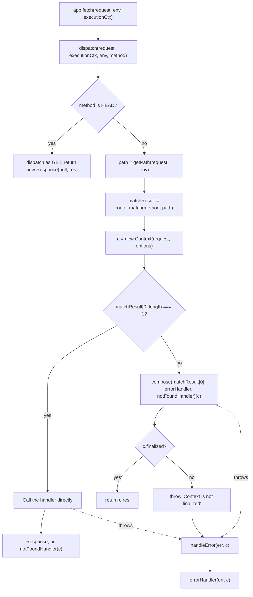
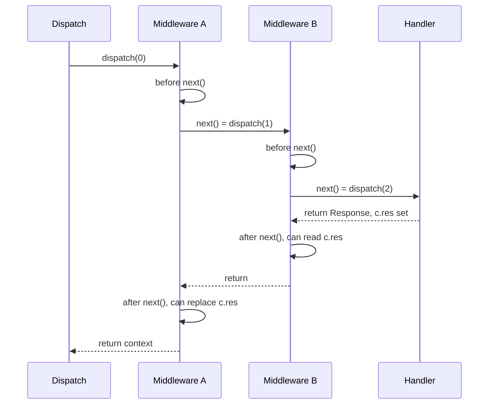

## Overview

Every request enters a Hono app through `fetch` and leaves as one `Response`. In between, `HonoBase.#dispatch` finds the path, asks the router for every matching middleware and handler, wraps the request in a `Context`, and runs the matches either directly (one match) or through `compose` (several). `compose` implements the koa-style "onion": each middleware runs up to `await next()`, the rest of the chain runs, then control returns to the middleware. This page traces that path through `src/hono-base.ts`, `src/compose.ts` and `src/context.ts`.

Sources: [src/hono-base.ts:406-485](repo://src/hono-base.ts#L406-L485), [src/compose.ts:1-24](repo://src/compose.ts#L1-L24)



Sources: [src/hono-base.ts:406-466](repo://src/hono-base.ts#L406-L466)

## Entering the app

### fetch and HEAD requests

`fetch(request, env, executionCtx)` forwards to `#dispatch(request, executionCtx, env, request.method)`. `app.request` builds a `Request` and calls `fetch`; the deprecated `app.fire` calls `#dispatch` from a `fetch` event listener with the event as execution context.

Sources: [src/hono-base.ts:479-485](repo://src/hono-base.ts#L479-L485), [src/hono-base.ts:499-542](repo://src/hono-base.ts#L499-L542)

A `HEAD` request is dispatched again as `GET`, and the resulting response is copied into `new Response(null, res)`: status and headers are kept, the body is dropped. So `app.get` routes answer `HEAD` without a separate registration.

Sources: [src/hono-base.ts:412-416](repo://src/hono-base.ts#L412-L416)

### Path extraction and matching

`this.getPath(request, { env })` returns the routing path. The default scans `request.url` from the first `/` after the scheme and host up to `?` or `#`, decoding only when it meets a `%`. With `strict: false` a trailing slash is removed. The router then returns `matchResult`, whose first element is the list of every matching `[[handler, RouterRoute], params]` entry in registration order, middleware included.

Sources: [src/hono-base.ts:418-419](repo://src/hono-base.ts#L418-L419), [src/utils/url.ts:106-146](repo://src/utils/url.ts#L106-L146), [src/router.ts:54-98](repo://src/router.ts#L54-L98)

### Building the Context

`new Context(request, { path, matchResult, env, executionCtx, notFoundHandler })` stores these values; the `HonoRequest` wrapper (`c.req`) is created lazily on first access from the raw request, path and `matchResult`. Because the whole `matchResult` is kept, `c.req.param()` looks up parameters through `matchResult[0][c.req.routeIndex]`, so each handler reads the parameters of its own route pattern.

Sources: [src/hono-base.ts:421-427](repo://src/hono-base.ts#L421-L427), [src/context.ts:352-367](repo://src/context.ts#L352-L367), [src/request.ts:94-110](repo://src/request.ts#L94-L110)

## The single-handler fast path

When exactly one handler matched, `#dispatch` skips `compose` to avoid creating the dispatch closure and the extra promise. It calls the handler with a `next` that sets `c.res` to the not-found response.

Sources: [src/hono-base.ts:429-448](repo://src/hono-base.ts#L429-L448)

1. A synchronous throw is caught and passed to `#handleError`.
2. If the handler returned a promise, its resolved value is used; if that is empty, `c.res` is used when `c.finalized` is true (the handler called `next()` or assigned `c.res`), otherwise the not-found handler runs. A rejected promise goes to `#handleError`.
3. If the handler returned a value synchronously it is returned; `undefined` or `null` falls back to the not-found handler.

Sources: [src/hono-base.ts:430-447](repo://src/hono-base.ts#L430-L447)

```ts
// Matches only one handler, so it runs without compose
app.get('/hello', (c) => c.text('hi'))

// Returns nothing: the not-found handler answers
app.get('/empty', () => {})
```

Sources: [src/hono-base.ts:440-447](repo://src/hono-base.ts#L440-L447)

> [!NOTE]
> On this path the error goes straight to the app's error handler without passing through `compose`, so `c.error` is not set.

Sources: [src/hono-base.ts:430-438](repo://src/hono-base.ts#L430-L438), [src/compose.ts:50-60](repo://src/compose.ts#L50-L60)

## Composition with compose

### Building the chain

With two or more matches, `#dispatch` calls `compose(matchResult[0], this.errorHandler, this.#notFoundHandler)` and awaits the composed function with `c`. `compose` returns a function that starts `dispatch(0)`, keeping an `index` of the last position reached.

Sources: [src/hono-base.ts:450-454](repo://src/hono-base.ts#L450-L454), [src/compose.ts:15-24](repo://src/compose.ts#L15-L24)

### One dispatch step

Each call to `dispatch(i)` runs one position of the chain:

Sources: [src/compose.ts:32-35](repo://src/compose.ts#L32-L35)

1. If `i <= index`, the same `next` was called twice: it throws `next() called multiple times`. Otherwise `index = i`.
2. If `middleware[i]` exists, the handler is `middleware[i][0][0]` and `context.req.routeIndex` is set to `i`. Past the end, the handler is the outer `next` passed to the composed function (used when composing inside another chain), or none.
3. The handler is awaited as `handler(context, () => dispatch(i + 1))`; calling `next()` therefore runs the rest of the chain before returning.
4. If it throws an `Error` and `onError` was given, `context.error` is set, `onError(err, context)` produces the response and `isError` is set. Any other throw propagates.
5. With no handler, and `context.finalized` still false, `onNotFound(context)` produces the response.
6. A returned response is written to `context.res` only if the context is not finalized yet, or if it came from `onError`.

Sources: [src/compose.ts:32-71](repo://src/compose.ts#L32-L71)

```ts
async function dispatch(i: number): Promise<Context> {
  if (i <= index) {
    throw new Error('next() called multiple times')
  }
  index = i

  let res
  let isError = false
  let handler

  if (middleware[i]) {
    handler = middleware[i][0][0]
    context.req.routeIndex = i
  } else {
    handler = (i === middleware.length && next) || undefined
  }
```

Sources: [src/compose.ts:32-47](repo://src/compose.ts#L32-L47)

### The onion order

Because each middleware awaits the next one, code before `await next()` runs in registration order and code after it runs in reverse. The final handler's return value becomes `c.res` at its own step, so every outer middleware sees the finished response after `await next()` and can read or replace it.

Sources: [src/compose.ts:50-71](repo://src/compose.ts#L50-L71)



Sources: [src/compose.ts:32-71](repo://src/compose.ts#L32-L71), [src/hono-base.ts:450-461](repo://src/hono-base.ts#L450-L461)

```ts
app.use(async (c, next) => {
  console.log('A before')
  await next()
  console.log('A after')
})
app.use(async (c, next) => {
  console.log('B before')
  await next()
  console.log('B after')
})
app.get('/', (c) => {
  console.log('handler')
  return c.text('ok')
})
// A before, B before, handler, B after, A after
```

Sources: [src/compose.ts:50-71](repo://src/compose.ts#L50-L71)

## Finalizing the response

### How c.res and finalized work

`Context.finalized` starts false. The `c.res` setter marks it true. When a response already exists, the setter copies the old response's headers onto the new one, except `content-type`, and appends every `set-cookie`, so headers that middleware set with `c.header()` before the handler ran survive. Before any response exists, `c.header()` collects headers in a prepared `Headers` object that the response helpers start from.

Sources: [src/context.ts:403-434](repo://src/context.ts#L403-L434), [src/context.ts:515-527](repo://src/context.ts#L515-L527), [src/context.ts:604-614](repo://src/context.ts#L604-L614)

A middleware that wants to replace the response after `await next()` assigns `c.res = new Response(...)`: the assignment always goes through the setter, unlike a returned value, which `compose` ignores once the context is finalized.

Sources: [src/compose.ts:67-69](repo://src/compose.ts#L67-L69), [src/context.ts:414-434](repo://src/context.ts#L414-L434)

```ts
app.use('/api/*', async (c, next) => {
  await next()
  c.res = new Response(c.res.body, c.res)
  c.res.headers.set('X-Powered-By', 'Hono')
})
```

Sources: [src/context.ts:414-434](repo://src/context.ts#L414-L434)

### Short-circuiting

A middleware that returns a `Response` without calling `next()` ends the chain: the later handlers never run, and the returned value becomes `c.res` because the context is not finalized yet.

Sources: [src/compose.ts:50-71](repo://src/compose.ts#L50-L71)

```ts
app.use('/admin/*', async (c, next) => {
  if (c.req.header('Authorization') !== 'Bearer secret') {
    return c.text('Unauthorized', 401)
  }
  await next()
})
```

Sources: [src/compose.ts:50-71](repo://src/compose.ts#L50-L71)

### The not-finalized check

After the composed function resolves, `#dispatch` returns `context.res` only when `context.finalized` is true. Otherwise it throws the error "Context is not finalized. Did you forget to return a Response object or await next()?", which the error handler turns into a 500. This catches a handler that forgets `return`, and a middleware that calls `next()` without awaiting it, which can leave the response unset when the chain returns.

Sources: [src/hono-base.ts:452-465](repo://src/hono-base.ts#L452-L465)

## Not found and errors in the chain

When the chain runs past its last entry with no response (all matches were middleware that called `next()`), `compose` calls the not-found handler. When nothing matched at all, `matchResult[0]` is empty, so `compose` is still used and `dispatch(0)` immediately reaches the not-found branch.

Sources: [src/compose.ts:61-65](repo://src/compose.ts#L61-L65), [src/hono-base.ts:429-450](repo://src/hono-base.ts#L429-L450)

Errors thrown inside `compose` are handled at the step where they occur, so the middleware above it still resumes after `await next()` and can inspect `c.error`. Values thrown that are not `Error` instances are rethrown by `compose`; they and any other error escaping the composed function are caught by `#dispatch` and sent to `#handleError`, which calls the error handler for `Error` instances and rethrows anything else. [[Error Handling and HTTPException]] covers the handlers themselves; [[Context]] covers the rest of `c`.

Sources: [src/compose.ts:49-60](repo://src/compose.ts#L49-L60), [src/hono-base.ts:399-404](repo://src/hono-base.ts#L399-L404), [src/hono-base.ts:462-464](repo://src/hono-base.ts#L462-L464)
