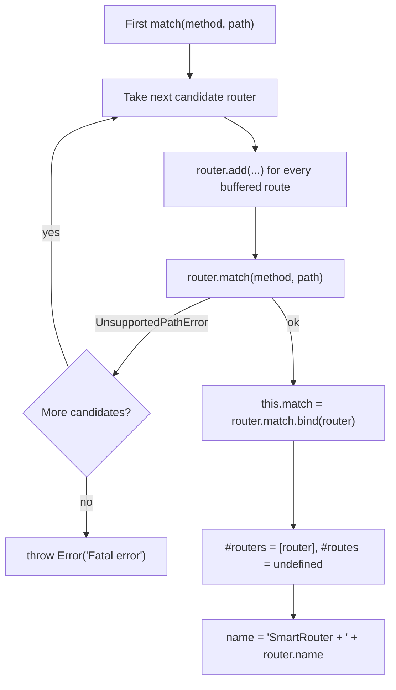

## Overview

Hono does not hard-wire one routing algorithm. Every app holds a `router` that implements a two-method `Router<T>` interface, and the app only ever calls `add` when a route is registered and `match` when a request arrives. Five implementations ship in `src/router`: `RegExpRouter`, `TrieRouter`, `LinearRouter`, `PatternRouter`, and the composite `SmartRouter`, which picks one of the others at the first request.

Sources: [src/router.ts:24-52](repo://src/router.ts#L24-L52), [src/hono-base.ts:115-118](repo://src/hono-base.ts#L115-L118)

The default `Hono` class wraps `RegExpRouter` and `TrieRouter` in a `SmartRouter`, so applications get the fastest matcher when their routes allow it and a fully general one otherwise. The presets in [[Presets: hono/tiny and hono/quick]] swap in other routers, and any app can pass its own through the `router` option.

Sources: [src/hono.ts:26-33](repo://src/hono.ts#L26-L33), [src/hono-base.ts:55-65](repo://src/hono-base.ts#L55-L65)

## The Router interface

### add and match

A router has a `name`, an `add(method, path, handler)` that records a route, and a `match(method, path)` that returns a `Result<T>`. `HonoBase.#addRoute` uppercases the method, joins the path to the app's base path with `mergePath`, and stores the tuple `[handler, RouterRoute]` as the router's handler value. Middleware registered with `app.use` arrives here too, as method `ALL`.

Sources: [src/router.ts:29-52](repo://src/router.ts#L29-L52), [src/hono-base.ts:385-397](repo://src/hono-base.ts#L385-L397)

At request time `#dispatch` computes the path with `getPath`, calls `this.router.match(method, path)` once, and hands the result to the `Context`. A result with exactly one handler is invoked directly; otherwise the handlers are composed in the order the router returned them, so a router must return middleware and handlers in registration order. See [[Request Lifecycle and Middleware Composition]] for the composition step.

Sources: [src/hono-base.ts:406-450](repo://src/hono-base.ts#L406-L450)

### Shared constants

| Name | Value | Purpose |
| --- | --- | --- |
| `METHOD_NAME_ALL` | `'ALL'` | Method used for `app.all` and `app.use` routes; every router treats it as matching any method. |
| `METHOD_NAME_ALL_LOWERCASE` | `'all'` | Lowercase form used when building the app's method helpers. |
| `METHODS` | `['get', 'post', 'put', 'delete', 'options', 'patch']` | The methods that get a dedicated `app.<method>` helper. |
| `MESSAGE_MATCHER_IS_ALREADY_BUILT` | `'Can not add a route since the matcher is already built.'` | Thrown by routers that compile once and cannot accept routes after the first `match`. |
| `UnsupportedPathError` | class | Thrown by a router that cannot represent a route set; `SmartRouter` catches it to fall back. |

Sources: [src/router.ts:6-22](repo://src/router.ts#L6-L22), [src/router.ts:100-103](repo://src/router.ts#L100-L103)

## The Result shape

### Two formats

`Result<T>` is a union of two tuple shapes. The indexed form, `[[T, ParamIndexMap][], ParamStash]`, lists each matched handler with a map from parameter name to an index into a shared string array. `RegExpRouter` and `PreparedRegExpRouter` return it: the stash is the regex match array itself, so no per-handler params object is built. The direct form, `[[T, Params][]]`, gives each handler its own `Record<string, string>` of values; `TrieRouter`, `LinearRouter` and `PatternRouter` return it.

Sources: [src/router.ts:54-98](repo://src/router.ts#L54-L98)

```ts
// [[handler, paramIndexMap][], paramArray]
[
  [
    [middlewareA, {}],                     // '*'
    [funcA,       {'id': 0}],              // '/user/:id/*'
    [funcB,       {'id': 0, 'action': 1}], // '/user/:id/:action'
  ],
  ['123', 'abc']
]
```

Sources: [src/router.ts:73-86](repo://src/router.ts#L73-L86)

### How HonoRequest reads it

`HonoRequest` stores the result and a `routeIndex` that the composer advances. `#getParamValue` checks whether the second element exists: if so, the map value is an index into the stash; if not, the map value is the parameter itself. This one branch is all [[HonoRequest]] needs to support both formats.

Sources: [src/request.ts:106-128](repo://src/request.ts#L106-L128)

## Supported path patterns

### Pattern syntax

Route paths share one syntax across routers. The shared test suite `runTest` exercises every router against the same cases, and each router's test file lists the cases it skips.

Sources: [src/router/common.case.test.ts:109-212](repo://src/router/common.case.test.ts#L109-L212)

| Pattern | Example | Meaning |
| --- | --- | --- |
| Static | `/api/posts` | Literal match. |
| Named parameter | `/entry/:id` | One path segment captured as `id`. |
| Regex parameter | `/post/:date{[0-9]+}` | Segment captured only when it matches the pattern inside braces. |
| Optional parameter | `/api/animals/:type?` | Expanded into `/api/animals` and `/api/animals/:type`. |
| Trailing wildcard | `/api/*` | Matches `/api` and anything under it. |
| Inner wildcard | `/wild/*/card` | Matches any single segment in that position. |
| Catch-all | `*` or `/*` | Matches every path; used by middleware. |
| Host-prefixed path | `www1.example.com/hello` | Plain string routing when `getPath` includes the host. |

Sources: [src/router/common.case.test.ts:109-192](repo://src/router/common.case.test.ts#L109-L192), [src/router/common.case.test.ts:373-413](repo://src/router/common.case.test.ts#L373-L413), [src/router/common.case.test.ts:703-722](repo://src/router/common.case.test.ts#L703-L722)

### Path helpers

Routers share the parsing helpers in `src/utils/url.ts`. `checkOptionalParameter` returns `null` unless the path ends in `?` and has a `:`; otherwise it walks the segments and emits one path per optional prefix, so `/api/animals/:type?` becomes `['/api/animals', '/api/animals/:type']`. `RegExpRouter`, `TrieRouter` and `LinearRouter` call it in `add`; `PatternRouter` handles the trailing `?` itself.

Sources: [src/utils/url.ts:171-206](repo://src/utils/url.ts#L171-L206)

`splitRoutingPath` hides `{...}` regex groups behind `@index` marks before splitting on `/`, then restores them, so a regex like `{[a-z0-9/]+.js}` that contains a slash stays inside one segment. `getPattern` turns a segment into a `Pattern`: `'*'` for a wildcard, `[label, name, true]` for a plain `:name`, or `[key, name, RegExp]` for `:name{re}`. When a regex parameter is followed by a static segment, the regex gets a `(?=/next)` lookahead and the cache key includes the next segment.

Sources: [src/utils/url.ts:6-78](repo://src/utils/url.ts#L6-L78)

## SmartRouter

### Deferred selection

`SmartRouter` takes an ordered list of candidate routers. `add` only buffers `[method, path, handler]` tuples in `#routes`; nothing is compiled until the first `match`.

Sources: [src/router/smart-router/router.ts:4-20](repo://src/router/smart-router/router.ts#L4-L20)

On the first `match` it tries each candidate in order: it replays every buffered route into that router with `add` and then calls its `match`. If either call throws `UnsupportedPathError`, the next candidate is tried; any other error propagates. The first router that accepts every route wins.

Sources: [src/router/smart-router/router.ts:21-61](repo://src/router/smart-router/router.ts#L21-L61)



Sources: [src/router/smart-router/router.ts:21-61](repo://src/router/smart-router/router.ts#L21-L61)

### After selection

The winner's bound `match` replaces `SmartRouter.match` on the instance, so later requests call the chosen router directly with no wrapper cost. `#routes` is set to `undefined`, which makes any later `add` throw `MESSAGE_MATCHER_IS_ALREADY_BUILT`: routes cannot be added after the first request. The `activeRouter` getter returns the chosen router and throws before one is chosen.

Sources: [src/router/smart-router/router.ts:13-20](repo://src/router/smart-router/router.ts#L13-L20), [src/router/smart-router/router.ts:49-69](repo://src/router/smart-router/router.ts#L49-L69)

`getRouterName` in the dev helper forces that choice by matching `GET /` and then reads `app.router.name`, which yields strings such as `SmartRouter + RegExpRouter`.

Sources: [src/helper/dev/index.ts:76-79](repo://src/helper/dev/index.ts#L76-L79)

## Router choice per entry point

| Entry point | Router | Candidates tried |
| --- | --- | --- |
| `hono` (`Hono`) | `SmartRouter` | [[RegExpRouter]], then [[TrieRouter]] |
| `hono/quick` | `SmartRouter` | `LinearRouter`, then `TrieRouter` |
| `hono/tiny` | `PatternRouter` | none, used directly |
| `new Hono({ router })` | the given router | none |

Sources: [src/hono.ts:26-33](repo://src/hono.ts#L26-L33), [src/preset/quick.ts:13-23](repo://src/preset/quick.ts#L13-L23), [src/preset/tiny.ts:11-20](repo://src/preset/tiny.ts#L11-L20)

`RegExpRouter` compiles all routes into one regex per method and is fastest at match time, but it refuses ambiguous route sets, for example a static segment next to a parameter at the same position. `TrieRouter` accepts every pattern, so it is the safe fallback. `LinearRouter` and `PatternRouter` skip compilation entirely, which suits environments where the app is rebuilt per request; see [[LinearRouter and PatternRouter]].

Sources: [src/router/reg-exp-router/router.test.ts:40-140](repo://src/router/reg-exp-router/router.test.ts#L40-L140), [src/router/smart-router/router.test.ts:1-13](repo://src/router/smart-router/router.test.ts#L1-L13)

## Choosing a router explicitly

Each router is importable from its own subpath (`hono/router/reg-exp-router`, `hono/router/trie-router`, `hono/router/smart-router`, `hono/router/linear-router`, `hono/router/pattern-router`) and passed through the `router` option.

Sources: [package.json:284-313](repo://package.json#L284-L313), [src/hono-base.ts:55-65](repo://src/hono-base.ts#L55-L65)

```ts
import { Hono } from 'hono'
import { RegExpRouter } from 'hono/router/reg-exp-router'
import { SmartRouter } from 'hono/router/smart-router'
import { TrieRouter } from 'hono/router/trie-router'

// Only RegExpRouter: an unsupported route set throws instead of falling back
const fast = new Hono({ router: new RegExpRouter() })

// The default, spelled out
const app = new Hono({
  router: new SmartRouter({ routers: [new RegExpRouter(), new TrieRouter()] }),
})
```

Sources: [src/hono.ts:26-33](repo://src/hono.ts#L26-L33), [src/router/smart-router/router.ts:8-11](repo://src/router/smart-router/router.ts#L8-L11)
