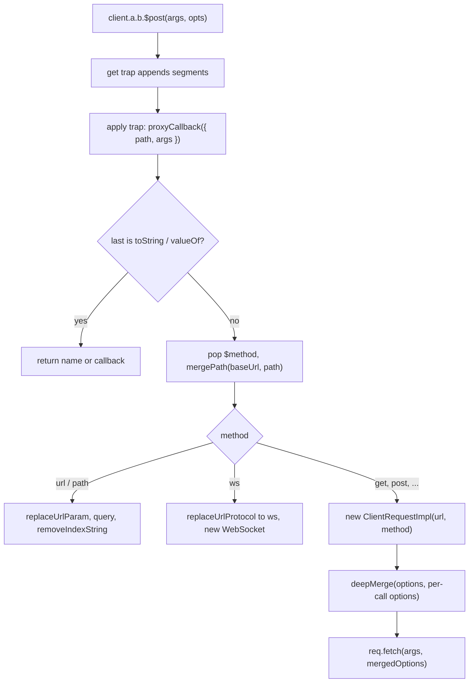

## Overview

`hono/client` exports `hc`, a typed HTTP client generated from a Hono app's type. You pass `typeof app` as a type argument and a base URL at runtime; `hc` returns a chain of nested objects mirroring the app's routes, ending in `$get`, `$post`, `$url`, `$path` or `$ws`. No code is shared with the server at runtime: the client is one recursive `Proxy` that records property names as path segments, and all route knowledge lives in TypeScript types derived from the app's schema.

Sources: [src/client/index.ts:1-17](repo://src/client/index.ts#L1-L17), [src/client/client.ts:132-232](repo://src/client/client.ts#L132-L232)

The input side of each endpoint comes from validators (see [[Validator]]); the output side comes from `c.json`, `c.text` and friends returning `TypedResponse`. Both are collected into the app's schema type described in [[Type System and Schema Inference]].

Sources: [src/client/types.ts:294-318](repo://src/client/types.ts#L294-L318)

## Usage

```ts
// server.ts
import { Hono } from 'hono'
import { validator } from 'hono/validator'

const app = new Hono()
const route = app.post(
  '/posts/:id',
  validator('json', (v) => v as { title: string }),
  (c) => c.json({ id: c.req.param('id'), ok: true }, 201)
)
export type AppType = typeof route

// client.ts
import { hc } from 'hono/client'
import type { AppType } from './server'

const client = hc<AppType>('http://localhost:8787/')
const res = await client.posts[':id'].$post({
  param: { id: '123' },
  json: { title: 'Hello' },
})
if (res.ok) {
  const data = await res.json() // { id: string; ok: boolean }
}
```

Sources: [src/client/client.ts:133-136](repo://src/client/client.ts#L133-L136), [src/client/types.ts:67-80](repo://src/client/types.ts#L67-L80)

## Proxy-based URL building

### The recursive proxy

`createProxy(callback, path)` wraps an empty function in a `Proxy`. Its `get` trap returns a new proxy with the property name appended to `path`, so `client.posts[':id'].$post` builds the array `['posts', ':id', '$post']`. Its `apply` trap fires when the chain is finally called and passes `{ path, args }` to the callback. Non-string keys (symbols) and the key `then` return `undefined`; excluding `then` keeps a proxy from looking like a thenable, so `await client.foo` does not try to call it.

Sources: [src/client/client.ts:15-31](repo://src/client/client.ts#L15-L31)

### Resolving the call

`hc` creates the root proxy with `proxyCallback`, which runs on every call:

Sources: [src/client/client.ts:137-232](repo://src/client/client.ts#L137-L232), [src/client/utils.ts:11-16](repo://src/client/utils.ts#L11-L16)

1. It looks at the last three path segments, reversed. A trailing `toString` or `valueOf` is handled first: after `name` it returns the segment before it (so `client.posts.name.toString()` is `"posts"`), otherwise it returns the callback's own source or the callback itself.
2. If the last segment starts with `$`, it is popped and the `$` is stripped to obtain the method (`get`, `post`, `url`, `ws`, ...).
3. The remaining segments are joined with `/` and appended to the base URL with `mergePath`, which trims trailing slashes from the base and leading slashes from the path.
4. `url` and `path` build an address without a request; `ws` opens a WebSocket; any other method builds a `ClientRequestImpl` and calls its `fetch`.

Sources: [src/client/client.ts:137-232](repo://src/client/client.ts#L137-L232), [src/client/utils.ts:11-16](repo://src/client/utils.ts#L11-L16)



Sources: [src/client/client.ts:137-232](repo://src/client/client.ts#L137-L232)

### Path parameters and index routes

`replaceUrlParam` replaces each `/:name` segment, including an optional `?` suffix and a regex constraint in braces such as `/:id{[0-9]+}`, with `/value`. When the value is empty or `undefined`, the whole segment is removed, which is how optional parameters disappear. A route registered at `/` appears in the type chain as the key `index`; `removeIndexString` strips a trailing `/index` from the URL (leaving `/` when it is the whole path after the host).

Sources: [src/client/utils.ts:18-24](repo://src/client/utils.ts#L18-L24), [src/client/utils.ts:55-60](repo://src/client/utils.ts#L55-L60), [src/client/types.ts:303-309](repo://src/client/types.ts#L303-L309)

## Sending requests

### How arguments become a request

`ClientRequestImpl.fetch(args, opt)` maps each validation target to part of the request:

Sources: [src/client/client.ts:53-110](repo://src/client/client.ts#L53-L110)

| Argument | Effect |
| --- | --- |
| `query` | serialized with `buildSearchParams` (or the custom option) and appended after `?` |
| `form` | appended to a new `FormData`; arrays append one entry per item; `undefined` values are skipped |
| `json` | `JSON.stringify` as the body; sets `Content-Type: application/json` |
| `param` | substituted into the URL with `replaceUrlParam` |
| `header` | copied into the request headers |
| `cookie` | each pair serialized with `path=/` and joined into a `Cookie` header |

Sources: [src/client/client.ts:53-110](repo://src/client/client.ts#L53-L110)

Headers are assembled in this order: `args.header`, then `opt.headers` (awaited when it is a function), then `Cookie`, then `Content-Type`. The body is dropped for `GET` and `HEAD`. The request is sent with `opt.fetch` or the global `fetch`, passing the URL as a string (for compatibility with MSW and node-fetch) and spreading `opt.init` last, so `init` can override `method`, `headers` and `body`.

Sources: [src/client/client.ts:91-129](repo://src/client/client.ts#L91-L129)

The default `buildSearchParams` skips `undefined` values and appends array items as repeated keys (`key=a&key=b`).

Sources: [src/client/utils.ts:26-44](repo://src/client/utils.ts#L26-L44)

### Merging client and call options

Options given to `hc` apply to every call; the second argument of `$get`/`$post` applies to one call. `proxyCallback` combines them with `deepMerge`, where per-call values win. Headers are special-cased: when both levels define `headers`, they are replaced by an async function that resolves both (each may itself be a function) and spreads the call's headers over the client's.

Sources: [src/client/client.ts:214-229](repo://src/client/client.ts#L214-L229), [src/client/utils.ts:62-82](repo://src/client/utils.ts#L62-L82)

## ClientRequestOptions

| Option | Type | Description |
| --- | --- | --- |
| `fetch` | `typeof fetch \| app.request` | Custom fetch. Passing `app.request` calls the app in-process, useful in tests. |
| `webSocket` | `(...args) => WebSocket` | Factory used by `$ws` instead of `new WebSocket`. |
| `init` | `RequestInit` | Spread last into the fetch init; overrides what Hono sets. |
| `headers` | `Record<string, string> \| () => Record \| Promise<Record>` | Extra headers; a function is awaited per request. |
| `buildSearchParams` | `(query) => URLSearchParams` | Custom query serialization, e.g. bracket notation via `qs`. |

Sources: [src/client/types.ts:30-65](repo://src/client/types.ts#L30-L65)

`ClientRequestOptions<T>` takes an optional type argument: when `T` has keys, `headers` becomes required and typed as `T`, which lets you enforce that every call sends certain headers.

Sources: [src/client/types.ts:57-65](repo://src/client/types.ts#L57-L65)

## URL helpers and WebSockets

### $url and $path

`$url(arg)` and `$path(arg)` build an address without sending anything. Both apply `arg.param` and `arg.query`, then `removeIndexString`. `$url` returns a `URL`; `$path` returns only the part after the base URL, normalized to start with `/`. At the type level, `$url` returns a `TypedURL` whose `pathname`, `host` and `href` are template literals when the base URL is a string literal, and `$path` returns a `BuildPath` literal; a parameter given as a literal string is substituted into the type.

Sources: [src/client/client.ts:171-186](repo://src/client/client.ts#L171-L186), [src/client/types.ts:81-111](repo://src/client/types.ts#L81-L111), [src/client/types.ts:156-230](repo://src/client/types.ts#L156-L230)

```ts
const client = hc<AppType>('http://localhost:8787/')
const url = client.posts[':id'].$url({ param: { id: '123' } })
url.pathname // '/posts/123'
client.posts[':id'].$path({ param: { id: '123' }, query: { q: 'x' } }) // '/posts/123?q=x'
```

Sources: [src/client/client.ts:171-186](repo://src/client/client.ts#L171-L186)

### $ws

`$ws` exists in the type only when the route's `$get` endpoint has `outputFormat: 'ws'`, which the `upgradeWebSocket` helper produces (see [[WebSockets]]). At runtime it substitutes params, swaps `http`/`https` for `ws`/`wss` with `replaceUrlProtocol`, sets or appends query values on a `URL`, and calls `options.webSocket` if provided, otherwise `new WebSocket(url)`.

Sources: [src/client/client.ts:187-212](repo://src/client/client.ts#L187-L212), [src/client/types.ts:112-118](repo://src/client/types.ts#L112-L118), [src/client/utils.ts:46-53](repo://src/client/utils.ts#L46-L53)

## How app types become client types

### From schema to property chain

`Client<T, Prefix>` extracts the schema `S` from `HonoBase<any, S, any>` and maps each route key through `PathToChain`. `PathToChain` strips a leading `/`, splits on `/` recursively into nested objects, and at the last segment produces a `ClientRequest` for that route's endpoints (an empty segment becomes `index`). Because `K` is a union of route keys, the result is a union of chains; `hc` casts it with `UnionToIntersection` so all routes are accessible on one object.

Sources: [src/client/types.ts:294-318](repo://src/client/types.ts#L294-L318), [src/client/client.ts:232-232](repo://src/client/client.ts#L232-L232)

### Methods and arguments

`ClientRequest` maps each `$method` key of the route's endpoints to a function. If the endpoint's `input` has required keys, `args` is required; otherwise it is optional. A `$all` endpoint (from `app.all`) is expanded by `ExpandAllMethod` into every standard method. The return type is `Promise<ClientResponse<O, S, F>>`, one member per output/status/format combination.

Sources: [src/client/types.ts:8-26](repo://src/client/types.ts#L8-L26), [src/client/types.ts:67-80](repo://src/client/types.ts#L67-L80), [src/client/types.ts:120-126](repo://src/client/types.ts#L120-L126)

### ClientResponse

`ClientResponse<T, U, F>` mirrors `Response` with stronger types: `status` is the literal status code `U`; `ok` is `true` for success codes and `false` otherwise, so checking `res.ok` or `res.status` narrows the union; `json()` resolves to `T` when the format is `json` and to `never` for `text`; `text()` resolves to the literal string type for text responses.

Sources: [src/client/types.ts:128-154](repo://src/client/types.ts#L128-L154)

## Inferring request and response types

| Type | Purpose |
| --- | --- |
| `InferRequestType<typeof client.x.$post>` | The `args` object the method accepts (non-nullable). |
| `InferResponseType<typeof client.x.$post, U>` | The output body type, optionally filtered to status codes `U`. |
| `Fetch<T>` | A function type with the same args and response as an existing method. |
| `ApplyGlobalResponse<typeof app, Def>` | Adds status/format/output entries from `Def` (for example responses produced by `onError`) to every endpoint. |
| `PickResponseByStatusCode<typeof app, U>` | Keeps only endpoints with status `U`, for clients that handle errors centrally. |

Sources: [src/client/types.ts:232-279](repo://src/client/types.ts#L232-L279), [src/client/types.ts:332-393](repo://src/client/types.ts#L332-L393)

`InferEndpointType` reconstructs an `Endpoint` (`input`, `output`, `outputFormat`, `status`) from a method's function type, and `InferResponseType` returns the `output` of every endpoint whose `status` extends `U` (all status codes by default).

Sources: [src/client/types.ts:239-263](repo://src/client/types.ts#L239-L263)

```ts
import type { InferRequestType, InferResponseType } from 'hono/client'

const $post = client.posts[':id'].$post
type Req = InferRequestType<typeof $post> // { param: { id: string }; json: { title: string } }
type Res201 = InferResponseType<typeof $post, 201>
```

Sources: [src/client/types.ts:251-271](repo://src/client/types.ts#L251-L271)

## parseResponse and DetailedError

`parseResponse(promise)` awaits a client call and returns its parsed body, typed as the success (non 4xx/5xx) output. It delegates to `fetchRP`, adapted from the `fetch-result-please` package:

Sources: [src/client/utils.ts:84-114](repo://src/client/utils.ts#L84-L114), [src/client/fetch-result-please.ts:7-95](repo://src/client/fetch-result-please.ts#L7-L95)

1. A body is read only when the response has one (`body`, or `_bodyInit` from the whatwg-fetch polyfill) and the status is not 101, 204, 205 or 304.
2. `detectResponseType` picks `json()` when the media type before `;` matches `application/json` or a `+json` suffix, and `text()` otherwise, including when `Content-Type` is missing.
3. A response that is not `ok` throws `DetailedError` with message `"<status> <statusText>"`, `statusCode`, and `detail: { data, statusText }` holding the parsed body.

Sources: [src/client/utils.ts:84-114](repo://src/client/utils.ts#L84-L114), [src/client/fetch-result-please.ts:7-95](repo://src/client/fetch-result-please.ts#L7-L95)

```ts
import { parseResponse, DetailedError } from 'hono/client'

try {
  const data = await parseResponse(client.posts.$get())
} catch (e) {
  if (e instanceof DetailedError) console.error(e.statusCode, e.detail.data)
}
```

Sources: [src/client/index.ts:6-7](repo://src/client/index.ts#L6-L7), [src/client/fetch-result-please.ts:46-75](repo://src/client/fetch-result-please.ts#L46-L75)
