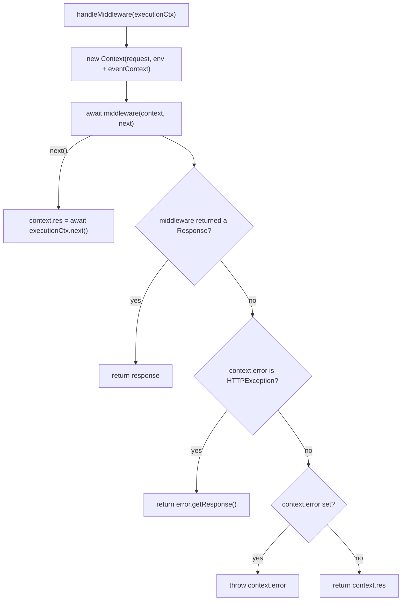

## Overview

Hono's core is written against Web Standard `Request` and `Response`, so a `Hono` app is already a function from request to response: `app.fetch(request, env, executionCtx)`. Runtimes that call a fetch-shaped handler (Cloudflare Workers, Bun, Deno) can use `app.fetch` directly. The adapters under `src/adapter/` fill the gaps that the standard leaves open: they reshape a platform's calling convention into `app.fetch`, and they supply runtime-specific implementations of features such as static file serving, WebSocket upgrade and client address lookup.

Sources: [src/hono-base.ts:479-485](repo://src/hono-base.ts#L479-L485)

Each adapter is published as its own subpath export (`hono/bun`, `hono/deno`, `hono/cloudflare-workers`, `hono/cloudflare-pages`, `hono/vercel`, `hono/netlify`, `hono/service-worker`), so an application only bundles the code for the platform it runs on. AWS Lambda and Lambda@Edge have their own event conversion layer, documented in [[AWS Lambda and Lambda@Edge]].

Sources: [package.json:344-388](repo://package.json#L344-L388)

## What each adapter exports

The table lists the public exports of each adapter's `index.ts`. A dash means the adapter does not provide that piece, usually because the runtime already calls `app.fetch` natively.

Sources: [package.json:344-388](repo://package.json#L344-L388)

| Adapter | Import | `handle` | `serveStatic` | `upgradeWebSocket` | `getConnInfo` | Other |
| --- | --- | --- | --- | --- | --- | --- |
| Bun | `hono/bun` | - | yes | yes | yes | `websocket`, `getBunServer`, `toSSG`, `bunFileSystemModule`, `createBunWebSocket` (deprecated) |
| Deno | `hono/deno` | - | yes | yes | yes | `toSSG`, `denoFileSystemModule` |
| Cloudflare Workers | `hono/cloudflare-workers` | - | yes (deprecated) | yes | yes | - |
| Cloudflare Pages | `hono/cloudflare-pages` | yes | yes | - | yes | `handleMiddleware`, type `EventContext` |
| Vercel | `hono/vercel` | yes | - | - | yes | - |
| Netlify | `hono/netlify` | yes | - | - | yes | - |
| Service Worker | `hono/service-worker` | yes | - | - | - | `fire` |

Sources: [src/adapter/bun/index.ts:1-11](repo://src/adapter/bun/index.ts#L1-L11), [src/adapter/deno/index.ts:1-9](repo://src/adapter/deno/index.ts#L1-L9), [src/adapter/cloudflare-workers/index.ts:1-8](repo://src/adapter/cloudflare-workers/index.ts#L1-L8), [src/adapter/cloudflare-pages/index.ts:1-8](repo://src/adapter/cloudflare-pages/index.ts#L1-L8), [src/adapter/vercel/index.ts:1-7](repo://src/adapter/vercel/index.ts#L1-L7), [src/adapter/netlify/mod.ts:1-2](repo://src/adapter/netlify/mod.ts#L1-L2), [src/adapter/service-worker/index.ts:28-36](repo://src/adapter/service-worker/index.ts#L28-L36)

## Shared building blocks

### Base middleware the adapters specialise

The adapters do not reimplement features; they plug runtime primitives into generic helpers. Every `serveStatic` wraps the base middleware from `src/middleware/serve-static`, which needs a `getContent(path, c)` callback and optionally `join` and `isDir`. Every `upgradeWebSocket` is built with `defineWebSocketHelper`, which turns a runtime handler `(c, events, options)` into either a middleware (when given an events factory) or a direct call. When the runtime handler returns nothing, the middleware falls through to `next()`. See [[Serving Static Files]] and [[WebSockets]] for the generic parts.

Sources: [src/middleware/serve-static/index.ts:33-52](repo://src/middleware/serve-static/index.ts#L33-L52), [src/helper/websocket/index.ts:111-136](repo://src/helper/websocket/index.ts#L111-L136)

### The ConnInfo contract

`getConnInfo` follows the `GetConnInfo` type from `hono/conninfo`: it receives the `Context` and returns a `ConnInfo` whose `remote` field may carry `address`, `addressType`, `port` and `transport`. Each adapter reads that information from wherever its platform exposes it, which is why the fields that are filled differ per runtime.

Sources: [src/helper/conninfo/types.ts:1-45](repo://src/helper/conninfo/types.ts#L1-L45)

| Adapter | Source of the remote address | Fields filled |
| --- | --- | --- |
| Bun | `server.requestIP(c.req.raw)` on the Bun server | `address`, `addressType`, `port` |
| Deno | `c.env.remoteAddr` (the handler info passed by `Deno.serve`) | `address`, `port`, `transport` |
| Cloudflare Workers | `cf-connecting-ip` header | `address` |
| Cloudflare Pages | `cf-connecting-ip` header | `address` |
| Vercel | `x-real-ip` header | `address` |
| Netlify | `c.env.context.ip` (the Netlify context object) | `address` |

Sources: [src/adapter/bun/conninfo.ts:10-43](repo://src/adapter/bun/conninfo.ts#L10-L43), [src/adapter/deno/conninfo.ts:8-17](repo://src/adapter/deno/conninfo.ts#L8-L17), [src/adapter/cloudflare-workers/conninfo.ts:1-7](repo://src/adapter/cloudflare-workers/conninfo.ts#L1-L7), [src/adapter/cloudflare-pages/conninfo.ts:22-26](repo://src/adapter/cloudflare-pages/conninfo.ts#L22-L26), [src/adapter/vercel/conninfo.ts:1-8](repo://src/adapter/vercel/conninfo.ts#L1-L8), [src/adapter/netlify/conninfo.ts:53-57](repo://src/adapter/netlify/conninfo.ts#L53-L57)

## Bun

### Serving the app and finding the server

Bun calls `fetch(request, server)`, so `app.fetch` receives the Bun `Server` object as its `env` argument. `getBunServer` recovers it: if `c.env` has a `server` property (an app that passes a custom env such as `{ server }`) it returns that, otherwise it treats `c.env` itself as the server. Both `getConnInfo` and `upgradeWebSocket` depend on this lookup and throw `TypeError('env has to include the 2nd argument of fetch.')` when no server is available, which happens when the app is invoked without Bun's second argument (for example through `app.request()` in a test).

Sources: [src/adapter/bun/server.ts:7-14](repo://src/adapter/bun/server.ts#L7-L14), [src/adapter/bun/conninfo.ts:10-24](repo://src/adapter/bun/conninfo.ts#L10-L24)

`getConnInfo` calls `server.requestIP`, which returns `null` for closed requests and Unix domain sockets; in that case the result is `{ remote: {} }`. Otherwise `family` is mapped to `addressType` only when it is `IPv4` or `IPv6`.

Sources: [src/adapter/bun/conninfo.ts:26-43](repo://src/adapter/bun/conninfo.ts#L26-L43)

### WebSockets on Bun

Bun splits a WebSocket into two halves: the request handler calls `server.upgrade(req, { data })`, and the socket's lifecycle events are delivered to a `websocket` handler object passed to `Bun.serve`. Hono's `upgradeWebSocket` stores the user's `events`, the request `URL` and the first requested subprotocol from `sec-websocket-protocol` in `data`, then returns an empty `Response` when the upgrade succeeded. The exported `websocket` object reads `ws.data.events` in its `open`, `close` and `message` callbacks, wraps the raw socket with `createWSContext`, and dispatches to `onOpen`, `onClose` and `onMessage`. Binary messages are normalised to their `buffer`.

Sources: [src/adapter/bun/websocket.ts:48-104](repo://src/adapter/bun/websocket.ts#L48-L104)

```ts
import { Hono } from 'hono'
import { upgradeWebSocket, websocket } from 'hono/bun'

const app = new Hono()

app.get(
  '/ws',
  upgradeWebSocket(() => ({
    onMessage(event, ws) {
      ws.send(`echo: ${event.data}`)
    },
  }))
)

export default { fetch: app.fetch, websocket }
```

Sources: [src/adapter/bun/websocket.ts:48-113](repo://src/adapter/bun/websocket.ts#L48-L113)

`createBunWebSocket()` is kept for compatibility and simply returns `{ upgradeWebSocket, websocket }`; it is marked deprecated in favour of importing both directly.

Sources: [src/adapter/bun/websocket.ts:106-113](repo://src/adapter/bun/websocket.ts#L106-L113)

### Static files and SSG on Bun

`serveStatic` passes `Bun.file(path)` as content when `file.exists()` resolves true, uses `node:path`'s `join`, and checks directories with `stat` from `node:fs/promises` so that a directory path can be resolved to its index document. `toSSG` binds the generic static site generator to `bunFileSystemModule`, whose `writeFile` uses `Bun.write` and whose `mkdir` is a no-op. Both SSG exports are marked experimental. See [[Static Site Generation]].

Sources: [src/adapter/bun/serve-static.ts:8-32](repo://src/adapter/bun/serve-static.ts#L8-L32), [src/adapter/bun/ssg.ts:1-27](repo://src/adapter/bun/ssg.ts#L1-L27)

## Deno

### Serving and connection info on Deno

Deno has no `handle` export: `Deno.serve(app.fetch)` passes the request and a handler info object, which Hono receives as `c.env`. `getConnInfo` reads `c.env.remoteAddr` and returns its `hostname`, `port` and `transport`.

Sources: [src/adapter/deno/conninfo.ts:1-17](repo://src/adapter/deno/conninfo.ts#L1-L17)

### WebSockets on Deno

`upgradeWebSocket` returns early (so the middleware calls `next()`) unless the `upgrade` header is `websocket`. It then calls `Deno.upgradeWebSocket(c.req.raw, ...)`, echoing the first subprotocol requested in `sec-websocket-protocol` as `protocol` because browsers reject a connection whose response omits the negotiated subprotocol. Options passed to `upgradeWebSocket` (typed `Deno.UpgradeWebSocketOptions`) are spread after it and can override it. The socket's `onopen`, `onmessage`, `onclose` and `onerror` are wired to the user's events with a `WSContext` whose `protocol` and `readyState` are live getters, and Deno's `response` is returned to complete the handshake.

Sources: [src/adapter/deno/websocket.ts:4-38](repo://src/adapter/deno/websocket.ts#L4-L38)

### Static files and SSG on Deno

`serveStatic` returns `null` for directories (checked with `Deno.lstatSync`), otherwise opens the file with `Deno.open` and returns its `readable` stream. Errors other than `Deno.errors.NotFound` are logged with `console.warn` and treated as a miss. `denoFileSystemModule` encodes string data with `TextEncoder` before `Deno.writeFile` and maps `mkdir` to `Deno.mkdir` with the `recursive` flag.

Sources: [src/adapter/deno/serve-static.ts:6-42](repo://src/adapter/deno/serve-static.ts#L6-L42), [src/adapter/deno/ssg.ts:9-27](repo://src/adapter/deno/ssg.ts#L9-L27)

## Cloudflare Workers

### Serving and WebSockets on Workers

A module Worker exports `default app` (or `{ fetch: app.fetch }`); Workers calls `fetch(request, env, ctx)`, which matches `app.fetch` exactly, so bindings arrive as `c.env` and the `ExecutionContext` as `c.executionCtx`. The adapter adds `upgradeWebSocket`, which requires an `Upgrade: websocket` header, creates a `WebSocketPair`, registers `close`, `message` and `error` listeners on the server half, calls `server.accept()` and answers `101` with the client half in the `webSocket` init field. Workers never fires an `open` event, so the helper's event type omits `onOpen`.

Sources: [src/adapter/cloudflare-workers/websocket.ts:5-53](repo://src/adapter/cloudflare-workers/websocket.ts#L5-L53)

### Workers Sites static files

`serveStatic` from `hono/cloudflare-workers` reads files from a Workers Sites KV namespace and is deprecated in favour of Cloudflare Static Assets. `getContentFromKVAsset` resolves the request path through an asset manifest (the `manifest` option, a JSON string or object, falling back to the global `__STATIC_CONTENT_MANIFEST`) to a hashed KV key, then fetches it as a stream from the namespace (the `namespace` option, `c.env.__STATIC_CONTENT`, or the global `__STATIC_CONTENT`). A path missing from the manifest or KV yields `null`, which makes the base middleware fall through. The exported version is the ES-module wrapper, whose options type omits `namespace`.

Sources: [src/adapter/cloudflare-workers/serve-static.ts:6-42](repo://src/adapter/cloudflare-workers/serve-static.ts#L6-L42), [src/adapter/cloudflare-workers/utils.ts:11-50](repo://src/adapter/cloudflare-workers/utils.ts#L11-L50), [src/adapter/cloudflare-workers/serve-static-module.ts:1-12](repo://src/adapter/cloudflare-workers/serve-static-module.ts#L1-L12)

## Cloudflare Pages

### handle

Pages Functions call `onRequest(eventContext)` with a single `EventContext` object. `handle(app)` converts it into the three `app.fetch` arguments: the `request`, an env made of the Pages bindings plus `eventContext` itself (so handlers can reach `c.env.eventContext.params` or `data`), and an execution context built from `waitUntil` and `passThroughOnException`.

Sources: [src/adapter/cloudflare-pages/handler.ts:12-46](repo://src/adapter/cloudflare-pages/handler.ts#L12-L46)

```ts
import { Hono } from 'hono'
import { handle } from 'hono/cloudflare-pages'

const app = new Hono().basePath('/api')
app.get('/hello', (c) => c.json({ message: 'Hello' }))

export const onRequest = handle(app)
```

Sources: [src/adapter/cloudflare-pages/handler.ts:32-46](repo://src/adapter/cloudflare-pages/handler.ts#L32-L46)

### handleMiddleware

`handleMiddleware(middleware)` lets a single Hono middleware run as a Pages `_middleware` function without a full app. It builds a `Context` directly, then calls the middleware with a `next` that awaits `executionCtx.next()` (the next Pages Function or static asset) and stores the result in `c.res`. The return value is chosen in this order:

Sources: [src/adapter/cloudflare-pages/handler.ts:49-79](repo://src/adapter/cloudflare-pages/handler.ts#L49-L79)

1. A `Response` returned by the middleware itself.
2. `error.getResponse()` when the captured error is an `HTTPException`.
3. Any other captured `Error` is rethrown; non-`Error` throws propagate immediately.
4. Otherwise `context.res`, the downstream response possibly modified by the middleware.

Sources: [src/adapter/cloudflare-pages/handler.ts:49-102](repo://src/adapter/cloudflare-pages/handler.ts#L49-L102)



Sources: [src/adapter/cloudflare-pages/handler.ts:60-101](repo://src/adapter/cloudflare-pages/handler.ts#L60-L101)

### serveStatic for advanced mode

In Pages advanced mode (a single `_worker.js`), static assets are served by the `ASSETS` binding. The Pages `serveStatic()` takes no options: it forwards the raw request to `c.env.ASSETS.fetch`, and turns a `404` into `c.notFound()` so the app's not-found handler applies.

Sources: [src/adapter/cloudflare-pages/handler.ts:104-123](repo://src/adapter/cloudflare-pages/handler.ts#L104-L123)

## Vercel and Netlify

### Vercel

`handle(app)` returns `(req) => app.fetch(req)`, the signature Vercel's Edge and Web-standard functions expect. No env is passed, so `getConnInfo` relies on the `x-real-ip` header that Vercel's edge sets.

Sources: [src/adapter/vercel/handler.ts:1-8](repo://src/adapter/vercel/handler.ts#L1-L8), [src/adapter/vercel/conninfo.ts:1-8](repo://src/adapter/vercel/conninfo.ts#L1-L8)

### Netlify

Netlify Functions and Edge Functions call `(req, context)`. `handle(app)` passes the Netlify `context` as the env, `app.fetch(req, { context })`, so handlers read it as `c.env.context`. `getConnInfo` takes the client IP from `c.env.context.ip`; the `NetlifyContext` type also documents `geo` and `requestId`.

Sources: [src/adapter/netlify/handler.ts:1-10](repo://src/adapter/netlify/handler.ts#L1-L10), [src/adapter/netlify/conninfo.ts:8-57](repo://src/adapter/netlify/conninfo.ts#L8-L57)

```ts
import { Hono } from 'hono'
import { handle, getConnInfo } from 'hono/netlify'

const app = new Hono()
app.get('/', (c) => c.text(`Your IP: ${getConnInfo(c).remote.address}`))

export default handle(app)
```

Sources: [src/adapter/netlify/conninfo.ts:38-57](repo://src/adapter/netlify/conninfo.ts#L38-L57)

## Service Worker

`handle(app, opts)` returns a `fetch` event listener that calls `evt.respondWith` with the app's response. The `FetchEvent` is passed as the execution context, so `c.executionCtx.waitUntil` works. When `opts.fetch` is set and the app answers `404`, the request is retried with that `fetch`, letting unmatched requests pass through to the network. The default options bind `globalThis.fetch` for this purpose, because an unbound `fetch` throws inside a service worker.

Sources: [src/adapter/service-worker/handler.ts:10-37](repo://src/adapter/service-worker/handler.ts#L10-L37)

`fire(app, options)` registers `handle(app, options)` with `addEventListener('fetch', ...)`. When `options` is omitted it is passed as `undefined`, so `handle`'s default parameter applies and the bound global `fetch` fallback is used; pass `{ fetch: undefined }` to disable the fallback and return the app's `404` as is. It replaces the deprecated `app.fire()` method on the `Hono` class.

Sources: [src/adapter/service-worker/index.ts:10-36](repo://src/adapter/service-worker/index.ts#L10-L36), [src/hono-base.ts:516-541](repo://src/hono-base.ts#L516-L541)

```ts
import { Hono } from 'hono'
import { fire } from 'hono/service-worker'

const app = new Hono().basePath('/sw')
app.get('/hello', (c) => c.text('Hello from the service worker'))

fire(app)
```

Sources: [src/adapter/service-worker/index.ts:16-34](repo://src/adapter/service-worker/index.ts#L16-L34)
