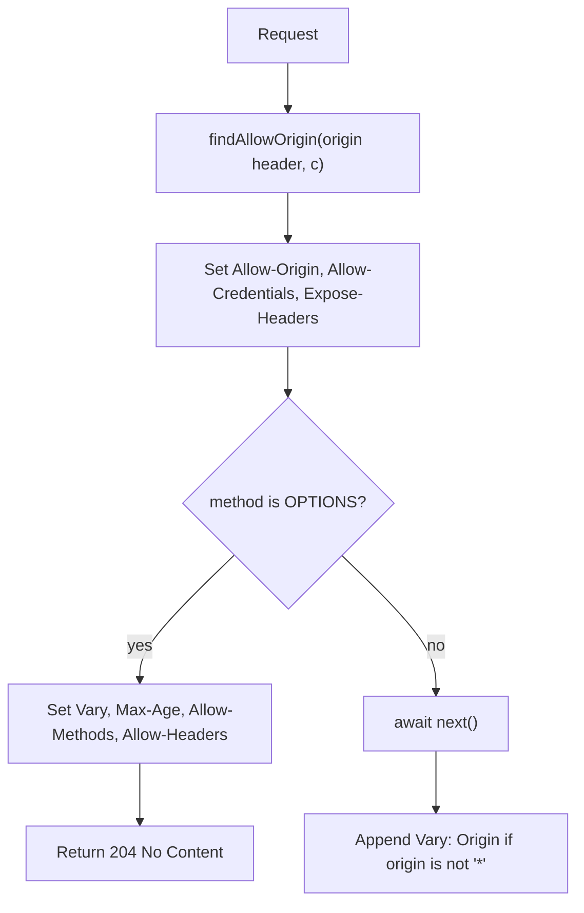
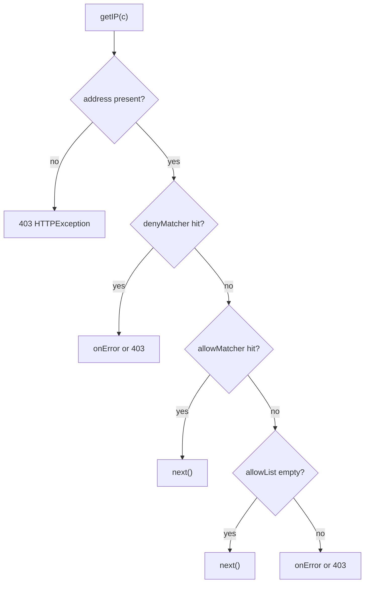

## Overview

Hono ships five middleware that harden an app at the HTTP layer without touching handler code: `cors` answers cross-origin preflights and sets the `Access-Control-*` headers, `csrf` rejects form-style writes from foreign sites, `secureHeaders` adds a Helmet-style set of response headers (with an optional per-request CSP nonce), `ipRestriction` filters clients by address, and `bodyLimit` caps the request body size. Each is a factory that does all option parsing once, when you call it, and returns a small `MiddlewareHandler` that runs per request.

Sources: [src/middleware/cors/index.ts:63-96](repo://src/middleware/cors/index.ts#L63-L96), [src/middleware/csrf/index.ts:94-138](repo://src/middleware/csrf/index.ts#L94-L138), [src/middleware/secure-headers/secure-headers.ts:179-215](repo://src/middleware/secure-headers/secure-headers.ts#L179-L215), [src/middleware/ip-restriction/index.ts:218-238](repo://src/middleware/ip-restriction/index.ts#L218-L238), [src/middleware/body-limit/index.ts:50-61](repo://src/middleware/body-limit/index.ts#L50-L61)

The rejecting middleware (`csrf`, `ipRestriction`, `bodyLimit`) signal refusal by throwing an `HTTPException` that carries a prepared `Response`, so the app's `onError` hook sees the rejection and, by default, the prepared response is sent. See [[Error Handling and HTTPException]] for how that exception is turned into a response, and [[Request Lifecycle and Middleware Composition]] for where middleware sits in the request flow.

Sources: [src/middleware/csrf/index.ts:144-147](repo://src/middleware/csrf/index.ts#L144-L147), [src/middleware/ip-restriction/index.ts:231-236](repo://src/middleware/ip-restriction/index.ts#L231-L236), [src/middleware/body-limit/index.ts:51-58](repo://src/middleware/body-limit/index.ts#L51-L58)

```ts
import { Hono } from 'hono'
import { cors } from 'hono/cors'
import { csrf } from 'hono/csrf'
import { secureHeaders } from 'hono/secure-headers'
import { bodyLimit } from 'hono/body-limit'

const app = new Hono()
app.use(secureHeaders())
app.use('/api/*', cors({ origin: 'https://app.example.com', credentials: true }))
app.use(csrf())
app.post('/upload', bodyLimit({ maxSize: 50 * 1024 }), (c) => c.text('ok'))
```

Sources: [src/middleware/cors/index.ts:9-22](repo://src/middleware/cors/index.ts#L9-L22), [src/middleware/csrf/index.ts:23-26](repo://src/middleware/csrf/index.ts#L23-L26), [src/middleware/body-limit/index.ts:13-16](repo://src/middleware/body-limit/index.ts#L13-L16)

## CORS

### cors options

`cors(options?)` merges your options over defaults of `origin: '*'`, the six common methods, and empty header lists.

Sources: [src/middleware/cors/index.ts:63-70](repo://src/middleware/cors/index.ts#L63-L70)

| Option | Type | Default | Description |
| --- | --- | --- | --- |
| `origin` | `string`, `string[]` or `(origin, c) => string \| null \| undefined` (may be async) | `'*'` | Value for `Access-Control-Allow-Origin`. A string other than `'*'` and an array only echo the request origin when it matches. |
| `allowMethods` | `string[]` or `(origin, c) => string[]` (may be async) | `['GET', 'HEAD', 'PUT', 'POST', 'DELETE', 'PATCH']` | Value for `Access-Control-Allow-Methods` on preflight. |
| `allowHeaders` | `string[]` | `[]` | Value for `Access-Control-Allow-Headers` on preflight. When empty, the request's `Access-Control-Request-Headers` are reflected. |
| `maxAge` | `number` | none | Value for `Access-Control-Max-Age` on preflight. |
| `credentials` | `boolean` | none | Sets `Access-Control-Allow-Credentials: true`. |
| `exposeHeaders` | `string[]` | `[]` | Value for `Access-Control-Expose-Headers`. |

Sources: [src/middleware/cors/index.ts:9-36](repo://src/middleware/cors/index.ts#L9-L36)

### Origin and method resolution

At construction time the `origin` option is normalised into a single `findAllowOrigin(origin, c)` function: `'*'` always returns `'*'`, any other string returns the request origin only when it is equal, an array returns it only when included, and a function is used as is. `allowMethods` is normalised the same way into `findAllowMethods`. A `null` or `undefined` result means no `Access-Control-Allow-Origin` header is set, which makes the browser block the response.

Sources: [src/middleware/cors/index.ts:72-94](repo://src/middleware/cors/index.ts#L72-L94)

### Preflight and actual requests

On every request the handler sets `Access-Control-Allow-Origin`, `Access-Control-Allow-Credentials` and `Access-Control-Expose-Headers` first. For an `OPTIONS` request it then adds the preflight-only headers and returns a `204 No Content` response immediately, without calling `next()`, so no route needs to handle `OPTIONS`. It strips `Content-Length` and `Content-Type` from the preflight response. For other methods it calls `next()` and afterwards appends `Vary: Origin` whenever `origin` is not `'*'`, so shared caches do not serve one origin's response to another.

Sources: [src/middleware/cors/index.ts:96-157](repo://src/middleware/cors/index.ts#L96-L157)



Sources: [src/middleware/cors/index.ts:96-157](repo://src/middleware/cors/index.ts#L96-L157)

> [!NOTE]
> Headers are written to `c.res.headers` before `next()`. Because Hono carries those headers over when a handler replaces `c.res`, they appear on the final response. A dynamic `origin` function receives an empty string when the request has no `Origin` header.

Sources: [src/middleware/cors/index.ts:97-104](repo://src/middleware/cors/index.ts#L97-L104), [src/context.ts:414-434](repo://src/context.ts#L414-L434)

## CSRF protection

### When a request is blocked

`csrf()` only inspects requests that a plain HTML form could send cross-site. A request is rejected with `403 Forbidden` when all four conditions hold: the method is not `GET` or `HEAD`; the `Content-Type` is `application/x-www-form-urlencoded`, `multipart/form-data` or `text/plain` (a missing header counts as `text/plain`); the `Sec-Fetch-Site` check fails; and the `Origin` check fails. Passing either header check is enough, so modern browsers are judged by `Sec-Fetch-Site` and older ones by `Origin`. JSON requests are never blocked here because a cross-site JSON POST already needs a CORS preflight.

Sources: [src/middleware/csrf/index.ts:28-30](repo://src/middleware/csrf/index.ts#L28-L30), [src/middleware/csrf/index.ts:138-151](repo://src/middleware/csrf/index.ts#L138-L151)

### csrf options

| Option | Type | Default | Description |
| --- | --- | --- | --- |
| `origin` | `string`, `string[]` or `(origin, c) => boolean \| Promise<boolean>` | same origin as `c.req.url` | Allowed values of the `Origin` header. |
| `secFetchSite` | `'same-origin' \| 'same-site' \| 'none' \| 'cross-site'`, an array of them, or `(secFetchSite, c) => boolean \| Promise<boolean>` | `'same-origin'` | Allowed values of the `Sec-Fetch-Site` header. |

Sources: [src/middleware/csrf/index.ts:10-26](repo://src/middleware/csrf/index.ts#L10-L26), [src/middleware/csrf/index.ts:95-125](repo://src/middleware/csrf/index.ts#L95-L125)

### Header validation

`isAllowedOrigin` denies when the `Origin` header is absent and otherwise calls the normalised `originHandler`. `isAllowedSecFetchSite` denies when `Sec-Fetch-Site` is absent or is not one of the four standard values (checked by the `isSecFetchSite` type guard) before calling `secFetchSiteHandler`, so a custom function only ever sees a valid value.

Sources: [src/middleware/csrf/index.ts:12-16](repo://src/middleware/csrf/index.ts#L12-L16), [src/middleware/csrf/index.ts:106-136](repo://src/middleware/csrf/index.ts#L106-L136)

```ts
app.use(
  '*',
  csrf({
    secFetchSite: (secFetchSite, c) =>
      secFetchSite === 'same-origin' ||
      (secFetchSite === 'cross-site' && c.req.path.startsWith('/webhook/')),
  })
)
```

Sources: [src/middleware/csrf/index.ts:70-81](repo://src/middleware/csrf/index.ts#L70-L81)

## Secure headers

### Default headers

`secureHeaders(customOptions?)` spreads your options over `DEFAULT_OPTIONS`. Each key of `HEADERS_MAP` is an "overridable header": `true` sends the default value, `false` omits the header, and a string replaces the value. `getFilteredHeaders` builds the static `[name, value]` list once.

Sources: [src/middleware/secure-headers/secure-headers.ts:67-124](repo://src/middleware/secure-headers/secure-headers.ts#L67-L124), [src/middleware/secure-headers/secure-headers.ts:231-238](repo://src/middleware/secure-headers/secure-headers.ts#L231-L238)

| Option | Header | Default value | Enabled by default |
| --- | --- | --- | --- |
| `crossOriginEmbedderPolicy` | `Cross-Origin-Embedder-Policy` | `require-corp` | no |
| `crossOriginResourcePolicy` | `Cross-Origin-Resource-Policy` | `same-origin` | yes |
| `crossOriginOpenerPolicy` | `Cross-Origin-Opener-Policy` | `same-origin` | yes |
| `originAgentCluster` | `Origin-Agent-Cluster` | `?1` | yes |
| `referrerPolicy` | `Referrer-Policy` | `no-referrer` | yes |
| `strictTransportSecurity` | `Strict-Transport-Security` | `max-age=15552000; includeSubDomains` | yes |
| `xContentTypeOptions` | `X-Content-Type-Options` | `nosniff` | yes |
| `xDnsPrefetchControl` | `X-DNS-Prefetch-Control` | `off` | yes |
| `xDownloadOptions` | `X-Download-Options` | `noopen` | yes |
| `xFrameOptions` | `X-Frame-Options` | `SAMEORIGIN` | yes |
| `xPermittedCrossDomainPolicies` | `X-Permitted-Cross-Domain-Policies` | `none` | yes |
| `xXssProtection` | `X-XSS-Protection` | `0` | yes |

Sources: [src/middleware/secure-headers/secure-headers.ts:94-124](repo://src/middleware/secure-headers/secure-headers.ts#L94-L124)

`removePoweredBy` (default `true`) deletes `X-Powered-By` after the handler runs. The remaining options add headers only when set: `contentSecurityPolicy`, `contentSecurityPolicyReportOnly`, `permissionsPolicy` (only when it has at least one key), `reportingEndpoints` (an array of `{ name, url }`, rendered as `name="url"` pairs) and `reportTo` (an array of objects, each serialised with `JSON.stringify`).

Sources: [src/middleware/secure-headers/secure-headers.ts:184-213](repo://src/middleware/secure-headers/secure-headers.ts#L184-L213), [src/middleware/secure-headers/secure-headers.ts:320-328](repo://src/middleware/secure-headers/secure-headers.ts#L320-L328)

### Content-Security-Policy

`contentSecurityPolicy` takes camelCase directive names (`defaultSrc`, `scriptSrc`, `frameAncestors`, `upgradeInsecureRequests`, ...) whose values are arrays of strings or handler functions; `reportTo` is a plain string and `reportUri` a string or array. `getCSPDirectives` converts each name to kebab-case and joins `directive value value; ` segments into one header string. Because CSP keywords such as `'self'` must keep their quotes, you write them as `"'self'"`.

Sources: [src/middleware/secure-headers/secure-headers.ts:15-44](repo://src/middleware/secure-headers/secure-headers.ts#L15-L44), [src/middleware/secure-headers/secure-headers.ts:240-266](repo://src/middleware/secure-headers/secure-headers.ts#L240-L266)

When a value is a function (a `ContentSecurityPolicyOptionHandler` taking `(ctx, directive)`), the header cannot be precomputed. `getCSPDirectives` keeps the joined parts as an array, records the index each function's output belongs at, and returns a callback that clones the array per request, fills those slots, and joins it. The middleware runs these callbacks before `await next()` so that values they store on the context are available to the handler, then writes all headers onto `ctx.res` after `next()` returns.

Sources: [src/middleware/secure-headers/secure-headers.ts:246-288](repo://src/middleware/secure-headers/secure-headers.ts#L246-L288), [src/middleware/secure-headers/secure-headers.ts:215-229](repo://src/middleware/secure-headers/secure-headers.ts#L215-L229), [src/middleware/secure-headers/secure-headers.ts:330-334](repo://src/middleware/secure-headers/secure-headers.ts#L330-L334)

### CSP nonce

The exported `NONCE` handler is the built-in function value. On first use in a request it generates 16 random bytes with `crypto.getRandomValues`, base64-encodes them, stores the result under the context variable `secureHeadersNonce`, and returns `'nonce-<value>'`. Later calls in the same request (for example when `NONCE` appears in both `scriptSrc` and `styleSrc`) reuse the stored value. The package augments `ContextVariableMap` with `SecureHeadersVariables`, so `c.get('secureHeadersNonce')` is typed.

Sources: [src/middleware/secure-headers/secure-headers.ts:11-13](repo://src/middleware/secure-headers/secure-headers.ts#L11-L13), [src/middleware/secure-headers/secure-headers.ts:131-145](repo://src/middleware/secure-headers/secure-headers.ts#L131-L145), [src/middleware/secure-headers/index.ts:1-8](repo://src/middleware/secure-headers/index.ts#L1-L8)

```ts
import { secureHeaders, NONCE } from 'hono/secure-headers'

app.use(
  secureHeaders({
    contentSecurityPolicy: {
      defaultSrc: ["'self'"],
      scriptSrc: [NONCE],
    },
  })
)

app.get('/', (c) => {
  const nonce = c.get('secureHeadersNonce')
  return c.html(`<script nonce="${nonce}">console.log('hi')</script>`)
})
```

Sources: [src/middleware/secure-headers/secure-headers.ts:137-145](repo://src/middleware/secure-headers/secure-headers.ts#L137-L145), [src/middleware/secure-headers/secure-headers.ts:215-229](repo://src/middleware/secure-headers/secure-headers.ts#L215-L229)

### Permissions-Policy

`permissionsPolicy` maps camelCase feature names (typed by `PermissionsPolicyDirective`, which lists standardized, proposed and experimental features) to a boolean or an allowlist array. `getPermissionsPolicyDirectives` renders `true` as `feature=*`, `false` as `feature=none`, `[]` as `feature=()`, a lone `'*'` or `'none'` as itself, and any other list as `feature=(...)` with `self` and `src` left bare and origins double-quoted. Entries are joined with `, `.

Sources: [src/middleware/secure-headers/secure-headers.ts:290-318](repo://src/middleware/secure-headers/secure-headers.ts#L290-L318), [src/middleware/secure-headers/permissions-policy.ts:1-12](repo://src/middleware/secure-headers/permissions-policy.ts#L1-L12)

## IP restriction

### Signature and rules

`ipRestriction(getIP, { denyList, allowList }, onError?)` takes a way to read the client address, either a runtime's `getConnInfo` (whose `remote.address` and `remote.addressType` are used) or a plain `(c) => string`. Each rule is `'*'`, a static IPv4/IPv6 address, a CIDR range such as `10.0.0.0/8` or `::1/10`, or a function `({ addr, type }) => boolean`. `onError` replaces the default `403 Forbidden` response when a request is blocked.

Sources: [src/middleware/ip-restriction/index.ts:20-38](repo://src/middleware/ip-restriction/index.ts#L20-L38), [src/middleware/ip-restriction/index.ts:169-225](repo://src/middleware/ip-restriction/index.ts#L169-L225)

```ts
import { ipRestriction } from 'hono/ip-restriction'
import { getConnInfo } from 'hono/cloudflare-workers'

app.use(
  '/admin/*',
  ipRestriction(
    getConnInfo,
    { denyList: ['10.0.0.0/8'], allowList: ['203.0.113.0/24', '::1'] },
    (remote, c) => c.text(`Access denied for ${remote.addr}`, 403)
  )
)
```

Sources: [src/middleware/ip-restriction/index.ts:187-216](repo://src/middleware/ip-restriction/index.ts#L187-L216)

### Rule compilation

`buildMatcher` compiles each list once. `'*'` short-circuits to a matcher that always returns `true`. Static rules are stored both as strings and as `bigint` binaries, and IPv4 rules are also registered in their IPv4-mapped IPv6 form (`::ffff:a.b.c.d`), so `127.0.0.1` matches a dual-stack socket reporting `::ffff:127.0.0.1`. CIDR rules become `[isIPv4, network, mask]` triples; a `/32` or `/128` prefix is treated as static, and an IPv4-mapped IPv6 range with a prefix of at least 96 is converted to an IPv4 range. An invalid address or prefix throws `TypeError('Invalid rule: ...')` at construction time.

Sources: [src/middleware/ip-restriction/index.ts:40-120](repo://src/middleware/ip-restriction/index.ts#L40-L120)

The returned matcher checks the static string set, then the binary static sets, then each CIDR rule by masking the remote address, and finally the function rules, returning on the first hit.

Sources: [src/middleware/ip-restriction/index.ts:122-167](repo://src/middleware/ip-restriction/index.ts#L122-L167)

### Decision order



Sources: [src/middleware/ip-restriction/index.ts:238-279](repo://src/middleware/ip-restriction/index.ts#L238-L279)

The deny list always wins over the allow list. An empty allow list means "allow everyone not denied", while a non-empty one turns the middleware into a whitelist. A missing address, or a remote address the IP utilities cannot parse (a `TypeError` with code `INVALID_IP_ADDRESS_ERROR_CODE`), is blocked with the default 403 even when `onError` is given.

Sources: [src/middleware/ip-restriction/index.ts:238-279](repo://src/middleware/ip-restriction/index.ts#L238-L279)

## Body limit

### bodyLimit options

| Option | Type | Default | Description |
| --- | --- | --- | --- |
| `maxSize` | `number` | required | Maximum body size in bytes. |
| `onError` | `(c) => Response \| Promise<Response>` | throws `HTTPException(413)` with body `Payload Too Large` | Called when the body is larger than `maxSize`. |

Sources: [src/middleware/body-limit/index.ts:10-16](repo://src/middleware/body-limit/index.ts#L10-L16), [src/middleware/body-limit/index.ts:50-59](repo://src/middleware/body-limit/index.ts#L50-L59)

### How the size is measured

A request without a body (typically `GET` or `HEAD`) passes straight through. When only `Content-Length` is present, the middleware trusts it and compares it to `maxSize` without reading the body. When `Transfer-Encoding` is present, or neither header is, it reads the whole stream up front, failing as soon as the running total exceeds `maxSize`, then rebuilds `c.req.raw` as a new `Request` whose body is a `ReadableStream` replaying the buffered chunks. Reading eagerly means the limit is enforced before the handler runs, however the handler later consumes the body, and per RFC 7230 a `Content-Length` sent alongside `Transfer-Encoding` is ignored.

Sources: [src/middleware/body-limit/index.ts:61-111](repo://src/middleware/body-limit/index.ts#L61-L111)

> [!WARNING]
> In the streaming case the full body (up to `maxSize`) is buffered in memory before your handler sees it. Choose `maxSize` with that in mind.

Sources: [src/middleware/body-limit/index.ts:81-109](repo://src/middleware/body-limit/index.ts#L81-L109)
