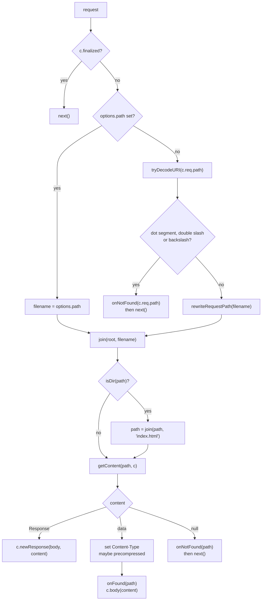

## Overview

Hono serves files from disk or from a key-value store with one runtime-neutral middleware, `serveStatic` in `src/middleware/serve-static`. It does not read files itself: it turns the request path into a file path, asks a `getContent` callback for the bytes, sets `Content-Type`, optionally swaps in a precompressed variant, and writes the response. Each runtime adapter (Bun, Deno, Cloudflare Workers) wraps it and supplies `getContent`, `join` and `isDir` built on that runtime's file APIs, which is why the base module's own doc comment says it "is not directly used by the user".

Sources: [src/middleware/serve-static/index.ts:32-53](repo://src/middleware/serve-static/index.ts#L32-L53)

Applications import the wrapper for their runtime, such as `serveStatic` from `hono/bun` or `hono/deno`, and mount it like any other middleware. See [[Runtime Adapters]] for the rest of each adapter and [[Request Lifecycle and Middleware Composition]] for how a middleware that falls through with `next()` hands the request to later handlers.

Sources: [src/adapter/bun/serve-static.ts:8-32](repo://src/adapter/bun/serve-static.ts#L8-L32), [src/adapter/deno/serve-static.ts:8-42](repo://src/adapter/deno/serve-static.ts#L8-L42)

```ts
import { Hono } from 'hono'
import { serveStatic } from 'hono/bun'

const app = new Hono()

app.use('/static/*', serveStatic({ root: './' }))
app.get('/favicon.ico', serveStatic({ path: './public/favicon.ico' }))
app.get(
  '/assets/*',
  serveStatic({
    root: './public',
    rewriteRequestPath: (path) => path.replace(/^\/assets/, ''),
    precompressed: true,
  })
)
```

Sources: [src/middleware/serve-static/index.ts:13-21](repo://src/middleware/serve-static/index.ts#L13-L21), [src/adapter/bun/serve-static.ts:8-10](repo://src/adapter/bun/serve-static.ts#L8-L10)

## Options

`ServeStaticOptions<E>` is the set of options every adapter accepts and forwards unchanged to the base middleware.

Sources: [src/middleware/serve-static/index.ts:13-21](repo://src/middleware/serve-static/index.ts#L13-L21)

| Option | Type | Default | Description |
| --- | --- | --- | --- |
| `root` | `string` | `'./'` | Directory the file path is joined onto. |
| `path` | `string` | none | Fixed file to serve for every matched request; the request path, and `rewriteRequestPath`, are then ignored. |
| `precompressed` | `boolean` | `false` | Look for `.br`, `.zst` or `.gz` siblings and serve one the client accepts. |
| `mimes` | `Record<string, string>` | none | Extra extension to MIME type map, consulted before the built-in table. |
| `rewriteRequestPath` | `(path: string) => string` | none | Maps the decoded request path to a file path before joining with `root`. Not applied when `path` is set. |
| `onFound` | `(path, c) => void \| Promise<void>` | none | Called with the resolved path just before the body is sent; use it to set headers such as `Cache-Control`. |
| `onNotFound` | `(path, c) => void \| Promise<void>` | none | Called when no content exists, or when the request path was rejected as unsafe. |

Sources: [src/middleware/serve-static/index.ts:13-21](repo://src/middleware/serve-static/index.ts#L13-L21), [src/middleware/serve-static/index.ts:50-79](repo://src/middleware/serve-static/index.ts#L50-L79), [src/middleware/serve-static/index.ts:93-123](repo://src/middleware/serve-static/index.ts#L93-L123)

The base `serveStatic` takes these plus four adapter-facing members: `getContent(path, c)` returning `Data | Response | null`, an optional `join(...paths)`, an optional `isDir(path)`, and a deprecated, unused `pathResolve`. `Data` is `string | ArrayBuffer | ReadableStream | Uint8Array`, so an adapter can return a stream, a buffer or a string.

Sources: [src/middleware/serve-static/index.ts:35-49](repo://src/middleware/serve-static/index.ts#L35-L49), [src/context.ts:26-26](repo://src/context.ts#L26-L26)

## Request flow

### Step order

The middleware does nothing if an earlier handler already finalized the response. Otherwise it resolves a file path, asks the adapter for content, and either answers or falls through.

Sources: [src/middleware/serve-static/index.ts:54-125](repo://src/middleware/serve-static/index.ts#L54-L125)



Sources: [src/middleware/serve-static/index.ts:54-125](repo://src/middleware/serve-static/index.ts#L54-L125)

### Path resolution and traversal guard

When `path` is not set, the request path is decoded with `tryDecodeURI`, so `%E7%82%8E.txt` maps to the real file name. The decoded name is then rejected if it contains a `.` or `..` segment, two or more consecutive slashes or backslashes, or any backslash at all. A rejected path, or one that fails to decode, calls `onNotFound` with the raw `c.req.path` and continues with `next()`, so an encoded traversal such as `/static/%2e%2e/secret` never reaches `getContent`.

Sources: [src/middleware/serve-static/index.ts:60-74](repo://src/middleware/serve-static/index.ts#L60-L74), [src/utils/url.ts:104-104](repo://src/utils/url.ts#L104-L104)

The file name (rewritten by `rewriteRequestPath` when present and `path` is absent) is joined onto `root` with the adapter's `join`, or with `defaultJoin` when none is given. `defaultJoin` drops empty parts, collapses repeated slashes, removes `.` segments and resolves `..` against the preceding segment; it always uses `/`, so the Bun and Deno adapters pass `join` from `node:path` instead.

Sources: [src/middleware/serve-static/index.ts:76-79](repo://src/middleware/serve-static/index.ts#L76-L79), [src/middleware/serve-static/path.ts:1-25](repo://src/middleware/serve-static/path.ts#L1-L25)

If the adapter provides `isDir` and it reports a directory, `index.html` (the `DEFAULT_DOCUMENT` constant) is appended, so `/static/sub` serves `static/sub/index.html`.

Sources: [src/middleware/serve-static/index.ts:30-30](repo://src/middleware/serve-static/index.ts#L30-L30), [src/middleware/serve-static/index.ts:81-83](repo://src/middleware/serve-static/index.ts#L81-L83)

### Content type and response

A `Response` returned by `getContent` is passed through with `c.newResponse(content.body, content)`, keeping its status and headers. Any other non-null value is treated as the file body: the MIME type comes from `getMimeType(path, options.mimes)` first and the built-in table second, falling back to `application/octet-stream`. `onFound` runs, then `c.body(content)` writes the response. Because the check is `content != null`, an empty string is a found file and answers 200 with an empty body.

Sources: [src/middleware/serve-static/index.ts:85-120](repo://src/middleware/serve-static/index.ts#L85-L120)

`getMimeType` takes the last extension of the file name, lowercases it and looks it up in the map; text types in the built-in table already carry `charset=utf-8`.

Sources: [src/utils/mime.ts:6-16](repo://src/utils/mime.ts#L6-L16), [src/utils/mime.ts:35-56](repo://src/utils/mime.ts#L35-L56)

### Precompressed variants

With `precompressed: true`, and only when the MIME type is unknown or matches `COMPRESSIBLE_CONTENT_TYPE_REGEX` (so a `.jpg` is never looked up), the middleware parses `Accept-Encoding` into a set and tries the encodings in the fixed order `br`, `zstd`, `gzip`. For the first one the client accepts, it calls `getContent(path + '.br' | '.zst' | '.gz')`; if that file exists it replaces the body, sets `Content-Encoding`, and appends `Accept-Encoding` to `Vary`. The `Content-Type` stays the one derived from the original file name.

Sources: [src/middleware/serve-static/index.ts:23-28](repo://src/middleware/serve-static/index.ts#L23-L28), [src/middleware/serve-static/index.ts:96-117](repo://src/middleware/serve-static/index.ts#L96-L117), [src/utils/compress.ts:9-10](repo://src/utils/compress.ts#L9-L10)

## Runtime adapters

### Bun

The Bun wrapper builds the base middleware per request. `getContent` returns `Bun.file(path)` when `file.exists()` is true and `null` otherwise; the `BunFile` is handed to `c.body()` as the body. `isDir` uses `stat` from `node:fs/promises`, and `join` comes from `node:path`.

Sources: [src/adapter/bun/serve-static.ts:1-32](repo://src/adapter/bun/serve-static.ts#L1-L32)

### Deno

The Deno wrapper uses `Deno.open(path)` and returns `file.readable`, a `ReadableStream`. `isDir` is synchronous via `Deno.lstatSync`, and `getContent` itself returns `null` for directories so that only the `index.html` join can produce content. Errors other than `Deno.errors.NotFound` are logged with `console.warn` before returning `null`.

Sources: [src/adapter/deno/serve-static.ts:1-42](repo://src/adapter/deno/serve-static.ts#L1-L42)

### Cloudflare Workers

The Workers wrapper is deprecated in favour of Cloudflare Static Assets. It adds `namespace` (a KV namespace) and `manifest` options and reads files from Workers Sites KV through `getContentFromKVAsset`. The namespace defaults to `c.env.__STATIC_CONTENT`. It supplies no `isDir` and no `join`, so `defaultJoin` builds the key and directory index files are not resolved automatically.

Sources: [src/adapter/cloudflare-workers/serve-static.ts:1-42](repo://src/adapter/cloudflare-workers/serve-static.ts#L1-L42)

`getContentFromKVAsset` parses the manifest (a JSON string or an object, defaulting to the global `__STATIC_CONTENT_MANIFEST`), maps the path to its hashed key, and fetches the value as a stream. A path missing from the manifest, or a missing KV value, returns `null`.

Sources: [src/adapter/cloudflare-workers/utils.ts:11-50](repo://src/adapter/cloudflare-workers/utils.ts#L11-L50)

`hono/cloudflare-workers` exports the ES module variant from `serve-static-module.ts`, whose type omits `namespace`, so module workers rely on `c.env.__STATIC_CONTENT` and usually pass the imported `__STATIC_CONTENT_MANIFEST` as `manifest`.

Sources: [src/adapter/cloudflare-workers/serve-static-module.ts:1-12](repo://src/adapter/cloudflare-workers/serve-static-module.ts#L1-L12), [src/adapter/cloudflare-workers/index.ts:6-6](repo://src/adapter/cloudflare-workers/index.ts#L6-L6)

### Cloudflare Pages

The Pages adapter's `serveStatic()` takes no options and does not use the base middleware: it forwards the raw request to the `ASSETS` binding and calls `c.notFound()` on a 404.

Sources: [src/adapter/cloudflare-pages/handler.ts:108-123](repo://src/adapter/cloudflare-pages/handler.ts#L108-L123)

### Writing an adapter

A new runtime only has to supply `getContent`, and optionally `join` and `isDir`, then call the base middleware with the user's options spread in. Returning `null` means "not found" and lets the request continue to the next handler.

Sources: [src/middleware/serve-static/index.ts:35-49](repo://src/middleware/serve-static/index.ts#L35-L49), [src/adapter/bun/serve-static.ts:25-30](repo://src/adapter/bun/serve-static.ts#L25-L30)

```ts
import { serveStatic as baseServeStatic } from 'hono/serve-static'
import type { ServeStaticOptions } from 'hono/serve-static'
import type { MiddlewareHandler } from 'hono'

export const serveStatic = (options: ServeStaticOptions = {}): MiddlewareHandler =>
  async (c, next) =>
    baseServeStatic({
      ...options,
      getContent: async (path) => (await myStore.get(path)) ?? null,
    })(c, next)
```

Sources: [src/middleware/serve-static/index.ts:35-49](repo://src/middleware/serve-static/index.ts#L35-L49)

## File path utility

`src/utils/filepath.ts` holds an older path helper that the current middleware no longer calls. `getFilePath` appends a default document to paths that end in `/` or have no extension, and `getFilePathWithoutDefaultDocument` returns `undefined` for any `..` segment, strips a leading `./` or `/`, converts backslashes to `/`, and prefixes `root`.

Sources: [src/utils/filepath.ts:12-60](repo://src/utils/filepath.ts#L12-L60)
